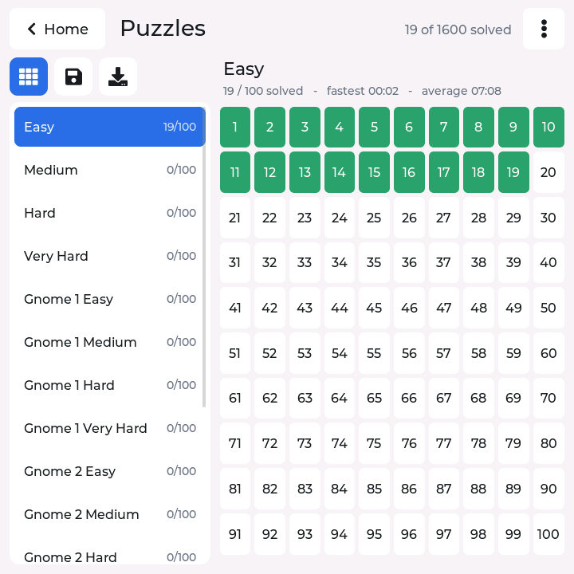
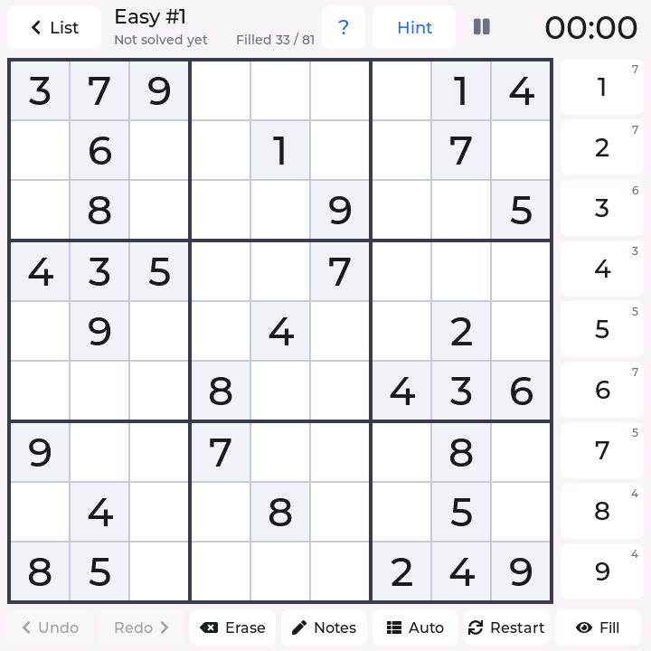
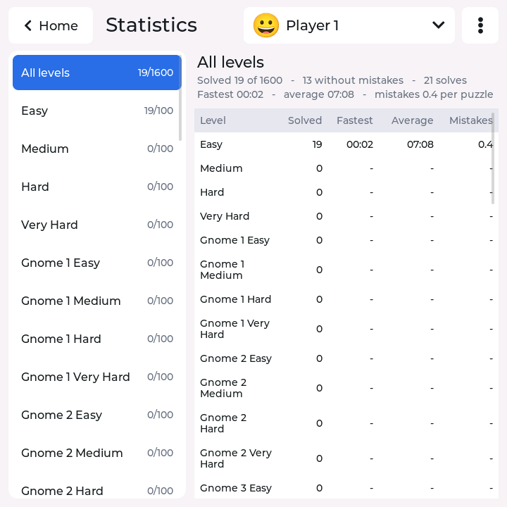
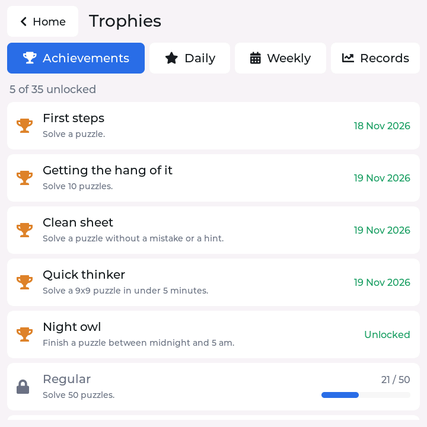
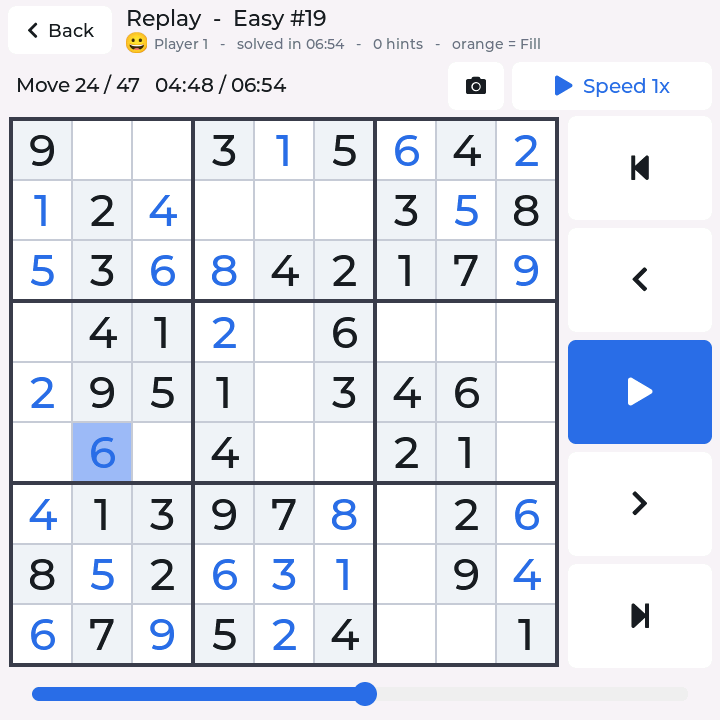
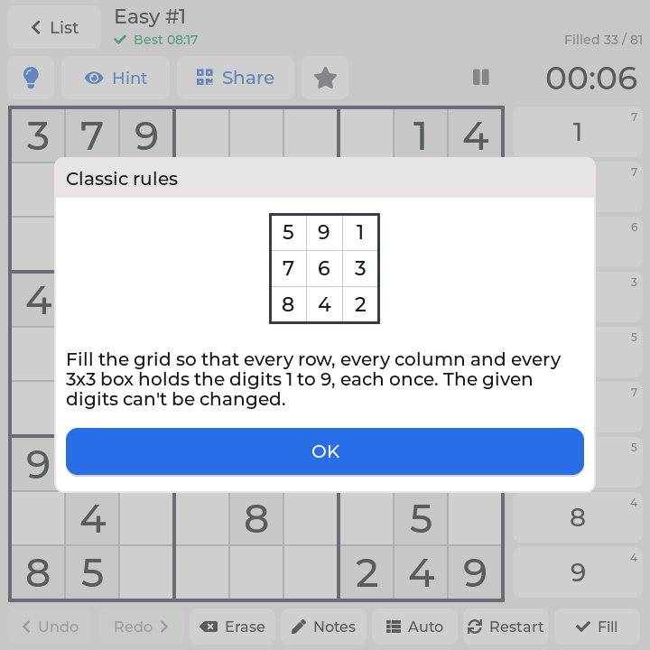
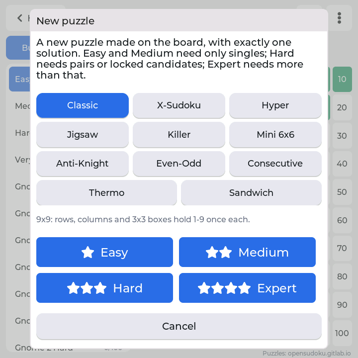
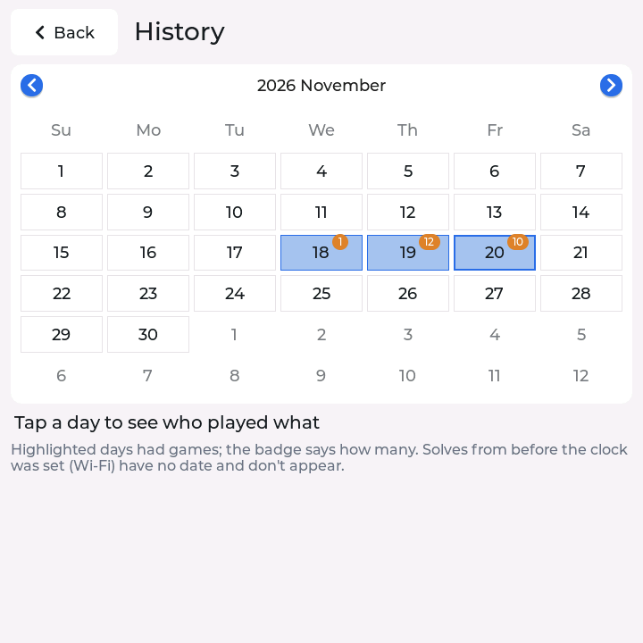
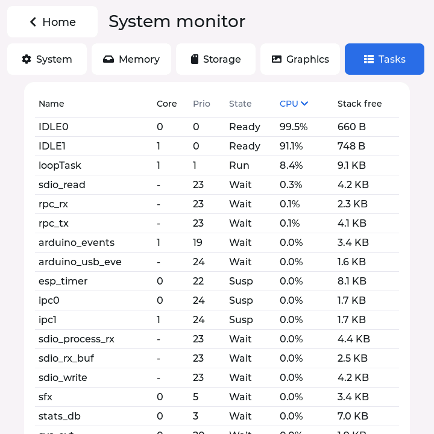

# esp32p4_sudoku

A touch-screen Sudoku for the **Waveshare ESP32-P4-WIFI6-Touch-LCD-4B** (4" 720×720 MIPI-DSI, GT911 touch, ES8311 speaker), built with LVGL 9.6 as an Arduino sketch.

**[Install it from the browser with the web flasher →](https://edipermadi.github.io/esp32p4_sudoku/)** (Chrome or Edge on a desktop computer; the board's UART USB port). No Arduino IDE needed. It installs the latest release; see [Web flasher](docs/building.md#web-flasher) for details.

## Screenshots

| Home | Puzzles | Game |
|---|---|---|
|  |  |  |
| **Statistics** | **Trophies** | **Settings** |
|  |  |  |
| **Replay** | **Share** | **Rules** |
|  |  |  |
| **New puzzle** | **History** | **System monitor** |
|  |  |  |

Captured from the board over its serial port (see [Screenshots and remote control](docs/devctl.md)). More, by topic, in [Features](docs/features.md).

## Highlights

- **1600 puzzles in flash** from the [OpenSudoku](https://opensudoku.gitlab.io/) collections, plus a generator for new ones at four levels and a daily puzzle.
- **Variants**: X-Sudoku, Hyper, Jigsaw, Killer, Mini 6×6, Anti-Knight, Even-Odd, Consecutive, Thermo and Sandwich.
- **Helpers**: a left-handed layout, pencil marks, Auto notes, digit-first entry, cell colours, undo/redo, mistake check, step-by-step hints (up to X-Wing, Swordfish and XY-Wing, or nudges only), a Learn mode for ten techniques and four variant rules, a tour of the game screen, starred puzzles and a 10-minute time attack.
- **Players, statistics and trophies**: per-player progress and emoji avatars, a history calendar, charts, achievements, daily and weekly leaderboards.
- **Replays**: every solve can be played back, or exported as an H.264 MP4 video.
- **Data on the microSD card** in a SQLite database (`sudoku.db`), with CSV export, puzzle import, a file manager with a Recycle bin (the database protected) and a picture/video viewer, screenshots, USB drive mode and firmware updates from the card.
- **Wi-Fi clock**, light and dark mode, a night mode, accent colours, colour-blind friendly colours, lock screen, screen-saver clock, synthesised sound effects, remote control by sound (Gibberlink / ggwave) and a system monitor with graphs of the last hour.

## Documentation

Also online, as web pages: **https://edipermadi.github.io/esp32p4_sudoku/docs/** (updated with each release).

| Page | What's in it |
|------|--------------|
| [Features](docs/features.md) | Everything the game does, by topic: puzzles, playing, players & progress, settings & system |
| [How to play](docs/how-to-play.md) | Which button does what, as a table |
| [Data & storage](docs/data.md) | `sudoku.db` and its tables, firmware update, USB drive, format, factory reset, saving |
| [Building and releases](docs/building.md) | Arduino settings, `arduino-cli`, GitHub Actions releases, the web flasher |
| [Development](docs/development.md) | Regenerating puzzles and fonts, colours, sounds, source layout |
| [Screenshots and remote control](docs/devctl.md) | `tools/devctl.py`: screenshots, simulated touches, files on the card over serial |
| [devctl protocol](docs/devctl-protocol.md) | The serial wire protocol, for other tools |

## Quick build

```
arduino-cli compile -b esp32:esp32:esp32p4:PSRAM=enabled,FlashSize=32M,PartitionScheme=app13M_data7M_32MB,ChipVariant=prev3 .
```

Needs esp32 Arduino core 3.3.x, LVGL 9.6.0 and `extras/lv_conf.h` at `~/Arduino/libraries/lv_conf.h`; see [Building](docs/building.md) for the details.

## Credits

The puzzles come from the [OpenSudoku](https://opensudoku.gitlab.io/) collections, which include puzzles from Gnome Sudoku. The board support code is shared with the `esp32p4_86box` project. The player avatars are [Noto Color Emoji](https://github.com/googlefonts/noto-emoji) (SIL Open Font License 1.1), as images in `src/avatars.c`. Data over sound is [ggwave](https://github.com/ggerganov/ggwave) by Georgi Gerganov (MIT, in `src/ggwave/`); the ES7210 and ES8311 register setup follows Espressif's `esp_codec_dev` drivers (Apache-2.0).
