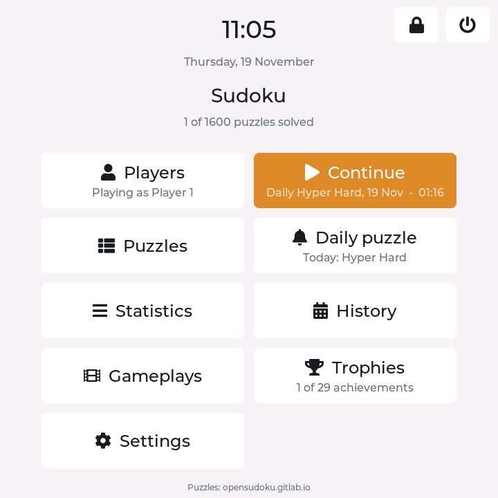
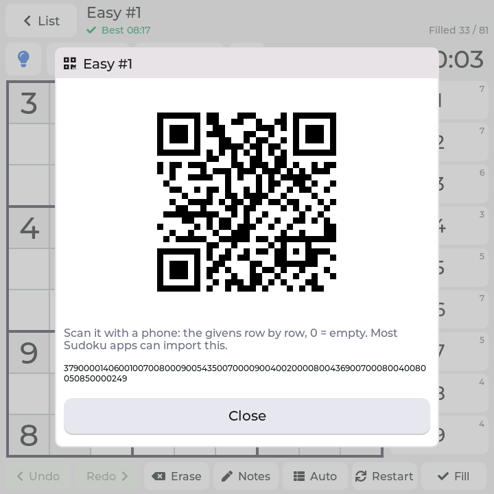

# esp32p4_sudoku

A touch-screen Sudoku for the **Waveshare ESP32-P4-WIFI6-Touch-LCD-4B** (4" 720×720 MIPI-DSI, GT911 touch, ES8311 speaker), built with LVGL 9.6 as an Arduino sketch.

## Screenshots

| Home | Puzzles | Game |
|---|---|---|
|  |  |  |
| **Statistics** | **Trophies** | **Settings** |
|  |  |  |
| **Replay** | **Share** | **Rules** |
|  |  |  |

Captured from the board over its serial port (see [Screenshots and remote control](#screenshots-and-remote-control)).

## Features

- **1600 puzzles in flash**: the 16 OpenSudoku collections from <https://opensudoku.gitlab.io/>. These are Easy, Medium, Hard and Very Hard, plus Gnome Sudoku sets 1–3 at each of those levels. Each puzzle is packed into 41 bytes, about 64 KB in total. Every puzzle was checked to have exactly one solution.
- **Home screen**: the time and date at the top (once Wi-Fi has fetched it), the solved count and big buttons. **Continue** resumes your unfinished game and only appears when there is one; with several (see **Unfinished games**) its line says how many more, and it opens a list to pick from. **Players** (at the top, showing who is playing), **Puzzles**, **Daily puzzle**, **Statistics**, **History**, **Gameplays** and **Settings** open those screens. The buttons stand in one column while they fit; when there are more than fit (with **Continue** showing), they arrange themselves in a grid, two per row.
- **Players**: the **Players** screen lists everyone who plays on the board, with their solved puzzles and solves. Tap a player to play as them; **Add player** and **Rename** ask for a name on an on-screen keyboard (names are unique, ignoring case). The red trash button deletes a player with their statistics, solve history and game in progress, after a confirmation; the last player can't be deleted, and deleting the one playing hands over to the first player left. Each player has their own statistics and their own game in progress, and every solve records who solved it. The Statistics screen has a player dropdown at the top right (person icon and name): it shows whose statistics these are, and picking another player switches to them. Players are kept in `sudoku.db`; without a card there is just one player.
- **History**: **History** on the home screen shows a calendar (‹ › change the month). Days on which anyone finished a puzzle or started one that is still in progress are highlighted. A small orange badge on each highlighted day shows how many games that was (puzzles solved plus games in progress started that day). Tap a day for who played what: player, level and puzzle number, time taken, mistakes, hints, and when it was started and solved (or "in progress"). Dates are local, in the time zone from Settings, and come from `sudoku.db`; solves from before the clock was set (Wi-Fi/NTP) have no date and don't appear.
- **New puzzle (generator)**: besides the 1600 built-in puzzles, **Puzzles → New puzzle** makes a fresh one on the board at the level you pick. It fills a random complete grid, then takes clues away in symmetric pairs as long as exactly one solution remains, and grades the result the way a person would solve it: **Easy** and **Medium** need only singles (Easy keeps 36 or more clues), **Hard** needs locked candidates (pointing/claiming) or naked/hidden pairs, **Expert** needs more than that. It takes well under a second; if a level can't be hit after many tries, you get the closest one and a note saying so. **Next** in the "Solved!" dialog makes another one of the same level. Generated puzzles are named "Generated Hard #12" and so on, are saved in `sudoku.db` (table `generated`), and work everywhere the built-in ones do: continue, History, Gameplays, Replay and MP4 export. They don't count in the per-level tables on the Statistics screen. Without a microSD card they last until power-off.
- **Unfinished games**: with `sudoku.db`, each player keeps up to 5 unfinished games. Opening another puzzle no longer asks to discard the current one: that one stays saved, and the new one is resumed if you'd started it before, or begun. **Continue** resumes the one played last, or, when there are several, lists them (played last first) with time, cells filled and when you last played; tap one to resume it, or the red trash button to discard it. Starting a 6th drops the one played longest ago, and a note says so. The puzzle list shows every unfinished game in orange. Without a card there is one slot, as before: starting another puzzle asks whether to resume or discard the one in it.
- **Variants: X-Sudoku, Hyper, Jigsaw, Killer, Mini 6×6, Anti-Knight, Even-Odd, Consecutive, Thermo and Sandwich**: the **New puzzle** dialog has rows of buttons above the levels: **Classic**, **X-Sudoku**, **Hyper** / **Jigsaw**, **Killer**, **Mini 6x6** / **Anti-Knight**, **Even-Odd**, **Consecutive** / **Thermo**, **Sandwich** (the choice stays until power-off).
  - **Rules card**: the light bulb button in the game's second row (next to Hint) shows the rules of the puzzle's variant with a small drawn example (a cage with its sum, a knight's crossed-out cells, a thermometer, and so on). It also opens by itself the first time each variant other than Classic is played (`settings.rules_seen` remembers which).
  - **X-Sudoku**: a 9×9 board where the two main diagonals must also hold 1–9 once each. The diagonal cells have a warm tint. A digit that repeats on a diagonal turns red like any other conflict, and completing a diagonal plays the sparkle. Hints know the diagonals too ("Look at the top-left diagonal: ..."; the top-left diagonal runs from the top-left corner, the top-right one from the top-right corner).
  - **Hyper** (Windoku): a 9×9 board with four extra 3×3 windows (rows and columns 2–4 and 6–8), tinted like the X diagonals, that must also hold 1–9 once each. Conflicts, sounds and hints count them ("Look at the top-left window: ...").
  - **Jigsaw**: a 9×9 board whose nine boxes are irregular regions of 9 connected cells, outlined with thick borders; every puzzle has its own shapes. The generator starts from the 3×3 boxes and trades cells across region borders (keeping each region in one piece), then fills and digs as usual; a shape that's slow to fill is dropped for another. Hints call the regions "region 1" to "region 9". The region map is kept in `generated.regions`.
  - **Killer**: Classic rules plus cages, groups of 2 to 5 (Easy and Medium: 2 to 3) connected cells outlined with a dashed line, with their sum small in the top-left corner: a cage's digits add up to its sum and none repeats. There are few givens (Easy 8 to 12, Medium 2 to 4, Hard and Expert whatever the uniqueness needs). A cage whose digits go over its sum, or that is full and short of it, turns red, and so does a repeated digit in a cage. Pencil marks are smaller in Killer, below the sum. The grader and hints know cage sums: for each cage, its empty cells keep only the digits of the sets of different digits that make up what's left of its sum ("The cage at row 3, column 4 adds up to 11: ... its empty cells can only be 2, 9"); that counts as a simple step, alongside singles. The cages are kept in `generated.cages` as `sum:cell,cell,...;sum:...` (cells 0–80 row by row).
  - **Anti-Knight**: Classic rules, and two cells a chess knight's move apart never hold the same digit; such a repeat turns red like any other conflict.
  - **Even-Odd**: Classic rules; about a third of the cells are marked: shaded cells hold an even digit, cells with a ring an odd one. A digit of the wrong kind turns red. The marks are kept in `generated.marks` (`e`, `o` or `.` per cell).
  - **Consecutive**: Classic rules; an orange bar sits on the line between every two side-by-side cells whose digits are 1 apart, and where there's no bar, they aren't. Puzzles need few givens (Expert: about 4). Two digits that break that turn red. The grader and hints use the bars ("The bars around row 4, column 2 (and where there are none) leave it only 3, 5"), as a simple step. The bars are kept in `generated.marks` (per cell `0`–`3`: 1 = a bar to the right, 2 = a bar below).
  - **Thermo**: Classic rules, and thermometers (a soft grey line from a round bulb, through cells side by side or diagonal): along each one the digits rise from the bulb. 7 thermometers of 3 to 6 cells (Hard and Expert: up to 10). Two digits along one that don't rise turn red. The grader and hints narrow each thermometer cell from both ends ("Along the thermometer the digits rise from the bulb, so row 2, column 5 can only be 4, 5"), as a simple step. The thermometers are kept in `generated.thermos` (`cell,cell,...;...`, each from its bulb).
  - **Sandwich**: Classic rules, and a number left of each row and above each column gives the sum of the digits between that line's 1 and 9 (0: they're side by side). The board is a little smaller to make room for the sums. Between a 1 and a 9 that add up to more, or (all filled) to anything else, the digits turn red. The grader and hints work out where a line's 1 and 9 can stand for its sum, as a simple step. The 18 sums are kept in `generated.marks` (rows, then columns, comma-separated).
  - **Mini 6×6**: a 6×6 board with 2×3 boxes (two rows, three columns) and digits 1–6, with bigger cells and a six-button number pad. Easy keeps 16 or more clues.
  - All are made, graded and hinted by the same generator as Classic, at all four levels. For the variants, Medium and Hard keep a clue whenever taking it away would need harder techniques, so nearly every attempt lands on the level asked for. Classic puzzles, and so the daily puzzle, come out exactly as before for the same seed. The daily puzzle is always Classic.
  - They are named "X-Sudoku Hard #14", "Hyper Medium #16", "Jigsaw Expert #17", "Killer Hard #18" or "Mini Easy #15" and work everywhere a generated puzzle does: **Next** makes another of the same variant and level, and Continue, History, Gameplays, Replay and MP4 export all show the right board. Their solves are logged with level "X-Sudoku Hard", "Jigsaw Easy" etc.; `generated.variant` holds the variant.
- **Hints**: **Hint** (top of the game screen, next to the timer) shows the next step a person would take, in steps. First it points to where to look ("Look at row 4: one digit has only one place left there"); **More** marks the cell and explains why (a hidden single, a naked single, or, when that's not enough, the pointing, claiming or pair step that leads to one); **Place it** fills it in. A digit that isn't part of the solution is pointed out first (**Erase it**). When no simple step exists, it shows the answer for the easiest cell. Each hint opened counts as one hint (with **Fill**), and its placed digit shows orange in replays. The card sits at the bottom of the screen, or at the top when the bottom row is involved; any move closes it.
- **Daily puzzle**: the **Daily puzzle** button on the home screen opens today's puzzle: one a day, the same for every player, made from the date, with a variant and level that follow the weekday: Monday Classic Easy, Tuesday Mini 6×6 Medium, Wednesday X-Sudoku Medium, Thursday Hyper Hard, Friday Killer Medium, Saturday Jigsaw Hard, Sunday Classic Expert. A day's puzzle, once made, stays what it was (days made before this version are Classic). Under the button: today's variant and level and your streak, the days in a row you solved the daily puzzle (it ends today, or yesterday if today's isn't solved yet). Solving it shows the new streak. It needs the date, so the button is greyed out (and says so) until Wi-Fi is connected and has set the clock. Daily puzzles are stored like generated ones, with their date (`generated.day`), and their solves are logged with level "Daily Easy" etc.
- **Progress chart**: **Chart** (top right of the Statistics screen) swaps the table for a chart of your newest 40 solves at the selected level (**All levels**: any puzzle, generated ones included), oldest on the left. Each solve is a dot; the orange line is the average of the last 5; minutes run up the side. Under it: your fastest time, and with 10 or more solves, how the newest 5 compare with the first 5 shown ("36% faster"). **Table** switches back. It needs `sudoku.db`.
- **Trophies**: **Trophies** on the home screen (the line under it counts your achievements) has two tabs.
  - **Achievements**: 29 of them per player, worked out from the solves in `sudoku.db`. Unlocked ones show a trophy and the date. The others show a lock, and their progress where there is a count to show (a bar and "3 / 10", "4 / 7 days", "2 h 5 min / 10 h"). They cover solve counts (1, 10, 50, 100), solving without a mistake or a hint (1, 25, and on Hard or harder), Expert, speed (a 9×9 under 5 minutes; Hard or harder under 10 minutes without hints), each variant (X-Sudoku, Hyper, Jigsaw, Killer, Mini; daily ones count too), Classic + X-Sudoku + Mini, Anti-Knight + Even-Odd + Consecutive, a Thermo, a Sandwich, all six of Classic, X-Sudoku, Hyper, Jigsaw, Killer and Mini, 10 New puzzles, the daily puzzle on 10 days, daily streaks (3, 7 and 30 days in a row, the longest run ever counts), a puzzle in each of the 16 collections, a whole collection, 10 hours of solving, and finishing between midnight and 5 am. After a solve, newly unlocked ones pop up at the top of the screen with a chime. Achievements earned before this version are recorded quietly the first time the card is opened, without a date.
  - **Daily**: the leaderboard of the daily puzzle, today first; ‹ › go to other days. Everyone's best time on that day's puzzle (whenever they solved it), fastest first (ties: fewer mistakes, then fewer hints), with mistakes, hints and how often they solved it; you are outlined, the leader gets a star, and players who haven't solved it are listed last. **Play today's puzzle** opens it if you haven't solved it yet. Solving the daily puzzle also tells you your place: "You're 2nd of 3 today".
  - **Weekly**: the week's daily puzzles (Monday to Sunday) added up per player: how many of the 7 they solved (a green square per day), and the sum of their best times on those; more days first, then less time. ‹ › go to other weeks.
  - **Records**: your personal bests, each with the puzzle and date it was set on: the fastest solve, the fastest without a mistake or a hint, the fastest from the collections, of New puzzles, of daily puzzles and of each variant (X-Sudoku, Hyper, Jigsaw, Killer, Anti-Knight, Even-Odd, Consecutive, Thermo, Sandwich, Mini; daily puzzles count for their variant), of imported puzzles, the most solves in a day, the most clean solves (no mistake, no hint) in a row, the longest daily streak, puzzles solved and time spent solving.
- **Replay**: every digit you put in or take out is recorded in order, with the game clock and how it got there: the number pad, **Fill**, **Erase**, **Undo** or **Redo** (pencil marks are not recorded). After solving, **Replay** in the "Solved!" dialog plays the game back; in History, tap a solve marked "Tap to replay"; or open **Gameplays** on the home screen, which lists every recorded game (newest first, 40 per page with **Newer** / **Older**) with player, puzzle, date, time, mistakes and hints, and tap one. The Replay screen has play/pause, one move back or forward, jump to start or end, a slider to scrub through the game, and 1x/2x/4x/8x speed. Playback follows the game clock, with pauses longer than 2 seconds shortened. Digits from Fill show orange, the last move is highlighted, and digits that break a rule show red. The log is saved with the game in progress (so a resumed game keeps it) and with the solve. Solves from before this version have no log. Up to 2048 moves per game are kept.
- **Export as video**: on **Gameplays**, the **MP4** button of a game saves its replay as a video on the microSD card, in `replays/` (named after the player, puzzle and when it was solved, e.g. `replays/Abi_Gnome-2-Hard-12_20261118-1405.mp4`). The video shows the Replay screen as it plays: the board filling in, the slider and the move counter moving. It holds the start for 1 s, plays at twice the replay speed (pauses already shortened to 2 s), and holds the solved board for 3 s; 720×720, 15 fps, H.264 in MP4, made by the ESP32-P4's hardware video encoder. The Replay screen is drawn on an invisible second display in memory while a progress dialog (with **Cancel**) shows on the real screen. Copy the video to a computer with **Settings → USB drive**.
- **Learn**: **Learn** on the Puzzles screen lists six techniques (hidden single, naked single, pointing, claiming, naked pair, hidden pair) with a line on each. Pick one, and a built-in puzzle opens at a point where that technique is the next step (found by playing puzzles forward with the hint engine; pairs, the rarest, can take a few seconds), with the hint card showing where to look: **More** explains it, **Place it** does it. The title says "Practice: Naked pair". Practice games aren't saved, recorded or counted.
- **Enter a puzzle**: **Enter** on the Puzzles screen (between New puzzle and Learn) opens a blank board with a 1–9 pad, to type in a Classic puzzle from a book or a newspaper: tap a cell, then a digit (the selection moves on to the next cell; the same digit again clears it; **Erase**, **Clear**). Digits that break a rule turn red. **Check & play** needs at least 17 digits and exactly one solution (the solver counts them; it says if there is none or more than one), rates it with the same grader as generated puzzles, saves it as "My puzzles #1", "#2" ... (`sudoku.db`, `generated` with `source` = "My puzzles"; RAM only, until power-off, without a card) and opens it like any other puzzle.
- **Imported puzzles**: put `.opensudoku` (OpenSudoku's XML, `data="..."` or `data='...'`) or `.sdm` / `.txt` files (a puzzle per line, 81 digits, `0` or `.` = empty) in a `puzzles/` folder on the card (copy them over with **Settings → Data → USB drive**), then **Settings → Data → Import puzzles**. Each puzzle is checked for exactly one solution (others are left out), and each file becomes a collection named after it, after the 16 built-in ones in the Puzzles screen's row, marked "(imported)"; a file of more than 100 puzzles makes several ("name 1", "name 2" ...). Up to 2000 puzzles per import; a file already imported is skipped. Their puzzles are named "name #12", play like any other (unfinished games, History, Gameplays, Replay, **Next** goes on through the collection), and their solves are logged with the collection as their level. They are kept in `sudoku.db` (`generated.source` and `number`, and the `imported` table).
- **Puzzle list**
  - Collections are in a row along the top, each with its solved count. Swipe the row sideways, or tap the ‹ › arrows at its ends, to see them all. An arrow only shows while there are more collections that way.
  - Puzzles 1–100 fill the screen below it. Solved ones are green and the game in progress is orange.
  - Each collection shows its fastest and average solve time.
- **Game**
  - The selected cell's row, column and box are highlighted, and so is every cell with the same digit.
  - Pencil marks (Notes). Placing a digit removes it from the notes in its row, column and box.
  - **Auto** fills in the notes of every empty cell with all the digits that still fit there (replacing what was there; Undo takes it back). It doesn't count as a hint.
  - **Digit first**: press and hold a digit on the number pad to lock it (it turns blue, and every cell with that digit is highlighted); then each tap on a cell puts that digit there (tap it again to clear it; with Notes on, it toggles the note). A short tap on another digit moves the lock there; a short tap on the locked digit, or holding it again, unlocks it.
  - Undo (128 steps), **Redo** (puts back what Undo took away, until the next change), Erase and Restart. Undo and Redo are dimmed when there's nothing to undo or redo.
  - **Cell colours**: press and hold a cell for its menu: six colours to paint it with (and ✕ for none), for colouring techniques. Painted cells keep their colour under the highlights, Undo takes a colour back, and colours are saved with the game (`saved_game.colors`) but not in the move log. On **Killer**, the menu also lists the sets of different digits that still make up the cell's cage sum, given the digits already in it ("Cage: 15 in 3 cells, 4 ways: 1+5+9  2+4+9  2+5+8  3+4+8").
  - The bottom bar has seven buttons (Undo, Redo, Erase, Notes, Auto, Restart, Fill); the status line (filled count, conflicts, the locked digit) is in the top bar, under the title.
  - **Fill** puts the right digit (from the puzzle's solution) in the selected cell. Each Fill counts as a hint: the number on the Fill button shows the hints used so far, Undo doesn't take one back, and the count is saved with the game in progress, shown in the "Solved!" dialog and the history, and logged with the solve (`solves.hints`).
  - The number pad shows how many of each digit are still to place. A digit that is complete is dimmed.
- **Share**: **Share** in the game's second row shows the puzzle as a QR code (black on white in either theme) to scan with a phone. A Classic or imported puzzle is the usual 81-digit string (givens row by row, 0 = empty) that most Sudoku apps can import; a variant is its name, its givens (a 6x6: its 36 cells) and its layout, e.g. `Killer 000... cages=11:0,1;...`, `Jigsaw ... regions=...`, `Thermo ... thermos=...`, `Sandwich ... sums=...`. The text is under the code too. The QR code generator is Project Nayuki's (MIT), copied from LVGL into `src/qrcode/` (the shared `lv_conf.h` has LVGL's QR widget off).
- **Show timer**: **Settings → Show timer** off hides the game's clock while you play (it shows `--:--`; tap it to pause as before). The time still runs and is recorded, and the Solved dialog shows it.
- **Head-to-head**: the Solved dialog says how the other players did on the same puzzle: "2nd of 3 - Bo leads with 06:20", "★ 1st of 2: ahead of Bo (07:45)", or "Nobody else has solved this one yet" (best times, from `sudoku.db`).
- **Export to CSV**: **Settings → Export to CSV** writes `export/solves.csv` (every solve: player, puzzle, level, number, seconds, mistakes, hints, started, finished, in local time), `export/achievements.csv` (every player and achievement: progress, goal, unlocked and when) and `export/records.csv` (every player's records) on the microSD card, for a spreadsheet. Copy them off with **Settings → USB drive**.
- **Solve indicator**
  - Conflicting digits turn red, and the status line counts them.
  - **Settings → Mistake check** chooses what turns red and buzzes: **Off** (nothing: the status line only says "All filled, not solved yet" when the board is full and something is wrong), **Rules** (the default: digits that break a row, column or box rule) or **Solution** (also digits that break no rule yet but aren't the solution's).
  - When the board is solved, it turns green and a "Solved!" dialog opens with the time and your best.
- **Time to solve**
  - The timer counts only while the game screen is open. Tap it to pause, which also hides the board.
  - The best time for each puzzle is stored.
- **Statistics**
  - A mistake is a placed digit that breaks a row, column or box rule: the ones that buzz and turn red. With Mistake check on **Solution**, a digit that isn't the solution's is a mistake too; with it **Off**, rule-breaking digits are still counted, just not shown. Undo doesn't take a mistake back. The count is saved with the game in progress and shown in the "Solved!" dialog.
  - **All levels** compares the 16 levels and the puzzles made on the board: puzzles solved, fastest and average best time, and average mistakes.
  - Each level lists its solved puzzles with the best time, the fewest mistakes in any solve, and how many times it was solved.
  - Below the 16 collections (the column scrolls), twelve more rows cover the puzzles made on the board: **New puzzles** (Classic from New puzzle), **Daily puzzle**, **X-Sudoku**, **Hyper**, **Jigsaw**, **Killer**, **Anti-Knight**, **Even-Odd**, **Consecutive**, **Thermo**, **Sandwich** and **Mini 6x6**, each with its count of puzzles solved. Their page has one row per level (Easy, Medium, Hard, Expert) with the same columns as All levels, and **Chart** shows their newest solves. They need `sudoku.db`.
  - Above the table: solved count, puzzles solved without a mistake, total solves, fastest and average time.
  - Puzzles solved before this version show "-" for mistakes and count as solved once.
  - The info button next to the "Statistics" title explains what the numbers mean and where they come from.
- **Screen-saver clock**: **Settings → Display → Screen-saver clock** on: at the screen timeout, instead of going dark at once, the screen shows a dim clock and the date on black with the backlight at 12%, at a new random spot every minute so nothing burns in; after 10 minutes the backlight goes off as usual. A tap wakes it the same way (and shows the lock screen first, if that's on). The home screen's lock button goes straight to dark.
- **Lock screen**: **Settings → Display → Lock screen** (Off, Swipe or PIN). The lock button on the home screen (left of the power button) locks at once: the screen goes dark and comes back locked at the next tap (with the setting Off, it locks with a swipe). When the setting is on, the screen also comes back from its timeout locked: a lock icon, the time, the date and who is playing, and either "Swipe up to unlock" (the time follows the finger; swipe far enough) or a 4-digit PIN on a keypad. Choosing PIN asks for the PIN twice; **Lock PIN → Change** sets a new one. After 5 wrong PINs the keypad waits 30 seconds. It is meant to keep little fingers out of a game, not to secure anything: the PIN is kept as plain text in `sudoku.db` (`settings.lock_pin`, with `lock_mode` 0 Off, 1 Swipe, 2 PIN), and pressing **RESET** starts the board unlocked (the lock only comes with a timeout), which is also the way back in with a forgotten PIN.
- **Screen timeout**: after a while without a touch the game pauses, the screen goes black and the backlight turns off, so a still image can't burn in. Tap anywhere to wake it. The waking tap doesn't press anything. Set the timeout under **Settings → Screen off after**: 1, 2, 5 (default), 10, 15 or 30 minutes, or Never.
- **Sound effects**: synthesised on the device, with no audio files. A background task mixes up to four at once.
  - A short tick on every touch.
  - A low buzz when a digit you place breaks a row, column or box rule.
  - A rising chime when all nine of a digit are placed without conflicts.
  - A quick bright sparkle when a placed digit completes a row, column or 3×3 box (1–9, each once), and a longer one when it completes two or three of them at once.
  - A fanfare when the puzzle is solved.
  - Turn them on or off under **Settings → Sound effects**.
- **Settings** is split into tabs under its title: **Network** (Wi-Fi, time zone; the tab Settings opens on), **Display** (dark mode, accent colour, brightness, screen off after, lock screen and PIN, screen-saver clock), **Sound** (sound effects, volume), **Game** (show timer, mistake check) and **Data** (microSD card, USB drive, firmware update, import puzzles, export to CSV, factory reset).
- **Light and dark mode**: switch between colour schemes under **Settings → Dark mode**.
- **Accent colour**: **Settings → Accent colour** picks Blue (the default), Teal, Green, Purple or Pink for buttons, the selected cell, the same-digit and row/column highlights and your digits, in both schemes.
- **Player colours**: each player has a colour, shown as a dot by their name on the **Players** screen and the Daily and Weekly leaderboards. Tap the dot on the Players screen for the next of eight colours (`players.color`; new players get one by turn).
- **Wi-Fi and clock**: on **Settings → Network**, the Wi-Fi row says "Connected  ******" rather than the network's name, so a photo or screenshot doesn't give it away; the eye button next to it shows the name (hidden again the next time Settings opens). **Settings → Wi-Fi** opens a screen with an on/off switch, nearby networks (tap one; secured networks ask for the password on an on-screen keyboard) and **Forget**. Once connected, the time comes from NTP (pool.ntp.org) and the home screen shows it. The board remembers the network and reconnects at start-up. Wi-Fi goes through the board's ESP32-C6 co-processor (ESP-Hosted over SDIO); the Wi-Fi code is shared with the `esp32p4_86box` project.
- **Time zone**: **Settings → Time zone** lists IANA names such as `Asia/Dubai`, with daylight saving where the zone has it.
- **Game data on the microSD card**: statistics, the game in progress and the settings are kept in `sudoku.db`, a SQLite 3 database in the root of a FAT32 microSD card that is inserted at start-up. Nothing is written to the board's flash for them; only the Wi-Fi network and on/off switch stay on the board (NVS). At start-up the board shows "Starting..." while it opens the database (about a second), then builds the screens with its settings. The **Statistics** screen reads the database with SQL queries; the puzzle list, the home screen and "New best!" use a copy in RAM loaded at start-up. Without a card, the game runs on defaults and keeps changes, the game in progress and solves only until power-off; the "Solved!" dialog warns about this and Settings shows it under **microSD card**. A FAT32 card without `sudoku.db` (a new or empty card) gets a skeleton database at start-up: all tables, the current settings and the game in progress, and no statistics. The screens then show exactly what the database holds. A card without a FAT32 filesystem is not formatted automatically; Settings offers **Format**. (A database from a build before settings moved to the card gets the board's older statistics merged in once.) Open it on a computer with `sqlite3 sudoku.db`:
  - `players`: `id`, `name`, `created_at`, `color` (0–7; NULL = by id). Statistics and saved games that existed before players were added belong to player 1, "Player 1".
  - `solves`: every solve, with `player_id`, `puzzle` (0–1599), `level`, `number` (1–100), `seconds`, `mistakes`, `started_at` (when the puzzle was opened, or restarted), `finished_at` (when it was solved) `hints` (cells filled with Fill; 0 for solves before Fill existed) and `moves` (the move log for Replay: 6 bytes per move, little-endian uint32 game-clock ms, uint8 cell 0–80, uint8 digit + kind × 16 with kind 0 = number pad, 1 = Fill, 2 = Erase, 3 = Undo, 4 = Redo; NULL for solves before Replay existed). Times are Unix time (UTC). The board knows the time once Wi-Fi has set the clock; a puzzle opened before that still gets its start time, worked out from the board's uptime. Earlier solves have no `started_at`.
  - `puzzle_stats`: per player and puzzle `best_seconds`, `fewest_mistakes` (NULL if solved before mistakes were counted) and `solves`.
  - `level_stats` (view): per player and level: solved, solves, fastest, average, average mistakes and solves without mistakes.
  - `saved_game`: each player's unfinished games (up to 5, one row per player and puzzle; `seq` orders them, the highest was played last): `cells` holds 81 digits row by row (0 = empty, givens included), `notes` 81 little-endian 16-bit masks (bit d = pencil mark d), plus `elapsed_ms`, `mistakes`, `hints`, `moves` (the move log so far), `started_at` and `saved_at`. It is saved after every move.
  - `generated`: puzzles made with **New puzzle** and the daily puzzles: `id` (their puzzle number elsewhere is 2000 + id), `level` (0 Easy, 1 Medium, 2 Hard, 3 Expert), `givens` (81 digits row by row, 0 = empty; a 6×6 puzzle uses the first 6 digits of the first 6 rows and leaves the rest 0), `created_at`, `day` (the date of a daily puzzle, `YYYY-MM-DD`; NULL otherwise) `variant` (0 Classic, 1 X-Sudoku, 2 Mini 6×6, 3 Hyper, 4 Jigsaw, 5 Killer, 6 Anti-Knight, 7 Even-Odd, 8 Consecutive, 9 Thermo, 10 Sandwich), `regions` (a Jigsaw puzzle's region map: 81 digits 0–8 row by row, the region of each cell; NULL for the others) `cages` (a Killer puzzle's cages, `sum:cell,cell,...;...`) `marks` (an Even-Odd or Consecutive puzzle's marks, 81 characters; a Sandwich's 18 sums), `thermos` (a Thermo puzzle's thermometers), and for imported puzzles `source` (the collection) and `number`; NULL for the others.
  - `imported`: the collections imported from `puzzles/`: `name`, `file`, `first_id` (the `generated.id` of the first puzzle), `count`, `created_at`. Their solves are logged with level "Generated Easy", "X-Sudoku Easy", "Mini Easy" etc. Saved games and move logs of a 6×6 puzzle use the same 81-cell layout (cell = row × 9 + column).
  - `achievements`: `player_id`, `key` (e.g. `clean_25`, `streak_7`; the list is `ACH` in `src/stats_db.c`) and `unlocked_at` (Unix time; NULL when it was found already done or the clock wasn't set).
  - `settings`: `dark_mode`, `sound`, `brightness` (10–100), `volume` (0–100), `assist` (Mistake check: 0 Off, 1 Rules, 2 Solution), `show_timer`, `accent` (0 Blue .. 4 Pink), `rules_seen` (bit per variant), `screen_off_minutes`, `time_zone`, `last_level`, `current_player` and `migrated_from_nvs`.

  ```
  sqlite3 -box sudoku.db "SELECT level, number, seconds, mistakes, datetime(started_at, 'unixepoch', 'localtime') AS started, datetime(finished_at, 'unixepoch', 'localtime') AS finished FROM solves ORDER BY id DESC LIMIT 10"
  sqlite3 -box sudoku.db "SELECT * FROM level_stats"
  ```

  SQLite 3.54.1 is built in from the official amalgamation (`src/sqlite/`), with a small file layer for ESP-IDF's FAT filesystem. The board doesn't lock the file, so take the card out (or switch off) before opening the database elsewhere.
- **Firmware update from the card**: **Settings → Data → Firmware update**. Put the sketch's binary on the card's root as `update.bin`, for example over **USB drive**. In the Arduino IDE, use **Sketch → Export Compiled Binary** and take `esp32p4_sudoku.ino.bin` (not the `.merged.bin`); with arduino-cli it's in the build folder. The row shows the running build and the file's build (the first 8 hex digits of the ELF file's SHA-256, as a crash log prints it), and **Update** is greyed out without a usable file. **Update** asks first, then writes the image into the board's other 12.5 MiB app slot (`ota_0` / `ota_1`) with a progress bar. The whole image is checked (format, chip, SHA-256) before the board is told to start it, so a broken or truncated file changes nothing. Then `update.bin` is renamed `update.done` and the board restarts into the new firmware. The new firmware starts on probation: it is kept once it has run for 15 seconds. If it crashes before then, the next restart goes back to the previous firmware (the bootloader's rollback). A USB upload from the IDE always goes back to the first slot.
- **USB drive (backup and restore)**: **Settings → USB drive → Connect** lends the microSD card to a computer as a USB mass-storage drive on the board's **USB OTG** port (the other USB-C port, not the UART one). **Connect** is greyed out until a computer is plugged into the OTG port; the hint under it says so. (To notice the computer, the board starts USB at power-on with the drive empty, so before **Connect** the computer shows an empty card reader called "Sudoku SD Card".) Copy `sudoku.db` off to back it up, or put a backup in its place to restore it. While the computer has the card, the board closes `sudoku.db` and shows a full-screen "USB drive" panel, so the two never write the card at once. Eject the drive on the computer, or unplug the USB cable, and the board takes the card back by itself (or tap **Done** once copying has finished); unplugging is noticed after 1.5 s of a quiet bus, which a computer going to sleep also causes; it then reopens `sudoku.db` and loads the settings, player, statistics and game from it. If `sudoku.db` was deleted, a new skeleton is created. Needs Tools → USB Mode = "USB-OTG (TinyUSB)" (the default).
- **Factory reset**: **Settings → Factory reset** (at the bottom; the Settings list scrolls) puts the settings back to the defaults, forgets the Wi-Fi network and switches Wi-Fi off, erases the board's leftover pre-database data (NVS), and deletes `sudoku.db` (all players, statistics, solve history and games in progress) and makes a new, empty one with a single "Player 1". It asks first. Back up `sudoku.db` over USB beforehand to keep a copy.
- **Format microSD card**: **Settings → microSD card → Format** erases the card and gives it a fresh MBR with one primary FAT32 partition spanning the whole card (FatFs `f_mkfs`, cluster size chosen automatically, data area aligned to 4 MiB). It shows the card's name and size in a confirmation dialog first. Formatting erases `sudoku.db` with the statistics and solve history; afterwards the board writes a new, empty `sudoku.db` holding the current settings and the game in progress, and its statistics start from zero.
  - Insert the card before switching the board on. The card shares its SD controller with the Wi-Fi chip, and setting up a card while Wi-Fi runs breaks the Wi-Fi link and restarts the board. So the card is detected at start-up, before Wi-Fi starts, and a card inserted later is only picked up if Wi-Fi hasn't been switched on since start-up.
- **Settings** (dark mode, sound effects, screen timeout and time zone) are kept in `sudoku.db`; the Wi-Fi network is kept on the board, with the password stored unencrypted in NVS.
- **Power off**: the power button at the top right of the home screen asks first, then closes `sudoku.db` and unmounts the card, turns off the backlight and speaker amp, holds the panel and the Wi-Fi chip (ESP32-C6) in reset, and puts the ESP32-P4 into deep sleep with no wake-up source. Press the board's **RESET** button (or unplug and replug power) to start it again; it boots normally and the game in progress is still there.
- **Saved state**: the game being played (entries, notes, elapsed time, mistakes and when it was started) is saved to `sudoku.db` after every move, and when you leave it or pause. If power is cut mid-game, at most the last move is lost.

## Building

1. Install **esp32 Arduino core 3.3.x**.
2. Install **LVGL 9.6.0** and put `lv_conf.h` at `~/Arduino/libraries/lv_conf.h`. It needs Montserrat 12–28 enabled. `extras/lv_conf.h` is the one the firmware is built with (CI copies it there); keep the two in step.
3. Choose these settings in the Tools menu:

   | Setting          | Value                                   |
   |------------------|-----------------------------------------|
   | Board            | ESP32P4 Dev Module                      |
   | PSRAM            | Enabled (required)                      |
   | Flash Size       | 32MB (256Mb)                            |
   | Partition Scheme | 32M Flash (13MB APP/6.75MB SPIFFS)      |
   | Chip Variant     | Match your chip (most 4B boards are pre-v3.00) |

   Or build from the command line:
   ```
   arduino-cli compile -b esp32:esp32:esp32p4:PSRAM=enabled,FlashSize=32M,PartitionScheme=app13M_data7M_32MB,ChipVariant=prev3 .
   ```

4. Upload through the USB-UART port. Serial output is at 115200 baud.
   ```
   arduino-cli upload -b esp32:esp32:esp32p4:PSRAM=enabled,FlashSize=32M,PartitionScheme=app13M_data7M_32MB,ChipVariant=prev3 -p /dev/ttyACM0 .
   ```

   Game data is on the microSD card, so uploads don't touch it; the Wi-Fi network survives a normal upload too. "Erase All Flash Before Sketch Upload" forgets the Wi-Fi network (and the old pre-database data).

### Builds and releases (GitHub Actions)

`.github/workflows/firmware.yml` builds the firmware on every push to `main` and every pull request, with the versions pinned in it (arduino-cli 1.6.0, esp32 core 3.3.12, LVGL 9.6.0, `extras/lv_conf.h`, the FQBN above). The run's summary shows the size and checksums, and the files are kept as the run's artifact for 30 days.

Pushing a tag that starts with `v` also publishes a GitHub release with them (a tag with a `-`, like `v1.1.0-rc1`, makes a pre-release):

```
git tag v1.0.0
git push origin v1.0.0
```

| File | What it's for |
|------|---------------|
| `esp32p4_sudoku-VERSION-update.bin` | The app alone. Copy it to the card as `update.bin` and use **Settings → Data → Firmware update** (or flash it at 0x10000). |
| `esp32p4_sudoku-VERSION-flash.zip` | The bootloader, partition table, `boot_app0.bin` and app, with `flash_args`: `esptool --chip esp32p4 -p PORT write-flash @flash_args` in its folder. Keeps the Wi-Fi setting. |
| `esp32p4_sudoku-VERSION-factory.bin` | All of it in one image, written at 0x0: for a blank board. Its gaps cover the settings area in flash (NVS), so a configured board forgets its Wi-Fi network. |
| `esp32p4_sudoku-VERSION-elf.zip` | The ELF file, to decode a crash's backtrace. |
| `SHA256SUMS` | Checksums of the above. |

The release builds are for pre-v3.00 chips (`ChipVariant=prev3`, most 4B boards). `tools/package_release.sh BUILD_DIR OUT_DIR VERSION` makes the same files from a local build.

### Web flasher

A release tag without a `-` also publishes a web flasher on GitHub Pages: **https://edipermadi.github.io/esp32p4_sudoku/**. It installs that release from Chrome or Edge on a desktop computer over Web Serial, with no Arduino IDE or esptool needed. It uses [ESP Web Tools](https://esphome.github.io/esp-web-tools/) 10.4.0, which picks the flasher stub for pre-v3 chips by itself.

- **What it flashes:** the separate parts at their `flash_args` offsets. This keeps the Wi-Fi setting unless *Erase device* is ticked in the installer. Data on the card is never touched.
- **The page:** `web/index.html`. `tools/make_flasher_site.sh BUILD_DIR OUT_DIR VERSION` adds the firmware and `manifest.json`.
- **Trying it locally:** `python3 -m http.server -d OUT_DIR 8000`, then open `http://localhost:8000`. Web Serial needs HTTPS or localhost.

One-time setup on GitHub:

1. **Settings → Pages → Build and deployment → Source: GitHub Actions.**
2. **Settings → Environments → github-pages → Deployment branches and tags:** add a tag rule `v*`. The environment only allows `main` by default, and the flasher deploys from tags.

To publish the flasher for a tag that already exists, use **Actions → Firmware → Run workflow** and pick the tag. Running it this way doesn't touch the release.

## How to play

| Action                          | How                                              |
|---------------------------------|--------------------------------------------------|
| Open the puzzle list            | **Puzzles** on the home screen                   |
| Resume an unfinished game       | **Continue** on the home screen (a list when there are several), or tap the puzzle |
| Pick a collection               | Tap it in the row at the top (swipe for more)    |
| Start or resume a puzzle        | Tap its number                                   |
| Select a cell                   | Tap it                                           |
| Enter a digit                   | Tap 1–9 on the right. Tap the same digit again to clear it |
| Pencil marks                    | Switch **Notes** on, then tap digits to toggle marks |
| All candidates as notes         | **Auto**                                         |
| Place one digit in many cells   | Hold the digit on the pad (it locks), then tap cells; tap the digit to unlock |
| Clear a cell                    | **Erase**                                        |
| Take back a move                | **Undo**; **Redo** puts it back                  |
| Start the puzzle over           | **Restart** (asks first if there is progress)    |
| Pause                           | Tap the timer; tap the board to resume           |
| Back to the list                | **List** (top left); the game is saved           |
| Back to the home screen         | **Home** (top left of the list, statistics, players or settings) |
| Solve times as a chart          | **Statistics → Chart** (top right); pick a level on the left |
| Achievements, daily leaderboard | **Trophies** on the home screen                  |
| Make a new puzzle               | **Puzzles → New puzzle**, pick a variant, then a level |
| Paint a cell / Killer cage sums | Press and hold the cell                          |
| Hide the clock                  | **Settings → Show timer**                        |
| Lock the screen on its timeout  | **Settings → Display → Lock screen** (Swipe or PIN) |
| Lock the screen now             | The lock button on the home screen (top right)   |
| Type in a puzzle from a book    | **Puzzles → Enter**, then **Check & play**        |
| A dim clock when the screen is off | **Settings → Display → Screen-saver clock**   |
| Update the firmware             | `update.bin` on the card, **Settings → Data → Firmware update** |
| A variant's rules               | The light bulb button in the game (next to Hint) |
| Accent colour                   | **Settings → Accent colour**                     |
| A player's colour               | Tap the dot by their name on **Players**         |
| Practise a technique            | **Puzzles → Learn**                              |
| Add puzzle files                | Copy them to `puzzles/` on the card, then **Settings → Data → Import puzzles** |
| Export to a spreadsheet         | **Settings → Export to CSV**, then **USB drive** |
| Switch or add players          | **Players** on the home screen                   |
| See who played on a day        | **History** on the home screen, tap the day      |
| Watch a recorded game again     | **Gameplays** on the home screen, tap a game     |
| See solve times and mistakes    | **Statistics** on the home screen; pick a level on the left |
| Sound on/off                    | **Settings → Sound effects**                     |
| Screen brightness               | **Settings → Brightness** (10–100 %)             |
| What turns red                  | **Settings → Mistake check** (Off / Rules / Solution) |
| Speaker volume                  | **Settings → Volume** (0–100 %; a tick plays at the new level) |
| Light / dark mode               | **Settings → Dark mode**                         |
| Screen timeout                  | **Settings → Screen off after**                  |
| Connect to Wi-Fi                | **Settings → Wi-Fi**, switch on, tap a network   |
| Time zone                       | **Settings → Time zone**                         |
| Back up / restore `sudoku.db`  | **Settings → USB drive → Connect**; plug into USB OTG |
| Format the microSD card         | **Settings → microSD card → Format**, confirm    |

The small number on each pad button is how many of that digit are still to place. Red digits break a row, column or box rule. The puzzle is solved when every cell is filled and nothing is red. Each puzzle has exactly one solution, so the solution is always the intended one.

Up to 5 unfinished games are kept per player (with a microSD card); starting a 6th drops the one played longest ago. Without a card only one is kept, and starting a different puzzle asks whether to resume the saved one or discard it.

## Regenerating data

**Puzzles**: the `.opensudoku` files are in `tools/opensudoku/`. To change the embedded set, edit `COLLECTIONS` in `tools/gen_puzzles.py` and run:
```
python3 tools/gen_puzzles.py
```
This rewrites `src/puzzles_data.c` and `src/puzzles_count.h`. It stops with an error if a puzzle is malformed or doesn't have exactly one solution. The download command for the source files is in the script's header. The list screen shows at most 100 puzzles per collection.

**Fonts**: the grid digits and the timer use Montserrat Medium, converted with lv_font_conv 1.5.2:
```
FONT=~/Arduino/libraries/lvgl/scripts/generators/built_in_font/Montserrat-Medium.ttf
npx lv_font_conv --no-compress --no-prefilter --bpp 4 --size 44 --font $FONT \
    -r 0x20,0x30-0x39 --format lvgl --lv-include lvgl.h -o src/fonts/font_digits_44.c
npx lv_font_conv --no-compress --no-prefilter --bpp 4 --size 36 --font $FONT \
    -r 0x20,0x30-0x3A --format lvgl --lv-include lvgl.h -o src/fonts/font_timer_36.c
```

## Screenshots and remote control

The firmware takes commands on the USB-UART port (`src/devctl.cpp`): it can send a screenshot of exactly what the screen shows (the panel's frame buffer, dialogs and notices included) and play touches as if a finger did them (taps, long presses, swipes). `tools/devctl.py` drives it from a computer and saves the screenshots as PNG files (it needs `pip install pyserial`):

```
python3 tools/devctl.py --port /dev/ttyACM0 shot home.png
python3 tools/devctl.py --port /dev/ttyACM0 "tap 513 308; wait 400; shot puzzles.png"
python3 tools/devctl.py --port /dev/ttyACM0 --script docs/screenshots.txt
```

- Commands: `tap X Y`, `long X Y [MS]`, `swipe X1 Y1 X2 Y2 [MS]`, `press X Y` / `move X Y` / `release`, `wait MS`, `screenoff` (as the screen timeout: black, with the lock screen under it if that's on; the next tap wakes it), `shot FILE.png [--blur X1,Y1,X2,Y2 ...]`, `ping`. Coordinates are screen pixels (0–719) from the top left. Several commands on the command line are separated by `;`; a script has one per line (`#` starts a comment).
- Opening the port restarts the board (its auto-reset circuit), so the tool waits for the `DEVCTL ready` line it prints at start-up and every run starts on a fresh Home screen, which keeps screenshot scripts repeatable. `--no-wait` skips the wait.
- The tool then switches the port to `--baud` (921600 by default) for the transfer; a screenshot takes about 2 seconds. It is sent run-length coded (720 × 720 RGB565, runs of up to 256 equal pixels) as numbered base64 lines with a CRC, so log lines from the firmware can't spoil it; a garbled one is asked for again.
- `docs/screenshots.txt` makes the pictures above: it only looks at screens (opens Easy #1 without playing it, changes nothing) and writes `docs/screenshots/*.png`.
- The protocol, for other tools: send a command line, wait for `OK <command>` (or `ERR ...`). `shot` answers `SHOT BEGIN 720 720`, lines `S <n> <base64>`, `SHOT END <bytes> <crc32 hex>`, then `OK shot`.

The wire protocol (lines, answers, the screenshot and file formats, a minimal client) is in [docs/devctl-protocol.md](docs/devctl-protocol.md).

### Files on the microSD card over serial

The same port and tool reach the card's files, without taking the card out or using the USB drive (the game keeps running):

```
python3 tools/devctl.py --port /dev/ttyACM1 ls                       # the card's root
python3 tools/devctl.py --port /dev/ttyACM1 "ls puzzles"
python3 tools/devctl.py --port /dev/ttyACM1 "get sudoku.db backup.db"   # a backup
python3 tools/devctl.py --port /dev/ttyACM1 "mkdir puzzles; put mine.sdm puzzles/mine.sdm"
python3 tools/devctl.py --port /dev/ttyACM1 "put build/esp32p4_sudoku.ino.bin update.bin"   # then Settings > Data > Firmware update
python3 tools/devctl.py --port /dev/ttyACM1 "mv 'old name.txt' new.txt; rm new.txt"
```

- `ls [DIR]`, `get REMOTE [LOCAL]` (LOCAL defaults to the file's name), `put LOCAL [REMOTE]` (REMOTE defaults to LOCAL's name in the root), `mv FROM TO` (TO must not exist), `rm PATH` (a file or an empty folder), `mkdir PATH`. Paths start at the card's root; quote the ones with spaces. No `.` or `..` parts.
- Transfers run at about 50 KB/s (a 2.2 MB firmware takes about 45 s); the screen doesn't respond while one runs. Each is checked with a CRC-32: a download that arrives garbled is not saved, and an upload is written to `REMOTE.part`, which only replaces `REMOTE` once its CRC matches (a broken upload leaves the old file as it was).
- `sudoku.db` is open while the board runs, so it can be downloaded but not replaced, renamed or deleted over serial (to restore a backup, use **Settings → Data → USB drive**, which closes it first). A download is a copy of the moment: taken while a game is being saved, it may miss that save.
- On the board, the commands are lines on the serial port (`src/devctl.h` has the protocol): a download comes as base64 lines like a screenshot; an upload sends base64 lines with an `ACK` from the board after every 12, so its 2 KB receive buffer never overflows.


## Changing the colours

Both colour schemes are tables at the top of `src/sudoku_ui.c`: `PAL_DARK` and `PAL_LIGHT`. They set the background, text, grid lines and each cell highlight state.

## Tuning the sounds

The effects are note tables at the top of `src/sfx.c`. Each note has a frequency, a length in ms, a waveform (sine, triangle or square) and a level. `SFX_VOLUME` sets the codec volume, 70 % by default.

## Layout

```
esp32p4_sudoku.ino      setup/loop
src/sudoku_ui.c         home, list, statistics, settings and game screens
src/devctl.cpp          serial control: screenshots and simulated touches (tools/devctl.py)
src/qrcode/             Project Nayuki's QR Code generator (MIT), for Share
src/store.cpp           RAM copy of statistics, saved game and settings; reads the old NVS keys once
src/stats_db.c          sudoku.db on the microSD card: statistics, saved game, settings, queries
src/usb_msc.cpp         the microSD card as a USB drive (TinyUSB MSC)
src/sqlite/             SQLite 3.54.1 amalgamation + ESP-IDF file layer (sqlite3_esp.c)
src/wifi_mgr.cpp        Wi-Fi worker task (ESP-Hosted / C6), saved network, starts SNTP
src/wifi_ui.c           Wi-Fi screen: networks, password keyboard
src/timezones.c         IANA time zone names -> POSIX TZ rules
src/ui_palette.h        light/dark colour schemes shared by the UI files
src/sfx.c               sound effects: note tables + 4-voice mixer task
src/generator.c         variants (Classic, X-Sudoku, Hyper, Jigsaw, Killer, Mini 6x6, Anti-Knight, Even-Odd, Consecutive, Thermo, Sandwich): generator, grader, solver (Fill) and hints
src/puzzles.h           puzzle access (unpack, collection lookup)
src/puzzles_data.c      generated puzzle data
src/fonts/              Montserrat 44 px digits / 36 px timer, FontAwesome person, calendar, info, trophy, lock, star, chart, lightbulb and QR code icons at 24/20 px (lv_font_conv)
src/bsp/                display (ST7703 / JD9365), GT911 touch, ES8311 speaker, microSD, LVGL port
tools/gen_puzzles.py    regenerates src/puzzles_data.c from tools/opensudoku/
tools/devctl.py         screenshots (PNG) and touches over the serial port
docs/screenshots.txt    the script that makes docs/screenshots/*.png
tools/opensudoku/       the downloaded .opensudoku collections
```

To change the embedded puzzles, edit `COLLECTIONS` in `tools/gen_puzzles.py` and run `python3 tools/gen_puzzles.py`.

## Credits

The puzzles come from the [OpenSudoku](https://opensudoku.gitlab.io/) collections, which include puzzles from Gnome Sudoku. The board support code is shared with the `esp32p4_86box` project.
