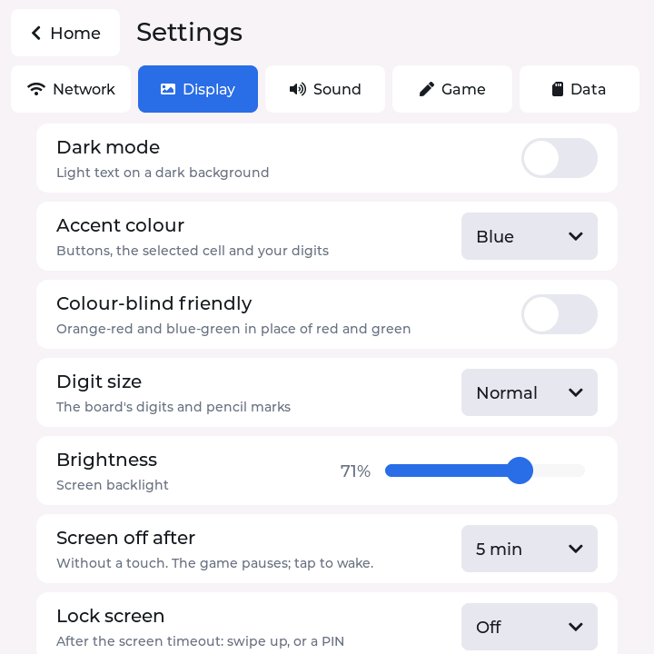

# esp32p4_sudoku

[](https://github.com/edipermadi/esp32p4_sudoku/actions/workflows/firmware.yml)
[](https://github.com/edipermadi/esp32p4_sudoku/releases/latest)
[](LICENSE)
[](https://edipermadi.github.io/esp32p4_sudoku/)


A touch-screen Sudoku for the **Waveshare ESP32-P4-WIFI6-Touch-LCD-4B** (4" 720×720 MIPI-DSI, GT911 touch, ES8311 speaker), built with LVGL 9.6 as an Arduino sketch.

## Online

On GitHub Pages, updated with each release:

| | Link | What's there |
|---|---|---|
| **Web flasher** | [edipermadi.github.io/esp32p4_sudoku](https://edipermadi.github.io/esp32p4_sudoku/) | Installs the latest release on the board from Chrome or Edge on a desktop computer, over the UART USB port, with no Arduino IDE needed ([details](docs/building.md#web-flasher)) |
| **Documentation** | [edipermadi.github.io/esp32p4_sudoku/docs](https://edipermadi.github.io/esp32p4_sudoku/docs/) | This README and everything in [`docs/`](docs/) as web pages: features, every variant, data, building, internals |
| **Code documentation** | [edipermadi.github.io/esp32p4_sudoku/code](https://edipermadi.github.io/esp32p4_sudoku/code/) | The firmware's code, documented with Doxygen: files, functions, structures, the screens diagram ([how it's made](docs/development.md)) |

## Screenshots

| Home | Puzzles | Game |
|---|---|---|
|  |  |  |
| **Statistics** | **Trophies** | **Settings** |
|  |  |  |
| **Replay** | **Share** | **Rules** |
|  |  |  |
| **New puzzle** | **History** | **System monitor** |
|  |  |  |

Captured from the board over its serial port (see [Screenshots and remote control](docs/devctl.md)). More, by topic, in [Features](docs/features.md).

## Highlights

- **1600 puzzles in flash** from the [OpenSudoku](https://opensudoku.gitlab.io/) collections, plus a generator for new ones at four levels and a daily puzzle.
- **[Variants](docs/variants/README.md)**: [X-Sudoku](docs/variants/x-sudoku.md), [Hyper](docs/variants/hyper.md), [Jigsaw](docs/variants/jigsaw.md), [Killer](docs/variants/killer.md), [Mini 6×6](docs/variants/mini-6x6.md), [Anti-Knight](docs/variants/anti-knight.md), [Anti-King](docs/variants/anti-king.md), [Even-Odd](docs/variants/even-odd.md), [Consecutive](docs/variants/consecutive.md), [Non-Consecutive](docs/variants/non-consecutive.md), [Disjoint Groups](docs/variants/disjoint-groups.md), [Asterisk](docs/variants/asterisk.md), [Kropki](docs/variants/kropki.md), [XV](docs/variants/xv.md), [Greater-Than](docs/variants/greater-than.md), [Quadruple](docs/variants/quadruple.md), [Arrow](docs/variants/arrow.md), [Renban](docs/variants/renban.md), [German Whispers](docs/variants/german-whispers.md), [Skyscraper](docs/variants/skyscraper.md), [Little Killer](docs/variants/little-killer.md), [Palindrome](docs/variants/palindrome.md), [Region Sum Lines](docs/variants/region-sum-lines.md), [X-Sums](docs/variants/x-sums.md), [Zipper Lines](docs/variants/zipper-lines.md), [Frame](docs/variants/frame.md), [Between Lines](docs/variants/between-lines.md), [Entropic Lines](docs/variants/entropic-lines.md), [Modular Lines](docs/variants/modular-lines.md), [Center Dot](docs/variants/center-dot.md), [Outside Sudoku](docs/variants/outside-sudoku.md), [Rossini](docs/variants/rossini.md), [Diagonal Non-Consecutive](docs/variants/diagonal-non-consecutive.md), [Dutch Whispers](docs/variants/dutch-whispers.md), [Parity Lines](docs/variants/parity-lines.md), [Slow Thermo](docs/variants/slow-thermo.md), [Fortress](docs/variants/fortress.md), [Argyle](docs/variants/argyle.md), [Nabner](docs/variants/nabner.md), [Numbered Rooms](docs/variants/numbered-rooms.md), [Sum Skyscrapers](docs/variants/sum-skyscrapers.md), [Lockout Lines](docs/variants/lockout-lines.md), [Sumless Killer](docs/variants/sumless-killer.md), [Double Arrow](docs/variants/double-arrow.md), [Diagonal Consecutive](docs/variants/diagonal-consecutive.md), [10 Lines](docs/variants/10-lines.md), [Girandola](docs/variants/girandola.md), [159 Sudoku](docs/variants/159-sudoku.md), [Product Killer](docs/variants/product-killer.md), [Extra Regions](docs/variants/extra-regions.md), [Anti-Diagonal](docs/variants/anti-diagonal.md), [Pill Arrows](docs/variants/pill-arrows.md), [Odd/Even Skyscrapers](docs/variants/odd-even-skyscrapers.md), [Chess Sudoku](docs/variants/chess-sudoku.md), [Magic Square](docs/variants/magic-square.md), [Average Lines](docs/variants/average-lines.md), [Thermo](docs/variants/thermo.md), [Sandwich](docs/variants/sandwich.md) and [Kids 4×4](docs/variants/kids-4x4.md) (and [Classic](docs/variants/classic.md)).
- **Helpers**: a left-handed layout, pencil marks, Auto notes, digit-first entry, cell colours, undo/redo, mistake check, step-by-step hints (up to X-Wing, Swordfish and XY-Wing, or nudges only), a Learn mode for ten techniques and every variant's own rule, a tour of the game screen, starred puzzles and a 10-minute time attack.
- **Players, statistics and trophies**: per-player progress and emoji avatars, a history calendar, charts, achievements, daily and weekly leaderboards.
- **Replays**: every solve can be played back, or exported as an H.264 MP4 video.
- **Data on the microSD card** in a SQLite database (`sudoku.db`), with CSV export, one-tap database backups, puzzle import, a file manager with a Recycle bin (the database protected), a picture/video viewer and a puzzle file preview, screenshots, USB drive mode and firmware updates from the card.
- **Wi-Fi clock**, light and dark mode, a night mode, accent colours, colour-blind friendly colours, lock screen, a choice of screen savers (a dim digital or analog clock, or animations in 3Blue1Brown's colours: Game of Life, digital rain, strange attractors, boids with hawks, Lissajous figures, double pendulums, Brian's Brain, Langton's ant and eight more cellular automata, each its own choice), synthesised sound effects, remote control by sound (Gibberlink / ggwave) and a system monitor with graphs of the last hour.

## Documentation

Also online, as web pages, with the code documentation next to them: see [Online](#online).

| Page | What's in it |
|------|--------------|
| [Features](docs/features.md) | Everything the game does, by topic: puzzles, playing, players & progress, settings & system |
| [How to play](docs/how-to-play.md) | Which button does what, as a table |
| [Variants](docs/variants/README.md) | Each of the 60 variants on its own page: rules, tips, a worked example with a screenshot, and the whole puzzle solved step by step |
| [Data & storage](docs/data.md) | `sudoku.db` and its tables, backups, firmware update, USB drive, format, factory reset, saving |
| [Internals](docs/internals/README.md) | How the game works inside: [puzzle generator](docs/internals/generator.md), [database design](docs/internals/database.md) (tables, how they connect, upgrades) |
| [Building and releases](docs/building.md) | Arduino settings, `arduino-cli`, GitHub Actions releases, the web flasher |
| [Development](docs/development.md) | Regenerating puzzles and fonts, colours, sounds, tests, puzzle generation speed on the board, source layout |
| [Screenshots and remote control](docs/devctl.md) | `tools/devctl.py`: screenshots, simulated touches, files on the card over serial |
| [devctl protocol](docs/devctl-protocol.md) | The serial wire protocol, for other tools |

## Quick build

```
arduino-cli compile -b esp32:esp32:esp32p4:PSRAM=enabled,FlashSize=32M,PartitionScheme=custom,ChipVariant=prev3 .
```

Needs esp32 Arduino core 3.3.x, LVGL 9.6.0 and `extras/lv_conf.h` at `~/Arduino/libraries/lv_conf.h`. The flash layout is the sketch's own `partitions.csv`, and the avatars go into their partition once (`extras/avatars.bin`); see [Building](docs/building.md) for the details.

## Credits

The puzzles come from the [OpenSudoku](https://opensudoku.gitlab.io/) collections, which include puzzles from Gnome Sudoku. The board support code is shared with the `esp32p4_86box` project. The player avatars are [Noto Color Emoji](https://github.com/googlefonts/noto-emoji) (SIL Open Font License 1.1), as images in `extras/avatars.bin` (made by `tools/gen_avatars.py`). Data over sound is [ggwave](https://github.com/ggerganov/ggwave) by Georgi Gerganov (MIT, in `src/ggwave/`); the ES7210 and ES8311 register setup follows Espressif's `esp_codec_dev` drivers (Apache-2.0).

---

Powered by [Claude Code](https://claude.com/claude-code)
