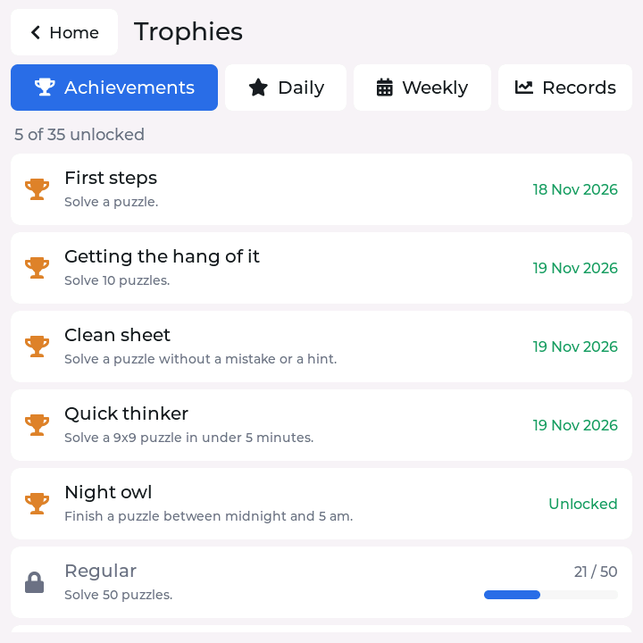
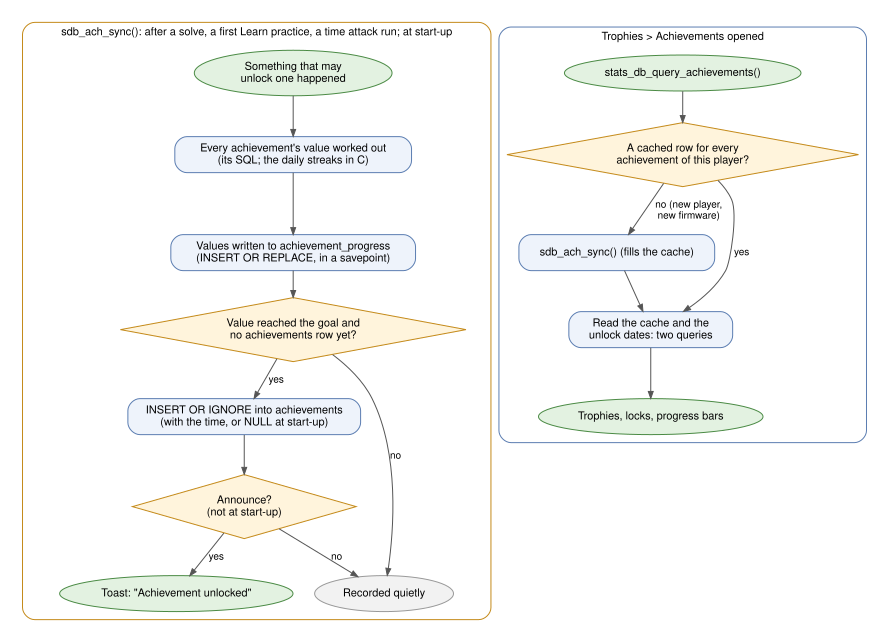

# Achievements

[← README](../README.md) · [Features](features.md) · [How to play](how-to-play.md) · [Data & storage](data.md) · [Building](building.md) · [Development](development.md) · [Remote control](devctl.md)

The 40 achievements on the **Trophies → Achievements** tab ([Players & progress](features-progress.md)), what each one asks for, and the key it is stored under.

## How they work

- **Per player**: each player has their own, worked out from their solves in `sudoku.db`. Switching players switches the list.
- **Progress**: unlocked ones show a trophy and the date. Locked ones show a lock and, where there is a count, a bar and the progress ("3 / 10", "4 / 7 days", "2 h 5 min / 10 h").
- **Unlocking**: achievements are checked after every solve, after a Learn practice finished for the first time, and after a time attack run. Newly unlocked ones pop up at the top of the screen with a chime, whatever screen is open.
- **Counted from the past too**: the progress counts every solve ever logged, so an achievement added in a new firmware can be unlocked by old solves. These, and those found already done in a restored `sudoku.db`, are recorded quietly at startup, without a date.
- **Never taken back**: once unlocked, an achievement stays, even if the rules for it are changed later.
- **Daily puzzles count everywhere**: a daily puzzle is a generated puzzle of some variant and level, so it counts for that variant, that level and the solve counts, as well as for the daily ones.
- **Levels**: "Hard or harder" means Hard, Very Hard or Expert.
- **Keys**: the `key` is stored in the `achievements` table and in `export/achievements.csv` ([Data & storage](data.md)). Keys never change; titles and descriptions may.

## Solving

| Achievement | How to get it | Goal | Key |
|---|---|---|---|
| **First steps** | Solve a puzzle. | 1 | `solve_1` |
| **Getting the hang of it** | Solve 10 puzzles. | 10 | `solve_10` |
| **Regular** | Solve 50 puzzles. | 50 | `solve_50` |
| **Centurion** | Solve 100 puzzles. | 100 | `solve_100` |
| **Marathon** | Spend 10 hours solving puzzles (the solve times added up). | 10 h | `marathon` |
| **Night owl** | Finish a puzzle between midnight and 5 am (local time; needs the clock). | 1 | `night_owl` |

## Clean solving

A clean solve has no mistake and no hint (**Fill**).

| Achievement | How to get it | Goal | Key |
|---|---|---|---|
| **Clean sheet** | Solve a puzzle without a mistake or a hint. | 1 | `clean_1` |
| **Steady hand** | Solve 25 puzzles without a mistake or a hint. | 25 | `clean_25` |
| **Hard and clean** | Solve a Hard, Very Hard or Expert puzzle without a mistake or a hint. | 1 | `hard_clean` |
| **Expert** | Solve an Expert puzzle (New puzzle or the Sunday daily). | 1 | `expert` |
| **Unaided expert** | Solve an Expert puzzle without a mistake or a hint. | 1 | `expert_clean` |

## Speed

| Achievement | How to get it | Goal | Key |
|---|---|---|---|
| **Quick thinker** | Solve a 9×9 puzzle in under 5 minutes (a Mini 6×6 or Kids 4×4 doesn't count). | 1 | `quick` |
| **Speed demon** | Solve a Hard or harder puzzle in under 10 minutes, without hints. | 1 | `fast_hard` |

## Time attack

The time attack is on the home screen: as many Easy puzzles as you can in 10 minutes ([Playing a game](features-game.md)). These count your best run; the puzzles solved in a run also count as usual for the others.

| Achievement | How to get it | Goal | Key |
|---|---|---|---|
| **Against the clock** | Solve 5 puzzles in one time attack. | 5 | `attack_5` |
| **Cool under pressure** | Solve 8 puzzles in one time attack without a mistake. | 8 | `attack_clean` |

## Variants

Puzzles of a variant come from **New puzzle**, the daily puzzle or an imported collection ([Variants](variants/README.md)). The built-in collections are Classic.

| Achievement | How to get it | Goal | Key |
|---|---|---|---|
| **Crossed lines** | Solve an X-Sudoku. | 1 | `x_sudoku` |
| **Small wonder** | Solve a Mini 6×6. | 1 | `mini` |
| **Little steps** | Solve a Kids 4×4. | 1 | `kids` |
| **Window cleaner** | Solve a Hyper Sudoku. | 1 | `hyper` |
| **Puzzle pieces** | Solve a Jigsaw Sudoku. | 1 | `jigsaw` |
| **Killer instinct** | Solve a Killer Sudoku. | 1 | `killer` |
| **Feeling the heat** | Solve a Thermo Sudoku. | 1 | `thermo` |
| **Lunch break** | Solve a Sandwich Sudoku. | 1 | `sandwich` |
| **Variety** | Solve a Classic, an X-Sudoku and a Mini 6×6. | 3 | `variety` |
| **Rule bender** | Solve an Anti-Knight, an Even-Odd and a Consecutive. | 3 | `rule_bender` |
| **Collector** | Solve each of the six original kinds: Classic, X-Sudoku, Hyper, Jigsaw, Killer and Mini 6×6. | 6 | `variety_5` |
| **Globetrotter** | Solve 10 different variants (Classic counts as one). | 10 | `variants_10` |
| **Rule book** | Solve every variant at least once. | 68 | `variants_all` |

The goal of **Rule book** is the number of variants the firmware has, so it grows when a variant is added.

## Daily puzzle

The daily puzzle needs the clock (Wi-Fi). A day counts once, however often its puzzle is solved.

| Achievement | How to get it | Goal | Key |
|---|---|---|---|
| **Daily regular** | Solve the daily puzzle on 10 different days. | 10 days | `daily_10` |
| **On a roll** | Solve the daily puzzle 3 days in a row. | 3 days | `streak_3` |
| **Week streak** | Solve the daily puzzle 7 days in a row. | 7 days | `streak_7` |
| **Monthly habit** | Solve the daily puzzle 30 days in a row. | 30 days | `streak_30` |

For the streaks, the longest run ever counts, not only the current one.

## Collections and New puzzle

| Achievement | How to get it | Goal | Key |
|---|---|---|---|
| **Explorer** | Solve a puzzle in each of the 16 built-in collections. | 16 | `explorer` |
| **Completionist** | Solve all 100 puzzles of one built-in collection. | 100 | `collection` |
| **Fresh off the press** | Solve 10 puzzles made with **New puzzle** (not daily or imported ones). | 10 | `fresh_10` |

## Techniques and challenges

Which techniques a game's hints showed is kept with its solve. The no-notes challenge is **Settings → Game → No-notes challenge** ([Playing a game](features-game.md)).

| Achievement | How to get it | Goal | Key |
|---|---|---|---|
| **Graduate** | Finish a Learn practice of all ten techniques (place the digit each leads to). | 10 | `graduate` |
| **Gone fishing** | Solve a puzzle where a hint showed an X-Wing or a Swordfish. | 1 | `fish` |
| **On a wing** | Solve a puzzle where a hint showed an XY-Wing. | 1 | `wing` |
| **Bare hands** | Solve a puzzle in the no-notes challenge. | 1 | `no_notes` |
| **All in your head** | Solve a Hard or harder puzzle in the no-notes challenge. | 1 | `no_notes_hard` |

## For developers

The list is `ACH` in `src/stats_db_achievements.c`: each entry has its key, title, description, goal, unit and the SQL that works out the player's progress (the daily streaks are worked out in C). Adding one is adding an entry; at most `STATS_ACH_MAX` (40, in `src/stats_db.h`) fit, and the build fails when the list is longer. Progress is cached in the `achievement_progress` table ([Database](internals/database.md)). Add the new one to this page too.
