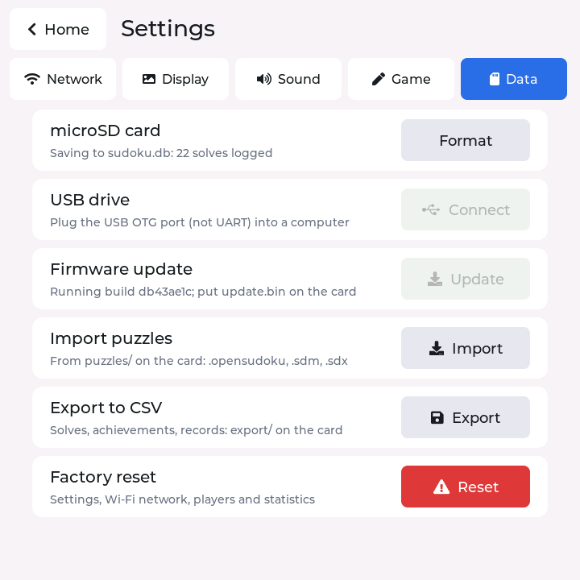
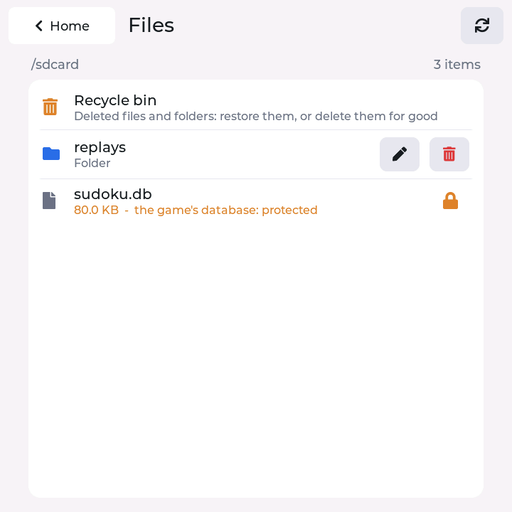
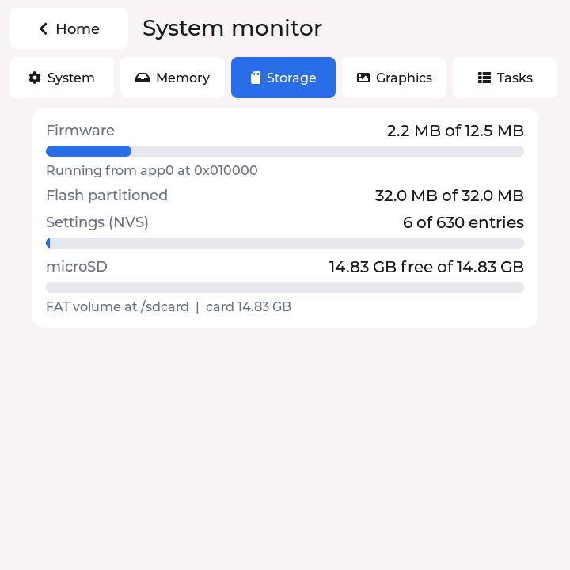

# Data & storage

[← README](../README.md) · [Features](features.md) · [How to play](how-to-play.md) · [Data & storage](data.md) · [Building](building.md) · [Development](development.md) · [Remote control](devctl.md)

Where the game keeps its data (`sudoku.db` on the microSD card), and the maintenance tools under **Settings → Data**. For the schema's design (tables, keys, how they connect), see [Database design](internals/database.md).

| **Settings → Data** | **Files** (home screen) | **System → Storage** (home screen) |
|---|---|---|
|  |  |  |

**Files** on the home screen renames and deletes files on the card from the board itself; `sudoku.db` is locked there. See [Home, settings & system](features-settings.md) for the details.

- **Game data on the microSD card**: statistics, the game in progress and the settings are kept in `sudoku.db`, a SQLite 3 database in the root of a FAT32 microSD card that is inserted at start-up ([Database design](internals/database.md) explains its tables and how they connect). Nothing is written to the board's flash for them; only the Wi-Fi network and on/off switch stay on the board (NVS). At start-up the board shows "Starting..." while it opens the database (about a second), then builds the screens with its settings. The **Statistics** screen reads the database with SQL queries; the puzzle list, the home screen and "New best!" use a copy in RAM loaded at start-up. Without a card, the game runs on defaults and keeps changes, the game in progress and solves only until power-off; the "Solved!" dialog warns about this and Settings shows it under **microSD card**. A FAT32 card without `sudoku.db` (a new or empty card) gets a skeleton database at start-up: all tables, the current settings and the game in progress, and no statistics. The screens then show exactly what the database holds. A card without a FAT32 filesystem is not formatted automatically; Settings offers **Format**. (A database from a build before settings moved to the card gets the board's older statistics merged in once.) Open it on a computer with `sqlite3 sudoku.db`:
  - `players`: `id`, `name`, `created_at`, `color` (0–7; NULL = by id), `avatar` (1–1867, the emoji's place in `tools/avatars_order.txt`; NULL = none). Statistics and saved games that existed before players were added belong to player 1, "Player 1".
  - `solves`: every solve, with `player_id`, `puzzle` (0–1599), `level`, `number` (1–100), `seconds`, `mistakes`, `started_at` (when the puzzle was opened, or restarted), `finished_at` (when it was solved) `hints` (cells filled with Fill; 0 for solves before Fill existed) and `moves` (the move log for Replay: 6 bytes per move, little-endian uint32 game-clock ms, uint8 cell 0–80, uint8 digit + kind × 16 with kind 0 = number pad, 1 = Fill, 2 = Erase, 3 = Undo, 4 = Redo; NULL for solves before Replay existed). Times are Unix time (UTC). The board knows the time once Wi-Fi has set the clock; a puzzle opened before that still gets its start time, worked out from the board's uptime. Earlier solves have no `started_at`. `flags`: bit 20 = played in the no-notes challenge, bits 0–15 = the techniques the game's hints showed (bit k = `TECH_*` k in `src/generator.h`, e.g. 10 X-Wing, 11 Swordfish, 12 XY-Wing); 0 for solves before this existed.
  - `puzzle_stats`: per player and puzzle `best_seconds`, `fewest_mistakes` (NULL if solved before mistakes were counted) and `solves`.
  - `level_stats` (view): per player and level: solved, solves, fastest, average, average mistakes and solves without mistakes.
  - `saved_game`: each player's unfinished games (up to 5, one row per player and puzzle; `seq` orders them, the highest was played last): `cells` holds 81 digits row by row (0 = empty, givens included), `notes` 81 little-endian 16-bit masks (bit d = pencil mark d), plus `elapsed_ms`, `mistakes`, `hints`, `moves` (the move log so far), `started_at`, `saved_at` and `flags` (as in `solves`). It is saved after every move.
  - `generated`: puzzles made with **New puzzle** and the daily puzzles: `id` (their puzzle number elsewhere is 2000 + id), `level` (0 Easy, 1 Medium, 2 Hard, 3 Expert), `givens` (81 digits row by row, 0 = empty; a 6×6 puzzle uses the first 6 digits of the first 6 rows and leaves the rest 0), `created_at`, `day` (the date of a daily puzzle, `YYYY-MM-DD`; NULL otherwise) `variant` (0 Classic, 1 X-Sudoku, 2 Mini 6×6, 3 Hyper, 4 Jigsaw, 5 Killer, 6 Anti-Knight, 7 Even-Odd, 8 Consecutive, 9 Thermo, 10 Sandwich, 11 Kids 4×4, 12 Anti-King, 13 Non-Consecutive, 14 Disjoint Groups, 15 Asterisk, 16 Kropki, 17 XV, 18 Greater-Than, 19 Quadruple, 20 Arrow, 21 Renban, 22 German Whispers, 23 Skyscraper, 24 Little Killer, 25 Palindrome, 26 Region Sum Lines, 27 X-Sums, 28 Zipper Lines, 29 Frame, 30 Between Lines), `regions` (a Jigsaw puzzle's region map: 81 digits 0–8 row by row, the region of each cell; NULL for the others) `cages` (a Killer puzzle's cages, `sum:cell,cell,...;...`; a Quadruple puzzle's circles, `cell:digits;...`; a Little Killer puzzle's diagonals, `t3,r,21;...`) `marks` (an Even-Odd, Consecutive, Kropki, XV or Greater-Than puzzle's marks, 81 characters; a Sandwich's 18 sums; a Skyscraper's, an X-Sums' or a Frame's 18 clues, 0 for none), `thermos` (a Thermo puzzle's thermometers, each from its bulb; an Arrow, Renban, German Whispers, Palindrome, Region Sum, Zipper or Between Lines puzzle's lines, an arrow from its circle: `cell,cell,...;...`), and for imported puzzles `source` (the collection) and `number`; NULL for the others.
  - `imported`: the collections imported from `puzzles/`: `name`, `file`, `first_id` (the `generated.id` of the first puzzle), `count`, `created_at`. Their solves are logged with level "Generated Easy", "X-Sudoku Easy", "Mini Easy" etc. Saved games and move logs of a 6×6 puzzle use the same 81-cell layout (cell = row × 9 + column).
  - `saved_collections`: collections made on the board with the game screen's **Save**: `id`, `name`, `created_at`. `saved_puzzles`: their puzzles: `collection_id`, `puzzle` (the puzzle number: 2000 + `generated.id`), `number` (its place in the collection, from 1), `added_at`. Shared by all players; a collection's row goes with its last puzzle, or when it is deleted (the Saved tab's trash button; deleting an imported collection removes its `imported` row, its puzzles stay in `generated`).
  - `bookmarks`: starred puzzles: `player_id`, `puzzle` and `at` (when starred).
  - `seen`: things shown once per player: `player_id`, `what` (`tour`: the game screen tour) and `at`.
  - `attack`: time attack runs: `id`, `player_id`, `finished_at`, `solved` (Easy puzzles solved in the 10 minutes) and `mistakes`.
  - `learned`: Learn practices each player has finished (placed the digit the technique leads to): `player_id`, `technique` (Learn's list, 0 Hidden single .. 9 XY-Wing) and `at`.
  - `achievements`: `player_id`, `key` (e.g. `clean_25`, `streak_7`; the list is `ACH` in `src/stats_db_achievements.c`) and `unlocked_at` (Unix time; NULL when it was found already done or the clock wasn't set).
  - `settings`: `dark_mode`, `sound`, `brightness` (10–100), `volume` (0–100), `assist` (Mistake check: 0 Off, 1 Rules, 2 Solution), `show_timer`, `accent` (0 Blue .. 4 Pink), `rules_seen` (bit per variant), `screen_off_minutes`, `saver_clock`, `lock_mode`, `lock_pin`, `cvd` (colour-blind friendly), `no_notes` (the no-notes challenge for new games), `left_hand` (the number pad on the left), `big_digits` (Digit size: Large), `is_hint_nudge` (Hints: Nudge only), `night_mode`, `night_start` and `night_end` (hours 0–23), `night_brightness` (10–100), `time_zone`, `last_level`, `current_player` and `migrated_from_nvs`.

  ```
  sqlite3 -box sudoku.db "SELECT level, number, seconds, mistakes, datetime(started_at, 'unixepoch', 'localtime') AS started, datetime(finished_at, 'unixepoch', 'localtime') AS finished FROM solves ORDER BY id DESC LIMIT 10"
  sqlite3 -box sudoku.db "SELECT * FROM level_stats"
  ```

  SQLite 3.54.1 is built in from the official amalgamation (`src/sqlite/`), with a small file layer for ESP-IDF's FAT filesystem. The board doesn't lock the file, so take the card out (or switch off) before opening the database elsewhere.
- **Avatars from the card**: the players' avatars live in their own flash partition. If they're missing (a board flashed from the IDE, or after **Erase All Flash**) they show blank, and an `avatars.bin` in the card's root (`extras/avatars.bin`) is installed by the board itself at start-up, in about a minute ("Installing the avatars": the screen is dark meanwhile, as for a firmware update), and checked before it's used. A file from another avatar set is ignored. The file can stay on the card; it's only read when the avatars are missing.
- **Firmware update from the card**: **Settings → Data → Firmware update**. Put the sketch's binary on the card's root as `update.bin`, for example over **USB drive**. In the Arduino IDE, use **Sketch → Export Compiled Binary** and take `esp32p4_sudoku.ino.bin` (not the `.merged.bin`); with arduino-cli it's in the build folder. The row shows the running build and the file's build (the first 8 hex digits of the ELF file's SHA-256, as a crash log prints it), and **Update** is greyed out without a usable file. **Update** asks first, then writes the image into the board's other 4.44 MiB app slot (`ota_0` / `ota_1`; see [Building → The flash layout](building.md#the-flash-layout)). A card says so first; then the screen goes dark while the flash is written (about 30 seconds), because writing the flash keeps the display from its frame buffer and the panel would flicker cyan. The whole image is checked (format, chip, SHA-256) before the board is told to start it, so a broken or truncated file changes nothing. Then `update.bin` is renamed `update.done` and the board restarts into the new firmware. The new firmware starts on probation: it is kept once it has run for 15 seconds. If it crashes before then, the next restart goes back to the previous firmware (the bootloader's rollback). A USB upload from the IDE always goes back to the first slot. The avatars aren't part of the firmware (they have their own flash partition), so an update leaves them alone. A board still on the older flash layout (Settings shows "of 12.5 MB" under **System → Storage**) needs one USB flash first: an update can't change the partition table.
- **USB drive (backup and restore)**: **Settings → USB drive → Connect** lends the microSD card to a computer as a USB mass-storage drive on the board's **USB OTG** port (the other USB-C port, not the UART one). **Connect** is greyed out until a computer is plugged into the OTG port; the hint under it says so. (To notice the computer, the board starts USB at power-on with the drive empty, so before **Connect** the computer shows an empty card reader called "Sudoku SD Card".) Copy `sudoku.db` off to back it up, or put a backup in its place to restore it. While the computer has the card, the board closes `sudoku.db` and shows a full-screen "USB drive" panel, so the two never write the card at once. Eject the drive on the computer, or unplug the USB cable, and the board takes the card back by itself (or tap **Done** once copying has finished); unplugging is noticed after 1.5 s of a quiet bus, which a computer going to sleep also causes; it then reopens `sudoku.db` and loads the settings, player, statistics and game from it. If `sudoku.db` was deleted, a new skeleton is created. Needs Tools → USB Mode = "USB-OTG (TinyUSB)" (the default).
- **Back up the database on the card**: **Settings → Data → Back up database** writes a copy of `sudoku.db` to `backup/sudoku_<unix time>.db` on the card, e.g. `backup/sudoku_1763712345.db` (SQLite `VACUUM INTO`: a consistent, compacted copy taken while the database is in use). A notice shows the file name and size. Without the clock (no Wi-Fi), the time counts from start-up and can repeat after a restart; a `_2`, `_3`, ... suffix then keeps the older file. To restore one, copy it over `sudoku.db` with **USB drive** (or on a computer).
- **Factory reset**: **Settings → Factory reset** (at the bottom; the Settings list scrolls) puts the settings back to the defaults, forgets the Wi-Fi network and switches Wi-Fi off, erases the board's leftover pre-database data (NVS), and deletes `sudoku.db` (all players, statistics, solve history and games in progress) and makes a new, empty one with a single "Player 1". It asks first. Back up `sudoku.db` beforehand (**Back up database**, or over USB) to keep a copy.
- **Format microSD card**: **Settings → microSD card → Format** erases the card and gives it a fresh MBR with one primary FAT32 partition spanning the whole card (FatFs `f_mkfs`, cluster size chosen automatically, data area aligned to 4 MiB). It shows the card's name and size in a confirmation dialog first. Formatting erases `sudoku.db` with the statistics and solve history; afterwards the board writes a new, empty `sudoku.db` holding the current settings and the game in progress, and its statistics start from zero.
  - Insert the card before switching the board on. The card shares its SD controller with the Wi-Fi chip, and setting up a card while Wi-Fi runs breaks the Wi-Fi link and restarts the board. So the card is detected at start-up, before Wi-Fi starts, and a card inserted later is only picked up if Wi-Fi hasn't been switched on since start-up.
- **Settings** (dark mode, sound effects, screen timeout and time zone) are kept in `sudoku.db`; the Wi-Fi network is kept on the board, with the password stored unencrypted in NVS.
- **Power off**: the power button at the top right of the home screen asks first, then closes `sudoku.db` and unmounts the card, turns off the backlight and speaker amp, holds the panel and the Wi-Fi chip (ESP32-C6) in reset, and puts the ESP32-P4 into deep sleep with no wake-up source. Press the board's **RESET** button (or unplug and replug power) to start it again; it boots normally and the game in progress is still there.
- **Saved state**: the game being played (entries, notes, elapsed time, mistakes and when it was started) is saved to `sudoku.db` after every move, and when you leave it or pause. If power is cut mid-game, at most the last move is lost.
