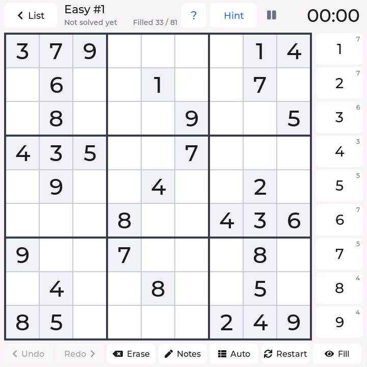
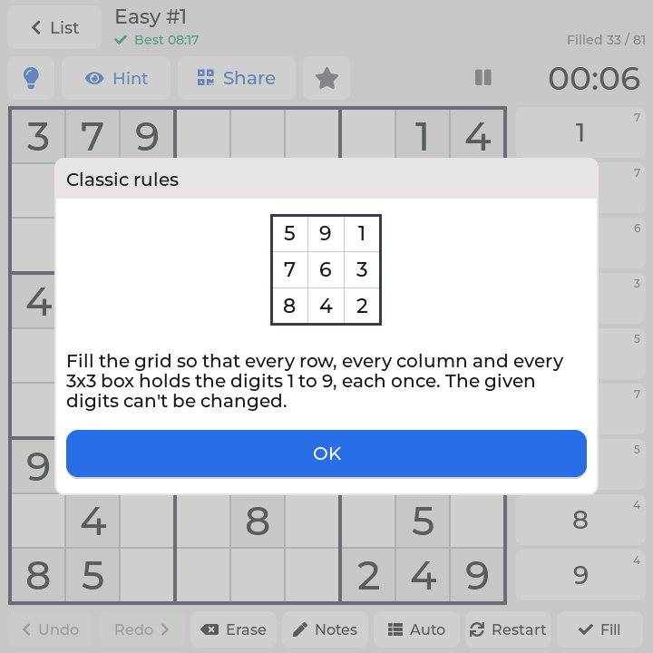
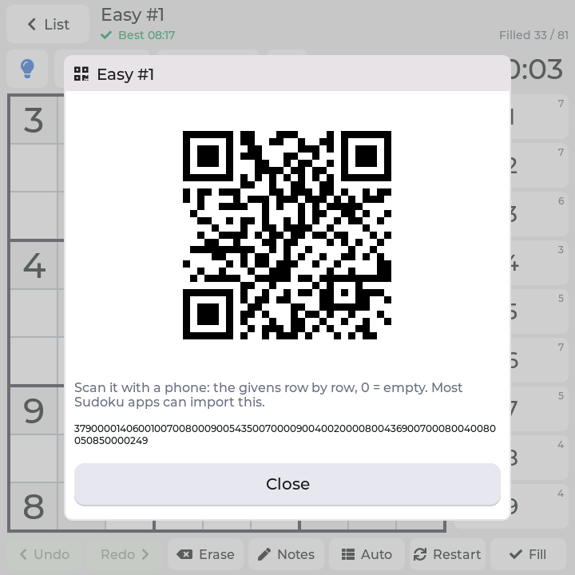
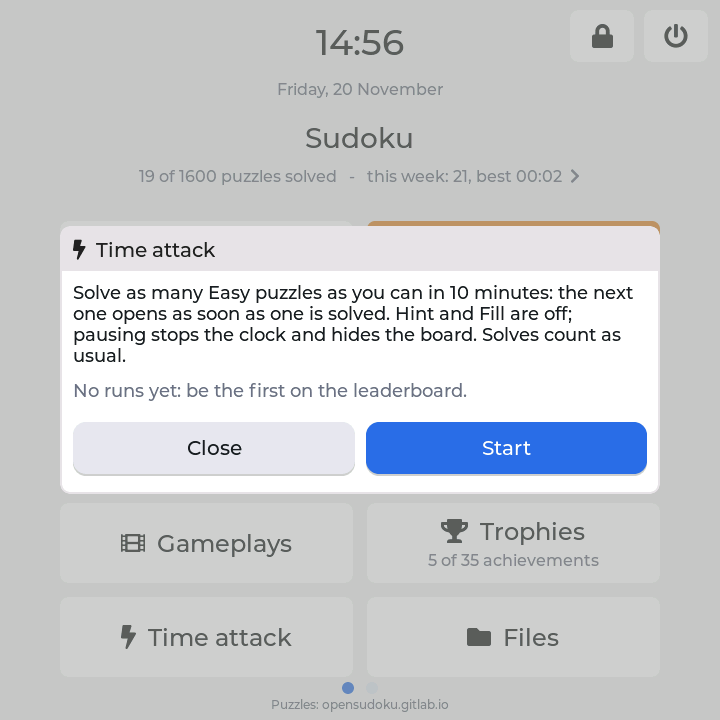
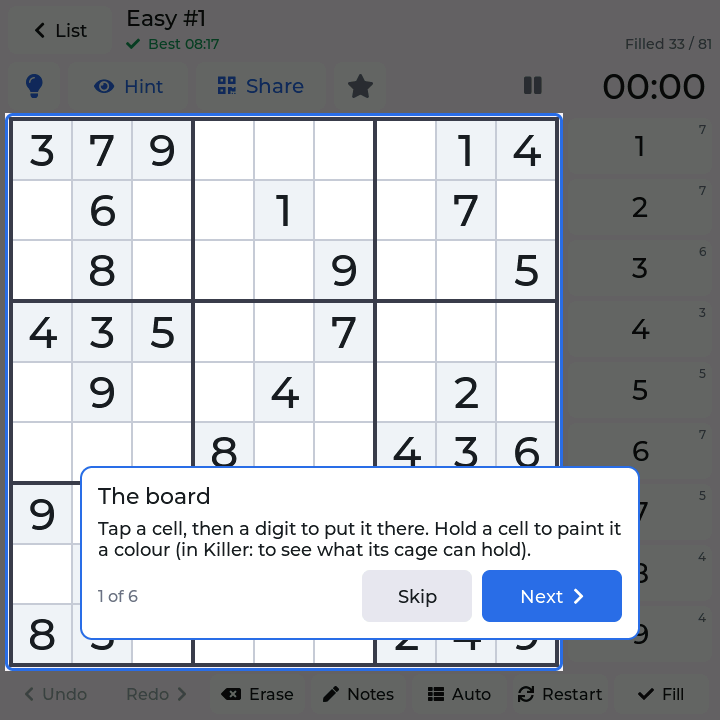

# Playing a game

[← README](../README.md) · [Features](features.md) · [How to play](how-to-play.md) · [Data & storage](data.md) · [Building](building.md) · [Development](development.md) · [Remote control](devctl.md)

The game screen and its helpers: notes, digit-first entry, colours, undo, the mistake check, the timer, hints, the tour, sharing, and the ways to play it (no notes, left-handed, time attack).

| **Game** | **Rules card** | **Share** |
|---|---|---|
|  |  |  |
| **Time attack** |  |  |
|  |  |  |

## Features

- **Game**
  - The selected cell's row, column and box are highlighted, and so is every cell with the same digit.
  - Pencil marks (Notes). Placing a digit removes it from the notes in its row, column and box.
  - **Auto** fills in the notes of every empty cell with all the digits that still fit there (replacing what was there; Undo takes it back). It doesn't count as a hint.
  - **Digit first**: press and hold a digit on the number pad to lock it (it turns blue, and every cell with that digit is highlighted); then each tap on a cell puts that digit there (tap it again to clear it; with Notes on, it toggles the note). A short tap on another digit moves the lock there; a short tap on the locked digit, or holding it again, unlocks it.
  - Undo (128 steps), **Redo** (puts back what Undo took away, until the next change), Erase and Restart. Undo and Redo are dimmed when there's nothing to undo or redo.
  - **Cell colours**: press and hold a cell for its menu: six colours to paint it with (and ✕ for none), for colouring techniques. Painted cells keep their colour under the highlights, Undo takes a colour back, and colours are saved with the game (`saved_game.colors`) but not in the move log. On **Killer**, the menu also lists the sets of different digits that still make up the cell's cage sum, given the digits already in it ("Cage: 15 in 3 cells, 4 ways: 1+5+9  2+4+9  2+5+8  3+4+8").
  - The bottom bar has seven buttons (Undo, Redo, Erase, Notes, Auto, Restart, Fill); the status line (filled count, conflicts, the locked digit) is in the top bar, under the title.
  - **Fill** puts the right digit (from the puzzle's solution) in the selected cell. Each Fill counts as a hint: the number on the Fill button shows the hints used so far, Undo doesn't take one back, and the count is saved with the game in progress, shown in the "Solved!" dialog and the history, and logged with the solve (`solves.hints`).
  - The number pad shows how many of each digit are still to place. A digit that is complete is dimmed.
- **Solve indicator**
  - Conflicting digits turn red, and the status line counts them.
  - **Settings → Mistake check** chooses what turns red and buzzes: **Off** (nothing: the status line only says "All filled, not solved yet" when the board is full and something is wrong), **Rules** (the default: digits that break a row, column or box rule) or **Solution** (also digits that break no rule yet but aren't the solution's).
  - When the board is solved, it turns green and a "Solved!" dialog opens with the time and your best.
- **Time to solve**
  - The timer counts only while the game screen is open. Tap it to pause, which also hides the board.
  - The best time for each puzzle is stored.
- **Hints**: **Hint** (top of the game screen, next to the timer) shows the next step a person would take, in steps. First it points to where to look ("Look at row 4: one digit has only one place left there"); **More** marks the cell and explains why (a hidden single, a naked single, or, when that's not enough, the step that leads to one: pointing, claiming, a naked or hidden pair, a naked triple, an X-Wing, a Swordfish or an XY-Wing, with the cells that make it highlighted); **Place it** fills it in. A digit that isn't part of the solution is pointed out first (**Erase it**). When no simple step exists, it shows the answer for the easiest cell. Each hint opened counts as one hint (with **Fill**), and its placed digit shows orange in replays. The card is as tall as its explanation needs; it sits at the bottom of the screen, or at the top when it would cover a highlighted cell there; any move closes it. Naked triples, X-Wings, Swordfish and XY-Wings are only used for hints: grading still calls a puzzle Hard when it needs pairs or locked candidates and Expert when it needs more, so Expert hints now explain a step where they used to show an answer.
- **Nudge-only hints**: **Settings → Game → Hints** **Nudge only**: a hint only says where to look ("Look at box 1: one digit has only one place left there") and highlights it; there's no **More** or **Place it**, and tapping **Hint** again does nothing more. It still counts as a hint. Learn's practice games always show the full hint.
- **Game screen tour**: the first time a player opens a puzzle, a short tour lights up the board, the number pad, the tools, **Hint**, the top bar and the timer one at a time, with a line on each (**Next**, **Skip**). The clock doesn't run meanwhile. It's shown once per player (`sudoku.db`, `seen`); **Settings → Game → Game screen tour → Show again** brings it back for the next puzzle opened.

| **Tour** |
|---|
|  |
- **Share**: **Share** in the game's second row shows the puzzle as a QR code (black on white in either theme) to scan with a phone. A Classic or imported puzzle is the usual 81-digit string (givens row by row, 0 = empty) that most Sudoku apps can import; a variant is its name, its givens (a 6x6: its 36 cells) and its layout, e.g. `Killer 000... cages=11:0,1;...`, `Jigsaw ... regions=...`, `Thermo ... thermos=...`, `Sandwich ... sums=...`. The text is under the code too. The QR code generator is Project Nayuki's (MIT), copied from LVGL into `src/qrcode/` (the shared `lv_conf.h` has LVGL's QR widget off).
- **No-notes challenge**: **Settings → Game → No-notes challenge** on: puzzles started from then on have **Notes** and **Auto** switched off (dimmed), so everything is worked out in your head. A game keeps the mode it started with, also when resumed later. Solves made this way show "no notes" on **Gameplays**, in **History** and on the daily leaderboard, the Solved dialog says so, and they count for the **Bare hands** and **All in your head** achievements. Learn's practice games are never in the challenge.
- **Left-handed**: **Settings → Game → Left-handed** puts the number pad on the left of the board and the board on the right.
- **Digit size**: **Settings → Display → Digit size** **Large** shows the board's digits at 52 px instead of 44 (and the pencil marks a size up too), for reading from further away; also on the Replay screen.
- **Show timer**: **Settings → Show timer** off hides the game's clock while you play (it shows `--:--`; tap it to pause as before). The time still runs and is recorded, and the Solved dialog shows it.
- **Screenshots**: the camera button in the Solved dialog (top left) and on the Replay screen (next to Speed) saves the screen as a JPEG in `screenshots/` on the card (720×720, quality 90, full colour resolution, about 100–200 KB, named by the date and time), compressed by the ESP32-P4's hardware JPEG encoder. It's made in the background, so the screen doesn't wait; copy it off with **USB drive**. Exported videos don't show the button.
- **Time attack**: **Time attack** on the home screen: solve as many Easy puzzles as you can in 10 minutes. A dialog explains it and shows the leaderboard (each player's best run, and how many runs); **Start** opens a random Easy puzzle, and the next one opens as soon as it's solved. The timer counts down (orange in the last minute) and only runs while you play: pausing stops it and hides the board. **Hint** and **Fill** are off. The title says "Time attack: Easy #12", the line under it how many are solved in this run. Its games aren't kept for **Continue**, but each solve counts as usual (statistics, achievements, Gameplays). When the time is up, the result and the leaderboard show, with **Again** and **Home**; **List** during a run asks first, and a stopped run isn't recorded. Runs are kept in `sudoku.db` (`attack`).
