# Players & progress

[← README](../README.md) · [Features](features.md) · [How to play](how-to-play.md) · [Data & storage](data.md) · [Building](building.md) · [Development](development.md) · [Remote control](devctl.md)

Who plays, and how they are doing: players, colours and avatars, statistics, the chart and insights, history, trophies and leaderboards, replays and videos.

| **Players** | **Avatar** | **Statistics** |
|---|---|---|
| 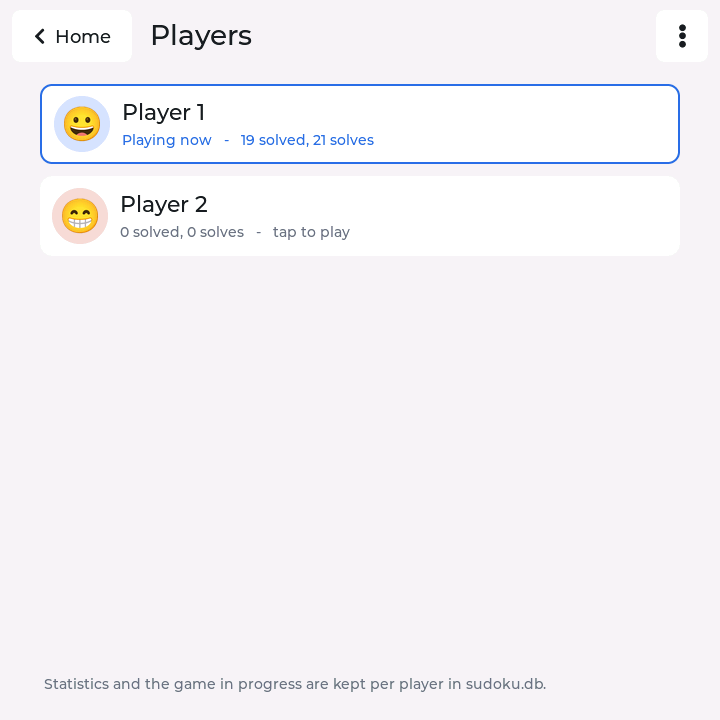 | 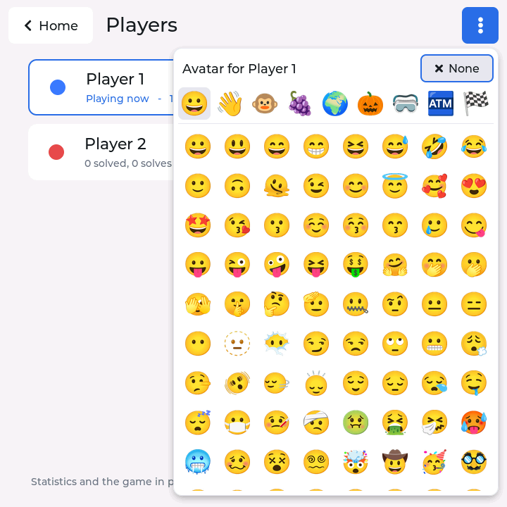 | 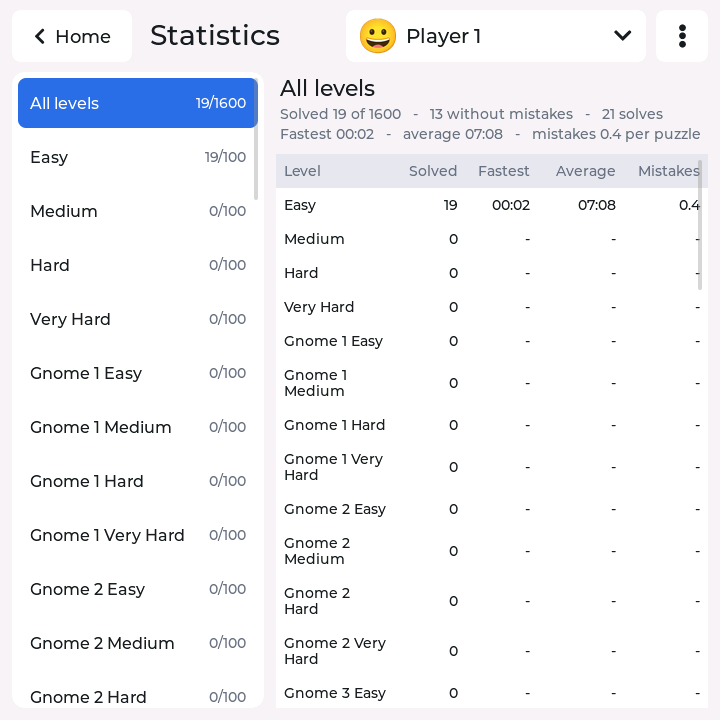 |
| **Insights** | **History** | **Trophies** |
| 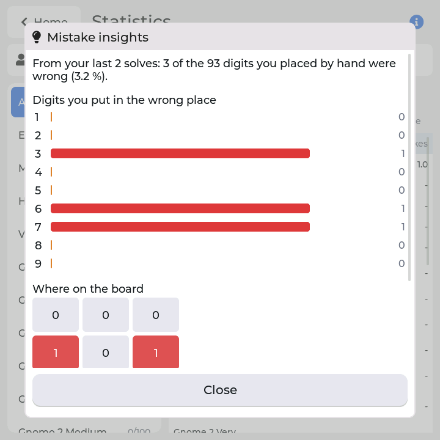 | 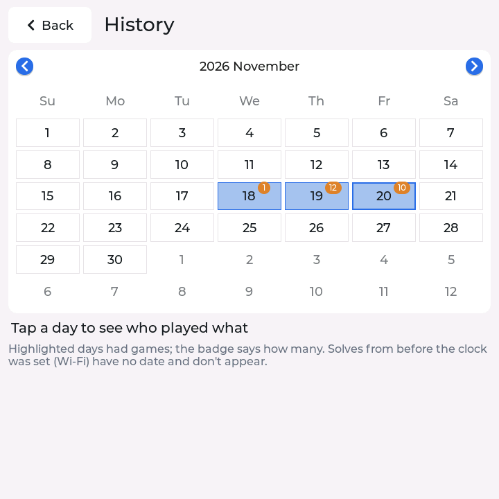 | 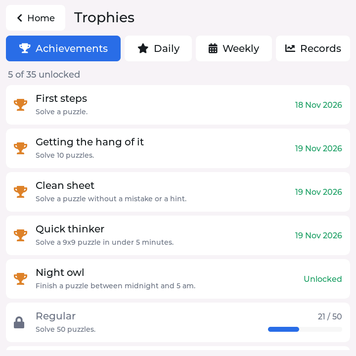 |
| **Records** | **Daily leaderboard** | **Gameplays** |
| 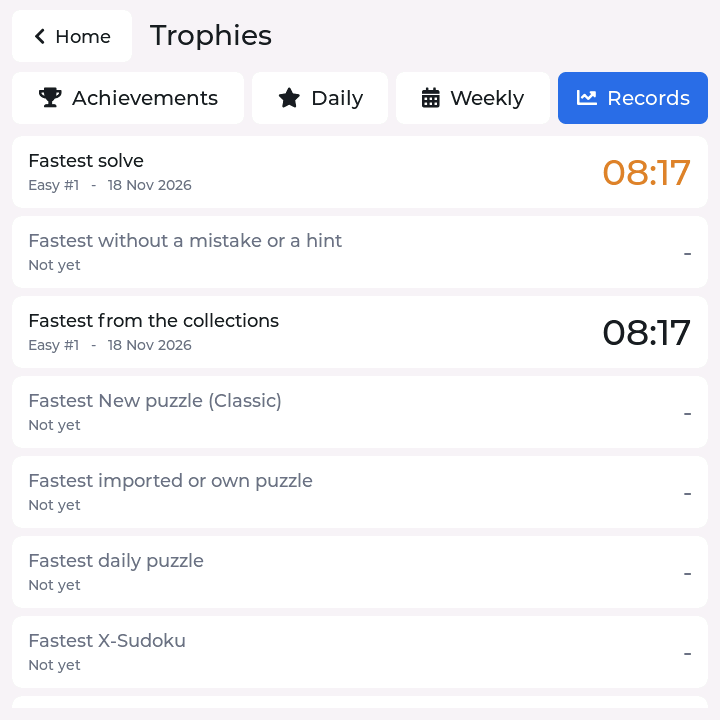 | 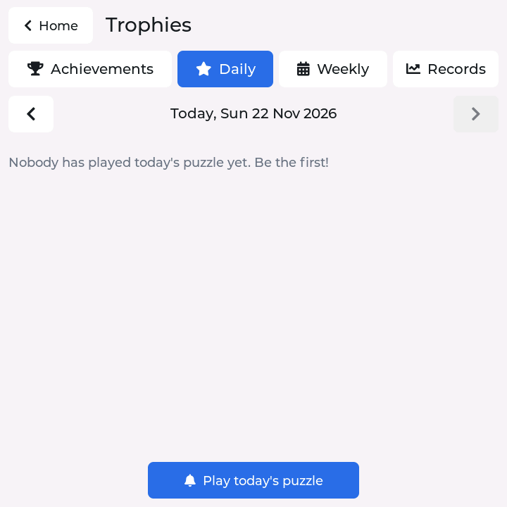 | 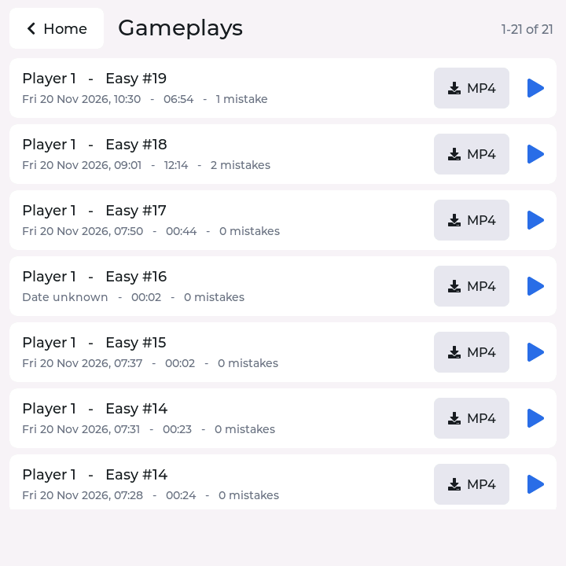 |
| **Replay** | **Progress chart** | **Weekly leaderboard** |
| 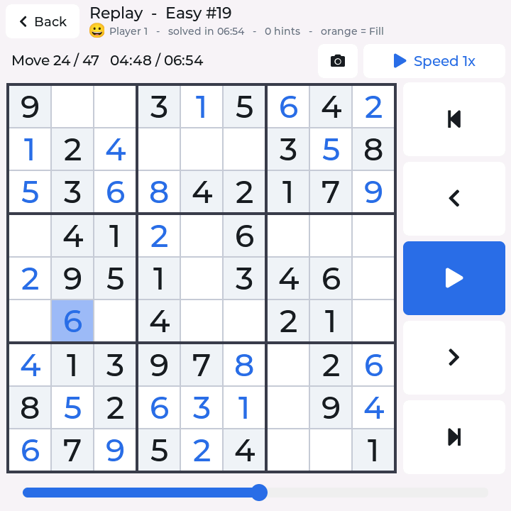 | 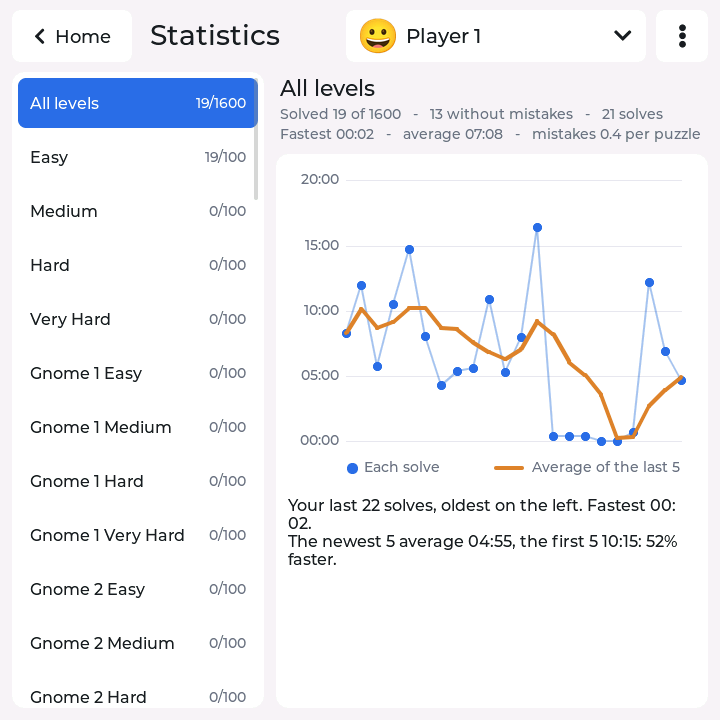 | 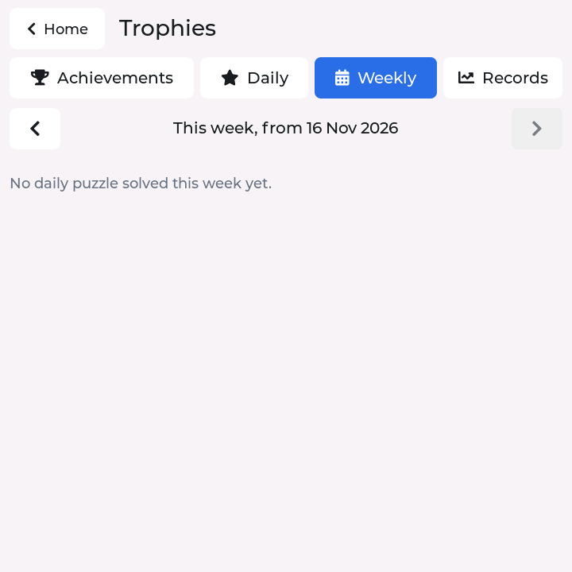 |

## Features

- **Players**: the **Players** screen lists everyone who plays on the board, with their solved puzzles and solves. Tap a player to play as them. The ⋮ button at the top right opens a menu: **Add player** and **Rename player** ask for a name on an on-screen keyboard (names are unique, ignoring case), **Avatar** picks an emoji (see **Avatars**), and **Delete player** deletes a player with their statistics, solve history and game in progress, after a confirmation. Rename, Avatar and Delete are for the player who is playing: to change someone else, tap their row first. The last player can't be deleted (Delete is greyed out), and deleting the one playing hands over to the first player left. Each player has their own statistics and their own game in progress, and every solve records who solved it. The Statistics screen has a player dropdown at the top left (their avatar, or a person icon, and their name; the open list shows everyone's avatar): it shows whose statistics these are, and picking another player switches to them. Players are kept in `sudoku.db`; without a card there is just one player.
- **Player colours**: each player has a colour, shown as a dot by their name on the **Players** screen and the Daily and Weekly leaderboards. Tap the dot on the Players screen for the next of eight colours (`players.color`; new players get one by turn).
- **Avatars**: **Players → ⋮ → Avatar** picks an emoji for the player who is playing, from all of Noto Color Emoji (1867 of them, without the skin-tone variants), in a grid that scrolls; the row of nine emoji at its top jumps to a group (smileys, people, animals, food, travel, activities, objects, symbols, flags), the current one is outlined, and **None** takes it off. It shows wherever the player does: the Players screen (on a circle of the player's colour, instead of the dot), Home's **Players** button, the Statistics player dropdown, the Daily and Weekly leaderboards, the Time attack leaderboard, History's day list, **Gameplays**, the Replay screen (and so in exported MP4s) and the Solved dialog's head-to-head line (the leader's). Without an avatar, the player's colour dot shows in its place. Kept in `sudoku.db` (`players.avatar`); the emoji are 36 px images in flash (about 7 MB, `src/avatars.c`).
- **Statistics**
  - The player list in the title row, next to the ⋮ menu, picks whose statistics are shown (picking a player also makes them the one playing, as on **Players**).
  - A mistake is a placed digit that breaks a row, column or box rule: the ones that buzz and turn red. With Mistake check on **Solution**, a digit that isn't the solution's is a mistake too; with it **Off**, rule-breaking digits are still counted, just not shown. Undo doesn't take a mistake back. The count is saved with the game in progress and shown in the "Solved!" dialog.
  - **All levels** compares the 16 levels and the puzzles made on the board: puzzles solved, fastest and average best time, and average mistakes.
  - Each level lists its solved puzzles with the best time, the fewest mistakes in any solve, and how many times it was solved.
  - Below the 16 collections (the column scrolls), <!-- gen:stats-row-count -->seventy-nine<!-- /gen:stats-row-count --> more rows cover the puzzles made on the board: <!-- gen:stats-rows -->**New puzzles** (Classic from New puzzle), **Daily puzzle**, **X-Sudoku**, **Hyper**, **Jigsaw**, **Killer**, **Anti-Knight**, **Even-Odd**, **Consecutive**, **Thermo**, **Sandwich**, **Mini 6x6**, **Kids 4x4**, **Anti-King**, **Non-Consecutive**, **Disjoint Groups**, **Asterisk**, **Kropki**, **XV**, **Greater-Than**, **Quadruple**, **Arrow**, **Renban**, **German Whispers**, **Skyscraper**, **Little Killer**, **Palindrome**, **Region Sum Lines**, **X-Sums**, **Zipper Lines**, **Frame**, **Between Lines**, **Entropic Lines**, **Modular Lines**, **Center Dot**, **Outside Sudoku**, **Rossini**, **Diagonal Non-Consecutive**, **Dutch Whispers**, **Parity Lines**, **Slow Thermo**, **Fortress**, **Argyle**, **Nabner**, **Numbered Rooms**, **Sum Skyscrapers**, **Lockout Lines**, **Sumless Killer**, **Double Arrow**, **Diagonal Consecutive**, **10 Lines**, **Girandola**, **159 Sudoku**, **Product Killer**, **Extra Regions**, **Anti-Diagonal**, **Pill Arrows**, **Odd/Even Skyscrapers**, **Chess Sudoku**, **Magic Square**, **Average Lines**, **Dutch Flatmates**, **Mathrax**, **Point Symmetry**, **Before Nine**, **Quadro**, **Anti-Queen 9s**, **Next to Nine**, **Clone Sudoku**, **Search Nine**, **Battlefield**, **Sequence Lines**, **Battenburg**, **Mini 8x8**, **Jigsaw 7x7**, **Jigsaw 6x6**, **Jigsaw 8x8**, **Weak Palindrome** and **Calcudoku Killer**<!-- /gen:stats-rows -->, each with its count of puzzles solved. Their page has one row per level (Easy, Medium, Hard, Expert) with the same columns as All levels, and **Chart** shows their newest solves. They need `sudoku.db`.
  - Above the table: solved count, puzzles solved without a mistake, total solves, fastest and average time.
  - Puzzles solved before this version show "-" for mistakes and count as solved once.
  - **⋮ → About statistics** explains what the numbers mean and where they come from.
- **Progress chart**: **⋮ → Chart** on the Statistics screen (the ⋮ button at the top right: **Insights**, **Chart**, **About statistics**; Chart reads **Table** while the chart is shown) swaps the table for a chart of your newest 40 solves at the selected level (**All levels**: any puzzle, generated ones included), oldest on the left. Each solve is a dot; the orange line is the average of the last 5; minutes run up the side. Under it: your fastest time, and with 10 or more solves, how the newest 5 compare with the first 5 shown ("36% faster"). **Table** switches back. It needs `sudoku.db`.
- **Mistake insights**: **⋮ → Insights** on the Statistics screen looks through the move logs of your last 300 solves (9×9) and shows how many of the digits you placed by hand were wrong, which digits you misplace most (a bar each), where on the board (the nine boxes, the more mistakes the redder) and your most common mix-ups ("A 3 where a 9 belongs: 4 times"). A solved game's last board is its solution, so nothing has to be solved again.
- **This week**: the home screen's "puzzles solved" line also says how many you solved this week (Monday to Sunday) and your best time; tap it to compare with last week: solved, fastest, average time, mistakes per puzzle and hints, with a line on how you did ("0.5 fewer mistakes per puzzle, and 1:20 faster on average than last week"). It needs the clock (Wi-Fi).
- **History**: **History** on the home screen shows a calendar (‹ › change the month). Days on which anyone finished a puzzle or started one that is still in progress are highlighted. A small orange badge on each highlighted day shows how many games that was (puzzles solved plus games in progress started that day). Tap a day for who played what: player, level and puzzle number, time taken, mistakes, hints, and when it was started and solved (or "in progress"). Dates are local, in the time zone from Settings, and come from `sudoku.db`; solves from before the clock was set (Wi-Fi/NTP) have no date and don't appear.
- **Trophies**: **Trophies** on the home screen (the line under it counts your achievements) has four tabs. **Daily** and **Weekly** need today's date: like Home's **Daily puzzle** button, they are greyed out until Wi-Fi is connected and the clock is set, and the page opens on **Achievements** meanwhile.
  - **Achievements**: 40 of them per player, worked out from the solves in `sudoku.db`: solve counts, clean solves, speed, the time attack, the variants, the daily puzzle and its streaks, the collections, the techniques and the no-notes challenge. Unlocked ones show a trophy and the date. The others show a lock, and their progress where there is a count to show (a bar and "3 / 10", "4 / 7 days", "2 h 5 min / 10 h"). Newly unlocked ones pop up at the top of the screen with a chime. Every one, with what it asks for and its key: [Achievements](achievements.md).
  - **Daily**: the leaderboard of the daily puzzle, today first; ‹ › go to other days. Everyone's best time on that day's puzzle (whenever they solved it), fastest first (ties: fewer mistakes, then fewer hints), with mistakes, hints and how often they solved it; you are outlined, the leader gets a star, and players who haven't solved it are listed last. **Play today's puzzle** opens it if you haven't solved it yet. Solving the daily puzzle also tells you your place: "You're 2nd of 3 today".
  - **Weekly**: the week's daily puzzles (Monday to Sunday) added up per player: how many of the 7 they solved (a green square per day), and the sum of their best times on those; more days first, then less time. ‹ › go to other weeks.
  - **Records**: your personal bests, each with the puzzle and date it was set on: the fastest solve, the fastest without a mistake or a hint, the fastest from the collections, of New puzzles, of daily puzzles and of each variant (<!-- gen:record-variants -->X-Sudoku, Hyper, Jigsaw, Killer, Anti-Knight, Even-Odd, Consecutive, Thermo, Sandwich, Mini 6x6, Kids 4x4, Anti-King, Non-Consecutive, Disjoint Groups, Asterisk, Kropki, XV, Greater-Than, Quadruple, Arrow, Renban, German Whispers, Skyscraper, Little Killer, Palindrome, Region Sum Lines, X-Sums, Zipper Lines, Frame, Between Lines, Entropic Lines, Modular Lines, Center Dot, Outside Sudoku, Rossini, Diagonal Non-Consecutive, Dutch Whispers, Parity Lines, Slow Thermo, Fortress, Argyle, Nabner, Numbered Rooms, Sum Skyscrapers, Lockout Lines, Sumless Killer, Double Arrow, Diagonal Consecutive, 10 Lines, Girandola, 159 Sudoku, Product Killer, Extra Regions, Anti-Diagonal, Pill Arrows, Odd/Even Skyscrapers, Chess Sudoku, Magic Square, Average Lines, Dutch Flatmates, Mathrax, Point Symmetry, Before Nine, Quadro, Anti-Queen 9s, Next to Nine, Clone Sudoku, Search Nine, Battlefield, Sequence Lines, Battenburg, Mini 8x8, Jigsaw 7x7, Jigsaw 6x6, Jigsaw 8x8, Weak Palindrome, Calcudoku Killer<!-- /gen:record-variants -->; daily puzzles count for their variant), of imported puzzles, the most solves in a day, the most clean solves (no mistake, no hint) in a row, the longest daily streak, puzzles solved and time spent solving.
- **Head-to-head**: the Solved dialog says how the other players did on the same puzzle: "2nd of 3 - Bo leads with 06:20", "★ 1st of 2: ahead of Bo (07:45)", or "Nobody else has solved this one yet" (best times, from `sudoku.db`).
- **Share a daily result**: after solving the daily puzzle, the QR button at the top right of the Solved dialog shows the result as a QR code: the day, the kind of puzzle, who solved it, the time, mistakes, hints and whether it was a no-notes solve. Scan it with a phone to send it to friends who play the same daily puzzle on their own boards.
- **Replay**: every digit you put in or take out is recorded in order, with the game clock and how it got there: the number pad, **Fill**, **Erase**, **Undo** or **Redo** (pencil marks are not recorded). After solving, **Replay** in the "Solved!" dialog plays the game back; in History, tap a solve marked "Tap to replay"; or open **Gameplays** on the home screen, which lists every recorded game (newest first, 40 per page with **Newer** / **Older**) with player, puzzle, date, time, mistakes and hints, and tap one. The Replay screen has play/pause, one move back or forward, jump to start or end, a slider to scrub through the game, and 1x/2x/4x/8x speed. Playback follows the game clock, with pauses longer than 2 seconds shortened. Digits from Fill show orange, the last move is highlighted, and digits that break a rule show red. The log is saved with the game in progress (so a resumed game keeps it) and with the solve. Solves from before this version have no log. Up to 2048 moves per game are kept.
- **Export as video**: on **Gameplays**, the **MP4** button of a game saves its replay as a video on the microSD card, in `replays/` (named after the player, puzzle and when it was solved, e.g. `replays/Abi_Gnome-2-Hard-12_20261118-1405.mp4`). The video shows the Replay screen as it plays: the board filling in, the slider and the move counter moving. It holds the start for 1 s, plays at twice the replay speed (pauses already shortened to 2 s), and holds the solved board for 3 s; 720×720, 15 fps, H.264 in MP4, made by the ESP32-P4's hardware video encoder; the colour conversion for it (RGB to YUV) is done by the PPA, by DMA, about 4 times faster than on the CPU. The Replay screen is drawn on an invisible second display in memory while a progress dialog (with **Cancel**) shows on the real screen. Copy the video to a computer with **Settings → USB drive**.
- **Export to CSV**: **Settings → Export to CSV** writes `export/solves.csv` (every solve: player, puzzle, level, number, seconds, mistakes, hints, started, finished, in local time), `export/achievements.csv` (every player and achievement: progress, goal, unlocked and when) and `export/records.csv` (every player's records) on the microSD card, for a spreadsheet. Copy them off with **Settings → USB drive**.
