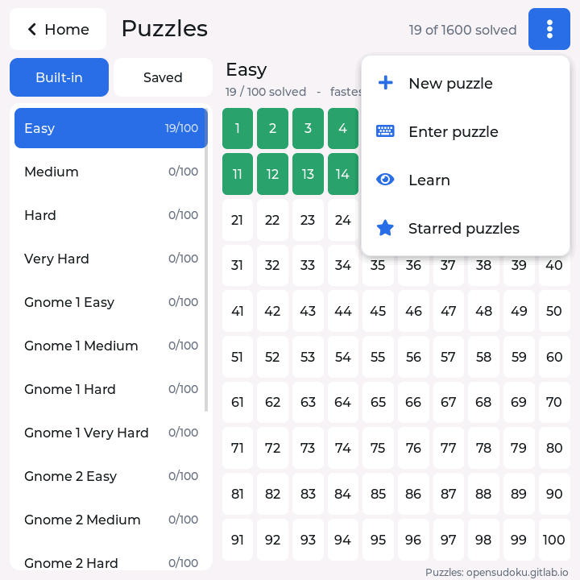
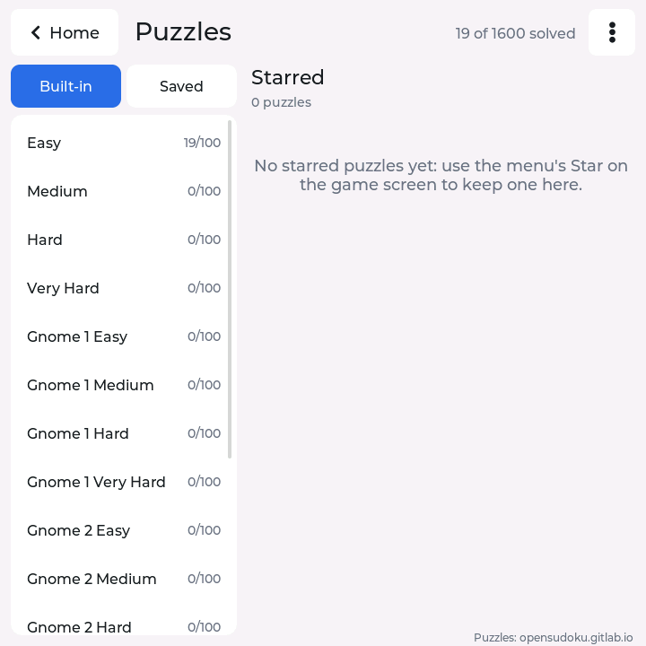
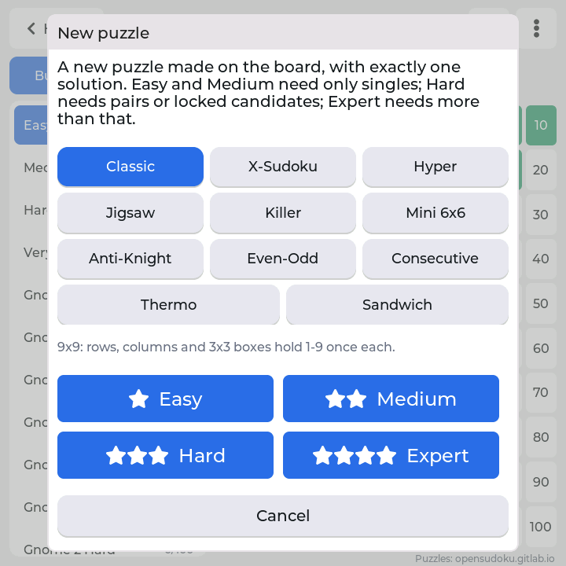
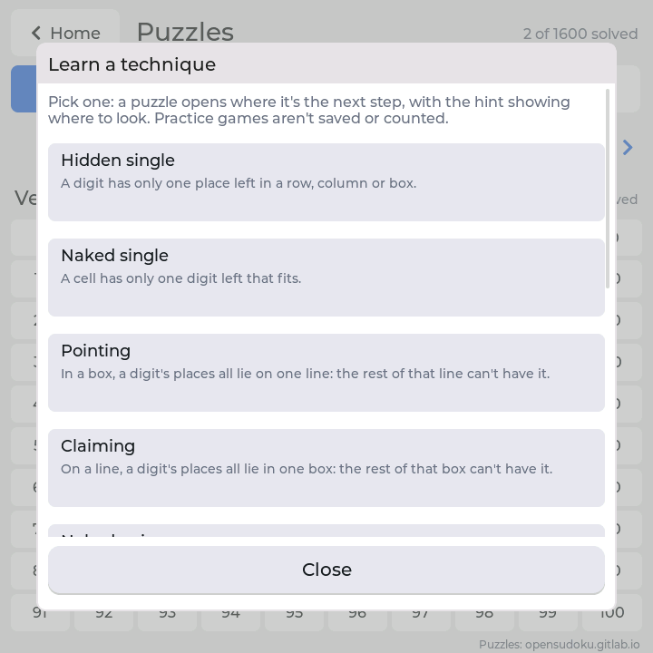
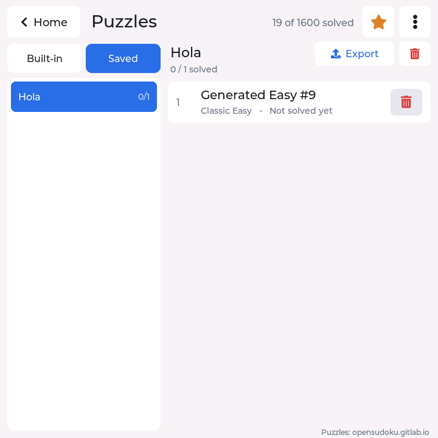

# Puzzles

[← README](../README.md) · [Features](features.md) · [How to play](how-to-play.md) · [Data & storage](data.md) · [Building](building.md) · [Development](development.md) · [Remote control](devctl.md)

The puzzles on the board and where they come from: the built-in collections, the Puzzles screen, puzzles made on the board, the daily puzzle, Learn, typing one in, importing, saving and starring.

| **Puzzles** | **The ⋮ menu** | **Starred** |
|---|---|---|
|  |  |  |
| **New puzzle** | **Learn** | **Enter a puzzle** |
|  |  |  |
| **Saved tab** | | |
|  | | |

## Features

- **1600 puzzles in flash**: the 16 OpenSudoku collections from <https://opensudoku.gitlab.io/>. These are Easy, Medium, Hard and Very Hard, plus Gnome Sudoku sets 1–3 at each of those levels. Each puzzle is packed into 41 bytes, about 64 KB in total. Every puzzle was checked to have exactly one solution.
- **Puzzles screen**: two panes under the title row. On the left, the collections in a column that scrolls (name and solved count), under two tabs: **Built-in** (the 16 collections in the firmware) and **Saved** (your own: the saved collections and the imported ones). On the right, the selected collection: its name, solved count, fastest and average time, and its puzzles. The title row has the solved total, **Starred** (a star toggle, see **Starred puzzles**) and a ⋮ menu with **New puzzle**, **Enter puzzle** and **Learn**. Each tab remembers the collection last shown in it; Saved with nothing in it says how to save one. Built-in collections show their 100 puzzles as numbered buttons; in **Saved** a collection is a list instead, a row per puzzle: its number, its name ("Killer Easy #3", "My puzzles #2"), variant and level, and Solved, In progress or Not solved yet; tap a row to play it. In a saved collection each row has a red trash button that takes the puzzle out (the game screen's Save puts it back). The red trash button right of the collection's name (next to **Export**) deletes the whole collection, saved or imported, after asking: only the collection goes; its puzzles stay on the board with their solves, History and Gameplays, and an imported collection's file can be imported again.
- **Puzzle list**
  - The collections are in the left pane, a column that scrolls, each with its solved count (green when all are solved); the selected one is blue. Back from a game, the column shows that game's collection.
  - Its puzzles 1–100 fill the right pane, ten to a row. Solved ones are green and the game in progress is orange.
  - Above them: the collection's name, how many are solved, and its fastest and average solve time.
- **Starred puzzles**: the star next to **Share** on the game screen bookmarks the puzzle (it turns orange); tap it again to take the star off. The star button in the Puzzles screen's title row is a toggle: on (blue), the right pane lists the starred puzzles, newest first, with the best time, In progress or "Not solved yet"; tap one to open it, or its orange star to take the star off. Tap the star button again, or a collection, to go back to the collection. Per player, in `sudoku.db` (`bookmarks`); not for Learn's practice games or puzzles kept only in RAM.
- **New puzzle (generator)**: besides the 1600 built-in puzzles, **Puzzles → ⋮ → New puzzle** makes a fresh one on the board at the level you pick. It fills a random complete grid, then takes clues away in symmetric pairs as long as exactly one solution remains, and grades the result the way a person would solve it: **Easy** and **Medium** need only singles (Easy keeps 36 or more clues), **Hard** needs locked candidates (pointing/claiming) or naked/hidden pairs, **Expert** needs more than that. It takes well under a second; if a level can't be hit after many tries, you get the closest one and a note saying so. **Next** in the "Solved!" dialog makes another one of the same level. Generated puzzles are named "Generated Hard #12" and so on, are saved in `sudoku.db` (table `generated`), and work everywhere the built-in ones do: continue, History, Gameplays, Replay and MP4 export. They don't count in the per-level tables on the Statistics screen. Without a microSD card they last until power-off.
- **Variants: X-Sudoku, Hyper, Jigsaw, Killer, Mini 6×6, Anti-Knight, Even-Odd, Consecutive, Thermo, Sandwich and Kids 4×4**: the **New puzzle** dialog has rows of buttons above the levels: **Classic**, **X-Sudoku**, **Hyper** / **Jigsaw**, **Killer**, **Mini 6x6** / **Anti-Knight**, **Even-Odd**, **Consecutive** / **Thermo**, **Sandwich**, **Kids 4x4** (the choice stays until power-off).
  - **Rules card**: the light bulb button in the game's second row (next to Hint) shows the rules of the puzzle's variant with a small drawn example (a cage with its sum, a knight's crossed-out cells, a thermometer, and so on). It also opens by itself the first time each variant other than Classic is played (`settings.rules_seen` remembers which).
  - **X-Sudoku**: a 9×9 board where the two main diagonals must also hold 1–9 once each. The diagonal cells have a warm tint. A digit that repeats on a diagonal turns red like any other conflict, and completing a diagonal plays the sparkle. Hints know the diagonals too ("Look at the top-left diagonal: ..."; the top-left diagonal runs from the top-left corner, the top-right one from the top-right corner).
  - **Hyper** (Windoku): a 9×9 board with four extra 3×3 windows (rows and columns 2–4 and 6–8), tinted like the X diagonals, that must also hold 1–9 once each. Conflicts, sounds and hints count them ("Look at the top-left window: ...").
  - **Jigsaw**: a 9×9 board whose nine boxes are irregular regions of 9 connected cells, outlined with thick borders; every puzzle has its own shapes. The generator starts from the 3×3 boxes and trades cells across region borders (keeping each region in one piece), then fills and digs as usual; a shape that's slow to fill is dropped for another. Hints call the regions "region 1" to "region 9". The region map is kept in `generated.regions`.
  - **Killer**: Classic rules plus cages, groups of 2 to 5 (Easy and Medium: 2 to 3) connected cells outlined with a dashed line, with their sum small in the top-left corner: a cage's digits add up to its sum and none repeats. There are few givens (Easy 8 to 12, Medium 2 to 4, Hard and Expert whatever the uniqueness needs). A cage whose digits go over its sum, or that is full and short of it, turns red, and so does a repeated digit in a cage. Pencil marks are smaller in Killer, below the sum. The grader and hints know cage sums: for each cage, its empty cells keep only the digits of the sets of different digits that make up what's left of its sum ("The cage at row 3, column 4 adds up to 11: ... its empty cells can only be 2, 9"); that counts as a simple step, alongside singles. The cages are kept in `generated.cages` as `sum:cell,cell,...;sum:...` (cells 0–80 row by row).
  - **Anti-Knight**: Classic rules, and two cells a chess knight's move apart never hold the same digit; such a repeat turns red like any other conflict.
  - **Even-Odd**: Classic rules; about a third of the cells are marked: shaded cells hold an even digit, cells with a ring an odd one. A digit of the wrong kind turns red. The marks are kept in `generated.marks` (`e`, `o` or `.` per cell).
  - **Consecutive**: Classic rules; an orange bar sits on the line between every two side-by-side cells whose digits are 1 apart, and where there's no bar, they aren't. Puzzles need few givens (Expert: about 4). Two digits that break that turn red. The grader and hints use the bars ("The bars around row 4, column 2 (and where there are none) leave it only 3, 5"), as a simple step. The bars are kept in `generated.marks` (per cell `0`–`3`: 1 = a bar to the right, 2 = a bar below).
  - **Thermo**: Classic rules, and thermometers (a soft grey line from a round bulb, through cells side by side or diagonal): along each one the digits rise from the bulb. 7 thermometers of 3 to 6 cells (Hard and Expert: up to 10). Two digits along one that don't rise turn red. The grader and hints narrow each thermometer cell from both ends ("Along the thermometer the digits rise from the bulb, so row 2, column 5 can only be 4, 5"), as a simple step. The thermometers are kept in `generated.thermos` (`cell,cell,...;...`, each from its bulb).
  - **Sandwich**: Classic rules, and a number left of each row and above each column gives the sum of the digits between that line's 1 and 9 (0: they're side by side). The board is a little smaller to make room for the sums. Between a 1 and a 9 that add up to more, or (all filled) to anything else, the digits turn red. The grader and hints work out where a line's 1 and 9 can stand for its sum, as a simple step. The 18 sums are kept in `generated.marks` (rows, then columns, comma-separated).
  - **Mini 6×6**: a 6×6 board with 2×3 boxes (two rows, three columns) and digits 1–6, with bigger cells and a six-button number pad. Easy keeps 16 or more clues.
  - **Kids 4×4**: for younger players: a 4×4 board with 2×2 boxes and digits 1–4, big cells with big digits (96 px), a four-button number pad and pencil marks two by two. Easy keeps 8–10 of the 16 cells, Medium fewer (about 5); Hard and Expert are greyed out, since a 4×4 board never needs their techniques. Its own rules card, statistics row (**Kids 4x4**), record (**Fastest Kids 4x4**) and `.sdx` name (`Kids 4x4`, variant 11).
  - All are made, graded and hinted by the same generator as Classic, at all four levels. For the variants, Medium and Hard keep a clue whenever taking it away would need harder techniques, so nearly every attempt lands on the level asked for. Classic puzzles, and so the daily puzzle, come out exactly as before for the same seed. The daily puzzle is always Classic.
  - They are named "X-Sudoku Hard #14", "Hyper Medium #16", "Jigsaw Expert #17", "Killer Hard #18" or "Mini Easy #15" and work everywhere a generated puzzle does: **Next** makes another of the same variant and level, and Continue, History, Gameplays, Replay and MP4 export all show the right board. Their solves are logged with level "X-Sudoku Hard", "Jigsaw Easy" etc.; `generated.variant` holds the variant.
- **Daily puzzle**: the **Daily puzzle** button on the home screen opens today's puzzle: one a day, the same for every player, made from the date, with a variant and level that follow the weekday: Monday Classic Easy, Tuesday Mini 6×6 Medium, Wednesday X-Sudoku Medium, Thursday Hyper Hard, Friday Killer Medium, Saturday Jigsaw Hard, Sunday Classic Expert. A day's puzzle, once made, stays what it was (days made before this version are Classic). Under the button: today's variant and level and your streak, the days in a row you solved the daily puzzle (it ends today, or yesterday if today's isn't solved yet). Solving it shows the new streak. It needs the date, so the button is greyed out (and says so) until Wi-Fi is connected and has set the clock. Daily puzzles are stored like generated ones, with their date (`generated.day`), and their solves are logged with level "Daily Easy" etc.
- **Learn**: **Learn** in the Puzzles screen's ⋮ menu lists ten techniques (hidden single, naked single, pointing, claiming, naked pair, hidden pair, naked triple, X-Wing, Swordfish, XY-Wing) and, under **Variant rules**, four lessons on the variants' own rules (Killer cage, Thermometer, Sandwich clue, Consecutive bars), with a line or two on each (the list scrolls). For a variant lesson a new puzzle of that kind is made on the spot (a few seconds) and kept only in RAM: nothing is added to `sudoku.db`. Pick one, and a built-in puzzle opens at a point where that technique is the next step (found by playing puzzles forward with the hint engine; for the last four, which the hint engine seldom reaches first, any point where the technique opens up a single will do; the rarer ones can take a few seconds), with the hint card showing where to look: **More** explains it, **Place it** does it. The title says "Practice: Naked pair". Practice games aren't saved, recorded or counted.
- **Enter a puzzle**: **Enter puzzle** in the Puzzles screen's ⋮ menu opens a blank board with a 1–9 pad, to type in a Classic puzzle from a book or a newspaper: tap a cell, then a digit (the selection moves on to the next cell; the same digit again clears it; **Erase**, **Clear**). Digits that break a rule turn red. **Check & play** needs at least 17 digits and exactly one solution (the solver counts them; it says if there is none or more than one), rates it with the same grader as generated puzzles, saves it as "My puzzles #1", "#2" ... (`sudoku.db`, `generated` with `source` = "My puzzles"; RAM only, until power-off, without a card) and opens it like any other puzzle.
- **Imported puzzles**: put `.opensudoku` (OpenSudoku's XML, `data="..."` or `data='...'`), `.sdm` / `.txt` files (a puzzle per line, 81 digits, `0` or `.` = empty) or `.sdx` files (a saved collection exported by this board, any variant: see **Export a saved collection**) in a `puzzles/` folder on the card (copy them over with **Settings → Data → USB drive**), then **Settings → Data → Import puzzles**. Each puzzle is checked for exactly one solution, under its own variant's rules for `.sdx` (others are left out), and each file becomes a collection named after it, in the Puzzles screen's **Saved** tab, marked "(imported)"; a file of more than 100 puzzles makes several ("name 1", "name 2" ...). Up to 2000 puzzles per import; a file already imported is skipped. A single `.sdm`, `.sdx` or `.opensudoku` file can also be imported from anywhere on the card: open it in **Files** (see **Puzzle file preview** in [Home, settings & system](features-settings.md)) and tap **Import**. Their puzzles are named "name #12", play like any other (unfinished games, History, Gameplays, Replay, **Next** goes on through the collection), and their solves are logged with the collection as their level. They are kept in `sudoku.db` (`generated.source` and `number`, and the `imported` table).
- **Saved collections**: on the game screen, **Save** (the disk icon next to the star) appears for puzzles made on the board: generated ones (New puzzle, the daily puzzle, the variants) and ones typed in with **Enter** (not built-in or imported ones, which belong to a collection already, nor Learn's practice or puzzles kept only in RAM). It lists your collections, ticked where the puzzle is already, with the number of puzzles in each: tap one to put the puzzle in it, or to take it out again; **New collection...** asks for a name (the on-screen keyboard; not a built-in or imported collection's name) and puts the puzzle there. The icon turns blue while the puzzle is in a collection. Up to 16 collections of up to 100 puzzles; a collection goes when its last puzzle is taken out. They are shared by all players (each sees their own solved puzzles in them), kept in `sudoku.db` (`saved_collections`, `saved_puzzles`). A puzzle opened from a saved collection goes back to it (**List**), and **Next** in the Solved! dialog goes on through it.
- **Export a saved collection**: on the **Saved** tab, a saved collection has **Export** (right of its name): it writes `puzzles/<name>.sdx` on the card (characters a file name can't hold become `_`; an older file of that name is replaced). **Import puzzles** reads it back, on this board or another, as an imported collection of the same name, every variant included (Jigsaw regions, Killer cages, Even-Odd and Consecutive marks, Thermo lines, Sandwich sums; X-Sudoku, Hyper, Mini and Anti-Knight need nothing more). Only the puzzles go (their givens and level), not solves or games in progress. A file that was imported once is skipped after that, so rename it to import it again. The format, for other tools: lines starting with `#` are comments, then one puzzle per line, fields split by `|`:

  ```
  variant|level|givens|regions|cages|marks|thermos
  Hyper|Hard|010800006000000130000007000290000040304000809080000073000100000032000000100003050||||
  Killer|Easy|000000006...000000000||12:0,1;10:2,11,20;17:3,12,21;...||
  ```

  `variant` is a name (Classic, X-Sudoku, Mini 6x6, Hyper, Jigsaw, Killer, Anti-Knight, Even-Odd, Consecutive, Thermo, Sandwich, Kids 4x4) or its number 0–11; `level` Easy, Medium, Hard or Expert (or 0–3); `givens` 81 digits row by row (`0` or `.` empty; Mini uses the top-left 6×6); `regions` a Jigsaw's 81 digits 0–8; `cages` a Killer's `sum:cell,cell,...;...`; `marks` 81 characters (Even-Odd `.`/`e`/`o`, Consecutive `0`–`3`) or a Sandwich's 18 sums `n,n,...`; `thermos` `cell,cell,...;...` from each bulb (cells 0–80 row by row). Fields a variant doesn't use are empty, and trailing ones can be left off; a line of just 81 digits is a Classic puzzle.
- **Unfinished games**: with `sudoku.db`, each player keeps up to 5 unfinished games. Opening another puzzle no longer asks to discard the current one: that one stays saved, and the new one is resumed if you'd started it before, or begun. **Continue** resumes the one played last, or, when there are several, lists them (played last first) with time, cells filled and when you last played; tap one to resume it, or the red trash button to discard it. Starting a 6th drops the one played longest ago, and a note says so. The puzzle list shows every unfinished game in orange. Without a card there is one slot, as before: starting another puzzle asks whether to resume or discard the one in it.
