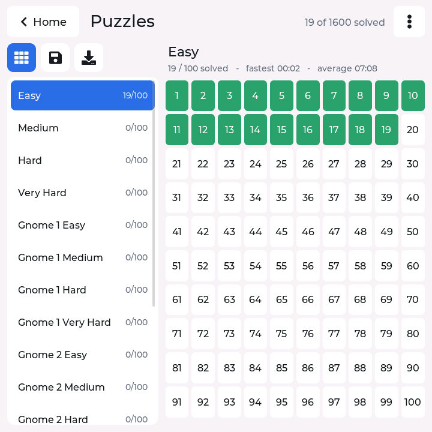
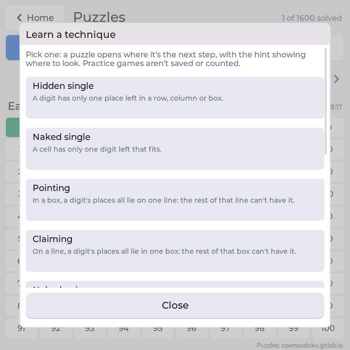
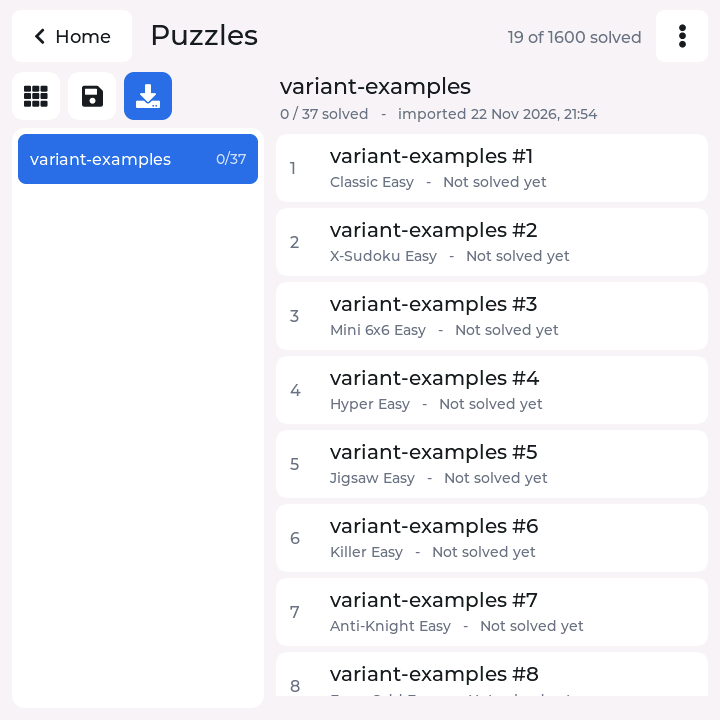

# Puzzles

[← README](../README.md) · [Features](features.md) · [How to play](how-to-play.md) · [Data & storage](data.md) · [Building](building.md) · [Development](development.md) · [Remote control](devctl.md)

The puzzles on the board and where they come from: the built-in collections, the Puzzles screen, puzzles made on the board, the daily puzzle, Learn, typing one in, importing, saving and starring.

| **Puzzles** | **The ⋮ menu** | **Starred** |
|---|---|---|
|  |  |  |
| **New puzzle** | **Learn** | **Enter a puzzle** |
|  |  |  |
| **Saved tab** | **Imported tab** | |
|  |  | |

## Features

- **1600 puzzles in flash**: the 16 OpenSudoku collections from <https://opensudoku.gitlab.io/>. These are Easy, Medium, Hard and Very Hard, plus Gnome Sudoku sets 1–3 at each of those levels. Each puzzle is packed into 41 bytes, about 64 KB in total. Every puzzle was checked to have exactly one solution.
- **Puzzles screen**: two panes under the title row. On the left, the collections in a column that scrolls (name and solved count), under three tabs, shown as icons: **Built-in** (a 3×3 grid: the 16 collections in the firmware), **Saved** (a floppy disk, like the game menu's **Save to collection**: your own, made on the board) and **Imported** (a download arrow, like the **Import** buttons: the ones imported from the card). On the right, the selected collection: its name, solved count, fastest and average time, and its puzzles. The title row has the solved total and a ⋮ menu with **New puzzle**, **Enter puzzle**, **Learn**, **Starred puzzles** (see **Starred puzzles**), **Export collection** and **Delete collection**; the last two act on the collection shown and are dimmed where they don't apply (the Built-in tab, Starred; Export: saved collections only). Each tab remembers the collection last shown in it; Saved or Imported with nothing in it says how to save or import one. Built-in collections show their 100 puzzles as numbered buttons; in **Saved** and **Imported** a collection is a list instead, a row per puzzle: its number, its name ("Killer Easy #3", "My puzzles #2"), variant and level, and Solved, In progress or Not solved yet; tap a row to play it. In a saved collection each row has a red trash button that takes the puzzle out (the game screen's Save puts it back). **Delete collection** in the ⋮ menu deletes the whole collection shown, saved or imported, after asking: only the collection goes; its puzzles stay on the board with their solves, History and Gameplays, and an imported collection's file can be imported again.
- **Puzzle list**
  - The collections are in the left pane, a column that scrolls, each with its solved count (green when all are solved); the selected one is blue. Back from a game, the column shows that game's collection.
  - Its puzzles 1–100 fill the right pane, ten to a row. Solved ones are green and the game in progress is orange.
  - Above them: the collection's name, how many are solved, and its fastest and average solve time.
- **Solved before, under another name**: starting a puzzle you've already solved as another one, the same givens turned, mirrored or with the digits renumbered, a notice says so: "You've solved this puzzle before, as Gnome 2 Easy #14 on 12 Mar 2026". It works across the built-in collections, puzzles made on the board and imported ones, for every variant, each compared only under the turns, mirrors and renumberings its rules allow: Classic and the variants whose rules don't care which digit is which renumbered any way; those whose rules do (Point Symmetry, Non-Consecutive, Diagonal Non-Consecutive, Magic Square, Dutch Flatmates, 159 Sudoku, Quadro with odd kept odd and even even, Anti-Queen 9s with its 9s kept) only as far as their rules allow; the variants with a layout (regions, cages, clone areas, marks, circles, lines, clues) with their layout turned and mirrored along with the givens, their digits as they are where the layout's numbers need them (Jigsaw, Sumless Killer and Extra Regions renumbered any way). Pill Arrows and the clues left of the rows and above the columns only match themselves as they are or mirrored about the main diagonal, which keeps a pill reading left to right or top to bottom and the clues left and above. Each solve keeps the puzzle's canonical hash (`solves.canon`, [`src/canon_core.h`](../src/canon_core.h), which lists each variant's rules): the smallest of its allowed copies. Needs `sudoku.db`.
- **Search**: the magnifier after the three tabs opens a box to type in; the right pane then lists the puzzles whose name, variant or level has every word, in any order and case: "gnome 2 easy", "killer hard", "x-sudoku", "daily", "#14". It looks through every puzzle: those made on the board, typed in or imported first (newest first), then the 1600 built-in ones (Classic), and shows the first 100 with their variant, level and whether you've solved them; tap one to play it. The magnifier stays lit while the results show; a tab, a collection or Starred goes back. Puzzles made on the board, typed in or imported need `sudoku.db`.
- **Starred puzzles**: **⋮ → Star** on the game screen bookmarks the puzzle, and a small orange star shows after its title; the same item, now **Unstar**, takes the star off. On the Puzzles screen, **⋮ → Starred puzzles** shows the starred puzzles in the right pane, newest first, with the best time, In progress or "Not solved yet"; tap one to open it, or its orange star to take the star off. **⋮ → All puzzles** (the same item), or a collection, goes back to the collection. Per player, in `sudoku.db` (`bookmarks`); not for Learn's practice games or puzzles kept only in RAM.
- **New puzzle (generator)**: besides the 1600 built-in puzzles, **Puzzles → ⋮ → New puzzle** makes a fresh one on the board at the level you pick. The dialog has the variant buttons (below) and one row of four level buttons, each a figure growing up over the level's name: a baby for **Easy**, a child for **Medium**, a man for **Hard** and a king for **Expert** (the avatar emoji); the ✕ in its title bar, or a tap beside it, closes it. It fills a random complete grid, then takes clues away in symmetric pairs as long as exactly one solution remains, and grades the result the way a person would solve it: **Easy** and **Medium** need only singles (Easy keeps 36 or more clues), **Hard** needs locked candidates (pointing/claiming) or naked/hidden pairs, **Expert** needs more than that. While it works, a dialog says what it's making, with a progress bar. The bar is an estimate from the usual time for that variant and level on the board (see [Development](development.md#puzzle-generation-speed)): about two thirds full at the usual time, then slowing down, and it closes when the puzzle is ready. Most take well under a second, a few variants several seconds at Hard and Expert; if a level can't be hit after many tries, you get the closest one and a note saying so. **Next** in the "Solved!" dialog makes another one of the same level. Generated puzzles are named "Generated Hard #12" and so on, are saved in `sudoku.db` (table `generated`), and work everywhere the built-in ones do: continue, History, Gameplays, Replay and MP4 export. They don't count in the per-level tables on the Statistics screen. Without a microSD card they last until power-off.
- **Variants** (each has its own page with a worked example: [Variants](variants/README.md); each one is described below, in [Variants by category](#variants-by-category)): <!-- gen:variant-links-docs -->**[X-Sudoku](variants/x-sudoku.md), [Mini 6×6](variants/mini-6x6.md), [Hyper](variants/hyper.md), [Jigsaw](variants/jigsaw.md), [Killer](variants/killer.md), [Anti-Knight](variants/anti-knight.md), [Even-Odd](variants/even-odd.md), [Consecutive](variants/consecutive.md), [Thermo](variants/thermo.md), [Sandwich](variants/sandwich.md), [Kids 4×4](variants/kids-4x4.md), [Anti-King](variants/anti-king.md), [Non-Consecutive](variants/non-consecutive.md), [Disjoint Groups](variants/disjoint-groups.md), [Asterisk](variants/asterisk.md), [Kropki](variants/kropki.md), [XV](variants/xv.md), [Greater-Than](variants/greater-than.md), [Quadruple](variants/quadruple.md), [Arrow](variants/arrow.md), [Renban](variants/renban.md), [German Whispers](variants/german-whispers.md), [Skyscraper](variants/skyscraper.md), [Little Killer](variants/little-killer.md), [Palindrome](variants/palindrome.md), [Region Sum Lines](variants/region-sum-lines.md), [X-Sums](variants/x-sums.md), [Zipper Lines](variants/zipper-lines.md), [Frame](variants/frame.md), [Between Lines](variants/between-lines.md), [Entropic Lines](variants/entropic-lines.md), [Modular Lines](variants/modular-lines.md), [Center Dot](variants/center-dot.md), [Outside Sudoku](variants/outside-sudoku.md), [Rossini](variants/rossini.md), [Diagonal Non-Consecutive](variants/diagonal-non-consecutive.md), [Dutch Whispers](variants/dutch-whispers.md), [Parity Lines](variants/parity-lines.md), [Slow Thermo](variants/slow-thermo.md), [Fortress](variants/fortress.md), [Argyle](variants/argyle.md), [Nabner](variants/nabner.md), [Numbered Rooms](variants/numbered-rooms.md), [Sum Skyscrapers](variants/sum-skyscrapers.md), [Lockout Lines](variants/lockout-lines.md), [Sumless Killer](variants/sumless-killer.md), [Double Arrow](variants/double-arrow.md), [Diagonal Consecutive](variants/diagonal-consecutive.md), [10 Lines](variants/10-lines.md), [Girandola](variants/girandola.md), [159 Sudoku](variants/159-sudoku.md), [Product Killer](variants/product-killer.md), [Extra Regions](variants/extra-regions.md), [Anti-Diagonal](variants/anti-diagonal.md), [Pill Arrows](variants/pill-arrows.md), [Odd/Even Skyscrapers](variants/odd-even-skyscrapers.md), [Chess Sudoku](variants/chess-sudoku.md), [Magic Square](variants/magic-square.md), [Average Lines](variants/average-lines.md), [Dutch Flatmates](variants/dutch-flatmates.md), [Mathrax](variants/mathrax.md), [Point Symmetry](variants/point-symmetry.md), [Before Nine](variants/before-nine.md), [Quadro](variants/quadro.md), [Anti-Queen 9s](variants/anti-queen-9s.md), [Next to Nine](variants/next-to-nine.md), [Clone Sudoku](variants/clone-sudoku.md), [Search Nine](variants/search-nine.md), [Battlefield](variants/battlefield.md), [Sequence Lines](variants/sequence-lines.md), [Battenburg](variants/battenburg.md), [Mini 8×8](variants/mini-8x8.md), [Jigsaw 7×7](variants/jigsaw-7x7.md), [Jigsaw 6×6](variants/jigsaw-6x6.md), [Jigsaw 8×8](variants/jigsaw-8x8.md), [Weak Palindrome](variants/weak-palindrome.md), [Calcudoku Killer](variants/calcudoku-killer.md)**<!-- /gen:variant-links-docs -->: the **New puzzle** dialog sorts them into four tabs above the levels (up to 24 buttons a tab, six rows of four), each from the easiest (top left) to the hardest (bottom right): <!-- gen:new-puzzle-tabs -->**Grids** (Kids 4×4, Mini 6×6, Mini 8×8, Classic, Center Dot, Girandola, Asterisk, X-Sudoku, Hyper, Extra Regions, Disjoint Groups, Clone Sudoku, Jigsaw 6×6, Jigsaw 7×7, Jigsaw 8×8, Jigsaw, Point Symmetry, Magic Square, Anti-Diagonal, 159 Sudoku, Argyle), **Marks** (Even-Odd, Consecutive, Greater-Than, Fortress, Quadruple, Mathrax, XV, Kropki, Anti-King, Anti-Knight, Chess Sudoku, Anti-Queen 9s, Search Nine, Dutch Flatmates, Quadro, Battenburg, Diagonal Consecutive, Non-Consecutive, Diagonal Non-Consecutive), **Lines** (Thermo, Slow Thermo, Arrow, Average Lines, Pill Arrows, Palindrome, Weak Palindrome, Renban, Parity Lines, German Whispers, Dutch Whispers, Double Arrow, Region Sum Lines, Zipper Lines, Sequence Lines, Nabner, Between Lines, Lockout Lines, 10 Lines, Entropic Lines, Modular Lines) and **Clues** (Killer, Frame, Outside Sudoku, Skyscraper, Little Killer, Product Killer, Calcudoku Killer, Sandwich, Rossini, X-Sums, Before Nine, Next to Nine, Battlefield, Odd/Even Skyscrapers, Sum Skyscrapers, Numbered Rooms, Sumless Killer)<!-- /gen:new-puzzle-tabs -->. The order is a judgement: the familiar rules and those marked on the board first, then those where a missing mark is a clue too, then the less familiar kinds. Each tab remembers the variant picked in it last, and the dialog opens on the tab and variant chosen last (until power-off).
  - **Rules card**: **⋮ → Rules** on the game screen shows the rules of the puzzle's variant with a small drawn example (a cage with its sum, a knight's crossed-out cells, a thermometer, and so on). It also opens by itself the first time each variant other than Classic is played (`settings.rules_seen` remembers which).
  - All are made, graded and hinted by the same generator as Classic, at all four levels. For the variants, Medium and Hard keep a clue whenever taking it away would need harder techniques, so nearly every attempt lands on the level asked for. Classic puzzles, and so the daily puzzle, come out exactly as before for the same seed. The daily puzzle is always Classic.
  - They are named "X-Sudoku Hard #14", "Hyper Medium #16", "Jigsaw Expert #17", "Killer Hard #18" or "Mini Easy #15" and work everywhere a generated puzzle does: **Next** makes another of the same variant and level, and Continue, History, Gameplays, Replay and MP4 export all show the right board. Their solves are logged with level "X-Sudoku Hard", "Jigsaw Easy" etc.; `generated.variant` holds the variant.
- **Daily puzzle**: the **Daily puzzle** button on the home screen opens today's puzzle: one a day, the same for every player, made from the date, with a variant and level that follow the weekday: Monday Classic Easy, Tuesday Mini 6×6 Medium, Wednesday X-Sudoku Medium, Thursday Hyper Hard, Friday Killer Medium, Saturday Jigsaw Hard, Sunday Classic Expert. A day's puzzle, once made, stays what it was (days made before this version are Classic). Under the button: today's variant and level and your streak, the days in a row you solved the daily puzzle (it ends today, or yesterday if today's isn't solved yet). Solving it shows the new streak. It needs the date, so the button is greyed out (and says so) until Wi-Fi is connected and has set the clock. Daily puzzles are stored like generated ones, with their date (`generated.day`), and their solves are logged with level "Daily Easy" etc.
- **Learn**: **Learn** in the Puzzles screen's ⋮ menu has its lessons in tabs, like New puzzle's variants. **Techniques**: ten techniques (hidden single, naked single, pointing, claiming, naked pair, hidden pair, naked triple, X-Wing, Swordfish, XY-Wing), on the built-in puzzles. **Grids**, **Marks**, **Lines** and **Clues**: every variant's own rule, one lesson each (<!-- gen:lesson-count -->74: all but Classic, Mini 6×6, Kids 4×4 and Mini 8×8, which only change the grid<!-- /gen:lesson-count -->), such as Kropki dots, Fortress walls, Argyle lines or a Rossini arrow. Each lesson has a line or two on what it does (the list scrolls). Pick one, and a puzzle opens at a point where that technique or rule is the next step, with the hint card showing where to look: **More** explains it, **Place it** does it. The title says "Practice: Naked pair". For a technique, a built-in puzzle is played forward with the hint engine to such a point (for the last four, which the hint engine seldom reaches first, any point where the technique opens up a single will do). For a variant rule, a new puzzle of that kind is made on the spot (Medium; usually under a second, a few seconds at most) and played forward until the next step needs the rule: the rule's own step for a variant that has one (a cage's sum, a line, a clue, the marks between cells), else a single that the same digits on a Classic board wouldn't give (a digit with one place left on an X-Sudoku diagonal or in a Hyper window, a cell an Anti-Knight knight's move or an argyle line settles, an Even-Odd cell's parity). That puzzle is kept only in RAM: nothing is added to `sudoku.db`. Practice games aren't saved, recorded or counted.
- **Enter a puzzle**: **Enter puzzle** in the Puzzles screen's ⋮ menu opens a blank board with a 1–9 pad, to type in a Classic puzzle from a book or a newspaper: tap a cell, then a digit (the selection moves on to the next cell; the same digit again clears it; **Erase**, **Clear**). Digits that break a rule turn red. **Check & play** needs at least 17 digits and exactly one solution (the solver counts them; it says if there is none or more than one), rates it with the same grader as generated puzzles, saves it as "My puzzles #1", "#2" ... (`sudoku.db`, `generated` with `source` = "My puzzles"; RAM only, until power-off, without a card) and opens it like any other puzzle.
- **Imported puzzles**: put `.opensudoku` (OpenSudoku's XML, `data="..."` or `data='...'`), `.sdm` / `.txt` files (a puzzle per line, 81 digits, `0` or `.` = empty) or `.sdx` files (a saved collection exported by this board, any variant: see **Export a saved collection**) in a `puzzles/` folder on the card (copy them over with **Settings → Data → USB drive**), then **Settings → Data → Import puzzles**. Each puzzle is checked for exactly one solution, under its own variant's rules for `.sdx` (others are left out), and each file becomes a collection named after it, in the Puzzles screen's **Imported** tab; a file of more than 100 puzzles makes several ("name 1", "name 2" ...). Each puzzle gets a level: the file's own (an `.sdx` line may give one) or else the grader's, the same one New puzzle uses (Easy to Expert by the techniques it needs), so imported puzzles show their real level in the Imported tab and Statistics (before 2026-11-20 they were all Easy). Up to 2000 puzzles per import; a file already imported is skipped. A single `.sdm`, `.sdx` or `.opensudoku` file can also be imported from anywhere on the card: open it in **Files** (see **Puzzle file preview** in [Home, settings & system](features-settings.md)) and tap **Import**. Their puzzles are named "name #12", play like any other (unfinished games, History, Gameplays, Replay, **Next** goes on through the collection), and their solves are logged with the collection as their level. They are kept in `sudoku.db` (`generated.source` and `number`, and the `imported` table). Under the collection's name, the right pane shows when it was imported ("imported 22 Nov 2026, 21:54"). Importing needs the clock, so that every collection is dated: until Wi-Fi has set it after switching on, **Import puzzles** and the preview's **Import** say so instead (collections imported before 2026-11-22 without the clock show no date).
- **Saved collections**: on the game screen, the ⋮ menu's **Save to collection** works for puzzles made on the board (it's dimmed for the rest): generated ones (New puzzle, the daily puzzle, the variants) and ones typed in with **Enter** (not built-in or imported ones, which belong to a collection already, nor Learn's practice or puzzles kept only in RAM). It lists your collections, ticked where the puzzle is already, with the number of puzzles in each: tap one to put the puzzle in it, or to take it out again; **New collection...** asks for a name (the on-screen keyboard; not a built-in or imported collection's name) and puts the puzzle there. The menu entry reads **Saved: collections** while the puzzle is in one. Up to 16 collections of up to 100 puzzles; a collection goes when its last puzzle is taken out. They are shared by all players (each sees their own solved puzzles in them), kept in `sudoku.db` (`saved_collections`, `saved_puzzles`). A puzzle opened from a saved collection goes back to it (**List**), and **Next** in the Solved! dialog goes on through it. The right pane shows when a collection was made ("saved 20 Nov 2026, 08:46"). Like importing, saving needs the clock: until Wi-Fi has set it, **Save to collection** says so, and a puzzle received by sound can be played but isn't kept in **Received**.
- **Export a saved collection**: on the **Saved** tab, **Export collection** in the ⋮ menu: it writes `puzzles/<name>.sdx` on the card (characters a file name can't hold become `_`; an older file of that name is replaced). **Import puzzles** reads it back, on this board or another, as an imported collection of the same name, every variant included (Jigsaw regions, Killer cages, Even-Odd and Consecutive marks, Thermo lines, Sandwich sums; X-Sudoku, Hyper, Mini and Anti-Knight need nothing more). Only the puzzles go (their givens and level), not solves or games in progress. A file that was imported once is skipped after that, so rename it to import it again. The format, for other tools: lines starting with `#` are comments, then one puzzle per line, fields split by `|`:

  ```
  variant|level|givens|regions|cages|marks|thermos
  Hyper|Hard|010800006000000130000007000290000040304000809080000073000100000032000000100003050||||
  Killer|Easy|000000006...000000000||12:0,1;10:2,11,20;17:3,12,21;...||
  ```

  `variant` is a name (<!-- gen:variant-names -->Classic, X-Sudoku, Mini 6x6, Hyper, Jigsaw, Killer, Anti-Knight, Even-Odd, Consecutive, Thermo, Sandwich, Kids 4x4, Anti-King, Non-Consecutive, Disjoint Groups, Asterisk, Kropki, XV, Greater-Than, Quadruple, Arrow, Renban, German Whispers, Skyscraper, Little Killer, Palindrome, Region Sum Lines, X-Sums, Zipper Lines, Frame, Between Lines, Entropic Lines, Modular Lines, Center Dot, Outside Sudoku, Rossini, Diagonal Non-Consecutive, Dutch Whispers, Parity Lines, Slow Thermo, Fortress, Argyle, Nabner, Numbered Rooms, Sum Skyscrapers, Lockout Lines, Sumless Killer, Double Arrow, Diagonal Consecutive, 10 Lines, Girandola, 159 Sudoku, Product Killer, Extra Regions, Anti-Diagonal, Pill Arrows, Odd/Even Skyscrapers, Chess Sudoku, Magic Square, Average Lines, Dutch Flatmates, Mathrax, Point Symmetry, Before Nine, Quadro, Anti-Queen 9s, Next to Nine, Clone Sudoku, Search Nine, Battlefield, Sequence Lines, Battenburg, Mini 8x8, Jigsaw 7x7, Jigsaw 6x6, Jigsaw 8x8, Weak Palindrome, Calcudoku Killer<!-- /gen:variant-names -->) or its number 0–<!-- gen:variant-max -->77<!-- /gen:variant-max -->; `level` Easy, Medium, Hard or Expert (or 0–3); `givens` 81 digits row by row (`0` or `.` empty; Mini 6x6 uses the top-left 6×6, Mini 8x8 the top-left 8×8); `regions` a Jigsaw's 81 digits 0–8; `cages` a Killer's `sum:cell,cell,...;...`; `marks` 81 characters (Even-Odd `.`/`e`/`o`, Consecutive `0`–`3`) or a Sandwich's 18 sums `n,n,...` (a Search Nine's 81 arrows `.`/`u`/`r`/`d`/`l`, a Battlefield's 18 sums (`.` none), a Battenburg's 81 marks `.`/`b`, a Skyscraper's, an X-Sums', a Frame's, a Numbered Rooms' or a Sum Skyscrapers' 18 clues likewise, an Outside Sudoku's 18 digit sets like `37` and a Rossini's 18 arrows 0–2, 0 for none; a Little Killer's diagonals go in `cages` as `t3,r,21;...`); `thermos` `cell,cell,...;...` from each bulb (an Arrow's from its circle; Renban, German Whispers, Palindrome, Region Sum, Zipper, Between, Entropic, Modular, Dutch Whispers, Parity Lines, Nabner, Lockout Lines, Double Arrow, 10 Lines, Pill Arrows and Average lines too, and Slow Thermo's thermometers; cells 0–80 row by row). Fields a variant doesn't use are empty, and trailing ones can be left off; a line of just 81 digits is a Classic puzzle.
- **Unfinished games**: with `sudoku.db`, each player keeps up to 5 unfinished games. Opening another puzzle no longer asks to discard the current one: that one stays saved, and the new one is resumed if you'd started it before, or begun. **Continue** resumes the one played last, or, when there are several, lists them (played last first) with time, cells filled and when you last played; tap one to resume it, or the red trash button to discard it. Starting a 6th drops the one played longest ago, and a note says so. The puzzle list shows every unfinished game in orange. Without a card there is one slot, as before: starting another puzzle asks whether to resume or discard the one in it.

## Variants by category

The New puzzle dialog's four tabs, each from the easiest (first) to the hardest (last), as the dialog lists them. The rules card, the names and how the variants are made are under **Variants** above.

### Grids

The grid and its groups: a different size, extra groups whose digits don't repeat, or a different shape of box.

- **[Kids 4×4](variants/kids-4x4.md)**: for younger players: a 4×4 board with 2×2 boxes and digits 1–4, big cells with big digits (96 px), a four-button number pad and pencil marks two by two. Easy keeps 8–10 of the 16 cells, Medium fewer (about 5); Hard and Expert are greyed out, since a 4×4 board never needs their techniques. Its own rules card, statistics row (**Kids 4x4**), record (**Fastest Kids 4x4**) and `.sdx` name (`Kids 4x4`, variant 11).
- **[Mini 6×6](variants/mini-6x6.md)**: a 6×6 board with 2×3 boxes (two rows, three columns) and digits 1–6, with bigger cells and a six-button number pad. Easy keeps 16 or more clues.
- **[Mini 8×8](variants/mini-8x8.md)**: an 8×8 board with 2×4 boxes (two rows, four columns) and the digits 1-8, an eight-key pad; everything else as in Classic. All four levels; Easy keeps 28 or more of the 64 cells. In the New puzzle dialog: **Grids → Mini 8x8**.
- **[Classic](variants/classic.md)**: rows, columns and 3×3 boxes hold 1–9 once each: the rules every other variant builds on.
- **[Center Dot](variants/center-dot.md)**: Classic rules, and the nine box centres (tinted) also hold 1–9 once each. Conflicts and hints count them ("Look at the box centres: ...").
- **[Girandola](variants/girandola.md)**: nine tinted cells in a pinwheel, one per box, also hold 1–9. A fixed board, like Asterisk's. In the New puzzle dialog: **Grids → Girandola**.
- **[Asterisk](variants/asterisk.md)**: Classic rules, and nine tinted cells in an asterisk shape around the centre (row 2 column 5, rows 3 and 7 columns 3 and 7, row 5 columns 2, 5 and 8, row 8 column 5) also hold 1–9 once each. Conflicts and hints count it ("Look at the asterisk: ...").
- **[X-Sudoku](variants/x-sudoku.md)**: a 9×9 board where the two main diagonals must also hold 1–9 once each. The diagonal cells have a warm tint. A digit that repeats on a diagonal turns red like any other conflict, and completing a diagonal plays the sparkle. Hints know the diagonals too ("Look at the top-left diagonal: ..."; the top-left diagonal runs from the top-left corner, the top-right one from the top-right corner).
- **[Hyper](variants/hyper.md)** (Windoku): a 9×9 board with four extra 3×3 windows (rows and columns 2–4 and 6–8), tinted like the X diagonals, that must also hold 1–9 once each. Conflicts, sounds and hints count them ("Look at the top-left window: ...").
- **[Extra Regions](variants/extra-regions.md)**: 5 or 6 shaded regions of 5 to 9 cells in which no digit repeats; regions never touch, corners included. Kept in `generated.cages` like a Sumless Killer's (`0:cells`). In the New puzzle dialog: **Grids → Extra Regions**.
- **[Disjoint Groups](variants/disjoint-groups.md)**: Classic rules, and the nine cells in the same place in each 3×3 box (all the top-left corners, all the centres, ...) also hold 1–9 once each. The groups aren't drawn; selecting a cell highlights its group with the rest of its peers. Hints name them ("Look at the centre cells of the boxes: ...").
- **[Jigsaw](variants/jigsaw.md)**: a 9×9 board whose nine boxes are irregular regions of 9 connected cells, outlined with thick borders; every puzzle has its own shapes. The generator starts from the 3×3 boxes and trades cells across region borders (keeping each region in one piece), then fills and digs as usual; a shape that's slow to fill is dropped for another. Hints call the regions "region 1" to "region 9". The region map is kept in `generated.regions`.
- **[Jigsaw 7×7](variants/jigsaw-7x7.md)**: a 7×7 board with the digits 1-7 and seven irregular regions of seven connected cells (7 has no rectangular boxes), outlined with thick borders; every puzzle has its own shapes. The generator starts from the seven rows and trades cells across region borders (keeping each region in one piece), drawing again while a region still has six or seven cells in one row or column. A seven-key pad; hints call the regions "region 1" to "region 7". All four levels; Easy keeps 22 or more of the 49 cells. The region map is kept in `generated.regions` (0–6 on the 7×7). In the New puzzle dialog: **Grids → Jigsaw 7x7**.
- **[Jigsaw 6×6](variants/jigsaw-6x6.md)**: a 6×6 board with the digits 1-6 and six irregular regions of six connected cells instead of Mini 6×6's 2×3 boxes, outlined with thick borders; every puzzle has its own shapes. The generator starts from the 2×3 boxes and trades cells across region borders, drawing again while a region still has five or six cells in one row or column. A six-key pad; hints call the regions "region 1" to "region 6". All four levels; Easy keeps 16 or more of the 36 cells. The region map is kept in `generated.regions` (0–5 on the 6×6). In the New puzzle dialog: **Grids → Jigsaw 6x6**.
- **[Jigsaw 8×8](variants/jigsaw-8x8.md)**: an 8×8 board with the digits 1-8 and eight irregular regions of eight connected cells instead of Mini 8×8's 2×4 boxes, outlined with thick borders; every puzzle has its own shapes. Made like Jigsaw 6×6's, from the 2×4 boxes, drawn again while a region still has seven or eight cells in one row or column. An eight-key pad; hints call the regions "region 1" to "region 8". All four levels; Easy keeps 28 or more of the 64 cells. The region map is kept in `generated.regions` (0–7 on the 8×8). In the New puzzle dialog: **Grids → Jigsaw 8x8**.
- **[Magic Square](variants/magic-square.md)**: the centre box (tinted) is a magic square: its rows, columns and diagonals add up to 15, so its middle is 5, its corners even and its edges odd. A fixed board. In the New puzzle dialog: **Grids → Magic Square**.
- **[Anti-Diagonal](variants/anti-diagonal.md)**: the two long diagonals (tinted) each hold at most three different digits, repeated. A fixed board. In the New puzzle dialog: **Grids → Anti-Diagonal**.
- **[Point Symmetry](variants/point-symmetry.md)**: Classic rules, and two cells mirrored through the centre (half a turn round it) add up to 10, so the tinted centre is always 5. A mirrored pair that doesn't make 10 (or a centre that isn't 5) turns red. The grader and hints know one step: a cell keeps the digits whose partner to 10 its mirror can still be ("Cells mirrored through the centre add up to 10. What row 9, column 6, the mirror of row 1, column 4, can be leaves it only 1"). Its puzzles are dug a cell at a time, not in mirrored pairs as the others are, so a given often faces an empty mirror. Nothing to keep beyond the givens. In the New puzzle dialog: **Grids → Point Sym.**
- **[Clone Sudoku](variants/clone-sudoku.md)**: Classic rules, and pairs of tinted areas of the same shape, one the other moved (lettered A, B, C, outlined with a dashed line): each cell holds the same digit as its clone, the cell in the same place in the other area. A cell and its clone holding different digits turn red. The grader and hints know one step: a cell keeps only what its clone can still be. Two pairs of 4 to 6 cells (Hard and Expert: three). Kept in `generated.cages` as `cell,cell,...>rows,columns;...`, each pair's first area and how far its clone is moved. In the New puzzle dialog: **Grids → Clone**.
- **[159 Sudoku](variants/159-sudoku.md)**: in each row, the digit in column 1 is the column of the row's 1, in column 5 of its 5, in column 9 of its 9 (those columns tinted). A fixed board. In the New puzzle dialog: **Grids → 159 Sudoku**.
- **[Argyle](variants/argyle.md)**: no digit repeats along eight diagonal lines in an argyle pattern (four of 8 cells, four of 5), drawn as thin lines corner to corner. The lines' cells see each other, like Anti-Knight's knight moves: conflicts, hints and the grader count them. In the New puzzle dialog: **Grids → Argyle**.

### Marks

Marks between or on cells: what two neighbours may be, or what a cell holds (where a missing mark is a clue too, the variant says so).

- **[Even-Odd](variants/even-odd.md)**: Classic rules; about a third of the cells are marked: shaded cells hold an even digit, cells with a ring an odd one. A digit of the wrong kind turns red. The marks are kept in `generated.marks` (`e`, `o` or `.` per cell).
- **[Consecutive](variants/consecutive.md)**: Classic rules; an orange bar sits on the line between every two side-by-side cells whose digits are 1 apart, and where there's no bar, they aren't. Puzzles need few givens (Expert: about 4). Two digits that break that turn red. The grader and hints use the bars ("The bars around row 4, column 2 (and where there are none) leave it only 3, 5"), as a simple step. The bars are kept in `generated.marks` (per cell `0`–`3`: 1 = a bar to the right, 2 = a bar below).
- **[Greater-Than](variants/greater-than.md)**: Classic rules, and inside each 3×3 box an orange chevron between every two side-by-side cells points to the smaller digit (none across box borders). Graded and hinted the same way ("The signs around ..."); the solver and grader also give each cell its range from the chains of signs in its box (a cell bigger than 3 others, through the signs, is at least 4), which keeps even Expert to well under a second on the board. Easy keeps 16 or more clues, Hard and Expert a handful. Kept in `generated.marks` (1: the left / top cell is smaller, 2: bigger).
- **[Fortress](variants/fortress.md)**: 18 to 24 grey cells, each holding a bigger digit than every white cell side by side with it. Kept as marks (`f` for a grey cell); the solver reads each grey-white side as a Greater-Than sign, so the grader and hints work as for Greater-Than ("The grey cells (bigger than their white neighbours) around ..."). In the New puzzle dialog: **Marks → Fortress**.
- **[Quadruple](variants/quadruple.md)**: Classic rules, and an orange circle where four cells meet lists 1 to 4 digits that must be among those four cells, in any order (a digit can be listed twice: the two cells corner to corner). 14 circles (Hard and Expert 18). When the empty cells left are exactly as many as the circle's missing digits, a digit that doesn't fit the circle turns them red. The grader and hints know two steps: when a circle's missing digits fill its empty cells, those cells take nothing else; a missing digit with only as many places as it needs takes them ("The circle with 139 needs those digits among its four cells, which leaves row 2, column 5 only 3, 9"). The circles are kept in `generated.cages` as `cell:digits;...` (the top-left cell of the four).
- **[Mathrax](variants/mathrax.md)**: Classic rules, and an orange circle where four cells meet holds a clue that both diagonal pairs of those cells make: a sum (9+), a difference (2−), a product (12×), a quotient (3÷: one is 3 times the other), or E / O (all four even / odd). 11 circles (Hard and Expert 14), each at a corner where some clue holds; the harder levels give few digits. A full diagonal pair that misses its clue, or a digit no partner could make it with, turns red. The grader and hints know one step: a circle's cell keeps the digits some candidate of the cell across the circle makes the clue with ("The 9+ circle: both diagonal pairs of its four cells add up to 9. What the cell across from row 3, column 7 can be leaves it only 5"). The circles are kept in `generated.cages` as `cell:clue;...` (the top-left cell of the four; the clue a number and `+`, `-`, `x` or `/`, or `E` / `O`). In the New puzzle dialog: **Marks → Mathrax**.
- **[XV](variants/xv.md)**: Classic rules, and an orange X between two side-by-side cells means they add up to 10, a V that they add up to 5; with no mark, they add up to neither. Graded and hinted like Kropki ("The X and V marks around ..."). Easy keeps 22 or more clues. Kept in `generated.marks` (1 V, 2 X).
- **[Kropki](variants/kropki.md)**: Classic rules, and dots on the lines between side-by-side cells: a white dot means the two digits are 1 apart, a black dot that one is double the other (1 and 2 get either). Every dot is shown, so no dot means neither. Two digits a dot (or its absence) rules out turn red. The grader and hints narrow each cell by its neighbours' candidates across the dots ("The dots around row 3, column 4 (and where there are none) leave it only 2, 6"), as a simple step, so the dots carry most of the puzzle: Easy keeps 14 or more clues, Expert often none. The dots are kept in `generated.marks` (per cell `0`–`8`: the mark to the right + 3 × the mark below; 1 white, 2 black).
- **[Anti-King](variants/anti-king.md)**: Classic rules, and two cells that touch, also corner to corner (a chess king's move), never hold the same digit. Only the diagonal neighbours are new (side by side they share a row or column); a repeat turns red, and selecting a cell highlights them with its row, column and box. Hints say "row, column, box or a touching cell".
- **[Anti-Knight](variants/anti-knight.md)**: Classic rules, and two cells a chess knight's move apart never hold the same digit; such a repeat turns red like any other conflict.
- **[Chess Sudoku](variants/chess-sudoku.md)**: Anti-Knight and Anti-King together: no digit repeats a knight's move apart, nor in cells that touch. A fixed board. In the New puzzle dialog: **Marks → Chess**.
- **[Dutch Flatmates](variants/dutch-flatmates.md)**: Classic rules, and every 5 has a 1 directly above it or a 9 directly below it (or both); nothing is drawn. A 5 that can no longer have either turns red, with those neighbours. The grader and hints know two steps: a 5 can't go where neither a 1 above nor a 9 below can come, and a 5 whose 1 can't come takes the 9 below it (and the other way round). Nothing to keep beyond the givens. In the New puzzle dialog: **Marks → Flatmates**.
- **[Quadro](variants/quadro.md)**: Classic rules, and every 2×2 block of cells holds at least one odd and one even digit; nothing is drawn. A full block of four odd or four even digits turns red. The grader and hints know one step: when a block's other three cells can only be odd (or even), the fourth takes the other parity. Nothing to keep beyond the givens. In the New puzzle dialog: **Marks → Quadro**.
- **[Battenburg](variants/battenburg.md)**: Classic rules, and a mark (a small pink and yellow square) where four cells meet: their odd and even digits make a checkerboard, the two across the corner alike, the two side by side not. Every mark is shown, so four cells without one are no checkerboard. A marked block whose filled cells already break the pattern, or a full unmarked one that makes it, turns red. The grader and hints know one step: in a marked block a cell takes the parity its partner across the corner can have and the other one from its neighbours; in an unmarked block whose other three cells are set for a checkerboard, the fourth takes the parity that breaks it. Kept in `generated.marks` as 81 characters, `b` for a mark at the cell's bottom-right corner, `.` none. In the New puzzle dialog: **Marks → Battenburg**.
- **[Anti-Queen 9s](variants/anti-queen-9s.md)**: Classic rules, and no two 9s share a diagonal, of any length; nothing is drawn. Two 9s on one diagonal turn red. The grader and hints know one step: a 9 rules 9 out along both its diagonals. Nothing to keep beyond the givens. In the New puzzle dialog: **Marks → Anti-Queen 9**.
- **[Search Nine](variants/search-nine.md)**: Classic rules, and an arrow in a cell points along its row or column to the 9: the cell's digit is how many cells away that 9 is (so an arrow's cell is never 9, and the 9 is never behind an arrow). The arrows are drawn small by the side of the cell they point to. An arrow whose digit reaches another digit, or the edge, or whose line has its 9 elsewhere, turns red. The grader and hints know one step: an arrow's cell keeps the distances that reach a cell that can be 9, a cell an arrow can't point at isn't 9, and the cell an arrow's digit reaches is the 9. Kept in `generated.marks` as 81 characters, `.` or `u`, `r`, `d`, `l`. In the New puzzle dialog: **Marks → Search Nine**.
- **[Diagonal Consecutive](variants/diagonal-consecutive.md)**: an orange bar across a corner joins two cells touching there: they're 1 apart; where none does, they aren't (Diagonal Non-Consecutive with marks). Kept in `generated.marks`, 81 characters. In the New puzzle dialog: **Marks → Diagonal C.**
- **[Non-Consecutive](variants/non-consecutive.md)**: Classic rules, and two side-by-side cells never hold digits 1 apart (corner to corner doesn't count). It is Consecutive with no bars at all, so the grader and hints use the same step ("Its neighbours can't be 1 apart from row 4, column 2, which leaves it only 3, 7"), and two neighbours 1 apart turn red. Easy keeps 24 or more clues.
- **[Diagonal Non-Consecutive](variants/diagonal-non-consecutive.md)**: Classic rules, and two cells that touch at a corner never hold digits 1 apart (side by side they may). Two such digits turn red; the grader and hints take out a digit 1 away from all a corner cell can hold. In the New puzzle dialog: **Marks → Diagonal NC**.

### Lines

Lines drawn through the cells, each kind with its rule.

- **[Thermo](variants/thermo.md)**: Classic rules, and thermometers (a soft grey line from a round bulb, through cells side by side or diagonal): along each one the digits rise from the bulb. 7 thermometers of 3 to 6 cells (Hard and Expert: up to 10). Two digits along one that don't rise turn red. The grader and hints narrow each thermometer cell from both ends ("Along the thermometer the digits rise from the bulb, so row 2, column 5 can only be 4, 5"), as a simple step. The thermometers are kept in `generated.thermos` (`cell,cell,...;...`, each from its bulb).
- **[Slow Thermo](variants/slow-thermo.md)**: thermometers (3 to 7 cells) whose digits rise or stay the same from the bulb; the same digit only where two neighbours share no row, column or box (diagonally across a box corner). Drawn like Thermo's; the grader and hints count only the steps that must rise. In the New puzzle dialog: **Lines → Slow Thermo**.
- **[Arrow](variants/arrow.md)**: Classic rules, and arrows (a grey ring, the circle, with a shaft and an arrowhead): the digits along the shaft add up to the digit in the circle; shaft digits can repeat where the rows, columns and boxes allow. 8 arrows (Hard and Expert 10) with shafts of 1 to 3 cells. A shaft over its circle, or (filled) not equal to it, turns red. The grader and hints narrow the circle by the shaft's smallest and biggest sums and each shaft cell by what the circle leaves ("The arrow's shaft adds up to its circle, so ... can only be ..."). Kept in `generated.thermos` (`cell,cell,...;...`, the circle first), like Thermo's lines.
- **[Average Lines](variants/average-lines.md)**: teal lines (3 to 6 cells) from a circle: the circle is the average of the line's other digits. Kept in `generated.thermos`, the circle first. In the New puzzle dialog: **Lines → Average**.
- **[Sequence Lines](variants/sequence-lines.md)**: Classic rules, and indigo lines along which the digits go up or down by the same step from cell to cell, 1 or more (2 4 6 8, 9 6 3), so no digit repeats on one. Two digits on a line that no single step can join turn the line's digits red. The grader and hints narrow each cell of a line to what some step and start allow. Kept in `generated.thermos`, the lines never crossing. In the New puzzle dialog: **Lines → Sequence**.
- **[Pill Arrows](variants/pill-arrows.md)**: arrows whose circle is a pill, two cells in a capsule read as a two-digit number (left to right or top to bottom): the shaft adds up to it. Kept in `generated.thermos`, the pill's two cells first. In the New puzzle dialog: **Lines → Pill Arrow**.
- **[Palindrome](variants/palindrome.md)**: Classic rules, and grey lines (3 to 7 cells) that read the same from both ends: the first and last cells hold the same digit, so do the second and second to last, and so on (so they never share a row, column or box). Two mirrored cells that differ turn red; the grader and hints copy a cell's digit or candidates to its mirror. Kept in `generated.thermos`.
- **[Weak Palindrome](variants/weak-palindrome.md)**: olive lines; two cells the same distance from a line's middle are both odd or both even (they needn't be the same digit, so they may share a row, column or box). Made like Palindrome's, from the middle out, pairs of the same parity; its lines never cross themselves or each other corner to corner. Mirrored cells of different parity turn red; the grader and hints pass a cell's parity on to its mirror. Kept in `generated.thermos` like the other lines. In the New puzzle dialog: **Lines → Weak Pal.**
- **[Renban](variants/renban.md)**: Classic rules, and purple lines (3 to 5 cells): each line's digits are a run of consecutive digits in any order, so no repeats on a line. A repeat, or digits too far apart for the line's length, turn red. The grader and hints keep each cell's digits that fit some run of the line's length with its other cells. Kept in `generated.thermos`.
- **[Parity Lines](variants/parity-lines.md)**: neighbours on a red line (3 to 8 cells) are one odd and one even digit. Two odd or two even neighbours turn red; the grader and hints take out the parity a neighbour rules out. In the New puzzle dialog: **Lines → Parity**.
- **[German Whispers](variants/german-whispers.md)**: Classic rules, and green lines (3 to 6 cells): neighbours along a line differ by 5 or more, so no 5 on a line (the grader rules it out from the start). Two neighbours closer than 5 turn red; the grader and hints narrow each cell by its neighbours. Kept in `generated.thermos`. In the New puzzle dialog: **Whispers**.
- **[Dutch Whispers](variants/dutch-whispers.md)**: German Whispers with a gap of 4: neighbours on an amber line (3 to 6 cells) differ by 4 or more, so a 5 can be on a line, between a 1 and a 9. Kept in `generated.thermos`. In the New puzzle dialog: **Lines → Dutch**.
- **[Double Arrow](variants/double-arrow.md)**: blue lines (3 to 6 cells) with a circle at each end: the two circles add up to the digits between them. Kept in `generated.thermos`. In the New puzzle dialog: **Lines → Double Arrow**.
- **[Region Sum Lines](variants/region-sum-lines.md)**: Classic rules, and blue lines (3 to 8 cells) through two boxes or more: the line's digits in each box it passes through add up to the same total (a box entered twice counts both stretches). Two full parts that differ, or a part past a full one, turn red; the grader and hints narrow each cell by the smallest and biggest totals the line's other parts can make. Kept in `generated.thermos`. In the New puzzle dialog: **Region Sum**.
- **[Zipper Lines](variants/zipper-lines.md)**: Classic rules, and pink lines (3 to 7 cells): cells the same distance from a line's middle add up to the same total, which on an odd line is the middle digit. Two full pairs with different totals, or a pair past the middle digit, turn red; the grader and hints narrow each cell to the totals the line can still have, less its partner. Kept in `generated.thermos`. In the New puzzle dialog: **Lines → Zipper**.
- **[Nabner](variants/nabner.md)**: no two digits on a brown line (3 to 5 cells) are the same or 1 apart, anywhere on the line. Two such digits turn red; the grader and hints take out every digit within 1 of a digit on the line. Kept in `generated.thermos`. In the New puzzle dialog: **Lines → Nabner**.
- **[Between Lines](variants/between-lines.md)**: Classic rules, and grey lines with a circle at each end (3 to 7 cells): the digits between lie strictly between the circles' digits. With both circles filled, a digit not between them turns red; the grader and hints narrow the cells by the circles and the circles by the cells. Kept in `generated.thermos` (end to end). In the New puzzle dialog: **Lines → Between**.
- **[Lockout Lines](variants/lockout-lines.md)**: grey lines (3 to 6 cells) with a diamond at each end: the diamonds are 4 or more apart, and the digits between them lie outside their range (so never a 5). Kept in `generated.thermos`. In the New puzzle dialog: **Lines → Lockout**.
- **[10 Lines](variants/10-lines.md)**: green lines (2 to 8 cells) that split into runs of cells, each adding up to 10; where they split isn't shown. Kept in `generated.thermos`. In the New puzzle dialog: **Lines → 10 Lines**.
- **[Entropic Lines](variants/entropic-lines.md)**: Classic rules, and orange lines (3 to 8 cells): any three cells in a row on a line hold a low (1–3), a middle (4–6) and a high (7–9) digit, so cells three apart are in the same group. Two digits that break it turn red; the grader and hints give each third of the line a group of its own. Kept in `generated.thermos`. In the New puzzle dialog: **Lines → Entropic**.
- **[Modular Lines](variants/modular-lines.md)**: the same with the groups 1 4 7, 2 5 8 and 3 6 9 (the remainder mod 3), on teal lines. Kept in `generated.thermos`. In the New puzzle dialog: **Lines → Modular**.

### Clues

Numbers in cages or outside the grid.

- **[Killer](variants/killer.md)**: Classic rules plus cages, groups of 2 to 5 (Easy and Medium: 2 to 3) connected cells outlined with a dashed line, with their sum small in the top-left corner: a cage's digits add up to its sum and none repeats. There are few givens (Easy 8 to 12, Medium 2 to 4, Hard and Expert whatever the uniqueness needs). A cage whose digits go over its sum, or that is full and short of it, turns red, and so does a repeated digit in a cage. Pencil marks are smaller in Killer, below the sum. The grader and hints know cage sums: for each cage, its empty cells keep only the digits of the sets of different digits that make up what's left of its sum ("The cage at row 3, column 4 adds up to 11: ... its empty cells can only be 2, 9"); that counts as a simple step, alongside singles. The cages are kept in `generated.cages` as `sum:cell,cell,...;sum:...` (cells 0–80 row by row).
- **[Frame](variants/frame.md)**: Classic rules, and clues left of some rows and above some columns: the sum of the first three digits from there. The three over the clue, or (filled) not it, turn red; the grader and hints keep each cell's digits that make the clue with two others. Kept in `generated.marks` (18 numbers, 0 for no clue).
- **[Outside Sudoku](variants/outside-sudoku.md)**: Classic rules, and clues left of some rows and above some columns listing 1 to 3 digits that are among the first three cells from there (so nowhere else on that line). The first three turn red when fewer are empty than the clue's digits still missing; the grader and hints keep the clue's digits out of the rest of the line and narrow the three to what leaves room for them. Kept in `generated.marks` (18 entries: `0` or the digits, like `37`). In the New puzzle dialog: **Clues → Outside**.
- **[Skyscraper](variants/skyscraper.md)**: Classic rules, and clues left of some rows and above some columns: how many buildings (digits) are seen from there, a taller one hiding the shorter ones behind it. A line showing more than its clue, or (with its 9 placed) not its clue, turns red; the grader and hints use what a clue allows near it and, on a nearly full line, the orders of its missing digits that show the clue. Kept in `generated.marks` (18 numbers, 0 for no clue).
- **[Little Killer](variants/little-killer.md)**: Classic rules, and sums outside the grid with an arrow: the digits along that diagonal add up to it (repeats allowed). A diagonal over its sum, or full and not it, turns red; the grader and hints narrow each cell by what the rest of its diagonal can add up to. Kept in `generated.cages` (`t3,r,21;l5,u,14`: above column / left of row 0–8, then r down-right, l down-left, u up-right, then the sum).
- **[Product Killer](variants/product-killer.md)**: Killer's cages, but a cage's digits multiply to its number (up to 60480). Kept in `generated.cages`, each number the product. Easy to Hard only: products give so much away that Expert puzzles are rare (`sudoku_top_level()`), so its Expert button is greyed out. In the New puzzle dialog: **Clues → Product**.
- **[Calcudoku Killer](variants/calcudoku-killer.md)**: Killer cages, each with a number and a sign: **+** its digits add up to it, **×** they multiply to it, and on two-cell cages **−** they're that far apart or **÷** one is that many times the other; no repeats in a cage. The generator draws cages as for Killer and gives each a sign (a two-cell cage any of the four, ÷ only where one digit divides the other; a bigger one + or ×). A cage turns red when its digits can't make its number. All four levels. Kept in `generated.cages` with each number's sign after it (`12x:0,1,10;3-:2,3`). In the New puzzle dialog: **Clues → Calcudoku**.
- **[Sandwich](variants/sandwich.md)**: Classic rules, and a number left of each row and above each column gives the sum of the digits between that line's 1 and 9 (0: they're side by side). The board is a little smaller to make room for the sums. Between a 1 and a 9 that add up to more, or (all filled) to anything else, the digits turn red. The grader and hints work out where a line's 1 and 9 can stand for its sum, as a simple step. The 18 sums are kept in `generated.marks` (rows, then columns, comma-separated).
- **[Rossini](variants/rossini.md)**: Classic rules, and an arrow (or none) by every row and column: its first three digits rise toward where the arrow points; with no arrow they neither rise nor fall. Digits out of the arrow's order, or a run where there's no arrow, turn red; the grader and hints narrow the three by their arrow. Kept in `generated.marks` (18 numbers: 0 none, 1 rising away from the edge, 2 falling).
- **[X-Sums](variants/x-sums.md)**: Classic rules, and clues left of some rows and above some columns: the sum of the first X digits from there, X being the first digit itself (a clue of 1: the line starts with 1; 45: with 9). Once a line's first digit is in, its first X digits over the clue, or (filled) not it, turn red; the grader and hints try each first digit the clue still allows. Kept in `generated.marks` (18 numbers, 0 for no clue).
- **[Odd/Even Skyscrapers](variants/odd-even-skyscrapers.md)**: Skyscraper clues that count only the odd buildings seen (a ringed clue) or only the even ones (a shaded clue). Kept in `generated.marks`, 18 clues (`3` odd, `e2` even, `0` none). In the New puzzle dialog: **Clues → Odd/Even Sky**.
- **[Sum Skyscrapers](variants/sum-skyscrapers.md)**: a clue left of a row or above a column is the sum of the buildings seen from there (a taller building hides the shorter ones behind it). Kept in `generated.marks`, 18 clues. In the New puzzle dialog: **Clues → Sum Sky**.
- **[Before Nine](variants/before-nine.md)**: Classic rules, and a clue left of a row or above a column is the sum of the digits between it and the 9 (a line whose 9 is first gets no clue). The digits from a clue up to its 9, filled and not adding up to it (or already over it), turn red. The grader and hints try every order of a clued line's missing digits once 4 or fewer are left. Kept in `generated.marks` as 18 numbers, 0 for no clue. In the New puzzle dialog: **Clues → Before Nine**.
- **[Next to Nine](variants/next-to-nine.md)**: Classic rules, and a clue left of a row or above a column lists the digits right beside that line's 9, side by side in any order (one digit: the 9 is at an end). A digit beside a 9 that its clue doesn't list turns red, with the 9. The grader and hints try every order of a clued line's missing digits once 4 or fewer are left. Kept in `generated.marks` as 18 digit sets like `37`, 0 for no clue. In the New puzzle dialog: **Clues → Next to Nine**.
- **[Battlefield](variants/battlefield.md)**: Classic rules, and a clue left of a row or above a column: with X the line's first digit and Y its last, the first X cells and the last Y cells either overlap, and the clue is the overlap's sum, or don't, and it's the sum of the cells between them (0: they just meet). It reads the same from either end. A full overlap or gap that misses its clue turns the line's digits red. The grader and hints try every order of a clued line's missing digits once 4 or fewer are left. Kept in `generated.marks` as 18 sums, `.` for no clue. In the New puzzle dialog: **Clues → Battlefield**.
- **[Numbered Rooms](variants/numbered-rooms.md)**: a clue left of a row or above a column is the digit in the X-th cell from there, X being the first digit. Kept in `generated.marks`, 18 clues like Skyscraper's. In the New puzzle dialog: **Clues → Numbered**.
- **[Sumless Killer](variants/sumless-killer.md)**: dashed cages of 2 to 5 cells without sums: no digit repeats in a cage. Only cages that reach over a box border (or across rows and columns) are kept. Kept in `generated.cages`, each sum 0. In the New puzzle dialog: **Clues → Sumless**.
