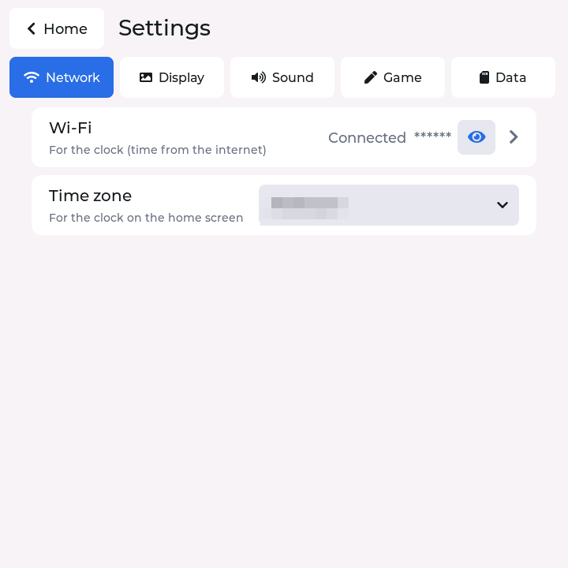
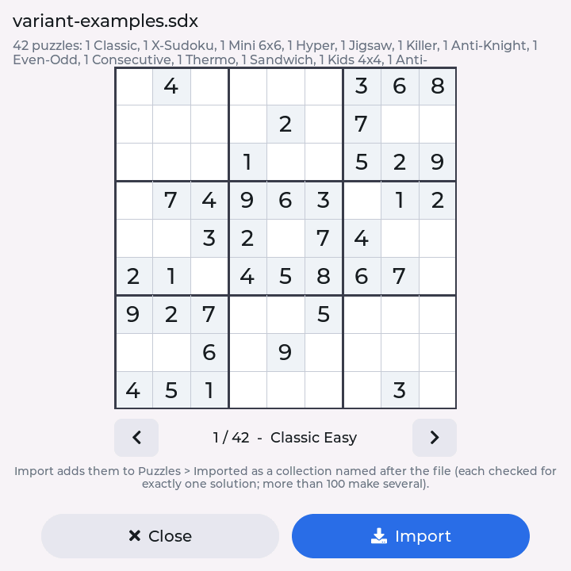

# Home, settings & system

[← README](../README.md) · [Features](features.md) · [How to play](how-to-play.md) · [Data & storage](data.md) · [Building](building.md) · [Development](development.md) · [Remote control](devctl.md)

The home screen, Settings and its tabs, how the board looks and sounds, Gibberlink, Wi-Fi and the clock, and the tools: Files, the picture and video viewer and the system monitor. Settings → Data is in [Data & storage](data.md).

| **Home** | **Settings → Network** | **Settings → Display** |
|---|---|---|
|  |  |  |
| **Settings → Sound** | **Settings → Game** | **Files** |
|  |  |  |
| **Puzzle file preview** | | |
|  | | |

## Features

- **Home screen**: the time and date at the top (once Wi-Fi has fetched it), the solved count and big buttons. **Continue** resumes your unfinished game; when there is none it stays in its place, greyed out, with "No game in progress"; with several (see [Unfinished games](features-puzzles.md)) its line says how many more, and it opens a list to pick from. **Players** (at the top, showing who is playing), **Puzzles**, **Daily puzzle**, **Statistics**, **History**, **Gameplays**, **Trophies**, **Time attack**, **Files**, **Settings** and **System** (the system monitor) open those screens. The buttons stand in one column while they fit, then in a grid of two per row; when even the grid doesn't fit (five rows: ten buttons), the menu has pages side by side: swipe left or right, and dots under it show which page is shown (with twelve buttons, **Settings** and **System** are on the second page).
- **Settings** is split into tabs under its title: **Network** (Wi-Fi, time zone; the tab Settings opens on), **Display** (dark mode, accent colour, brightness, screen off after, lock screen and PIN, screen-saver clock), **Sound** (sound effects, volume, Gibberlink), **Game** (show timer, mistake check) and **Data** (microSD card, USB drive, firmware update, import puzzles, export to CSV, back up database, system monitor, factory reset).
- **Light and dark mode**: switch between colour schemes under **Settings → Dark mode**.
- **Accent colour**: **Settings → Accent colour** picks Blue (the default), Teal, Green, Purple or Pink for buttons, the selected cell, the same-digit and row/column highlights and your digits, in both schemes.
- **Colour-blind friendly**: **Settings → Display → Colour-blind friendly** swaps red and green, which look alike to most colour-blind people, for the Okabe-Ito colours: mistakes in vermillion (orange-red), solved puzzles and finished boards in bluish green, the game in progress in yellow-orange. They differ from each other and from the blue of your digits in lightness as well as hue. Both light and dark mode have their own shades.
- **Night mode**: **Settings → Display → Night mode** on: between the **Night hours** (22:00 to 07:00 by default, local time; the hours may span midnight) the screens turn dark and the backlight goes down to the **Night brightness** (20 % by default, never above the day's). At the end of the night the day's look comes back. It needs the clock (Wi-Fi). Only the switch-over changes things, so dark mode or brightness changed by hand during the night stay until morning; the Dark mode switch shows what's on screen. Waking from the screen saver uses the night brightness too.
- **Screen-saver clock**: **Settings → Display → Screen-saver clock** on: at the screen timeout, instead of going dark at once, the screen shows a dim clock and the date on black with the backlight at 12%, at a new random spot every minute so nothing burns in; after 10 minutes the backlight goes off as usual. A tap wakes it the same way (and shows the lock screen first, if that's on). The home screen's lock button goes straight to dark.
- **Lock screen**: **Settings → Display → Lock screen** (Off, Swipe or PIN). The lock button on the home screen (left of the power button) locks at once: the screen goes dark and comes back locked at the next tap (with the setting Off, it locks with a swipe). When the setting is on, the screen also comes back from its timeout locked: a lock icon, the time, the date and who is playing, and either "Swipe up to unlock" (the time follows the finger; swipe far enough) or a 4-digit PIN on a keypad. Choosing PIN asks for the PIN twice; **Lock PIN → Change** sets a new one. After 5 wrong PINs the keypad waits 30 seconds. It is meant to keep little fingers out of a game, not to secure anything: the PIN is kept as plain text in `sudoku.db` (`settings.lock_pin`, with `lock_mode` 0 Off, 1 Swipe, 2 PIN), and pressing **RESET** starts the board unlocked (the lock only comes with a timeout), which is also the way back in with a forgotten PIN.
- **Screen timeout**: after a while without a touch the game pauses, the screen goes black and the backlight turns off, so a still image can't burn in. Tap anywhere to wake it. The waking tap doesn't press anything. Set the timeout under **Settings → Screen off after**: 1, 2, 5 (default), 10, 15 or 30 minutes, or Never.
- **Sound effects**: synthesised on the device, with no audio files. A background task mixes up to four at once.
  - A short tick on every touch.
  - A low buzz when a digit you place breaks a row, column or box rule.
  - A rising chime when all nine of a digit are placed without conflicts.
  - A quick bright sparkle when a placed digit completes a row, column or 3×3 box (1–9, each once), and a longer one when it completes two or three of them at once.
  - A fanfare when the puzzle is solved.
  - Turn them on or off under **Settings → Sound effects**.
- **Gibberlink (remote control by sound)**: **Settings → Sound → Gibberlink** (off by default; also how a board takes in a puzzle another one sends with Share → **Send by sound**, see [Playing a game](features-game.md)) has the board's two microphones (the ES7210) listen for [ggwave](https://github.com/ggerganov/ggwave) transmissions, the data-over-sound protocol AI agents switch to in [Gibberlink](https://github.com/PennyroyalTea/gibberlink). Each message is one [remote-control command](devctl.md): `tap X Y`, `long X Y [MS]`, `swipe X1 Y1 X2 Y2 [MS]`, `press`/`move`/`release`, `wait MS` (up to 10 s), `fill CELL:DIGIT ...` (digits straight into the game: about 27 cells per message, as a message holds 140 bytes), `state` (the board as 81 characters, answered as `P4$OK state s0 <board>`), `ping`, `heap` or `screenoff` (not screenshots or files: sound carries about 16 bytes a second). A Gibberlink sender id in front (`AB$tap 360 400`) is fine. The board runs it as if it came over serial and answers by sound: `P4$OK tap`, or `P4$ERR ...`. A message may end in a check, `*` and 4 hex digits: the CRC-16/CCITT-FALSE of the text before it (Python: `binascii.crc_hqx(text, 0xFFFF)`), e.g. `fill 1:9 4:2*7C3E`. ggwave's error correction now and then lets a garbled message through as a different one (seen right after a restart); with the check the board refuses it (`ERR checksum`) instead of running it, and its answer carries a check too (`P4$OK fill 2*XXXX`), so a client can trust what `state` reads. A whole puzzle goes in about a minute this way: `state`, solve, two or three `fill` messages, `state` to confirm (tested: Easy #17 in 76 s, 45 cells in 2 messages). It understands ggwave's audible Normal, Fast and Fastest protocols (Gibberlink uses Fast, or Fastest in its fast mode) and answers in Fast; any ggwave sender works, such as the Waver app or ggwave's web demos. While it listens, a small note icon shows at the bottom right of every screen and lights up while a command runs. The board doesn't decode while it is answering (its own reply), and its replies play even with sound effects off. Listening takes a worker task on core 0 and about 9 MB of PSRAM; switched off, the memory is given back and the task ends (once a reply still playing has finished), and switching it on starts it again.
- **Wi-Fi and clock**: on **Settings → Network**, the Wi-Fi row says "Connected  ******" rather than the network's name, so a photo or screenshot doesn't give it away; the eye button next to it shows the name (hidden again the next time Settings opens). **Settings → Wi-Fi** opens a screen with an on/off switch, nearby networks (tap one; secured networks ask for the password on an on-screen keyboard) and **Forget**. Once connected, the time comes from NTP (pool.ntp.org) and the home screen shows it. The board remembers the network and reconnects at start-up. Wi-Fi goes through the board's ESP32-C6 co-processor (ESP-Hosted over SDIO); the Wi-Fi code is shared with the `esp32p4_86box` project.
- **Time zone**: **Settings → Time zone** lists IANA names such as `Asia/Dubai`, with daylight saving where the zone has it.
- **Files**: **Files** on the home screen lists the microSD card's folders and files (folders first, then A–Z; up to 200 per folder) with each file's size and date. Tap a folder to open it, **Up** to go back. Each row has **Rename** (an on-screen keyboard; the name must be new in that folder and can't hold `\ / : * ? " < > |`) and **Delete** (asks first). Deleting moves a file or a whole folder to the **Recycle bin** (`.trash` on the card, shown at the top of the card's root): inside it each item shows where it came from, with **Restore** (puts it back, making its folders again if they're gone) and **Delete for good**; **Empty** clears the bin. Deleted things still take space on the card until the bin is emptied. The game's database is protected: `sudoku.db` and SQLite's files next to it (`sudoku.db-journal`, `-wal`, `-shm`) show a lock and can't be renamed or deleted, and nothing can be renamed to those names (a stray file named like the journal would be rolled back into the database). While the card is lent to a computer (**USB drive**), the screen says it can't be read. Folders are read by a worker task on core 0, so a folder of many replays doesn't hold up the screen.
- **Puzzle file preview**: in **Files**, tap an `.sdm`, `.sdx` or `.opensudoku` puzzle file (the list icon) to see what's in it: its name, how many puzzles and of which variants (and how many lines or entries aren't puzzles), and the puzzles one at a time on a board, with ‹ › to step through them and the variant and level under it. The board shows the givens, the X-Sudoku diagonals and Hyper windows tinted, Jigsaw regions as thick lines and Killer cages dashed with their sums (Even-Odd, Consecutive, Thermo, Sandwich, Kropki, XV and Greater-Than marks, Quadruple circles and Arrow, Renban and Whispers lines aren't drawn). **Close** goes back to the folder; **Import** imports that file, wherever it is, as **Settings → Data → Import puzzles** does for `puzzles/` (each puzzle checked for exactly one solution, a collection named after the file in **Puzzles → Imported**; a file imported already is skipped, by its name), and a notice says how it went. Import needs `sudoku.db` and the clock (set over Wi-Fi: each collection is dated), and is dimmed, with the reason under the board, without them. Up to 2000 puzzles (512 KB of the file) are shown.
- **Picture and video viewer**: in **Files**, tap a `.jpg` (the screenshots) or an `.mp4` (the exported replays) to see it full screen. Swipe left or right, or use the arrows at the sides, to go through the other pictures and videos in the same folder; a tap shows or hides the bars; **✕** closes it. Pictures bigger than the screen are scaled down to fit. JPEGs are decoded by the ESP32-P4's hardware JPEG decoder (baseline JPEGs; progressive ones can't be shown). Videos are H.264 Baseline in MP4, decoded in software (tinyh264): **play/pause**, a slider to jump anywhere and the time. A 720×720 replay plays at its real speed, showing about 8 of its 15 frames a second: one core decodes while the other converts the frame for the screen (only the rows that changed), but decoding alone nearly fills the time a frame lasts, so some frames are decoded but not shown; other phones' or cameras' videos (Main or High profile) say they can't be played.
- **System monitor**: **System** on the home screen shows, refreshed every second, in five tabs (**System**, **Memory**, **Storage**, **Graphics**, **Tasks**; it reopens on the tab last used): uptime, CPU temperature, the load on each core and the last reset reason; internal RAM (free, lowest free, largest block), PSRAM (free, used) and DMA-capable RAM; the firmware's size in its app partition, NVS entries and the microSD card's free space; LVGL's frames drawn per second, how busy it is, draw time per frame, objects and timers; and every FreeRTOS task with its core, priority, state, CPU share (of one core) and free stack; tap **Name**, **Core**, **CPU** or **Stack free** above the list to sort by it (busiest first to begin with; tap again to reverse). Nothing on it may hold interrupts off on the display's core for long, or the whole screen blinks cyan: so no largest free PSRAM block (walking the 28 MB heap took 4 ms), the CPU load comes from the idle tasks' counters, and the full task list (1.5 ms to collect) is read only while the **Tasks** tab is open, by a small task on the other core (core 0), whose interrupts the display doesn't use. The **System** tab also shows the board's IP address (while Wi-Fi is connected), its Wi-Fi MAC address (the ESP32-C6's, read once Wi-Fi has connected) and its Ethernet MAC address (the ESP32-P4's own), and graphs of the last hour: CPU load (core 0 and core 1), temperature and the Wi-Fi signal strength (dBm, with a word for it: excellent, good, fair or weak; a gap while not connected); the **Memory** tab one of free internal RAM. A point is taken every 10 seconds from start-up, whether the page is open or not, so the graphs are there when you open it. It only reads, nothing is written.

## Home menu, second page

There are twelve buttons: the menu turns into pages. Swipe left for **Settings** and **System**.

| **Home, page 2** |
|---|
|  |

## System monitor tabs

**System** on the home screen (the menu's second page), refreshed every second (see **System monitor** above).

| **System** | **Memory** |
|---|---|
|  |  |
| **Storage** | **Graphics** |
|  |  |
| **Tasks** (sorted by CPU) | |
|  | |
