# Features

[← README](../README.md) · [Features](features.md) · [How to play](how-to-play.md) · [Data & storage](data.md) · [Building](building.md) · [Development](development.md) · [Remote control](devctl.md)

Everything the game does, screen by screen. Saving, the microSD card and maintenance are in [Data & storage](data.md).

## Screens

| **Home** | **Puzzles** | **New puzzle** |
|---|---|---|
| 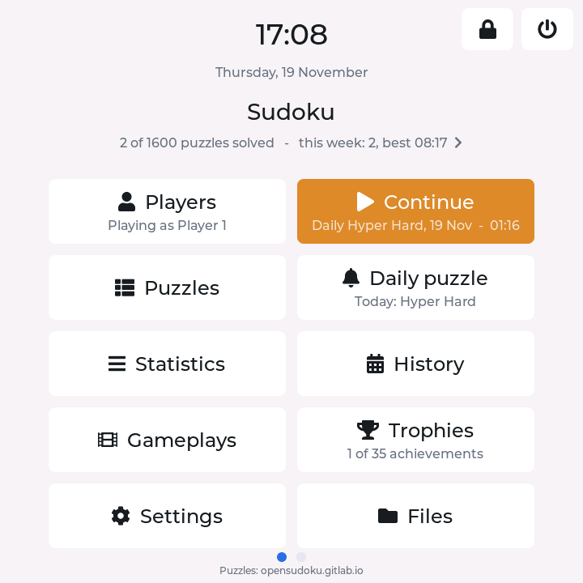 | 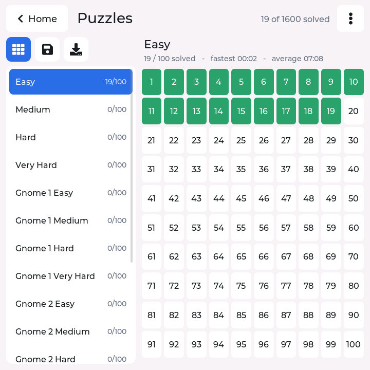 | 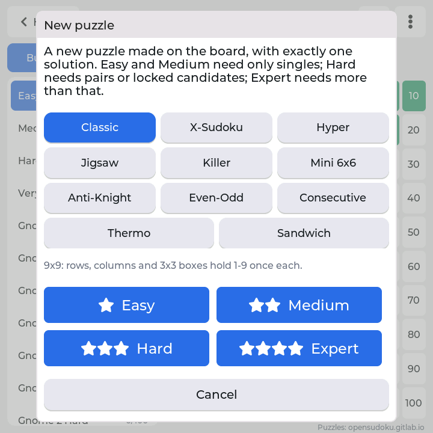 |
| **Learn** | **Enter a puzzle** | **Game** |
| 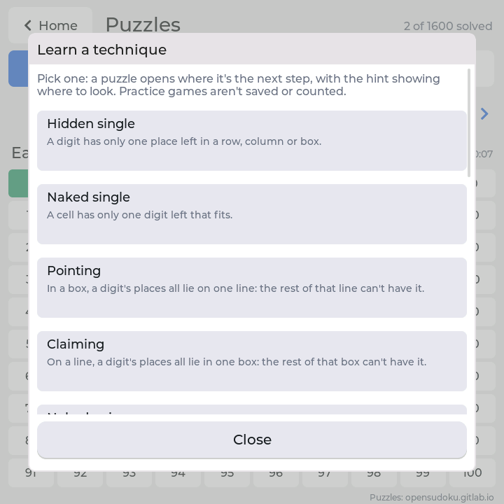 | 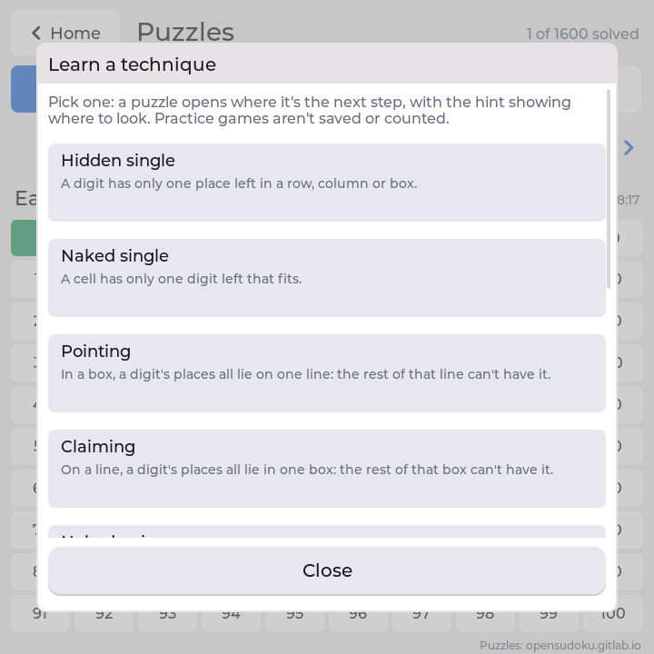 | 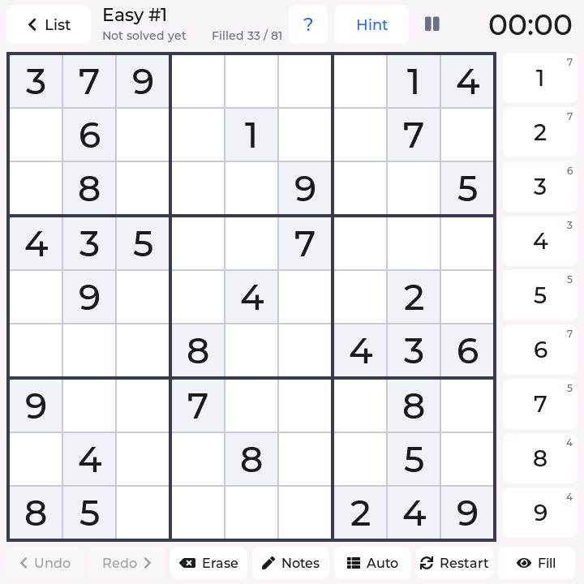 |
| **Rules card** | **Share** | **Replay** |
| 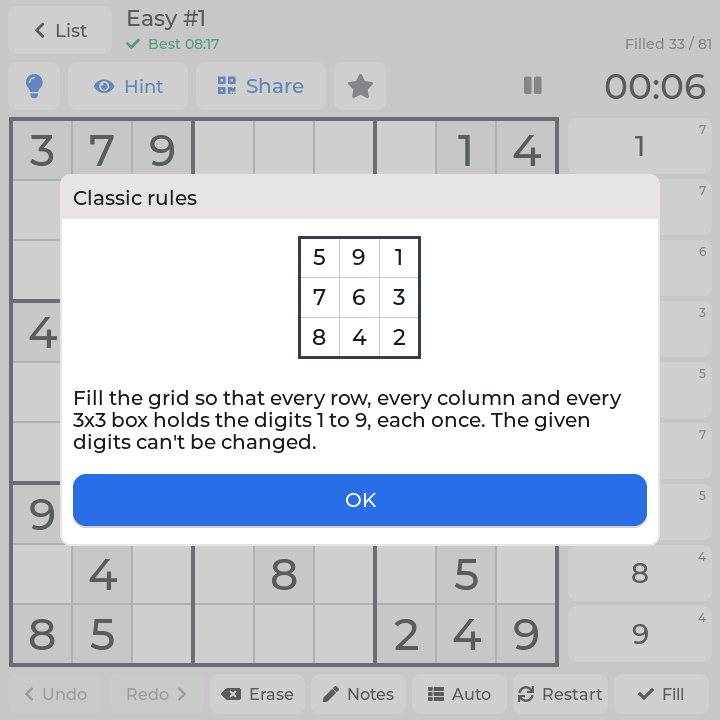 | 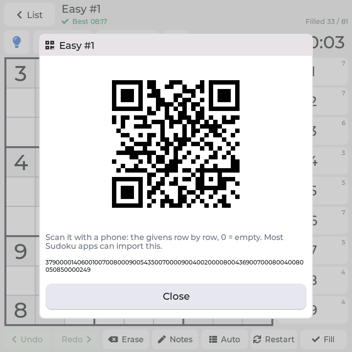 | 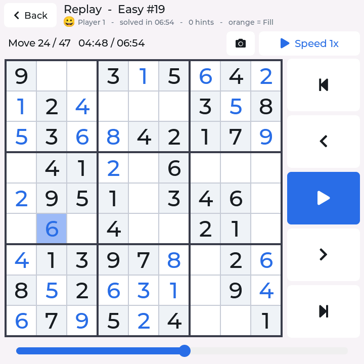 |
| **Statistics** | **Players** | **History** |
| 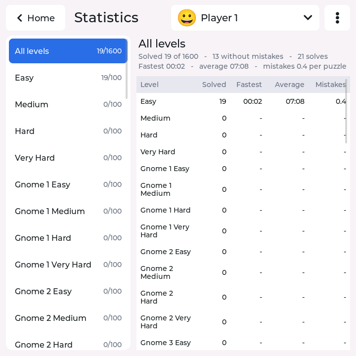 | 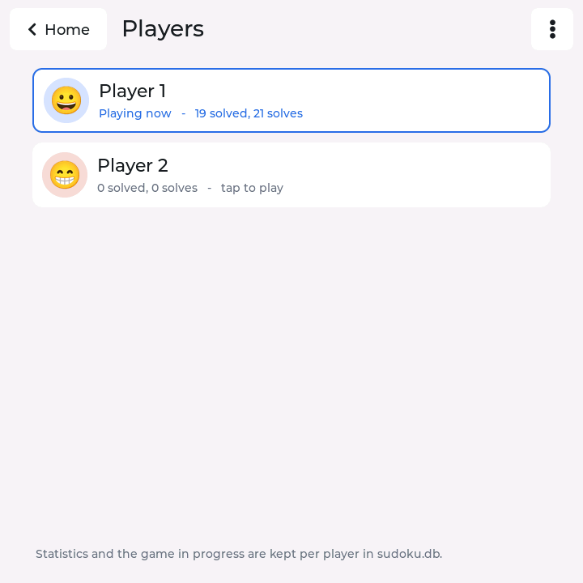 | 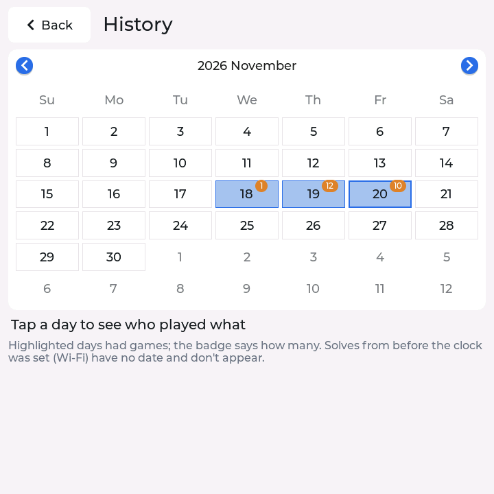 |
| **Insights** | **Trophies** | **Records** |
| 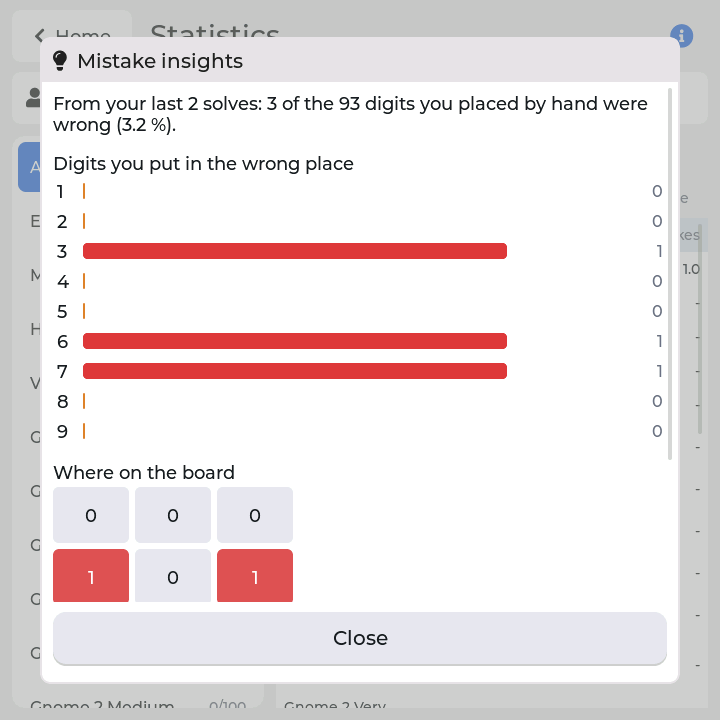 | 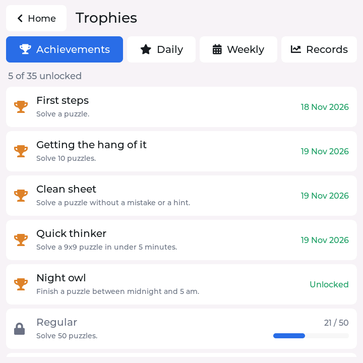 | 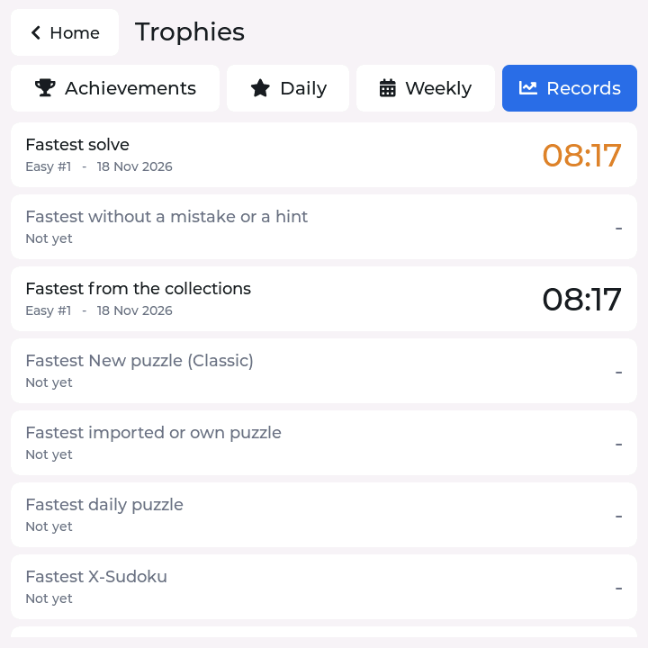 |
| **Gameplays** | | |
| 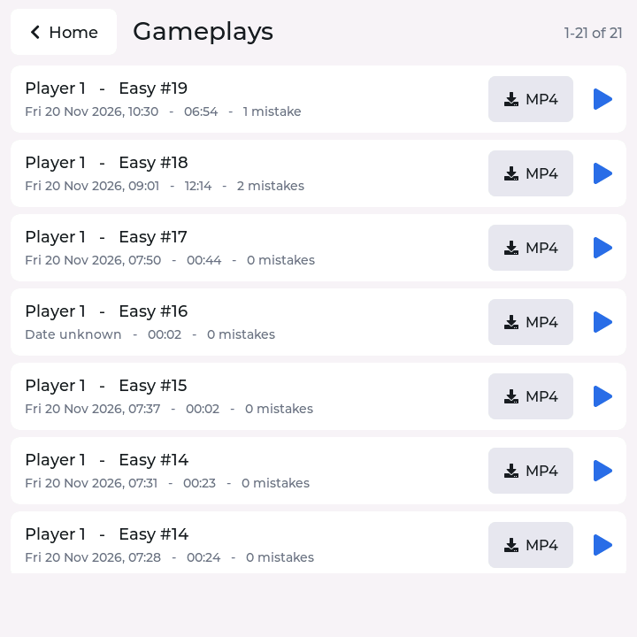 | | |
| **Daily leaderboard** | **Settings → Network** | **Settings → Display** |
| 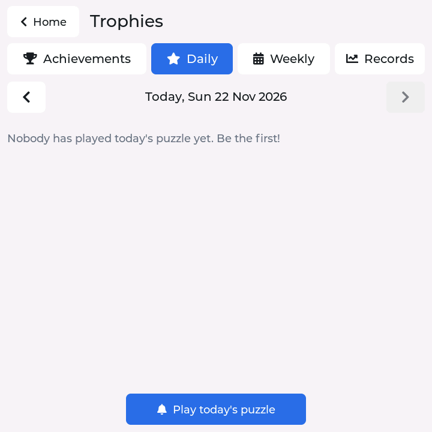 | 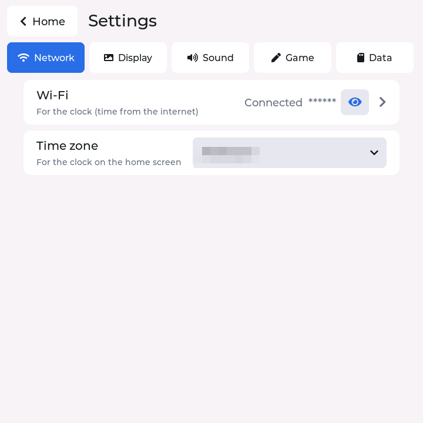 | 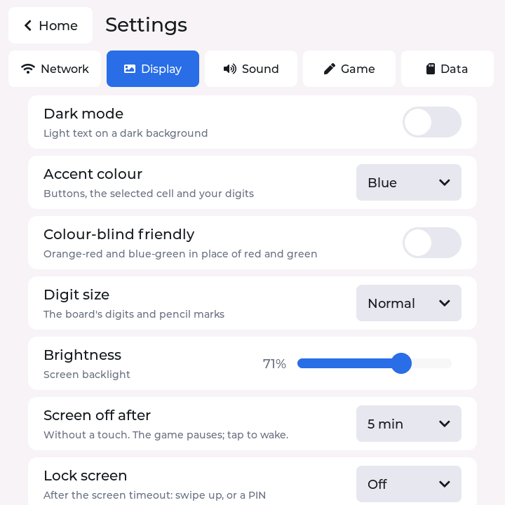 |

The System monitor's tabs are at the [end of this page](#system-monitor-tabs); Settings → Data is in [Data & storage](data.md).

## All features

- **1600 puzzles in flash**: the 16 OpenSudoku collections from <https://opensudoku.gitlab.io/>. These are Easy, Medium, Hard and Very Hard, plus Gnome Sudoku sets 1–3 at each of those levels. Each puzzle is packed into 41 bytes, about 64 KB in total. Every puzzle was checked to have exactly one solution.
- **Home screen**: the time and date at the top (once Wi-Fi has fetched it), the solved count and big buttons. **Continue** resumes your unfinished game; when there is none it stays in its place, greyed out, with "No game in progress"; with several (see **Unfinished games**) its line says how many more, and it opens a list to pick from. **Players** (at the top, showing who is playing), **Puzzles**, **Daily puzzle**, **Statistics**, **History**, **Gameplays**, **Trophies**, **Settings**, **Files** and **System** (the system monitor) open those screens. The buttons stand in one column while they fit, then in a grid of two per row; when even the grid doesn't fit (five rows: ten buttons), the menu has pages side by side: swipe left or right, and dots under it show which page is shown (with eleven buttons, **System** is on the second page).
- **Players**: the **Players** screen lists everyone who plays on the board, with their solved puzzles and solves. Tap a player to play as them; **Add player** and **Rename** ask for a name on an on-screen keyboard (names are unique, ignoring case). The red trash button deletes a player with their statistics, solve history and game in progress, after a confirmation; the last player can't be deleted, and deleting the one playing hands over to the first player left. Each player has their own statistics and their own game in progress, and every solve records who solved it. The Statistics screen has a player dropdown at the top right (person icon and name): it shows whose statistics these are, and picking another player switches to them. Players are kept in `sudoku.db`; without a card there is just one player.
- **History**: **History** on the home screen shows a calendar (‹ › change the month). Days on which anyone finished a puzzle or started one that is still in progress are highlighted. A small orange badge on each highlighted day shows how many games that was (puzzles solved plus games in progress started that day). Tap a day for who played what: player, level and puzzle number, time taken, mistakes, hints, and when it was started and solved (or "in progress"). Dates are local, in the time zone from Settings, and come from `sudoku.db`; solves from before the clock was set (Wi-Fi/NTP) have no date and don't appear.
- **New puzzle (generator)**: besides the 1600 built-in puzzles, **Puzzles → New puzzle** makes a fresh one on the board at the level you pick. It fills a random complete grid, then takes clues away in symmetric pairs as long as exactly one solution remains, and grades the result the way a person would solve it: **Easy** and **Medium** need only singles (Easy keeps 36 or more clues), **Hard** needs locked candidates (pointing/claiming) or naked/hidden pairs, **Expert** needs more than that. It takes well under a second; if a level can't be hit after many tries, you get the closest one and a note saying so. **Next** in the "Solved!" dialog makes another one of the same level. Generated puzzles are named "Generated Hard #12" and so on, are saved in `sudoku.db` (table `generated`), and work everywhere the built-in ones do: continue, History, Gameplays, Replay and MP4 export. They don't count in the per-level tables on the Statistics screen. Without a microSD card they last until power-off.
- **Unfinished games**: with `sudoku.db`, each player keeps up to 5 unfinished games. Opening another puzzle no longer asks to discard the current one: that one stays saved, and the new one is resumed if you'd started it before, or begun. **Continue** resumes the one played last, or, when there are several, lists them (played last first) with time, cells filled and when you last played; tap one to resume it, or the red trash button to discard it. Starting a 6th drops the one played longest ago, and a note says so. The puzzle list shows every unfinished game in orange. Without a card there is one slot, as before: starting another puzzle asks whether to resume or discard the one in it.
- **Variants: X-Sudoku, Hyper, Jigsaw, Killer, Mini 6×6, Anti-Knight, Even-Odd, Consecutive, Thermo and Sandwich**: the **New puzzle** dialog has rows of buttons above the levels: **Classic**, **X-Sudoku**, **Hyper** / **Jigsaw**, **Killer**, **Mini 6x6** / **Anti-Knight**, **Even-Odd**, **Consecutive** / **Thermo**, **Sandwich** (the choice stays until power-off).
  - **Rules card**: the light bulb button in the game's second row (next to Hint) shows the rules of the puzzle's variant with a small drawn example (a cage with its sum, a knight's crossed-out cells, a thermometer, and so on). It also opens by itself the first time each variant other than Classic is played (`settings.rules_seen` remembers which).
  - **X-Sudoku**: a 9×9 board where the two main diagonals must also hold 1–9 once each. The diagonal cells have a warm tint. A digit that repeats on a diagonal turns red like any other conflict, and completing a diagonal plays the sparkle. Hints know the diagonals too ("Look at the top-left diagonal: ..."; the top-left diagonal runs from the top-left corner, the top-right one from the top-right corner).
  - **Hyper** (Windoku): a 9×9 board with four extra 3×3 windows (rows and columns 2–4 and 6–8), tinted like the X diagonals, that must also hold 1–9 once each. Conflicts, sounds and hints count them ("Look at the top-left window: ...").
  - **Jigsaw**: a 9×9 board whose nine boxes are irregular regions of 9 connected cells, outlined with thick borders; every puzzle has its own shapes. The generator starts from the 3×3 boxes and trades cells across region borders (keeping each region in one piece), then fills and digs as usual; a shape that's slow to fill is dropped for another. Hints call the regions "region 1" to "region 9". The region map is kept in `generated.regions`.
  - **Killer**: Classic rules plus cages, groups of 2 to 5 (Easy and Medium: 2 to 3) connected cells outlined with a dashed line, with their sum small in the top-left corner: a cage's digits add up to its sum and none repeats. There are few givens (Easy 8 to 12, Medium 2 to 4, Hard and Expert whatever the uniqueness needs). A cage whose digits go over its sum, or that is full and short of it, turns red, and so does a repeated digit in a cage. Pencil marks are smaller in Killer, below the sum. The grader and hints know cage sums: for each cage, its empty cells keep only the digits of the sets of different digits that make up what's left of its sum ("The cage at row 3, column 4 adds up to 11: ... its empty cells can only be 2, 9"); that counts as a simple step, alongside singles. The cages are kept in `generated.cages` as `sum:cell,cell,...;sum:...` (cells 0–80 row by row).
  - **Anti-Knight**: Classic rules, and two cells a chess knight's move apart never hold the same digit; such a repeat turns red like any other conflict.
  - **Even-Odd**: Classic rules; about a third of the cells are marked: shaded cells hold an even digit, cells with a ring an odd one. A digit of the wrong kind turns red. The marks are kept in `generated.marks` (`e`, `o` or `.` per cell).
  - **Consecutive**: Classic rules; an orange bar sits on the line between every two side-by-side cells whose digits are 1 apart, and where there's no bar, they aren't. Puzzles need few givens (Expert: about 4). Two digits that break that turn red. The grader and hints use the bars ("The bars around row 4, column 2 (and where there are none) leave it only 3, 5"), as a simple step. The bars are kept in `generated.marks` (per cell `0`–`3`: 1 = a bar to the right, 2 = a bar below).
  - **Thermo**: Classic rules, and thermometers (a soft grey line from a round bulb, through cells side by side or diagonal): along each one the digits rise from the bulb. 7 thermometers of 3 to 6 cells (Hard and Expert: up to 10). Two digits along one that don't rise turn red. The grader and hints narrow each thermometer cell from both ends ("Along the thermometer the digits rise from the bulb, so row 2, column 5 can only be 4, 5"), as a simple step. The thermometers are kept in `generated.thermos` (`cell,cell,...;...`, each from its bulb).
  - **Sandwich**: Classic rules, and a number left of each row and above each column gives the sum of the digits between that line's 1 and 9 (0: they're side by side). The board is a little smaller to make room for the sums. Between a 1 and a 9 that add up to more, or (all filled) to anything else, the digits turn red. The grader and hints work out where a line's 1 and 9 can stand for its sum, as a simple step. The 18 sums are kept in `generated.marks` (rows, then columns, comma-separated).
  - **Mini 6×6**: a 6×6 board with 2×3 boxes (two rows, three columns) and digits 1–6, with bigger cells and a six-button number pad. Easy keeps 16 or more clues.
  - All are made, graded and hinted by the same generator as Classic, at all four levels. For the variants, Medium and Hard keep a clue whenever taking it away would need harder techniques, so nearly every attempt lands on the level asked for. Classic puzzles, and so the daily puzzle, come out exactly as before for the same seed. The daily puzzle is always Classic.
  - They are named "X-Sudoku Hard #14", "Hyper Medium #16", "Jigsaw Expert #17", "Killer Hard #18" or "Mini Easy #15" and work everywhere a generated puzzle does: **Next** makes another of the same variant and level, and Continue, History, Gameplays, Replay and MP4 export all show the right board. Their solves are logged with level "X-Sudoku Hard", "Jigsaw Easy" etc.; `generated.variant` holds the variant.
- **Hints**: **Hint** (top of the game screen, next to the timer) shows the next step a person would take, in steps. First it points to where to look ("Look at row 4: one digit has only one place left there"); **More** marks the cell and explains why (a hidden single, a naked single, or, when that's not enough, the step that leads to one: pointing, claiming, a naked or hidden pair, a naked triple, an X-Wing, a Swordfish or an XY-Wing, with the cells that make it highlighted); **Place it** fills it in. A digit that isn't part of the solution is pointed out first (**Erase it**). When no simple step exists, it shows the answer for the easiest cell. Each hint opened counts as one hint (with **Fill**), and its placed digit shows orange in replays. The card is as tall as its explanation needs; it sits at the bottom of the screen, or at the top when it would cover a highlighted cell there; any move closes it. Naked triples, X-Wings, Swordfish and XY-Wings are only used for hints: grading still calls a puzzle Hard when it needs pairs or locked candidates and Expert when it needs more, so Expert hints now explain a step where they used to show an answer.
- **Daily puzzle**: the **Daily puzzle** button on the home screen opens today's puzzle: one a day, the same for every player, made from the date, with a variant and level that follow the weekday: Monday Classic Easy, Tuesday Mini 6×6 Medium, Wednesday X-Sudoku Medium, Thursday Hyper Hard, Friday Killer Medium, Saturday Jigsaw Hard, Sunday Classic Expert. A day's puzzle, once made, stays what it was (days made before this version are Classic). Under the button: today's variant and level and your streak, the days in a row you solved the daily puzzle (it ends today, or yesterday if today's isn't solved yet). Solving it shows the new streak. It needs the date, so the button is greyed out (and says so) until Wi-Fi is connected and has set the clock. Daily puzzles are stored like generated ones, with their date (`generated.day`), and their solves are logged with level "Daily Easy" etc.
- **Progress chart**: **Chart** (top right of the Statistics screen) swaps the table for a chart of your newest 40 solves at the selected level (**All levels**: any puzzle, generated ones included), oldest on the left. Each solve is a dot; the orange line is the average of the last 5; minutes run up the side. Under it: your fastest time, and with 10 or more solves, how the newest 5 compare with the first 5 shown ("36% faster"). **Table** switches back. It needs `sudoku.db`.
- **Trophies**: **Trophies** on the home screen (the line under it counts your achievements) has two tabs.
  - **Achievements**: 35 of them per player, worked out from the solves in `sudoku.db`. Unlocked ones show a trophy and the date. The others show a lock, and their progress where there is a count to show (a bar and "3 / 10", "4 / 7 days", "2 h 5 min / 10 h"). They cover solve counts (1, 10, 50, 100), solving without a mistake or a hint (1, 25, and on Hard or harder), Expert, speed (a 9×9 under 5 minutes; Hard or harder under 10 minutes without hints), each variant (X-Sudoku, Hyper, Jigsaw, Killer, Mini; daily ones count too), Classic + X-Sudoku + Mini, Anti-Knight + Even-Odd + Consecutive, a Thermo, a Sandwich, all six of Classic, X-Sudoku, Hyper, Jigsaw, Killer and Mini, 10 New puzzles, the daily puzzle on 10 days, daily streaks (3, 7 and 30 days in a row, the longest run ever counts), a puzzle in each of the 16 collections, a whole collection, 10 hours of solving, finishing between midnight and 5 am, and, for the techniques: finishing a Learn practice of all ten (**Graduate**), solving a puzzle where a hint showed an X-Wing or a Swordfish (**Gone fishing**) or an XY-Wing (**On a wing**), an Expert without a mistake or a hint (**Unaided expert**), and the no-notes challenge (**Bare hands**; Hard or harder: **All in your head**). Which techniques a game's hints showed is kept with its solve. After a solve, newly unlocked ones pop up at the top of the screen with a chime. Achievements earned before this version are recorded quietly the first time the card is opened, without a date.
  - **Daily**: the leaderboard of the daily puzzle, today first; ‹ › go to other days. Everyone's best time on that day's puzzle (whenever they solved it), fastest first (ties: fewer mistakes, then fewer hints), with mistakes, hints and how often they solved it; you are outlined, the leader gets a star, and players who haven't solved it are listed last. **Play today's puzzle** opens it if you haven't solved it yet. Solving the daily puzzle also tells you your place: "You're 2nd of 3 today".
  - **Weekly**: the week's daily puzzles (Monday to Sunday) added up per player: how many of the 7 they solved (a green square per day), and the sum of their best times on those; more days first, then less time. ‹ › go to other weeks.
  - **Records**: your personal bests, each with the puzzle and date it was set on: the fastest solve, the fastest without a mistake or a hint, the fastest from the collections, of New puzzles, of daily puzzles and of each variant (X-Sudoku, Hyper, Jigsaw, Killer, Anti-Knight, Even-Odd, Consecutive, Thermo, Sandwich, Mini; daily puzzles count for their variant), of imported puzzles, the most solves in a day, the most clean solves (no mistake, no hint) in a row, the longest daily streak, puzzles solved and time spent solving.
- **Replay**: every digit you put in or take out is recorded in order, with the game clock and how it got there: the number pad, **Fill**, **Erase**, **Undo** or **Redo** (pencil marks are not recorded). After solving, **Replay** in the "Solved!" dialog plays the game back; in History, tap a solve marked "Tap to replay"; or open **Gameplays** on the home screen, which lists every recorded game (newest first, 40 per page with **Newer** / **Older**) with player, puzzle, date, time, mistakes and hints, and tap one. The Replay screen has play/pause, one move back or forward, jump to start or end, a slider to scrub through the game, and 1x/2x/4x/8x speed. Playback follows the game clock, with pauses longer than 2 seconds shortened. Digits from Fill show orange, the last move is highlighted, and digits that break a rule show red. The log is saved with the game in progress (so a resumed game keeps it) and with the solve. Solves from before this version have no log. Up to 2048 moves per game are kept.
- **Export as video**: on **Gameplays**, the **MP4** button of a game saves its replay as a video on the microSD card, in `replays/` (named after the player, puzzle and when it was solved, e.g. `replays/Abi_Gnome-2-Hard-12_20261118-1405.mp4`). The video shows the Replay screen as it plays: the board filling in, the slider and the move counter moving. It holds the start for 1 s, plays at twice the replay speed (pauses already shortened to 2 s), and holds the solved board for 3 s; 720×720, 15 fps, H.264 in MP4, made by the ESP32-P4's hardware video encoder; the colour conversion for it (RGB to YUV) is done by the PPA, by DMA, about 4 times faster than on the CPU. The Replay screen is drawn on an invisible second display in memory while a progress dialog (with **Cancel**) shows on the real screen. Copy the video to a computer with **Settings → USB drive**.
- **Learn**: **Learn** on the Puzzles screen lists ten techniques (hidden single, naked single, pointing, claiming, naked pair, hidden pair, naked triple, X-Wing, Swordfish, XY-Wing) and, under **Variant rules**, four lessons on the variants' own rules (Killer cage, Thermometer, Sandwich clue, Consecutive bars), with a line or two on each (the list scrolls). For a variant lesson a new puzzle of that kind is made on the spot (a few seconds) and kept only in RAM: nothing is added to `sudoku.db`. Pick one, and a built-in puzzle opens at a point where that technique is the next step (found by playing puzzles forward with the hint engine; for the last four, which the hint engine seldom reaches first, any point where the technique opens up a single will do; the rarer ones can take a few seconds), with the hint card showing where to look: **More** explains it, **Place it** does it. The title says "Practice: Naked pair". Practice games aren't saved, recorded or counted.
- **Enter a puzzle**: **Enter** on the Puzzles screen (between New puzzle and Learn) opens a blank board with a 1–9 pad, to type in a Classic puzzle from a book or a newspaper: tap a cell, then a digit (the selection moves on to the next cell; the same digit again clears it; **Erase**, **Clear**). Digits that break a rule turn red. **Check & play** needs at least 17 digits and exactly one solution (the solver counts them; it says if there is none or more than one), rates it with the same grader as generated puzzles, saves it as "My puzzles #1", "#2" ... (`sudoku.db`, `generated` with `source` = "My puzzles"; RAM only, until power-off, without a card) and opens it like any other puzzle.
- **Imported puzzles**: put `.opensudoku` (OpenSudoku's XML, `data="..."` or `data='...'`) or `.sdm` / `.txt` files (a puzzle per line, 81 digits, `0` or `.` = empty) in a `puzzles/` folder on the card (copy them over with **Settings → Data → USB drive**), then **Settings → Data → Import puzzles**. Each puzzle is checked for exactly one solution (others are left out), and each file becomes a collection named after it, after the 16 built-in ones in the Puzzles screen's row, marked "(imported)"; a file of more than 100 puzzles makes several ("name 1", "name 2" ...). Up to 2000 puzzles per import; a file already imported is skipped. Their puzzles are named "name #12", play like any other (unfinished games, History, Gameplays, Replay, **Next** goes on through the collection), and their solves are logged with the collection as their level. They are kept in `sudoku.db` (`generated.source` and `number`, and the `imported` table).
- **Puzzle list**
  - Collections are in a row along the top, each with its solved count. Swipe the row sideways, or tap the ‹ › arrows at its ends, to see them all. An arrow only shows while there are more collections that way.
  - Puzzles 1–100 fill the screen below it. Solved ones are green and the game in progress is orange.
  - Each collection shows its fastest and average solve time.
- **Game**
  - The selected cell's row, column and box are highlighted, and so is every cell with the same digit.
  - Pencil marks (Notes). Placing a digit removes it from the notes in its row, column and box.
  - **Auto** fills in the notes of every empty cell with all the digits that still fit there (replacing what was there; Undo takes it back). It doesn't count as a hint.
  - **Digit first**: press and hold a digit on the number pad to lock it (it turns blue, and every cell with that digit is highlighted); then each tap on a cell puts that digit there (tap it again to clear it; with Notes on, it toggles the note). A short tap on another digit moves the lock there; a short tap on the locked digit, or holding it again, unlocks it.
  - Undo (128 steps), **Redo** (puts back what Undo took away, until the next change), Erase and Restart. Undo and Redo are dimmed when there's nothing to undo or redo.
  - **Cell colours**: press and hold a cell for its menu: six colours to paint it with (and ✕ for none), for colouring techniques. Painted cells keep their colour under the highlights, Undo takes a colour back, and colours are saved with the game (`saved_game.colors`) but not in the move log. On **Killer**, the menu also lists the sets of different digits that still make up the cell's cage sum, given the digits already in it ("Cage: 15 in 3 cells, 4 ways: 1+5+9  2+4+9  2+5+8  3+4+8").
  - The bottom bar has seven buttons (Undo, Redo, Erase, Notes, Auto, Restart, Fill); the status line (filled count, conflicts, the locked digit) is in the top bar, under the title.
  - **Fill** puts the right digit (from the puzzle's solution) in the selected cell. Each Fill counts as a hint: the number on the Fill button shows the hints used so far, Undo doesn't take one back, and the count is saved with the game in progress, shown in the "Solved!" dialog and the history, and logged with the solve (`solves.hints`).
  - The number pad shows how many of each digit are still to place. A digit that is complete is dimmed.
- **Share**: **Share** in the game's second row shows the puzzle as a QR code (black on white in either theme) to scan with a phone. A Classic or imported puzzle is the usual 81-digit string (givens row by row, 0 = empty) that most Sudoku apps can import; a variant is its name, its givens (a 6x6: its 36 cells) and its layout, e.g. `Killer 000... cages=11:0,1;...`, `Jigsaw ... regions=...`, `Thermo ... thermos=...`, `Sandwich ... sums=...`. The text is under the code too. The QR code generator is Project Nayuki's (MIT), copied from LVGL into `src/qrcode/` (the shared `lv_conf.h` has LVGL's QR widget off).
- **No-notes challenge**: **Settings → Game → No-notes challenge** on: puzzles started from then on have **Notes** and **Auto** switched off (dimmed), so everything is worked out in your head. A game keeps the mode it started with, also when resumed later. Solves made this way show "no notes" on **Gameplays**, in **History** and on the daily leaderboard, the Solved dialog says so, and they count for the **Bare hands** and **All in your head** achievements. Learn's practice games are never in the challenge.
- **Share a daily result**: after solving the daily puzzle, the QR button at the top right of the Solved dialog shows the result as a QR code: the day, the kind of puzzle, who solved it, the time, mistakes, hints and whether it was a no-notes solve. Scan it with a phone to send it to friends who play the same daily puzzle on their own boards.
- **Left-handed**: **Settings → Game → Left-handed** puts the number pad on the left of the board and the board on the right.
- **Screenshots**: the picture button in the Solved dialog (top left) and on the Replay screen (next to Speed) saves the screen as a PNG in `screenshots/` on the card (720×720, about 1.5 MB, named by the date and time). It's made in the background, so the screen doesn't wait; copy it off with **USB drive**. Exported videos don't show the button.
- **Mistake insights**: **Insights** on the Statistics screen looks through the move logs of your last 300 solves (9×9) and shows how many of the digits you placed by hand were wrong, which digits you misplace most (a bar each), where on the board (the nine boxes, the more mistakes the redder) and your most common mix-ups ("A 3 where a 9 belongs: 4 times"). A solved game's last board is its solution, so nothing has to be solved again.
- **Digit size**: **Settings → Display → Digit size** **Large** shows the board's digits at 52 px instead of 44 (and the pencil marks a size up too), for reading from further away; also on the Replay screen.
- **This week**: the home screen's "puzzles solved" line also says how many you solved this week (Monday to Sunday) and your best time; tap it to compare with last week: solved, fastest, average time, mistakes per puzzle and hints, with a line on how you did ("0.5 fewer mistakes per puzzle, and 1:20 faster on average than last week"). It needs the clock (Wi-Fi).
- **Show timer**: **Settings → Show timer** off hides the game's clock while you play (it shows `--:--`; tap it to pause as before). The time still runs and is recorded, and the Solved dialog shows it.
- **Head-to-head**: the Solved dialog says how the other players did on the same puzzle: "2nd of 3 - Bo leads with 06:20", "★ 1st of 2: ahead of Bo (07:45)", or "Nobody else has solved this one yet" (best times, from `sudoku.db`).
- **Export to CSV**: **Settings → Export to CSV** writes `export/solves.csv` (every solve: player, puzzle, level, number, seconds, mistakes, hints, started, finished, in local time), `export/achievements.csv` (every player and achievement: progress, goal, unlocked and when) and `export/records.csv` (every player's records) on the microSD card, for a spreadsheet. Copy them off with **Settings → USB drive**.
- **Solve indicator**
  - Conflicting digits turn red, and the status line counts them.
  - **Settings → Mistake check** chooses what turns red and buzzes: **Off** (nothing: the status line only says "All filled, not solved yet" when the board is full and something is wrong), **Rules** (the default: digits that break a row, column or box rule) or **Solution** (also digits that break no rule yet but aren't the solution's).
  - When the board is solved, it turns green and a "Solved!" dialog opens with the time and your best.
- **Time to solve**
  - The timer counts only while the game screen is open. Tap it to pause, which also hides the board.
  - The best time for each puzzle is stored.
- **Statistics**
  - A mistake is a placed digit that breaks a row, column or box rule: the ones that buzz and turn red. With Mistake check on **Solution**, a digit that isn't the solution's is a mistake too; with it **Off**, rule-breaking digits are still counted, just not shown. Undo doesn't take a mistake back. The count is saved with the game in progress and shown in the "Solved!" dialog.
  - **All levels** compares the 16 levels and the puzzles made on the board: puzzles solved, fastest and average best time, and average mistakes.
  - Each level lists its solved puzzles with the best time, the fewest mistakes in any solve, and how many times it was solved.
  - Below the 16 collections (the column scrolls), twelve more rows cover the puzzles made on the board: **New puzzles** (Classic from New puzzle), **Daily puzzle**, **X-Sudoku**, **Hyper**, **Jigsaw**, **Killer**, **Anti-Knight**, **Even-Odd**, **Consecutive**, **Thermo**, **Sandwich** and **Mini 6x6**, each with its count of puzzles solved. Their page has one row per level (Easy, Medium, Hard, Expert) with the same columns as All levels, and **Chart** shows their newest solves. They need `sudoku.db`.
  - Above the table: solved count, puzzles solved without a mistake, total solves, fastest and average time.
  - Puzzles solved before this version show "-" for mistakes and count as solved once.
  - The info button next to the "Statistics" title explains what the numbers mean and where they come from.
- **Screen-saver clock**: **Settings → Display → Screen-saver clock** on: at the screen timeout, instead of going dark at once, the screen shows a dim clock and the date on black with the backlight at 12%, at a new random spot every minute so nothing burns in; after 10 minutes the backlight goes off as usual. A tap wakes it the same way (and shows the lock screen first, if that's on). The home screen's lock button goes straight to dark.
- **Lock screen**: **Settings → Display → Lock screen** (Off, Swipe or PIN). The lock button on the home screen (left of the power button) locks at once: the screen goes dark and comes back locked at the next tap (with the setting Off, it locks with a swipe). When the setting is on, the screen also comes back from its timeout locked: a lock icon, the time, the date and who is playing, and either "Swipe up to unlock" (the time follows the finger; swipe far enough) or a 4-digit PIN on a keypad. Choosing PIN asks for the PIN twice; **Lock PIN → Change** sets a new one. After 5 wrong PINs the keypad waits 30 seconds. It is meant to keep little fingers out of a game, not to secure anything: the PIN is kept as plain text in `sudoku.db` (`settings.lock_pin`, with `lock_mode` 0 Off, 1 Swipe, 2 PIN), and pressing **RESET** starts the board unlocked (the lock only comes with a timeout), which is also the way back in with a forgotten PIN.
- **Screen timeout**: after a while without a touch the game pauses, the screen goes black and the backlight turns off, so a still image can't burn in. Tap anywhere to wake it. The waking tap doesn't press anything. Set the timeout under **Settings → Screen off after**: 1, 2, 5 (default), 10, 15 or 30 minutes, or Never.
- **Sound effects**: synthesised on the device, with no audio files. A background task mixes up to four at once.
  - A short tick on every touch.
  - A low buzz when a digit you place breaks a row, column or box rule.
  - A rising chime when all nine of a digit are placed without conflicts.
  - A quick bright sparkle when a placed digit completes a row, column or 3×3 box (1–9, each once), and a longer one when it completes two or three of them at once.
  - A fanfare when the puzzle is solved.
  - Turn them on or off under **Settings → Sound effects**.
- **Settings** is split into tabs under its title: **Network** (Wi-Fi, time zone; the tab Settings opens on), **Display** (dark mode, accent colour, brightness, screen off after, lock screen and PIN, screen-saver clock), **Sound** (sound effects, volume), **Game** (show timer, mistake check) and **Data** (microSD card, USB drive, firmware update, import puzzles, export to CSV, system monitor, factory reset).
- **System monitor**: **System** on the home screen shows, refreshed every second, in five tabs (**System**, **Memory**, **Storage**, **Graphics**, **Tasks**; it reopens on the tab last used): uptime, CPU temperature, the load on each core and the last reset reason; internal RAM and PSRAM (free, used, lowest free, largest block) and DMA-capable RAM; the firmware's size in its app partition, NVS entries and the microSD card's free space; LVGL's frames drawn per second, how busy it is, draw time per frame, objects and timers; and every FreeRTOS task with its core, priority, state, CPU share (of one core) and free stack; tap **Name**, **Core**, **CPU** or **Stack free** above the list to sort by it (busiest first to begin with; tap again to reverse). The **System** tab also shows the board's IP address (while Wi-Fi is connected), its Wi-Fi MAC address (the ESP32-C6's, read once Wi-Fi has connected) and its Ethernet MAC address (the ESP32-P4's own), and graphs of the last hour: CPU load (core 0 and core 1), temperature and the Wi-Fi signal strength (dBm, with a word for it: excellent, good, fair or weak; a gap while not connected); the **Memory** tab one of free internal RAM. A point is taken every 10 seconds from start-up, whether the page is open or not, so the graphs are there when you open it. It only reads, nothing is written.
- **Files**: **Files** on the home screen lists the microSD card's folders and files (folders first, then A–Z; up to 200 per folder) with each file's size and date. Tap a folder to open it, **Up** to go back. Each row has **Rename** (an on-screen keyboard; the name must be new in that folder and can't hold `\ / : * ? " < > |`) and **Delete** (asks first). Deleting moves a file or a whole folder to the **Recycle bin** (`.trash` on the card, shown at the top of the card's root): inside it each item shows where it came from, with **Restore** (puts it back, making its folders again if they're gone) and **Delete for good**; **Empty** clears the bin. Deleted things still take space on the card until the bin is emptied. The game's database is protected: `sudoku.db` and SQLite's files next to it (`sudoku.db-journal`, `-wal`, `-shm`) show a lock and can't be renamed or deleted, and nothing can be renamed to those names (a stray file named like the journal would be rolled back into the database). While the card is lent to a computer (**USB drive**), the screen says it can't be read. Folders are read by a worker task on core 0, so a folder of many replays doesn't hold up the screen.
- **Light and dark mode**: switch between colour schemes under **Settings → Dark mode**.
- **Night mode**: **Settings → Display → Night mode** on: between the **Night hours** (22:00 to 07:00 by default, local time; the hours may span midnight) the screens turn dark and the backlight goes down to the **Night brightness** (20 % by default, never above the day's). At the end of the night the day's look comes back. It needs the clock (Wi-Fi). Only the switch-over changes things, so dark mode or brightness changed by hand during the night stay until morning; the Dark mode switch shows what's on screen. Waking from the screen saver uses the night brightness too.
- **Colour-blind friendly**: **Settings → Display → Colour-blind friendly** swaps red and green, which look alike to most colour-blind people, for the Okabe-Ito colours: mistakes in vermillion (orange-red), solved puzzles and finished boards in bluish green, the game in progress in yellow-orange. They differ from each other and from the blue of your digits in lightness as well as hue. Both light and dark mode have their own shades.
- **Accent colour**: **Settings → Accent colour** picks Blue (the default), Teal, Green, Purple or Pink for buttons, the selected cell, the same-digit and row/column highlights and your digits, in both schemes.
- **Player colours**: each player has a colour, shown as a dot by their name on the **Players** screen and the Daily and Weekly leaderboards. Tap the dot on the Players screen for the next of eight colours (`players.color`; new players get one by turn).
- **Wi-Fi and clock**: on **Settings → Network**, the Wi-Fi row says "Connected  ******" rather than the network's name, so a photo or screenshot doesn't give it away; the eye button next to it shows the name (hidden again the next time Settings opens). **Settings → Wi-Fi** opens a screen with an on/off switch, nearby networks (tap one; secured networks ask for the password on an on-screen keyboard) and **Forget**. Once connected, the time comes from NTP (pool.ntp.org) and the home screen shows it. The board remembers the network and reconnects at start-up. Wi-Fi goes through the board's ESP32-C6 co-processor (ESP-Hosted over SDIO); the Wi-Fi code is shared with the `esp32p4_86box` project.
- **Time zone**: **Settings → Time zone** lists IANA names such as `Asia/Dubai`, with daylight saving where the zone has it.

## Home menu, second page

There are eleven buttons: the menu turns into pages. Swipe left for **System**.

| **Home, page 2** |
|---|
| 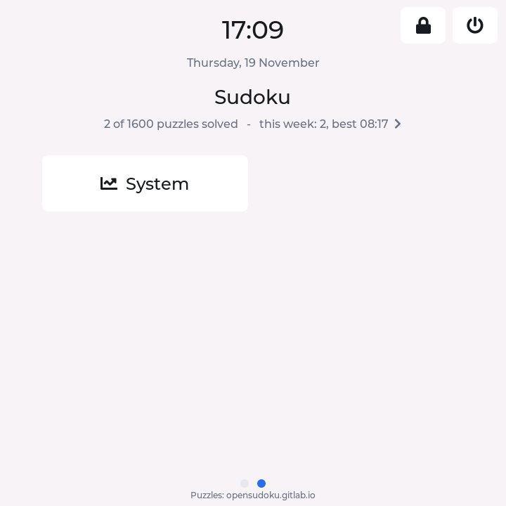 |

## System monitor tabs

**System** on the home screen (the menu's second page), refreshed every second (see **System monitor** above).

| **System** | **Memory** |
|---|---|
| 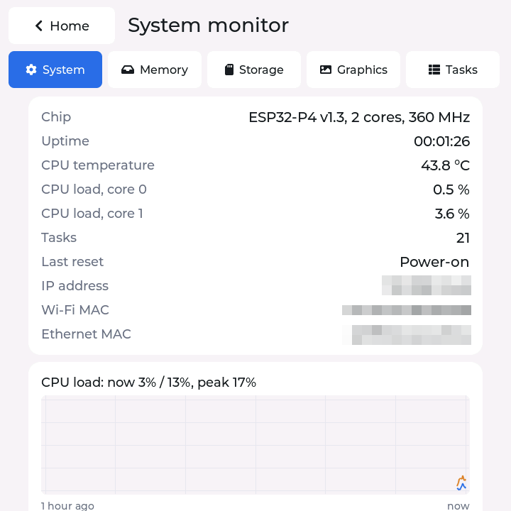 | 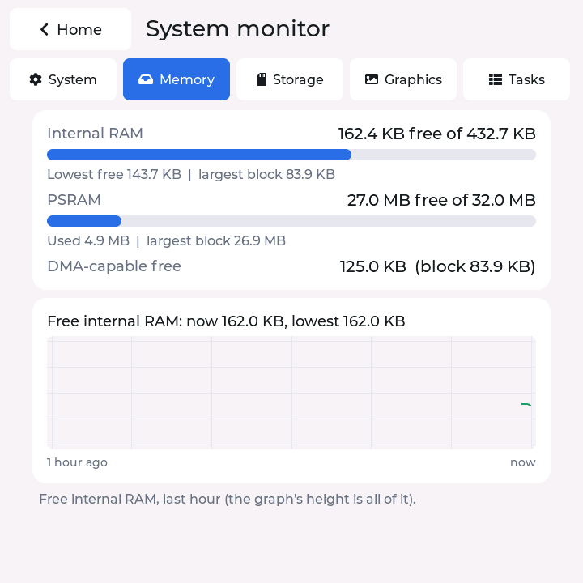 |
| **Storage** | **Tasks** (sorted by CPU) |
| 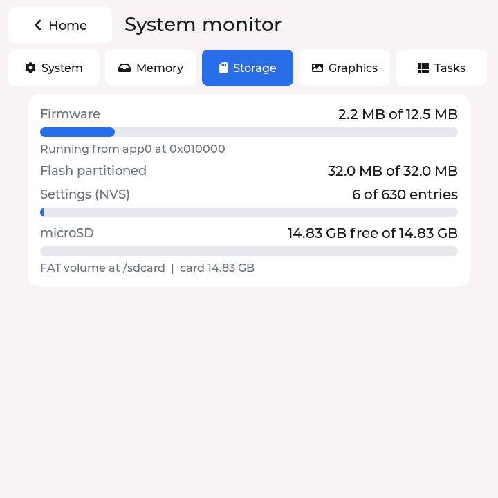 | 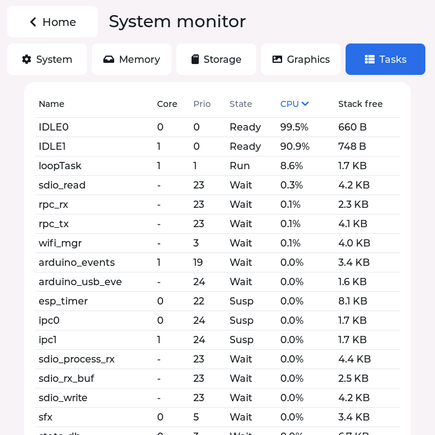 |
