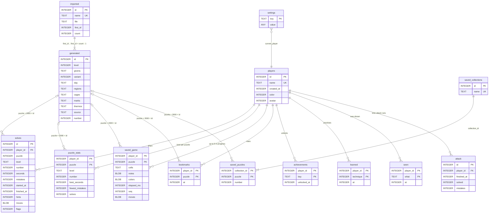

# Database design

[← Internals](README.md) · [README](../../README.md) · [Features](../features.md) · [How to play](../how-to-play.md) · [Data & storage](../data.md) · [Building](../building.md) · [Development](../development.md) · [Remote control](../devctl.md)

How `sudoku.db` is laid out: its tables, what each one is for, and how they connect. [Data & storage](../data.md) lists every column; this page explains the design. The schema is in `src/stats_db.c` (`T_*`, `SCHEMA`, `SCHEMA_POST`) and is described again at the top of `src/stats_db.h`.

## Overview

`sudoku.db` is a SQLite 3 file in the root of the microSD card. It holds everything the game remembers: players, solves, games in progress, puzzles made on the board, collections, achievements and settings. The schema version is in `PRAGMA user_version` (now 11).

The tables fall into four groups:

| Group | Tables | Keyed by |
|---|---|---|
| **People** | `players` | `id` |
| **Per player** | `solves`, `puzzle_stats`, `saved_game`, `bookmarks`, `achievements`, `learned`, `seen`, `attack` | `player_id` (+ puzzle, key ...) |
| **Puzzles and collections** | `generated`, `imported`, `saved_collections`, `saved_puzzles` | `id`; shared by all players |
| **Device** | `settings` | `key` |

Plus one view, `level_stats`, and the indexes listed under [Indexes and the view](#indexes-and-the-view).

## The puzzle id: what ties everything together

Almost every table that talks about a puzzle stores one integer, `puzzle`. It covers every puzzle the game can show:

| `puzzle` | What it is | Where its digits come from |
|---|---|---|
| 0 – 1599 | The 16 built-in collections, 100 puzzles each (`PUZZLE_COUNT`) | The firmware (`src/puzzles*.h`), not the database |
| 2000 + *n* | A puzzle made on the board, a daily puzzle, or an imported one (`PUZZLE_GEN_BASE` in `src/puzzles.h`) | `generated` row `id = n` |

So `puzzle < 2000` means "built in", and a join to `generated` is always `ON s.puzzle = 2000 + g.id`. The link isn't a declared foreign key, because built-in puzzles have no row to point to. The records and achievements filter by variant this way too, for example `puzzle IN (SELECT 2000 + id FROM generated WHERE variant = 23)` for Skyscraper.

`solves`, `puzzle_stats` and `saved_game` also copy the puzzle's **`level`** and **`number`** next to the id, so a row is readable without the firmware:

- built in: the collection's name (`Gnome 2 Hard`) and its place 1–100;
- made on the board: kind and level (`Generated Easy`, `Daily Hard`, `Skyscraper Expert` ...) and `generated.id`;
- imported: the collection's name (`generated.source`) and its place in it (`generated.number`).

## How the tables connect



(Columns are shortened in the diagram; [Data & storage](../data.md) has all of them.)

The `REFERENCES players(id)` clauses document the links, but SQLite's `foreign_keys` pragma is off, so the database doesn't enforce them. The firmware keeps them consistent itself (see [Deleting](#deleting)).

## The tables

### People

**`players`**: one row per player. `name` is unique, case-insensitive. `color` and `avatar` are only for display. Which player is playing now is not stored here but in `settings.current_player`. A database from before players existed gets "Player 1" (id 1), and all its old data becomes theirs.

### Per player: history and progress

**`solves`**: the log, one row per finished puzzle, never changed afterwards. It records time, mistakes and Fill uses (`hints`), when the puzzle was started and finished, the full move log (`moves`, which Replay and MP4 export read) and `flags` (the no-notes challenge and which hint techniques were shown). Everything historic is computed from here: charts, streaks, records, the daily calendar and most achievements.

**`puzzle_stats`**: a summary of `solves`, one row per player and puzzle: best time, fewest mistakes and number of solves. It exists so the puzzle list and the home screen don't need to scan the log. At start-up the current player's rows are loaded into RAM, the "copy" the UI reads. It is updated in the **same transaction** as the `solves` insert, with an upsert (`MIN` for the bests, `+1` for the count), so the two never disagree.

**`saved_game`**: games in progress, up to 5 per player (`STATS_MAX_GAMES`), keyed by player and puzzle. It is rewritten after every move: digits (`cells`), pencil marks (`notes`, 81 × 16-bit masks), cell colours, the clock, mistakes, Fill uses and the move log so far. `seq` orders the games, and the highest was played last. A sixth game pushes out the one with the lowest `seq`. On a solve, the game's moves and flags move into `solves`, and its row is deleted.

**`bookmarks`**: starred puzzles (player + puzzle id, with the time). The Starred list sorts them newest first.

**`achievements`**: one row per unlocked achievement (`key` from the `ACH` list in `src/stats_db.c`). They are checked after every solve against `solves`, `puzzle_stats`, `attack` and `learned`. `unlocked_at` is NULL when the achievement was found already done or the clock wasn't set.

**`learned`**: Learn practices finished (technique 0–9).

**`seen`**: one-time things a player has been shown (`what = 'tour'`).

**`attack`**: Time Attack runs (Easy puzzles solved in 10 minutes). These are separate from `solves` because a run is many puzzles. The leaderboard groups them by player.

### Puzzles and collections (shared by all players)

**`generated`**: every puzzle that isn't built in, one row each, so its digits survive a restart:

- **New puzzle**: `day` NULL, `source` NULL.
- **Daily puzzle**: `day` = its date `YYYY-MM-DD`. There is one per day, made the first time it's opened that day; later opens find it by `day`.
- **Imported**: `source` = the collection's name, `number` = its place in it.

`variant` says which rules apply (0 Classic ... 24 Little Killer, the `VAR_*` order in `src/generator.h`, append-only). The four text columns `regions`, `cages`, `marks` and `thermos` hold whatever the variant needs beyond the givens; columns a variant doesn't use are NULL:

| Column | Used by |
|---|---|
| `regions` | Jigsaw (81 digits, the region of each cell) |
| `cages` | Killer cages; Quadruple circles; Little Killer diagonals |
| `marks` | Even-Odd, Consecutive, Kropki, XV, Greater-Than (81 characters); Sandwich sums and Skyscraper clues (18 numbers) |
| `thermos` | Thermo bulbs-first; Arrow (circle first), Renban and German Whispers lines |

The same four fields make up a `.sdx` line (`src/sdx.c`), so sharing, importing and exporting all use one format. The rules (Classic, X-Sudoku, Hyper, Mini ...) aren't stored: they come from `variant`. `puzzle_geom()` in `src/ui_common.c` rebuilds a board from `variant` and these columns.

**`imported`**: one row per collection imported from `puzzles/`. Its puzzles are the consecutive `generated` ids `first_id .. first_id + count − 1` (a file with more than 100 puzzles becomes several collections). `file` stops the same file being imported twice.

**`saved_collections`** and **`saved_puzzles`**: collections the players make with the game screen's **Save**. `saved_puzzles` refers to puzzles by puzzle id, usually 2000 + `generated.id`, and `number` is its place in the collection. A collection disappears with its last puzzle.

### Device

**`settings`**: key–value pairs (`key TEXT PRIMARY KEY, value` with no type), for the board rather than per player: brightness, sound, dark mode, screen-off minutes, night mode, time zone, `rules_seen` (a bit per variant), `current_player` and so on. The Wi-Fi network isn't here; it stays in the board's NVS.

## Indexes and the view

| Name | On | Used for |
|---|---|---|
| `solves_puzzle` | `solves(puzzle)` | variant and daily filters, records |
| `solves_player` | `solves(player_id, puzzle)` | a player's history, charts, achievements |
| `puzzle_stats_level` | `puzzle_stats(player_id, level, number)` | the per-collection rows on Statistics |
| `level_stats` (view) | `puzzle_stats` ⨝ `players` | per player and level: solved, solves, fastest, average, mistakes; for `sqlite3` users |

`SCHEMA_POST` drops and recreates the index and the view on every start, so they always match the current build.

## Life of the data

**Opening a puzzle**:
1. The digits come from the firmware (id < 2000) or from `generated` (id ≥ 2000).
2. If there is a `saved_game` row for the player and puzzle, play resumes from it.

**Every move**: the `saved_game` row is upserted (only the newest queued save is written).

**Solving**:
1. In one transaction: insert into `solves` and upsert `puzzle_stats`.
2. The `saved_game` row goes.
3. `achievements` are checked and new ones inserted, and "Achievement unlocked" shows.

**New puzzle / Daily**: a `generated` row is inserted (the daily puzzle only if that `day` has none yet), and the puzzle's id is 2000 + its `id`.

**Importing**: in one transaction per file, the `generated` rows are inserted (each checked for exactly one solution) and then the `imported` row.

**Switching player**: `settings.current_player` changes, and that player's `puzzle_stats` and games are loaded.

## Deleting

Since SQLite doesn't enforce the links, the firmware deletes in a fixed order, each in one transaction:

- **Deleting a player** removes their rows from `solves`, `puzzle_stats`, `saved_game`, `achievements`, `learned`, `bookmarks`, `seen` and `attack`, and then the `players` row.
- **Deleting a saved collection** removes its `saved_puzzles` and then its `saved_collections` row.
- **Deleting an imported collection** removes only its `imported` row. Its `generated` puzzles stay, so solves, stars and saved collections that refer to them still work.
- **`generated` rows are never deleted.** A solve or a star can point at any of them for good.
- **Factory reset** deletes the whole file and starts a new one.

## Writing safely

- **One writer:** all SQL runs on one FreeRTOS task (`worker()` in `src/stats_db.c`, task "stats_db"). The UI sends it commands through a queue: writes are fire-and-forget, reads wait for the answer. The UI thread never blocks on the card for a write.
- **Transactions:** every multi-row change (solve, import, deleting a player, upgrades) is a `BEGIN`…`COMMIT`, with a `ROLLBACK` if any step fails.
- **Lending the card over USB:** the database is closed while a computer has the card and reopened afterwards.
- **Backups:** made with `VACUUM INTO`, a consistent copy taken while the database is in use.

## Upgrades

The tables are created with `CREATE TABLE IF NOT EXISTS`, so an older database keeps its old tables. `upgrade_schema()` then brings it up to date:

- **New columns** are added with `ALTER TABLE ... ADD COLUMN` when `has_column()` doesn't find them. Defaults mean old rows stay valid: `hints` 0, `flags` 0, `moves` NULL ("not recorded").
- **Key changes** (adding `player_id`; one saved game per player becoming five) rename the old table to `*_v3` / `*_v8`, create the new one, copy the rows across and drop the old one, all in one transaction.
- **Numbers that are already stored never change meaning:** variants, `TECH_*` bits, achievement keys and Learn techniques are only ever added at the end.

## Example queries

```sh
# a player's solves per variant (generated puzzles)
sqlite3 -box sudoku.db "SELECT p.name, g.variant, COUNT(*) AS solves, MIN(s.seconds) AS best
  FROM solves s JOIN players p ON p.id = s.player_id JOIN generated g ON s.puzzle = 2000 + g.id
  GROUP BY p.id, g.variant ORDER BY p.id, g.variant"

# games in progress, the latest first
sqlite3 -box sudoku.db "SELECT p.name, sg.level, sg.number, sg.elapsed_ms / 1000 AS seconds
  FROM saved_game sg JOIN players p ON p.id = sg.player_id ORDER BY sg.player_id, sg.seq DESC"

# the puzzles of each imported collection
sqlite3 -box sudoku.db "SELECT i.name, COUNT(g.id) AS puzzles
  FROM imported i JOIN generated g ON g.id BETWEEN i.first_id AND i.first_id + i.count - 1 GROUP BY i.id"

# starred puzzles that were never solved
sqlite3 -box sudoku.db "SELECT b.player_id, b.puzzle FROM bookmarks b
  LEFT JOIN puzzle_stats ps ON ps.player_id = b.player_id AND ps.puzzle = b.puzzle WHERE ps.puzzle IS NULL"
```
