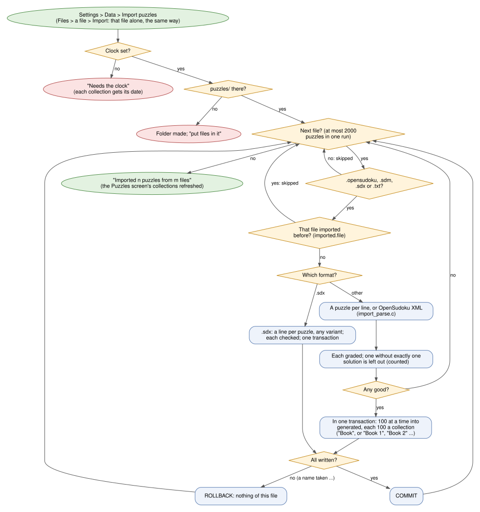

# `imported`

[← Database tables](README.md) · [Database design](../database.md) · [Data & storage](../../data.md) · [Internals](../README.md)

One row per collection imported from `puzzles/` on the card (Settings > Data > Import, or Files > a file > Import). Its puzzles are the consecutive `generated` rows `first_id` … `first_id + count − 1`.

**Group:** puzzles and collections

## Columns

| Column | Type | Null | What it holds |
|---|---|---|---|
| `id` | INTEGER | no | primary key |
| `name` | TEXT | no | the collection's name, unique: the file's name without its extension ("Book 1", "Book 2", ... for more than 100 puzzles) |
| `file` | TEXT | no | the file it came from: a file already imported isn't imported again |
| `first_id` | INTEGER | no | `generated.id` of its first puzzle |
| `count` | INTEGER | no | its puzzles, at most 100 |
| `created_at` | INTEGER | yes | when; importing waits for the clock, so only old collections have NULL |

## Keys and limits

- Primary key `id`; `name` is `UNIQUE`.
- A file with more than 100 puzzles becomes several collections. One import run reads at most 2000 puzzles; the Puzzles screen lists at most `STATS_MAX_IMPORTS` (24) collections.

## Written



In one transaction per file: the puzzles into `generated` (each graded; a puzzle without exactly one solution is skipped), then this row (`src/stats_db_import.c`). The formats: a puzzle per line (`.sdm`, `.txt`), OpenSudoku's XML (`.opensudoku`), and `.sdx` for any variant (`src/import_parse.c`, `src/sdx.c`).

## Read

The Puzzles screen's Imported tab, a puzzle's name ("Book #12"), the Files preview.

## Deleted

Puzzles > ⋮ > Delete collection: only this row. Its `generated` puzzles stay, so solves, stars and saved collections that point at them still work.

## Example queries

```sh
sqlite3 -box sudoku.db "SELECT i.name, i.count, COUNT(ps.puzzle) AS solved FROM imported i LEFT JOIN puzzle_stats ps ON ps.puzzle BETWEEN 2000 + i.first_id AND 2000 + i.first_id + i.count - 1 AND ps.player_id = 1 GROUP BY i.id"
```
