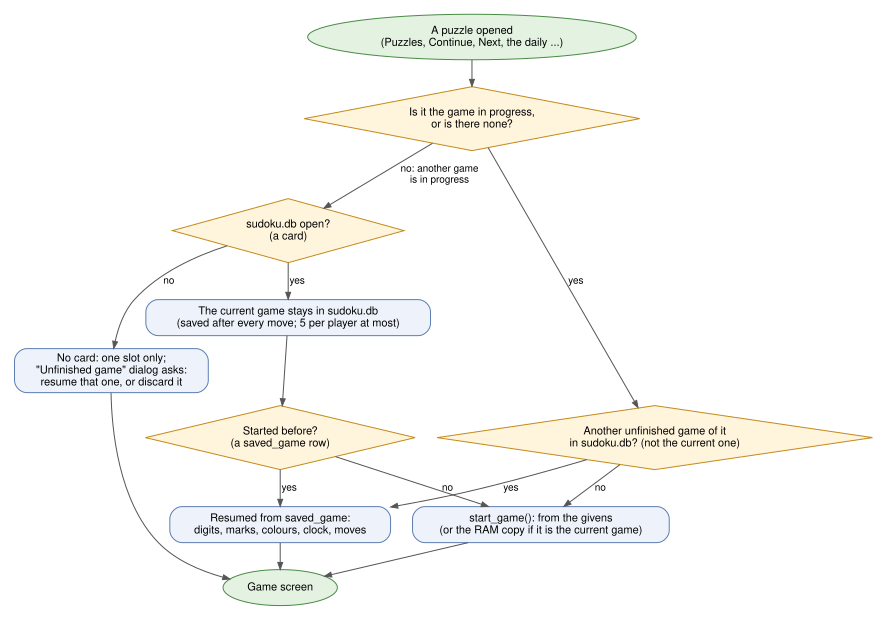
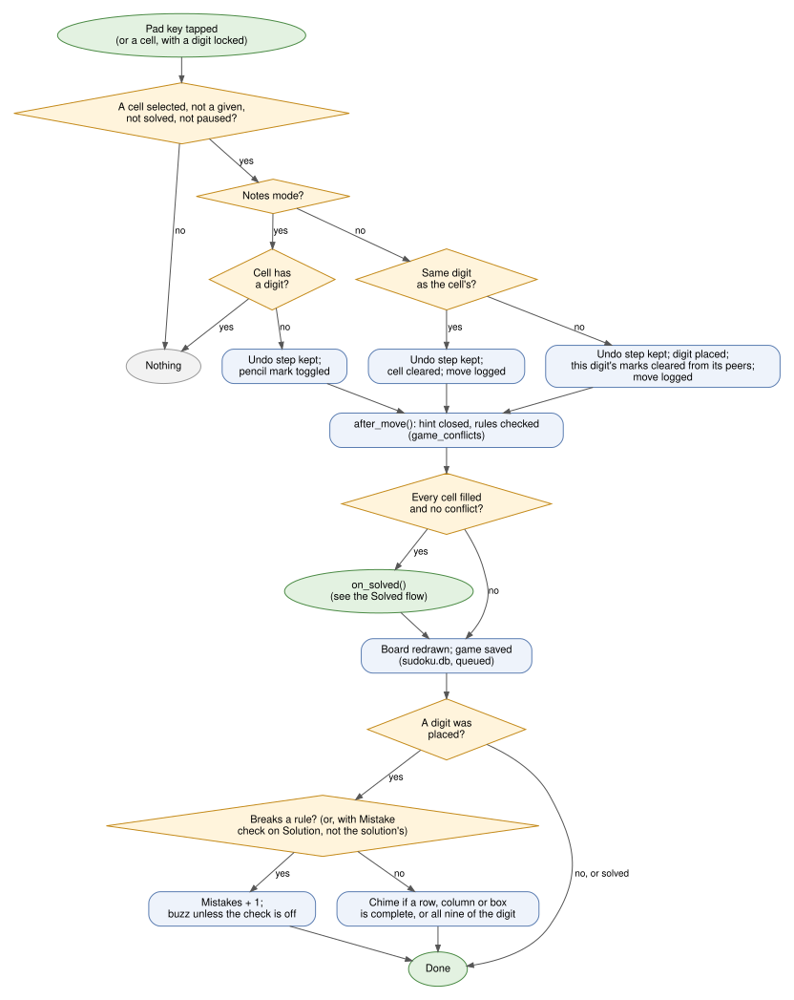
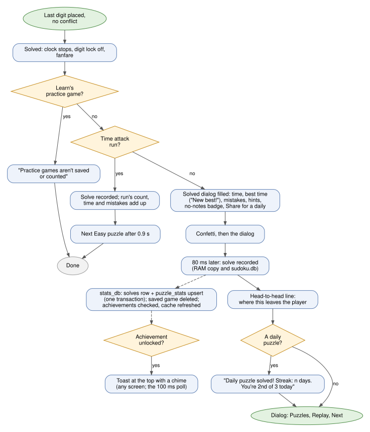
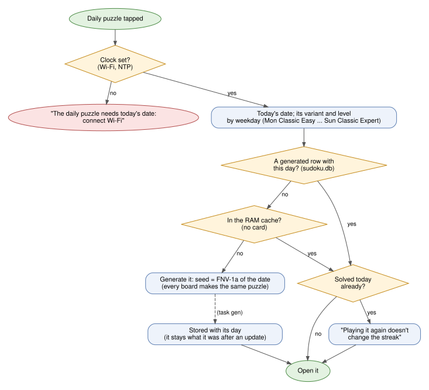

# Game flow

[← Internals](README.md) · [README](../../README.md) · [Features](../features.md) · [Data & storage](../data.md) · [Building](../building.md) · [Development](../development.md) · [Remote control](../devctl.md)

What happens when a puzzle is opened, a digit is entered and the puzzle is solved: the decisions the game screen makes, in the order it makes them. The code is in `src/ui_continue_open.c`, `src/ui_game.c` and `src/ui_game_win.c`; the state they share (the board, the clock, the move log) is described in [UI structure](ui-structure.md).

The flowcharts' sources are in `docs/diagrams/` (`make diagrams` renders them).

## Opening a puzzle

Every way into a game (Puzzles, Continue, Next, the daily puzzle, a puzzle received by sound) ends in `open_puzzle(id)`. With a card, `sudoku.db` keeps up to 5 unfinished games per player, so opening another puzzle never loses one; without a card there is a single slot in RAM, and the "Unfinished game" dialog asks first.

## Entering a digit

A tap on the pad (or on a cell, with a digit locked by a long press) is `enter_digit()`. Every change keeps an undo step and is logged in the move log (pencil marks are undoable but not logged). The rules check runs after every move; a mistake is counted whether or not Mistake check shows it.

## Solving

`on_solved()` decides what kind of game it was. A normal game shows the Solved dialog after the confetti, and only then records the solve (80 ms later, so the dialog appears without waiting for the card); the database checks achievements and the toast comes by the usual poll.

## The daily puzzle

