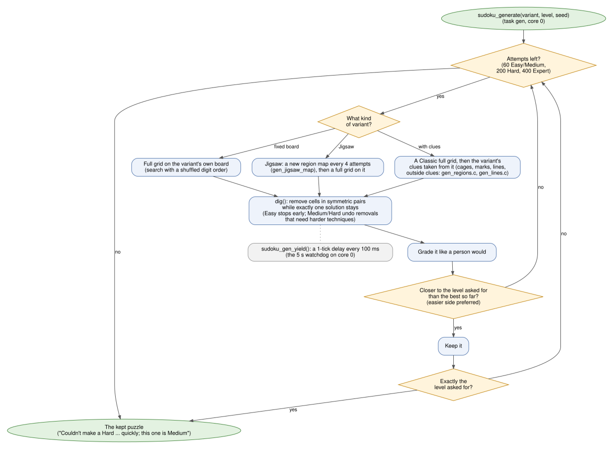
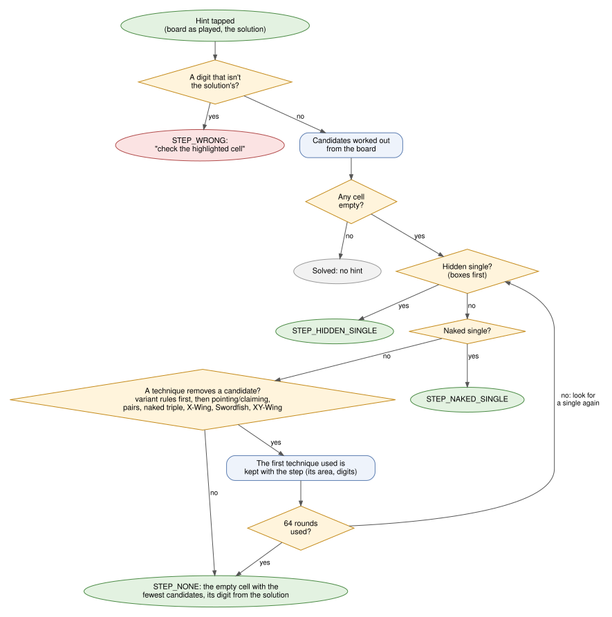

# Puzzle generator

[← Internals](README.md) · [README](../../README.md) · [Features](../features.md) · [Data & storage](../data.md) · [Development](../development.md) · [Variants](../variants/README.md)

How **New puzzle** and the daily puzzle are made, how a puzzle is graded Easy to Expert, and how the same code solves puzzles, checks them, gives hints and finds Learn's positions. It is all in `src/gen_*.c` (`gen_geometry.c` the boards and texts, `gen_solver.c` the rules and the search, `gen_grade.c` the techniques, `gen_make.c` generating, `gen_regions.c` Jigsaw regions and Killer cages, `gen_lines.c` the line variants' lines, `gen_hints.c` hints; they share `gen_internal.h`) and `src/generator.h`: plain C with no ESP-IDF or LVGL in it, so the PC tests (`make -C tests`) and the docs tools build it unchanged. The firmware side (the task, the progress bar, saving) is in `src/ui_newpuzzle.c`; the daily puzzle's choice in `src/daily_core.c`.

## In one paragraph

Make a **random complete grid** that follows the variant's rules. For variants whose clues come from the grid (cages, marks, lines, outside sums), **derive those clues from it**. Then **take givens away** in symmetric pairs while exactly one solution remains. **Grade** what's left with a solver that only uses techniques a person would, and keep the attempt closest to the level asked for. Repeat until one lands on the level or the attempts run out.

## The board: `sudoku_geom_t`

Every variant is described by one struct, the **geometry**: which cells are in use, which groups of cells must hold different digits, and the variant's extra clues. The solver, the grader and the hints only ever look at this struct, never at the variant number. A new variant is mostly a new way to fill it in.

**Cells**: always 81, row by row (`cell = row × 9 + column`). A 6×6 or 4×4 board uses the top-left corner and leaves the rest unused (`used[]`, `cells[]`, `ncells`). This is why saved games, move logs and the database are the same for every variant.

**Units**: groups of *n* cells that hold each digit once. They have fixed numbers whatever the variant:

| Units | What |
|---|---|
| 0 – 8 | rows |
| 9 – 17 | columns |
| 18 – 26 | boxes (Jigsaw: the regions) |
| 27, 28 | the two diagonals (X-Sudoku) |
| 29 – 32 | the Hyper windows |
| 33 – 41 | the Disjoint groups |
| 42 | the Asterisk |
| 43 | the Center Dot (the nine box centres) |

`active[]` says which ones the variant uses. `cu[c]` lists a cell's units (up to 5), `peers[c]` the cells that share one with it, and `peer_bits` the same as a bitset.

**Extra peers**: `xpeers` are cells that must differ without sharing a unit: a knight's move (Anti-Knight), a diagonal touch (Anti-King) or a place on the same line (Argyle's eight diagonal lines, `sudoku_argyle_line()`: up to 12 per cell; lines of 5 and 8 cells aren't units, which need every digit).

**`allow[c]`**: a bitmask of the digits a cell may hold at all (bit *d* = digit *d*). Even-Odd narrows it to even or odd. Skyscraper clues, X-Sums clues (the first cell: only the X that can make the clue), Frame clues (the first three: the digits three different ones can make it with), Outside Sudoku clues (their digits out of the rest of the line), Rossini arrows (a rising first cell at most 7, and so on) and Greater-Than sign chains narrow it near the clue. The rest of the code starts from it instead of from "1–9".

**Variant clues**, each in its own fields:

| Fields | Variants |
|---|---|
| `cage_*` | Killer cages (their cells are also peers) |
| `consec` | Consecutive bars; with `consec_on` and no bars: Non-Consecutive |
| `edge_kind`, `edge` | Kropki dots, XV marks, Greater-Than signs, on each cell's right and lower edge; Fortress' grey-white sides as signs (`EDGE_FORT`, not drawn: `parity` says which cells are grey, `PARITY_FORT`) |
| `quad_*` | Quadruple circles |
| `thermo_*`, `line_kind` | Thermo, Arrow, Renban, German Whispers, Palindrome, Region Sum, Zipper, Between, Entropic, Modular Lines, Dutch Whispers, Parity Lines and Slow Thermo: one set of "paths of cells", with `line_kind` saying how to read them |
| `sandwich_sum` | Sandwich: 18 sums |
| `sky` | Skyscraper: 18 clues, 0 = none |
| `lk_*` | Little Killer diagonals |
| `xsums`, `xsum` | X-Sums: 18 clues, 0 = none |
| `frame`, `frame_sum` | Frame: 18 clues, 0 = none |
| `outside`, `outside_set` | Outside Sudoku: 18 digit sets, 0 = none |
| `rossini`, `rossini_dir` | Rossini: 18 arrows (`ROSSINI_*`, none included) |
| `diag_nc` | Diagonal Non-Consecutive: no digits 1 apart at a corner |

`sudoku_geom_init()` builds the fixed boards once at start-up (Classic, X, Hyper, Mini, Kids, Anti-Knight, Anti-King, Disjoint, Asterisk, Center Dot, Argyle ...), and `sudoku_geom(variant)` returns them. Variants whose board comes **with** its puzzle (Jigsaw's regions, Killer's cages, every variant with clues) are built per puzzle, from text with `sudoku_geom_*_text()`, and turned back into text with `sudoku_*_text()`. That text is exactly what the database's `regions`, `cages`, `marks` and `thermos` columns hold (see [Database design](database.md)).

## Solving and counting: `grid_t` and `search()`

The exact solver is a depth-first search over a `grid_t`: the digits so far, a bitmask per unit of the digits it already has, and per cage the digits used, the sum left and the cells left.

- **`grid_free(g, cell)`**: the digits a cell can still take. It starts from `allow[cell]` minus what its units hold, then removes whatever each variant rule forbids given the digits placed so far. Examples: a knight's-move twin, a bar's neighbour that isn't 1 apart, a dot or sign broken, a line's rule, a Sandwich row whose 1 and 9 can no longer frame its sum, a Skyscraper line that already shows too many buildings, a Little Killer diagonal that can't reach its sum, a cage that can't make its total. **Every rule of every variant lives here once**, and everything else gets it for free.
- **`search()`**: picks the empty cell with the **fewest** free digits (stopping early at 0 or 1), tries each, and recurses. It counts solutions up to a `limit` (2 is enough to tell "unique" from "not"). Given a random generator, it shuffles the digit order and leaves the grid holding the first solution found, which is how random full grids are made.
- **`node_limit`**: an optional cap on search steps. When reached, the search gives up (`aborted`), so one unlucky layout can't hold the generator for seconds.

Public entry points built on it:

| Function | Used for |
|---|---|
| `sudoku_count_solutions()` | the tests and the grader's fallback |
| `is_sudoku_unique()` / `is_sudoku_classic_unique()` | importing, Enter a puzzle (capped at 400 000 / 200 000 nodes) |
| `sudoku_solve()` | the game's solution (mistake check, Fill, hints), Learn |
| `is_sudoku_fits()` / `sudoku_fits_why()` | the Rules mistake check: may this digit go here, and if not, which rule says no |

`sudoku_fits_why()` is `grid_free()` run once with a hook. A `WHY(code)` checkpoint after each rule records the first rule that removed the digit asked about (`FIT_UNIT`, `FIT_EDGE`, `FIT_SKY_ROW` ...). With nobody asking, each checkpoint is one predictable branch.

## Grading: a solver that thinks like a person

The exact search says *whether* a puzzle has one solution but not *how hard* it is. Grading uses a second solver, `logic_t`, which keeps a candidate bitmask per cell and only makes deductions a person can make. `gen_technique_tier()` runs it until the puzzle is solved or stuck:

1. **Singles** (naked and hidden), repeated as long as they place digits.
2. **The variant's own logic**, which counts as "simple" too. Each step removes candidates and is traced, so hints can explain it:

   | Function | Variants | What it uses |
   |---|---|---|
   | `gen_cage_logic` | Killer | cage sums |
   | `gen_consec_logic` | Consecutive, Non-Consecutive | bars |
   | `gen_thermo_logic` | Thermo, Slow Thermo, Arrow, Renban, Whispers (German, Dutch), Parity, Palindrome, Region Sum, Zipper, Between, Entropic, Modular | thermometers and lines (a mirrored cell's candidates; the range of each box's part; the totals a zipper can have; the circles' pairs; the groups each third of a line can be) |
   | `gen_sandwich_logic` | Sandwich | where the 1 and 9 can be |
   | `gen_edge_logic` | Kropki, XV, Greater-Than | marks |
   | `gen_quad_logic` | Quadruple | circles |
   | `gen_sky_logic` | Skyscraper | every order of a nearly full line's missing digits |
   | `gen_lk_logic` | Little Killer | the range a diagonal's other cells allow |
   | `gen_first3_logic` | Frame, Outside Sudoku, Rossini | the digits each of a line's first three cells can hold with the other two, by its clue (`gen_first3_allow()`) |
   | `gen_diagnc_logic` | Diagonal Non-Consecutive | a digit 1 away from all a corner cell can hold |
   | `gen_xsum_logic` | X-Sums | each first digit a clue allows, against the range the next X − 1 cells can make |

3. **Locked candidates** (pointing and claiming) and **naked and hidden pairs**: needing any of these makes the puzzle tier 2.
4. Still stuck: **tier 3**.

`sudoku_grade()` turns the tier into a level:

| Level | Rule |
|---|---|
| **Easy** | tier 1, and at least `gen_easy_min_clues()` givens (36 for Classic; fewer where the variant's clues carry information, e.g. Killer 8, Kropki 14, Sandwich 24) |
| **Medium** | tier 1, fewer givens |
| **Hard** | tier 2 |
| **Expert** | tier 3: needs more than pairs (triples, X-Wing, Swordfish, XY-Wing, or trial and error) |

A puzzle the logic solves (tier 1 or 2) has exactly one solution: the logic only removed impossible candidates and ended with one digit per cell. So the slow exact count runs **only for tier 3** (`-1` = not exactly one solution).

The hints (`sudoku_next_step()`) use the same functions in the same order, plus naked triples, X-Wing, Swordfish and XY-Wing. When none of those apply, they fall back to "the cell with the fewest candidates, from the solution". So the hint you get is the step the grader assumed you'd find.

## Generating: `sudoku_generate()`



```
for each attempt (60 Easy/Medium, 200 Hard, 400 Expert):
    make a full grid (and, for variants with clues, the clues from it)
    dig givens out of it
    grade it
    keep it if it's the closest so far to the level asked for
    stop if it is exactly that level
```

### 1. A full grid, and the variant's clues

- **Fixed boards** (Classic, X, Hyper, Mini, Kids, Anti-Knight, Anti-King, Non-Consecutive, Diagonal Non-Consecutive, Disjoint, Asterisk, Center Dot, Argyle): `gen_random_full_grid()` on the variant's own board, i.e. `search()` with a shuffled digit order. Anti-Knight, Anti-King and the two Non-Consecutives sometimes run into a dead end, so they get a 20 000-node cap and a fresh try.
- **Jigsaw**: `gen_jigsaw_map()` reshapes the 3×3 boxes by swapping cells across region borders while every region stays in one piece. A new shape is made every 4 attempts; one that won't fill quickly is dropped.
- **Variants with clues**: a random **Classic** grid first, then clues that are true of it, so the solution is known to fit:

  | Variant | Its clues |
  |---|---|
  | Killer | `gen_killer_cages()` grows cages of 2–3 cells (Hard/Expert: up to 5) with no repeated digit; the sums come from the grid |
  | Even-Odd | about a third of the cells marked even or odd |
  | Consecutive | every pair of neighbours 1 apart gets its bar, so a missing bar is information too |
  | Kropki, XV | every dot / mark the grid has, all of them, for the same reason |
  | Greater-Than | a sign between every pair of neighbours inside a box |
  | Quadruple | 14 circles (Hard/Expert 18) at random corners, each with 2–4 of its four digits |
  | Thermo | `gen_thermo_paths()`: 7 thermometers (Hard/Expert 10) along rising digits |
  | Slow Thermo | `gen_thermo_paths()` too: 7 thermometers (Hard/Expert 10) of 3 to 7 cells along digits that rise or stay the same (where a step can stay the same, it does half the time) |
  | Fortress | 18 to 24 grey cells, picked in a random order: a cell turns grey when its digit is bigger than every white neighbour's (turning a cell grey only drops signs, so the ones before stay kept) |
  | Arrow, Renban, Whispers | `gen_rule_paths()`: 8 lines (Hard/Expert 10) grown cell by cell (sideways or diagonally) through cells that keep the rule: a shaft that sums to its circle, a run of consecutive digits, neighbours 5 apart |
  | Sandwich | all 18 sums |
  | Skyscraper | each line's count, kept for about 75 % of the lines (Hard/Expert 60 %) |
  | Little Killer | 8 diagonals (Hard/Expert 10) of 3+ cells, at most one clue per place on the border and per diagonal |
  | Palindrome | `gen_palindrome_paths()`: 8 lines (Hard/Expert 10) grown from the middle out, a cell at each end at a time, both with the same digit |
  | Region Sum Lines | `gen_regionsum_paths()`: 8 random walks (Hard/Expert 10) of up to 8 cells, each cut at the longest length where every box's part adds up the same |
  | X-Sums | each line's sum of its first X digits, kept for about 75 % of the lines (Hard/Expert 60 %) |
  | Zipper Lines | `gen_zipper_paths()`: 8 lines (Hard/Expert 10) grown from the middle out, a pair at a time, each pair adding up to the middle digit (or the middle pair's sum) |
  | Frame | each line's sum of its first three digits, kept for about 75 % of the lines (Hard/Expert 60 %) |
  | Outside Sudoku | 1 to 3 of each line's first three digits, for about 85 % of the lines (Hard/Expert 70 %) |
  | Rossini | every line's arrow: rising, falling, or none |
  | Numbered Rooms | each line's digit in its X-th cell (X: the first), kept for about 75 % of the lines (Hard/Expert 60 %) |
  | Sum Skyscrapers | each line's sum of the buildings seen, kept for about 75 % of the lines (Hard/Expert 60 %) |
  | Between Lines | `gen_between_paths()`: 8 walks (Hard/Expert 10) from a circle through digits on one side of it, cut at the longest length whose last cell lies beyond all the ones between |

  | Dutch Whispers, Parity Lines | `gen_rule_paths()`, as German Whispers: 8 lines (Hard/Expert 10) of 3 to 6 (Parity 3 to 8) cells whose neighbours are 4 or more apart (one odd, one even) |
  | Nabner | `gen_rule_paths()`: 8 lines (Hard/Expert 10) of 3 to 5 cells grown through cells 2 or more away from every digit on the line so far |
  | Entropic, Modular Lines | `gen_group_paths()`: 8 walks (Hard/Expert 10) of 3 to 8 cells, each of the first three in a group of its own and every later one in the group of the cell three back |

  The newest line kinds (Zipper, Between, Entropic, Modular, Dutch Whispers, Parity, Slow Thermo, Nabner) never let a line cross itself or another diagonally (`is_line_crossing()`, and the 2x2 blocks earlier lines cross: `is_block_crossed()`); the older ones may (changing them would change their puzzles for a seed). Zipper, Between, Entropic, Modular and Nabner also dig logic-first below Expert, like Kropki, XV, Greater-Than and Quadruple: a removal the grader's logic solves within the level is unique without a count. Between Lines also knows that its cells between the circles which share a row, column or box must differ (`between_need`: the circles at least that far apart), and its uniqueness counts give up after 1500 nodes (the others: 6000).

  These boards go in `jig`, a geometry allocated once in PSRAM. The one that wins is copied out to the caller with the givens.

### 2. Digging: `dig()`

- The cells are taken in a random order, **in pairs**: a cell and its 180° turn, so puzzles look symmetric.
- A pair is removed only if the puzzle still has **exactly one solution** (`count_bounded(..., 2, ...) == 1`).
- **Easy** stops at a random few givens above its minimum, so it stays Easy. The other levels dig as far as uniqueness allows.
- Aiming the level (all variants except Classic): at **Medium** a removal that needs more than singles is undone, and at **Hard** one that needs more than pairs. Without this, digging to the minimum mostly lands on Expert.
- **Killer Medium** keeps only 2–4 givens: the cages carry the information.
- **Node caps** on the uniqueness check (Jigsaw 4 000, Killer and other variants 6 000): a check that takes too long keeps the pair instead. Near the minimum, the plain search can take thousands of times longer.
- **Marks and circles** (Kropki, XV, Greater-Than, Quadruple) grade first and count only if the logic can't finish. Their counting is slow, and logic proves uniqueness anyway.

### 3. Picking the result

Every attempt is graded. The kept puzzle is the one **closest to the level asked for, preferring the easier side**. If none hit the level exactly, the firmware says so: "Couldn't make a Hard Killer quickly; this one is Medium."

## Determinism and the daily puzzle

The generator uses its own random number generator, a **xorshift32** seeded by the caller, and nothing else random. The same variant, level and seed always give the same puzzle, on the board and on a PC.

- **New puzzle**: the seed is `esp_random()`.
- **Daily puzzle**: the seed is the **FNV-1a hash of the date** (`2026-11-21`), and the weekday picks the variant and level (Mon Classic Easy ... Sun Classic Expert; `DAILY_VARIANT` and `DAILY_LEVEL` in `ui_newpuzzle.c`). Every board makes the same daily puzzle without talking to each other.

This is why `dig()` keeps a few special cases ("Classic digs as it always has"): a change to how Classic, X, Mini, Hyper, Killer or Jigsaw dig would change every future daily puzzle compared with boards still running older firmware. New variants are free to dig their own way. A day's puzzle, once made, is stored in `generated` with its `day`, so it stays what it was even after an update.

## Running on the board

- **A task of its own**: `gen_start_ex()` starts `gen_task` ("gen", 16 KB stack, priority 2) on `WORKER_CORE` (core 0), away from LVGL. The screen stays responsive, and the result is collected by an LVGL timer (`gen_poll_cb`, every 50 ms).
- **Big state is static**: `grid_t` and `logic_t` are `static` inside their functions (one caller at a time per function), and `jig` lives in PSRAM. The small task stacks stay small.
- **The watchdog**: a hard Expert puzzle can search for seconds, and the task watchdog restarts the board if core 0's idle task doesn't run for 5 s. The generator calls `sudoku_gen_yield()` once per attempt, once per pair dug, and every 4 096 search nodes. It's a weak no-op in `gen_solver.c` (and so on a PC); `ui_newpuzzle.c` overrides it with a `vTaskDelay(1)` at most every 100 ms.
- **The progress bar**: there is no real progress to report (an attempt may land on the first try or the 400th). The bar shows `1 − e^(−elapsed / expected)`, where *expected* is the measured average for that variant and level (`GEN_EXPECT_MS`, from the [board benchmark](../development.md#puzzle-generation-speed)). It is about two-thirds full at the usual time and never passes 97 % until done.
- **Saving**: the finished puzzle and its clue text go into `generated` (`stats_db_gen_add`), and the puzzle opens as id 2000 + its row. Without a card it gets a RAM-only id until power-off.
- **Benchmarking**: `devctl genbench <variant> <level|all> <count>` runs the generator on the board at full clock and reports average, min and max times, how many came out on level, and the average givens. [Development → Puzzle generation speed](../development.md#puzzle-generation-speed) has the table.

## Hints and Learn

The same logic that grades a puzzle gives the hints (`sudoku_next_step()` in `src/gen_hints.c`). Given the board as the player has it and the solution, it finds the step a person would take next:




1. **A wrong digit first**: any cell whose digit isn't the solution's is the step (`STEP_WRONG`): the hint says to check it, then to erase it.
2. **Then the logic, round by round** (at most 64 rounds), on the board's candidates:
   1. a **hidden single** (a digit with one place left in a unit; boxes first, the easiest to spot), else
   2. a **naked single** (a cell with one candidate left), else
   3. the **first technique that removes a candidate**, in this order: the variant's own rules (cages, the Consecutive bars, thermometers and lines, Sandwich sums, Kropki/XV/Greater-Than marks, Quadruple circles, Skyscraper, Little Killer, X-Sums, the first-three clues of Frame, Outside and Rossini, Diagonal Non-Consecutive), then locked candidates (pointing, claiming), pairs, a naked triple, X-Wing, Swordfish, XY-Wing. It is recorded in `out->tech` (the first one used), and the round starts again.
3. **Nothing simple**: the empty cell with the fewest candidates, and its digit from the solution (`STEP_NONE`).

The step carries the cell, the digit, the unit of a single, and the technique that led there with what it involved (its unit, cells, digits). The game screen shows it in two stages: first a **nudge** (where to look: the technique's area or the single's unit highlighted), then **More** gives the reason and the cell, and **Place it** (or **Erase it**) acts. The words and highlights are made in `hint_explain()` (`src/hint_core.c`, plain C, tested on the PC for every variant's example); Settings > Game > Hints: Nudge only stops at the first stage. Each technique a hint showed sets its bit in the game's flags, kept with the solve (the **Gone fishing** and **On a wing** achievements).

**Learn** (`src/learn_core.c`) finds a position to practise each lesson on:

- **The ten techniques** (hidden single … XY-Wing) use the built-in Classic puzzles: a puzzle is played forward with `sudoku_next_step()` until the next step is that technique. The four rarest (naked triple, X-Wing, Swordfish, XY-Wing) almost never come first, so for them the puzzle is played until the singles run out and `sudoku_step_with()` checks that this technique, and nothing else, opens up a single.
- **A variant's rule** (one lesson per variant but Classic, Mini and Kids) uses new puzzles of that variant (Medium), played forward until the next step needs the rule: its technique where the hint engine has one (a cage, a line, a clue, the marks), or, for a variant that only adds regions or cells that see each other, a single that the same digits on a Classic board wouldn't give.

The search runs on core 0 (task `learn`) from a seed, and the PC tests check every lesson finds a position whose step is the solution's.

## Adding a variant

The usual path, roughly in the order it was done for the last few (Nabner, Numbered Rooms and Sum Skyscrapers, 2026-11-23, touched every file below):

1. **`generator.h`**: append to `sudoku_variant_t` (never reorder: the number is stored in the database), add its name, its geometry fields and text functions, and new `LINE_*`, `FIT_*` and `TECH_*` codes at the end of their enums.
2. **The `gen_*.c` files**:
   - its name in `VARIANT_NAMES`, its board in `sudoku_geom_init()`'s own-board list and `sudoku_geom()`, its builder (`gen_geom_*()`, `gen_geometry.c`) and text form (`gen_texts.c`, and `sudoku_layout_texts()`);
   - the rule in `grid_free()` with an `R_*` bit and a `WHY()` checkpoint (`gen_solver.c`; a line kind: `gen_line_allow()`);
   - a `gen_*_logic()` step, added to `gen_technique_tier()` (`gen_grade.c`) and `sudoku_next_step()` (`gen_hints.c`);
   - `gen_easy_min_clues()` (`gen_grade.c`);
   - a branch in `sudoku_generate()` that derives the clues from a full grid (`gen_make.c`; a new line kind's paths in `gen_lines.c`).
3. **Elsewhere**:
   - `sdx.c` (import/export), `share_core.c` (Share, Send by sound), `puzzles_lookup.c` (`puzzle_geom()`: the board back from the database);
   - `game_core.c` (the rules check), `hint_core.c` (the hint's words), `learn_core.c` (a lesson);
   - the UI: drawing (`ui_board_draw.c`, clues in `ui_game_layout.c`), the rules card (`ui_rules_card.c`), the New puzzle dialog's tab, label and description (`ui_gen_dialog.c`), `GEN_EXPECT_MS` (`ui_newpuzzle.c`);
   - `stats_db`: its kind (`stats_db.h`, `stats_db_kinds.c`) and record (`stats_db_records.c`);
   - the tests (`tests/test_main.c`: the solution check, the layout comparison and texts);
   - `tools/variant_examples.c` (then `make -C tests examples`), `tools/walkthrough.py`, `tools/variant_shots.py`, and its page in `docs/variants/`.
4. **Check**:
   - `make -C tests`;
   - a PC timing run of every level;
   - `devctl genbench` on the board, then `GEN_EXPECT_MS` updated from it.
