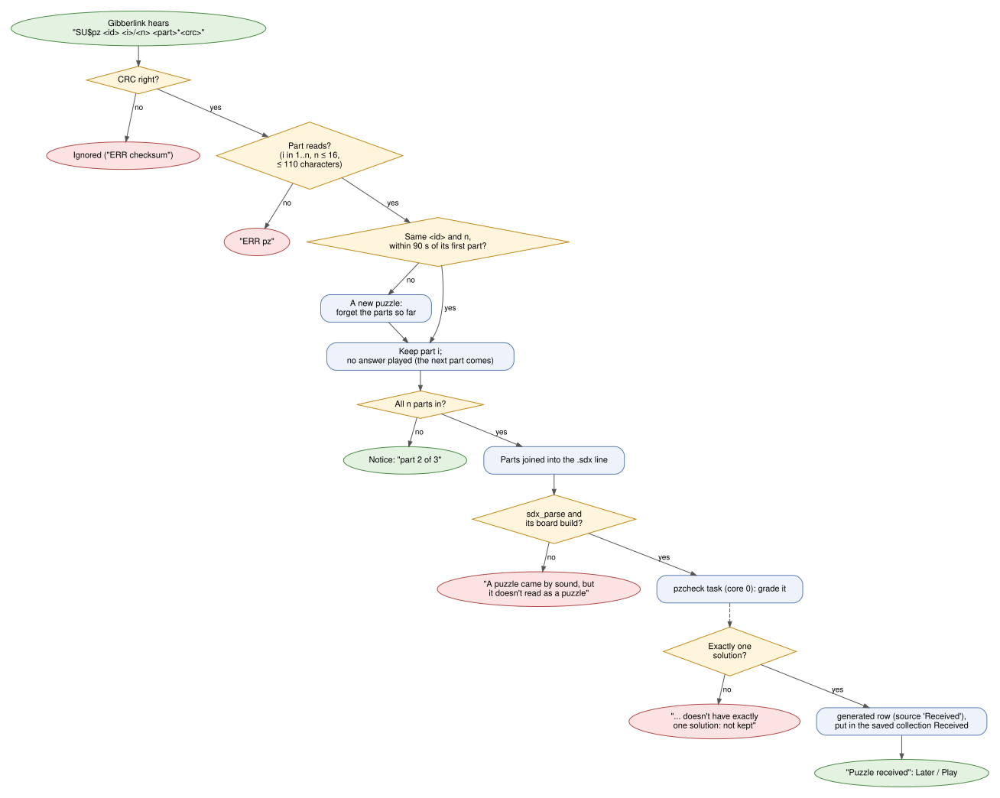

# Sound

[← Internals](README.md) · [README](../../README.md) · [Features](../features.md) · [Data & storage](../data.md) · [Building](../building.md) · [Development](../development.md) · [Remote control](../devctl.md)

The board's speaker and microphones: the sound effects, Gibberlink (remote control by sound), and Send by sound (a puzzle from one board to another). They share one audio path, so they are on one page.

## The audio path

The ES8311 codec drives the speaker, the ES7210 ADC reads the two microphones; both sit on the same I2S port at **24 kHz** (`src/bsp/bsp_audio.c`). The speaker's amplifier has its own enable pin, held off when the board turns off. Volume (Settings > Sound) is the codec's.

## Sound effects

`src/sfx.c`: a small synthesizer, not recorded sounds.

- **The sounds** are short note lists (frequency, length, waveform, level), per `sfx_id_t`:

  | Sound | When | Notes |
  |---|---|---|
  | `SFX_TOUCH` | any touch (but the tap that wakes the screen) | a 14 ms 2.4 kHz sine tick |
  | `SFX_DIGIT_DONE` | all nine of a digit placed | a rising fifth, G5 → C6 (triangle) |
  | `SFX_UNIT_DONE` | a row, column or box complete | E6 G6 C7 (sine) |
  | `SFX_UNITS_DONE` | two or three at once | C6 E6 G6 C7, held |
  | `SFX_ERROR` | a digit that breaks a rule | a low two-step buzz (square, G3 → D3) |
  | `SFX_SOLVED` | the puzzle solved | a C major arpeggio and a held top note |

- **Playing**: `sfx_play()` only queues the sound's id, so it is safe from any LVGL callback. The `sfx` task (core 0, priority 5) sleeps on the queue while silent; once something plays it mixes up to **4 voices** (a fifth sound steals the first voice), each note with a 2 ms attack and an exponential decay with a short linear tail, renders chunks and writes them to I2S. The chunk after the last note is silence, written too, so the tail isn't cut.
- **PCM clips**: `sfx_play_pcm()` mixes one mono 24 kHz clip over the notes (Gibberlink's replies); the caller keeps the samples until `is_sfx_pcm_busy()` says it's done.
- **Sound off** (Settings > Sound) stops new effects; a clip still plays (a reply must be heard).

Tuning the sounds: [Development](../development.md#tuning-the-sounds).

## Gibberlink: commands by sound

`src/gibberlink.cpp`, on with Settings > Sound > Gibberlink (off by default). [ggwave](https://github.com/ggerganov/ggwave) (vendored unchanged in `src/ggwave/`) is the data-over-sound protocol AI agents switch to in Gibberlink.

- **Listening**: the `gibberlink` task (core 0) reads the microphones 512 samples at a time (21.3 ms; the two averaged) and feeds ggwave, set up for audible Normal and Fast at 24 kHz. 512 samples at 24 kHz give 46.875 Hz a frequency bin, the same as ggwave's usual 48 kHz / 1024, so the board understands phones, browsers and Gibberlink's agents.
- **A message** (up to 140 bytes) is one devctl command (`tap 360 400`, `fill 1:9`, `state`, `ping` ...), optionally after a sender id (`AB$tap 360 400`) and optionally ending in `*` and a CRC-16/CCITT-FALSE of the text (`fill 1:9 4:2*7C3E`): ggwave's error correction now and then turns a garbled message into another valid-looking one, and with the check a garbled one isn't run (`ERR checksum`).
- **Running it**: the heard text is queued to the LVGL task, which runs it exactly as if it came over serial ([devctl](../devctl.md)), and queues the answer back.
- **Replying**: the worker encodes the answer as ggwave audible Fast, prefixed `P4$` (with the same kind of check), and has the `sfx` task play it as a PCM clip at ggwave volume 80 (30 was too quiet: a laptop a metre away missed one reply in four). Two replies are 700 ms apart so the listener's decoder settles.
- **Not hearing itself**: while a reply plays, and for 400 ms after, nothing is decoded; the board's own sound effects aren't decoded either.
- A small icon at the bottom right shows while Gibberlink is on, lit for 1.5 s after a command.

## Send by sound: a puzzle to another board

The game's ⋮ > Share > **Send by sound** (`src/ui_share.c`, the texts in `src/share_core.c`). The other board needs Gibberlink on.

**Sending**:

1. The puzzle becomes its `.sdx` line (`share_pz_line()`): variant, level, the givens packed (a run of 1–26 empty cells is one letter `a`–`z`), and its layout (regions, cages, marks, lines), trailing empty fields left out.
2. The line goes in parts of 110 characters (`PZ_PART`), at most 16 parts: a Classic puzzle is one part (about 6 s), a Killer three or four.
3. Each part is one Gibberlink message:

   ```
   SU$pz <id> <i>/<n> <part>*<crc>
   ```

   `SU` is the sender id; `<id>` 2 hex digits, random, the same in every part of one puzzle; `<i>/<n>` the part and the count; `<crc>` the CRC-16/CCITT-FALSE of the text after `SU$`.
4. The parts are queued to the Gibberlink sender; a notice says how long it takes.

**Receiving** (`sudoku_ui_puzzle_part()`, devctl's `pz` command):




1. Each part is checked (the CRC, by Gibberlink) and read (`share_pz_part_read()`). No answer is played for a part, so the next one isn't missed.
2. Parts are kept until all `n` of the same `<id>` are in; a new `<id>`, or 90 s since the first part (`PZ_TIMEOUT_MS`), starts over. A notice counts them ("part 2 of 3").
3. The whole line is parsed (`sdx_parse()`), its board built, and a task (`pzcheck`, core 0) grades it: a puzzle without exactly one solution is refused.
4. A good one is stored like a typed-in puzzle (`generated.source = 'Received'`), put in the saved collection **Received**, and offered to play.

## Who uses the speaker when

| Sound | Plays through |
|---|---|
| Effects | the `sfx` task's voices |
| Gibberlink's replies and Send by sound's parts | the `sfx` task, as PCM clips (one at a time) |

The microphones are read only while Gibberlink is on.
