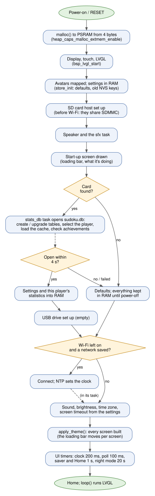
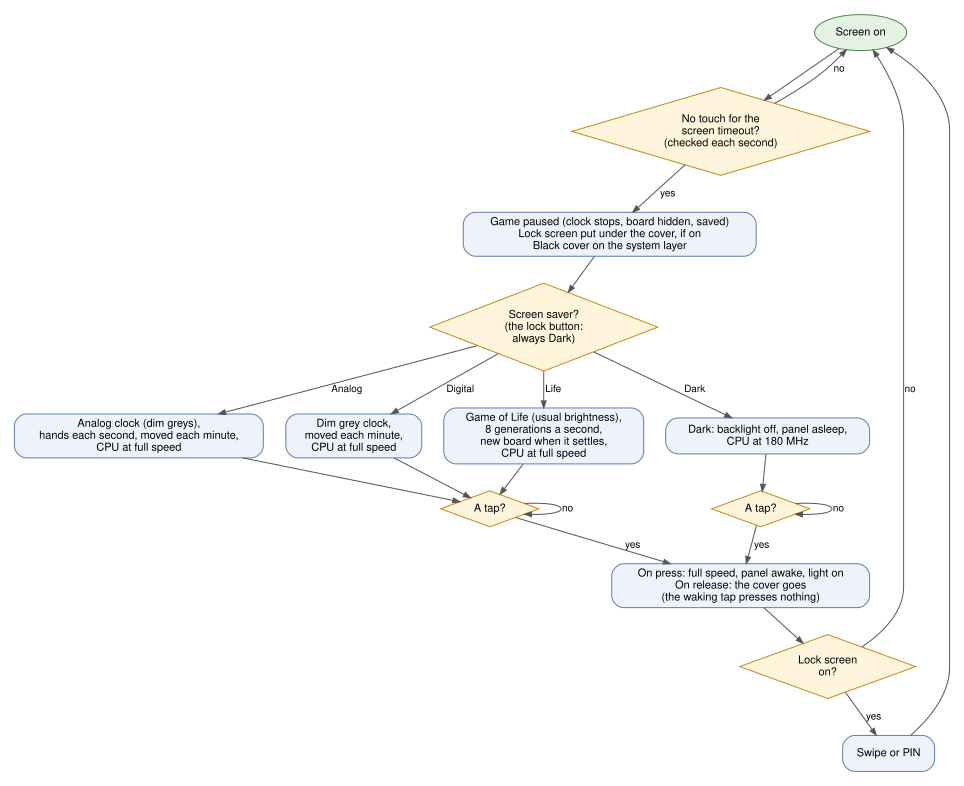
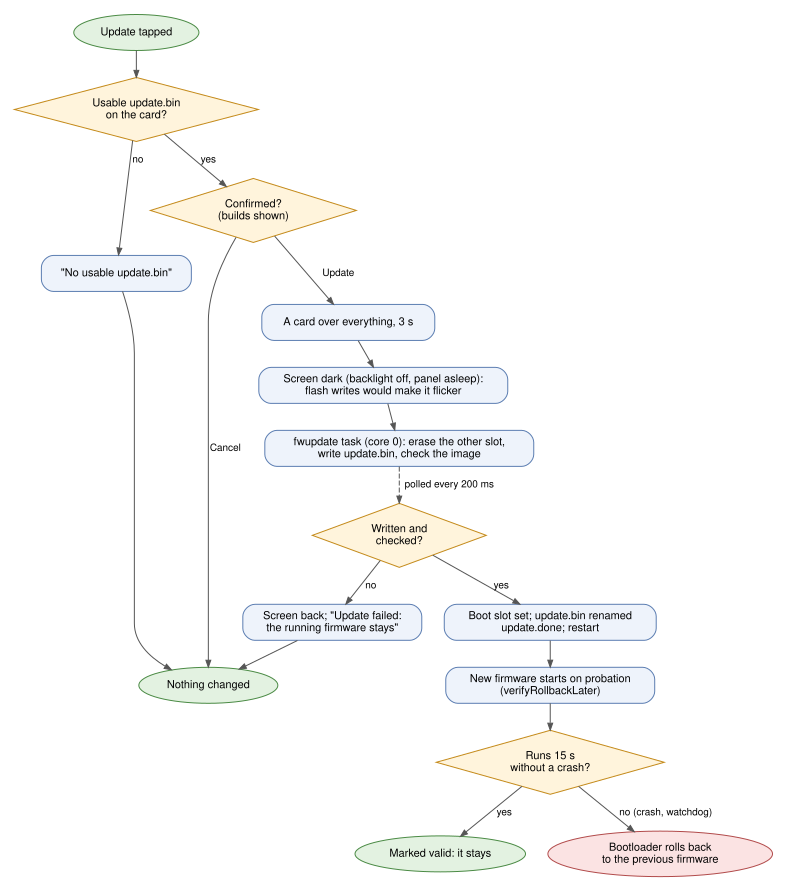

# Start-up and power

[← Internals](README.md) · [README](../../README.md) · [Features](../features.md) · [Data & storage](../data.md) · [Building](../building.md) · [Development](../development.md) · [Remote control](../devctl.md)

What happens from power-on to the Home screen, and back down: the screen saver, power saving, turning off, lending the card to a computer, and a firmware update's probation. The order of many steps is forced by the hardware; this page says why.

## Power-on to Home

`setup()` in `esp32p4_sudoku.ino`, then `sudoku_ui_start()` in `src/ui_sudoku.c`:

1. **`heap_caps_malloc_extmem_enable(4)`**: every `malloc()` of 4 bytes or more goes to PSRAM from here on (see [Memory](memory.md)). It comes first, before anything allocates.
2. **Serial** at 115200, with a 2 KB receive buffer for devctl uploads. The reset reason is read now and shown as a notice later if it wasn't a normal start (a brownout, a panic, a watchdog).
3. **Display and LVGL** (`bsp_lvgl_start()`): the MIPI-DSI panel (ST7703 or JD9365, detected), touch, the draw buffers.
4. **Avatars** (`avatars_init()`): their pixels mapped from their flash partition.
5. **The settings in RAM** (`store_init()`): defaults, then anything an old firmware left in NVS.
6. **The SD card's host** (`bsp_sdcard_host_init()`), **before Wi-Fi**: the card (SDMMC slot 0) and the Wi-Fi chip (an ESP32-C6 on SDMMC slot 1, ESP-Hosted) share the SDMMC host. Setting up the card while Wi-Fi runs kills the Wi-Fi link (the C6 times out and resets).
7. **The speaker** (`sfx_init()`) and its task.
8. **The UI** (`sudoku_ui_start()`):
   1. the undo buffers, the generator's tables and the puzzle cache, in PSRAM;
   2. the **splash screen** (`extras/splashscreen.png`, decoded once), drawn at once; its loading bar moves with each step below;
   3. **the card**: probed (`sd_probe_card()`); if there is one, the `stats_db` task opens `sudoku.db`: creates or upgrades the tables, merges any old NVS statistics once, selects the current player, loads the cache and checks every player's achievements (quietly). The UI waits up to 4 s for it, in 40 ms steps, then takes the settings and the current player's statistics into RAM;
   4. **USB**: the drive is set up empty (lent only on Connect); it also tells the board when a computer is plugged in;
   5. **Wi-Fi** (`wifi_mgr_start()`): reconnects to the saved network if Wi-Fi was left on; NTP sets the clock once connected;
   6. sound, Gibberlink, volume, brightness, the time zone, the screen timeout and the collection last shown, from the settings;
   7. **every screen built** (`apply_theme()`), the splash freed;
   8. **the UI's timers**: the game clock (200 ms), the screen saver and Home's clock (1 s), night mode (20 s), the database poll (100 ms).
9. `loop()` starts: LVGL, devctl, Gibberlink's commands, the avatar install, each pass. It waits 1–20 ms between passes (50 ms while the screen is dark).

Without a card the game starts on defaults and keeps everything in RAM until power-off; the Solved dialog and Settings say so.

## The screen saver and power saving

After the screen timeout (Settings > Display) without a touch (`saver_cb()` in `src/ui_saver.c`, each second):

1. the game pauses, and a black cover goes over everything on LVGL's system layer;
2. if **Clock** is on, a dim clock (12 % backlight) moves about for 10 minutes;
3. then **dark**: `bsp_power_save(true)` turns the backlight off, puts the panel to sleep (DCS display-off and sleep-in, while the DPI stream keeps running) and clocks the CPU down to **180 MHz**.

The next tap only wakes the screen (it doesn't press anything): sleep-out, display-on, full speed, the backlight. The lock screen, if on, is waiting under the cover.

Why 180 MHz and not lower: on this chip the memory and bus clocks follow the CPU, and at 90 MHz the display's DMA can't fetch the frame buffer from PSRAM fast enough ("can't fetch data from external memory fast enough"), and the board crashes. devctl `genbench` runs at full speed even while dark (`bsp_power_cpu_full()`).

Night mode (Settings > Display) is separate: between its hours the dark look and a lower brightness apply (`night_check()`, every 20 s); `effective_brightness()` is the lower of the two.

## Turning off

Home's power button (`power_off_cb()`), confirmed:

1. a black layer is drawn and the backlight goes off (nothing half-drawn shows);
2. `device_power_off()` closes `sudoku.db` cleanly;
3. `bsp_power_off()` drives and holds the backlight off, the speaker amplifier off, the panel in reset and the Wi-Fi chip in reset, then calls `gpio_force_hold_all()` and enters deep sleep with no wake source.

Only the **RESET** button wakes it, as a normal start. The hold-all matters on pre-v3 ESP32-P4 chips: the per-pin holds (`gpio_hold_en()`) live in a power domain that deep sleep switches off, so the pins floated and the backlight came back on; the PMU's hold-all is in the low-power domain and lasts until the boot ROM releases it on RESET.

## Lending the card over USB

Settings > Data > USB drive > Connect (`src/usb_drive.c`, `src/usb_msc.cpp`):

1. the database's pending writes are flushed and `sudoku.db` is closed (`stats_db_suspend()`), the FAT volume unmounted;
2. TinyUSB's mass-storage device exposes the card to the computer (the "Sudoku SD Card" drive); a panel covers the screen meanwhile;
3. on Done (or the computer ejecting it), the card is mounted again, `sudoku.db` reopened, and every setting reloaded from it (`settings_reload()`), since the computer may have replaced the file. New `puzzles/` files can be imported then.

Meanwhile the board can't use the card itself: the panel covers the screen, and devctl commands that need the card answer that it's busy (`settings_card_busy()`, which also covers a firmware update or a format under way).

## A firmware update and its probation

Settings > Data > Firmware update writes `update.bin` from the card into the other app slot (`src/fw_update.c`, task `fwupdate`) and restarts into it. The new firmware starts **on probation**: `verifyRollbackLater()` tells the Arduino core not to accept it at once, and `loop()` marks it good (`fw_mark_running_ok()`) only after it has run for 15 s. If it crashes before, the bootloader goes back to the previous firmware at the next start. While the flash is written the screen is dark ([Display and the flash](display.md#flash-writes)).

## Boot messages

On the serial port (115200): `ESP32-P4 Sudoku`, the reset reason, the panel's kind, the card (`microSD: "SD32G", 29.7 GB`), `stats_db: ... open, 2 players, playing as "...", 412 solves logged`, and `DEVCTL ready`. Serial capture through the board's CH343 can drop lines while the port is closed; see [Remote control](../devctl.md).
