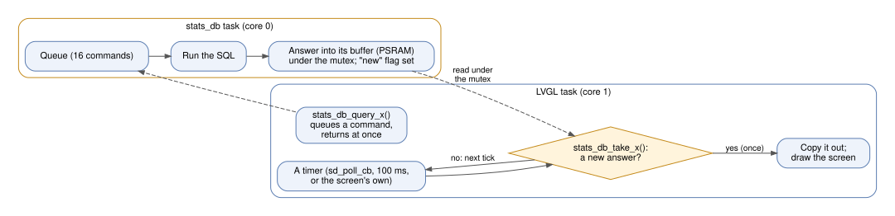

# Tasks and cores

[← Internals](README.md) · [README](../../README.md) · [Features](../features.md) · [Data & storage](../data.md) · [Building](../building.md) · [Development](../development.md) · [Remote control](../devctl.md)

What runs where on the ESP32-P4's two cores, how the tasks hand their results to the screens, and the rules that keep the board from rebooting or the screen from blinking.

## In one paragraph

Everything on screen runs in one place: Arduino's `loop()` task on **core 1**, which calls `lv_timer_handler()` (LVGL), devctl and Gibberlink's queue. Anything slow (the database, making a puzzle, decoding a video, writing a file, the microphones) runs in a task of its own, almost always on **core 0**. Those tasks never touch LVGL: they leave their result somewhere the UI polls, and an LVGL timer picks it up and draws it.

## The tasks

| Task | Started by | Core | Prio | Stack | Lives | What it does |
|---|---|---|---|---|---|---|
| `loopTask` (Arduino) | the core | 1 | 1 | 16 KB | always | `loop()`: LVGL and every screen, devctl, Gibberlink's commands, the avatar install's steps |
| `stats_db` | `stats_db_start()` | 0 | 3 | 16 KB | always | all SQL on `sudoku.db`, one command at a time from a queue |
| `wifi_mgr` | `wifi_mgr_start()` | any | 3 | | always | the Wi-Fi station: scanning, connecting, NTP |
| `sfx` | `sfx_init()` | 0 | 5 | 4 KB | always | mixes the sound effects and PCM clips into the speaker |
| `gibberlink` | Gibberlink switched on | 0 | 3 | 8 KB | while on | reads the microphones, decodes ggwave, encodes replies |
| `gen` | New puzzle, the daily puzzle | 0 | 2 | 16 KB | one puzzle | `sudoku_generate()` |
| `learn` | Learn | 0 | 2 | 16 KB | one search | finds a position to practise a lesson on |
| `edcheck` | Enter a puzzle > Check | 0 | 2 | 16 KB | one check | counts the solutions, grades |
| `pzcheck` | a puzzle received by sound | 0 | 2 | 16 KB | one check | grades it (one solution?) |
| `genbench` | devctl `genbench` | 0 | 2 | 16 KB | one run | times the generator |
| `media` | the Files viewer | 0 | 2 | 16 KB | one file | decodes a JPEG, or plays an MP4 (tinyh264) |
| `media_cv` | a video | **1** | 1 | 4 KB | one video | converts the decoded frames to RGB565 (overlaps the decoding) |
| `screenshot` | a camera button | 0 | 2 | 4 KB | one shot | JPEG-encodes the copied frame, writes it |
| `files`, `files_rm` | Files | 0 | 2 | 6–8 KB | one job | reads a folder; deletes into or out of the Recycle bin |
| `sd_card` | Settings > Data > Format, card probe | 0 | 4 | 8 KB | one job | probes or formats the card |
| `fwupdate` | Settings > Data > Firmware update | 0 | 3 | 8 KB | one update | writes `update.bin` into the other app slot |
| `avatars` | avatars.bin on the card | 0 | 1 | 4 KB | one install | writes the avatars' partition |
| `sysmon_tasks`, `sysmon_sd` | System monitor | 0 | 2 | 3–4 KB | while shown / one count | the task list; the card's free space |

`WORKER_CORE` (`src/ui_internal.h`) and `SETTINGS_TASK_CORE` (`src/settings_core.h`) are both 0. Besides these, ESP-IDF runs its own (Wi-Fi's ESP-Hosted link, lwIP, TinyUSB for the USB drive, the timers), and the display's DMA interrupts are served on core 1.

## How results get back to the screen

The UI never waits on a task for long. The patterns, from the most common:

- **A queue in, a "take" out** (`stats_db`): the UI calls `stats_db_query_*()`, which queues a command and returns at once. The worker runs it and leaves the answer in a buffer under a mutex with a "new" flag; an LVGL timer (`sd_poll_cb()`, every 100 ms, or the screen's own) calls `stats_db_take_*()`, which copies it out once. Writes (a solve, a saved game) are fire-and-forget; only the newest queued game save is written.
- **A done flag and a timer** (`gen`, `learn`, `edcheck`, `pzcheck`, `screenshot`, `files`): the task fills static variables, sets a `volatile` done flag (or a state: idle, writing, done, failed) and deletes itself, or suspends and waits to be deleted; a short LVGL timer started with it polls the flag, takes the result and deletes the timer.
- **Two buffers** (`media`): the worker decodes into the buffer not shown and hands it over (`s_pending`); the page's timer shows it and only then may the worker fill the other one. See [Replay and video](replay-video.md).
- **A queue the other way** (`gibberlink`): a heard command is queued to the LVGL task, which runs it as devctl would, and queues the answer back.
- **Fire and forget** (`sfx`): `sfx_play()` queues a sound and returns.

## The rules

1. **LVGL only from `loopTask`.** LVGL isn't thread-safe and runs without an OS layer (`LV_OS_NONE`). A worker that wants something shown leaves it for a poll. (`printf` from any task is fine.)
2. **Long work goes to core 0, and yields.** The task watchdog watches core 0's idle task with a 5 s timeout and a panic: a task that computes for more than 5 s without blocking reboots the board. The generator calls `sudoku_gen_yield()` (each attempt, each clue tried, every 4096 search nodes), which `ui_newpuzzle.c` makes a `vTaskDelay(1)` at most every 100 ms. A Greater-Than Expert puzzle once took 15 s and rebooted the board before this. A new long loop needs the same.
3. **Pin workers explicitly** (`xTaskCreatePinnedToCore(..., 0)`). An unpinned task is pinned to whichever core it is on the first time it uses the FPU, and tasks created from `setup()` start on core 1, next to LVGL: pinning the workers to core 0 shortened the stall returning to Home from 173 to 98 ms.
4. **Nothing on core 1 may switch interrupts off for long.** Core 1 also serves the display's interrupts; holding them off for milliseconds makes the whole panel blink cyan. Measured: `heap_caps_get_largest_free_block(MALLOC_CAP_SPIRAM)` walks the 28 MB heap under its lock (4 ms), `uxTaskGetSystemState()` holds the kernel lock (1.5 ms); once a second, either one blinked. So the System monitor shows no PSRAM largest block, works out CPU load from the idle tasks' counters, and reads the task list from `sysmon_tasks` on core 0. See [Display and the flash](display.md).
5. **One writer for `sudoku.db`.** All SQL goes through the `stats_db` task (devctl `sql` too). See [Database design](database.md#writing-safely).
6. **Big stacks for the solver.** The solver recurses (up to ~90 bytes a level, a level per empty cell): the tasks that run it get 16 KB, and so does `loop()` (`SET_LOOP_TASK_STACK_SIZE`), since Continue re-solves a puzzle there; 8 KB overflowed on a hard Hyper puzzle.

## Seeing them

System monitor > Tasks lists every task with its core, priority, stack left and CPU share (sortable); devctl `heap` prints the heaps. The task list is read on core 0 (rule 4).
