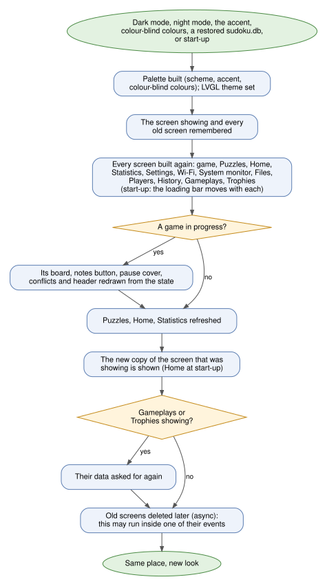

# UI structure

[← Internals](README.md) · [README](../../README.md) · [Features](../features.md) · [Data & storage](../data.md) · [Building](../building.md) · [Development](../development.md) · [Remote control](../devctl.md)

How the screens are organised in the source: which files make up a screen, how state is shared without global variables, how the screens are built and rebuilt, and the timers that keep them current. The file list is in [Development](../development.md#layout).

## Files

| Kind | Name | What's in it |
|---|---|---|
| A screen, or part of one | `ui_<name>.c` | LVGL: widgets, callbacks, drawing (`ui_game.c`, `ui_game_board.c`, `ui_stats.c` ...) |
| Its data, without LVGL | `<name>_core.c` (or a few files under a `<name>_core.h`) | what the screen shows and does, testable on a PC where it is plain C (`game_core.c`, `hint_core.c`, `statistics_core.c`, `puzzles_core.h` ...) |
| What the UI files share | `ui_internal.h` | includes, layout macros, types, every function one UI file calls in another, the accessors |
| What one screen's files share | `ui_<name>_part.h`, `ui_settings.h`, `ui_trophies_tab.h`, `ui_sysmon_tab.h` | only those files include it |
| The public face | `ui_sudoku.h`, `ui_media_view.h`, `ui_wifi.h` ... | what the sketch, devctl and the other modules call |

A UI file builds its widgets, handles their events and draws; the decisions (what to show, what a tap changes) are in the core file when they don't need LVGL. That split is what lets the rules check, the hints' words, Share, the daily puzzle, the undo history and the import parsers run in the PC tests.

## No global variables

- **Variables are `static`** in the file that owns them. Another file uses an **accessor** the owner defines, declared in `ui_internal.h` under the owner's name: `game_sel()` / `game_set_sel(i)`, `screen_home()`, `game_status_lbl()`.
- **Arrays and structs are handed out `const`** (`game_given()[i]`, `game_b()->val[i]`), so the compiler refuses a write from another file. Where another file must change them, the owner offers a function (`game_board()` for the board's moves, `game_set_save_state()`, `players_take()`).
- **No `extern` variables** anywhere in `src/`, in the UI or elsewhere. Constant tables are read through functions too (`variant_name()`, `ui_digits()`, `ui_palette()`).
- **A function stays `static`** unless another file calls it; then it is declared once in the shared header and defined without `static`, its comment in the header and `/* (documented in ui_internal.h) */` at the definition.

## The screens and the theme

The screens are LVGL screens kept in a registry (`src/ui_screens.c`): `screen_home()`, `screen_list()`, `screen_game()`, `screen_stats()`, `screen_settings()`, `screen_wifi()`, `screen_profile()`, `screen_history()`, `screen_plays()`, `screen_trophy()`, `screen_sysmon()`, `screen_files()`, plus a few built on demand (Replay, Learn, Enter a puzzle). Moving between them is `lv_screen_load()`.

**`apply_theme(dark)`** builds them all: the palette (`palette_build()`: the scheme, the accent, the colour-blind colours), LVGL's theme, then each screen's `build_*()` in turn. It runs at start-up (the start-up screen's loading bar and its line move on with each screen) and whenever the look changes: dark mode, night mode starting or ending, the accent colour, colour-blind colours, a restored `sudoku.db`. Because every screen is rebuilt:

- **no state lives in the widgets**: a screen draws from the state (the game, the settings, the database's answers) every time it is built or refreshed, so a rebuild loses nothing;
- the screen that was showing is shown again, and the old screens are deleted **later** (`lv_obj_delete_async()`): the rebuild may be running inside one of their events;
- for a moment there are two copies of every screen, so a data change never triggers a rebuild (it once left the SD card's DMA too little internal RAM); new collections refresh only the Puzzles screen (`list_fill_colls()`).

## Layers

| Layer | Used for |
|---|---|
| the screen | the screens' widgets |
| `lv_layer_top()` | dialogs (`make_msgbox()`), notices, the ⋮ context menus, the trophy toast, the tour, the Wi-Fi password dialog, the flash-busy card |
| `lv_layer_sys()` | the screen saver's black cover and the lock screen (over everything, including dialogs), the power-off black |

## Timers

LVGL timers, all on the UI task:

| Timer | Every | Does |
|---|---|---|
| `tick_cb` | 200 ms | the game clock and the timer label |
| `sd_poll_cb` | 100 ms | takes `sudoku.db`'s answers: statistics, players, imports, messages, reloaded settings; the card and USB state; the trophy toast; History and Gameplays |
| `clock_cb` | 1 s | Home's clock and date, the daily button at midnight, this week's line; on Settings, `settings_tick()` keeps the network, card and USB rows current |
| `saver_cb` | 1 s | the screen timeout and the screen saver |
| `night_check` | 20 s | night mode on or off |
| a screen's own | while shown | System monitor's refresh, the viewer's 10 ms poll, Replay's playback, a task's done flag |

A task's result is never pushed into the UI: a timer takes it (see [Tasks and cores](tasks.md#how-results-get-back-to-the-screen)).

## Notices, dialogs, menus

- **Notices** (`sudoku_ui_notice(text, ms)`, `src/ui_notice.c`): a banner at the bottom for a while; one can stay while something runs (a file from the computer). Workers and the database post messages the poll turns into notices.
- **Dialogs**: `make_msgbox(title, text)` and `msgbox_button()` (`src/ui_common.c`), on the top layer; `mbox_close_cb` closes one.
- **Context menus**: `ctx_menu_toggle(button, items, n)` (`src/ui_ctx_menu.c`): a card of icon rows under its button; a tap beside it closes it. Items can be dimmed.
- **The trophy toast**: achievements unlocked by the last solve, at the top with a chime, whatever the screen (`trophy_toast_poll()`).

## Adding a screen

1. `ui_<name>.c` with `build_<name>()` making its screen (`make_screen()`), and its data in a `<name>_core.c` if it has any logic.
2. A registry entry in `ui_screens.c` (`screen_<name>()`, and its setter if built elsewhere), and a call in `apply_theme()`'s list, with a `splash_built()` step and a row in `SPLASH_BUILD` (`src/ui_splash.c`: its name under the loading bar, and its time).
3. Its button: Home's menu (`src/ui_home.c`), a ⋮ menu, or another screen.
4. Anything it polls: from `sd_poll_cb()` if it is `sudoku.db`'s answer, or its own timer created while it's shown.
5. A name for devctl's `screen` command (`src/ui_remote.c`), so tests can tell where they are.
6. The new files in [Development](../development.md#layout), and `@ingroup` for the code documentation.
