# 10 Lines

[← All variants](README.md) · [Puzzles](../features-puzzles.md) · [How to play](../how-to-play.md)

## The rules

[Classic](classic.md) rules, and **green lines**: each line splits into **runs** of cells next to each other along it, and every run adds up to **10**. 3, 7, 1, 5, 4 is 3 + 7 and 1 + 5 + 4. Where a line splits isn't shown: that's part of the puzzle. A run has 2 cells or more.

## On the board

- The lines are wide soft green bands through the cell centres; lines don't cross each other.
- When no way of splitting a line into runs of 10 is left with the digits on it, its digits turn red.
- The grader and hints try every way to split a line: "This line splits into runs of cells that each add up to 10, so row 2, column 4 can only be 8."
- **Puzzles → ⋮ → New puzzle → Lines → 10 Lines**: 8 lines (Hard and Expert: 10), of 2 to 8 cells.

## How to solve it

- **Short lines are one run:** a run has 2 cells at least, so a line of 2 or 3 cells adds up to exactly 10. A two-cell line is 1 and 9, 2 and 8, 3 and 7 or 4 and 6 (5 and 5 only where the two don't see each other).
- **The whole line adds up to 10, 20, 30 ...:** a line of 4 is one run of 10 or two pairs making 20.
- **From the ends:** the first run starts at the line's start, so a 9 there needs a 1 right after it.

## Worked example

**variant-examples #50**, 10 Lines Easy (see [Classic](classic.md#worked-example-the-whole-puzzle) for how to import the examples; cells are written r*row*c*column*).

**Step 1: the 2 in box 2**, by the Classic rules: row 1 has a 2 (r1c3), column 4 one (r5c4), row 3 one (r3c8). **r2c5 = 2**.

**Step 2: the 3 in box 2**: column 4 has a 3 (r7c4), and the rest of the box is filled. **r3c5 = 3**.

**Step 3: the 5 in box 2.** Only r1c4 and r2c4 are empty. r2c4 and the 2 in r1c3 make a short green line of two cells: a single run, so r2c4 is 8, not 5. Only **r1c4** is left: **r1c4 = 5**.

## The whole puzzle, step by step

<!-- walkthrough -->
<!-- Written by tools/walkthrough.py 10-lines: edit the script, not this part. -->

The whole puzzle, from the start to the last cell: 49 steps, each one a single (one place left for a digit, or one digit left for a cell), taken in the order a box's single comes first, so not quite the order of the worked example above. In each picture, the unit the step looks at is tinted yellow (for a cell with one digit left: its row, column and box), the new digit is on green, the digits that rule cells out have an **orange ring**, and the empty cells they rule out a **red cross**. Givens are on grey, digits from earlier steps in blue.

#### Step 1: the 2 in box 2

Box 2 needs a 2. r1c4: row 1 has one (r1c3). r2c4: column 4 has one (r5c4). r3c5: row 3 has one (r3c8). Only **r2c5** is left: **r2c5 = 2**.

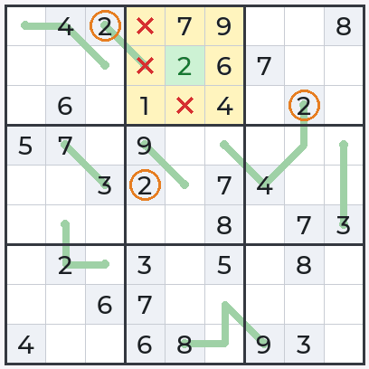

#### Step 2: the 3 in box 2

Box 2 needs a 3. r1c4 and r2c4: column 4 has one (r7c4). Only **r3c5** is left: **r3c5 = 3**.

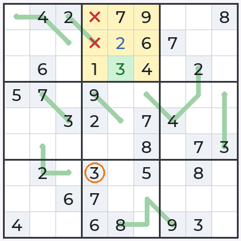

#### Step 3: the 5 in box 2

Box 2 needs a 5. r2c4: with a 5 there, its green line couldn't split into runs that each add up to 10. Only **r1c4** is left: **r1c4 = 5**.

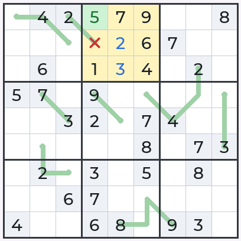

#### Step 4: the 8 in box 2

Box 2 needs an 8, and r2c4 is its last empty cell: **r2c4 = 8**.

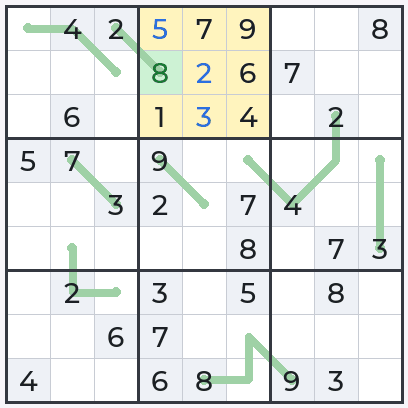

#### Step 5: the 3 in box 3

Box 3 needs a 3. r1c8 and r2c8: column 8 has one (r9c8). r2c9: column 9 has one (r6c9). r3c7 and r3c9: row 3 has one (r3c5). Only **r1c7** is left: **r1c7 = 3**.

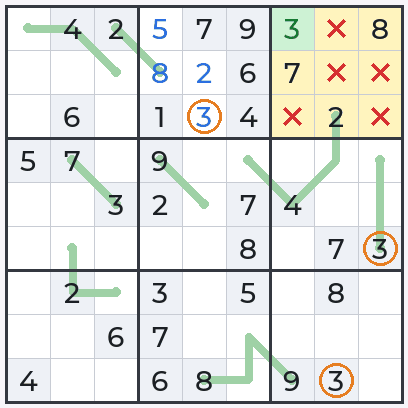

#### Step 6: the 6 in box 3

Box 3 needs a 6. r2c8 and r2c9: row 2 has one (r2c6). r3c7 and r3c9: row 3 has one (r3c2). Only **r1c8** is left: **r1c8 = 6**.

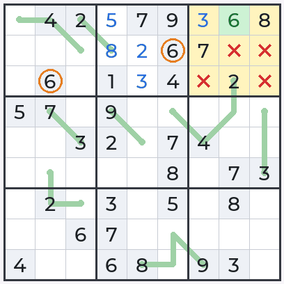

#### Step 7: the 2 in box 4

Box 4 needs a 2. r4c3 and r6c3: column 3 has one (r1c3). r5c1 and r5c2: row 5 has one (r5c4). r6c2: column 2 has one (r7c2). Only **r6c1** is left: **r6c1 = 2**.

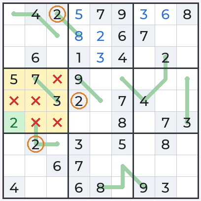

#### Step 8: the 6 in box 4

Box 4 needs a 6. r4c3 and r6c3: column 3 has one (r8c3). r5c2 and r6c2: column 2 has one (r3c2). Only **r5c1** is left: **r5c1 = 6**.

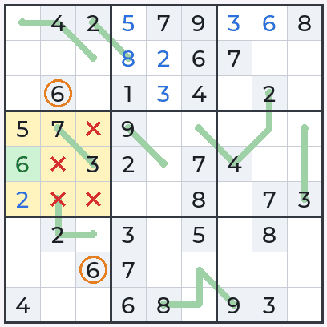

#### Step 9: the 3 in box 5

Box 5 needs a 3. r4c5: column 5 has one (r3c5). r5c5: row 5 has one (r5c3). r6c4 and r6c5: row 6 has one (r6c9). Only **r4c6** is left: **r4c6 = 3**.

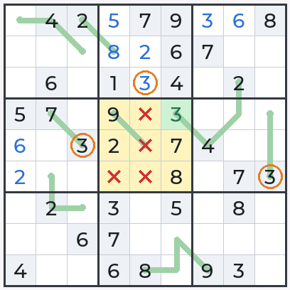

#### Step 10: the 5 in box 5

Box 5 needs a 5. r4c5: row 4 has one (r4c1). r6c4: column 4 has one (r1c4). r5c5: on its green line the run before it adds up to 9, and a 5 would take it past 10. Only **r6c5** is left: **r6c5 = 5**.

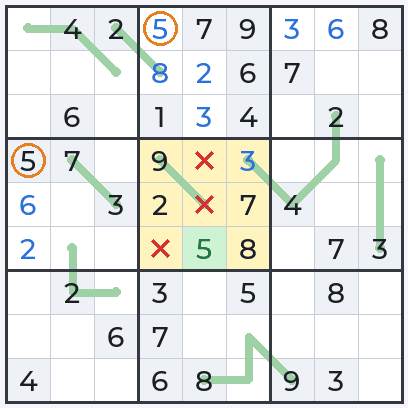

#### Step 11: the 6 in box 5

Box 5 needs a 6. r5c5: row 5 has one (r5c1). r6c4: column 4 has one (r9c4). Only **r4c5** is left: **r4c5 = 6**.

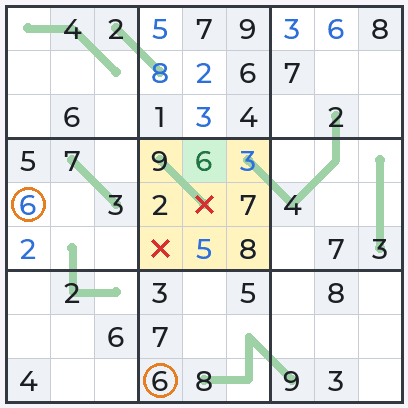

#### Step 12: the 1 in box 5

Box 5 needs a 1. r6c4: column 4 has one (r3c4). Only **r5c5** is left: **r5c5 = 1**.

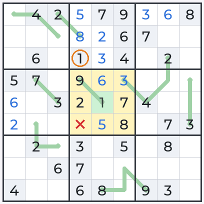

#### Step 13: the 4 in box 5

Box 5 needs a 4, and r6c4 is its last empty cell: **r6c4 = 4**.

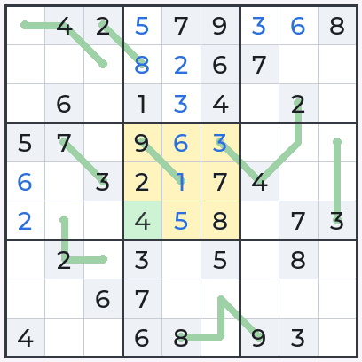

#### Step 14: the 4 in box 4

Box 4 needs a 4. r5c2: row 5 has one (r5c7). r6c2 and r6c3: row 6 has one (r6c4). Only **r4c3** is left: **r4c3 = 4**.

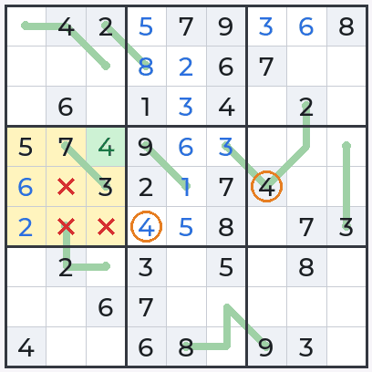

#### Step 15: the 8 in box 4

Box 4 needs an 8. r6c2 and r6c3: row 6 has one (r6c6). Only **r5c2** is left: **r5c2 = 8**.

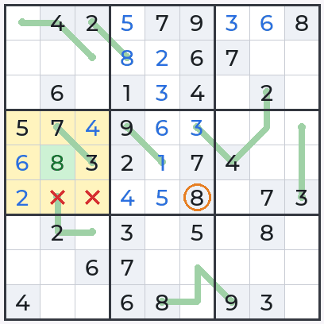

#### Step 16: the 9 in box 4

Box 4 needs a 9. r6c2: with a 9 there, its green line couldn't split into runs that each add up to 10. Only **r6c3** is left: **r6c3 = 9**.

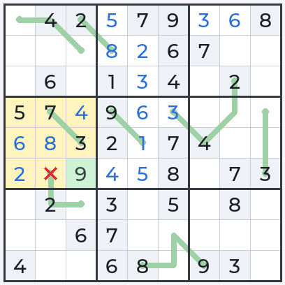

#### Step 17: the 1 in box 4

Box 4 needs a 1, and r6c2 is its last empty cell: **r6c2 = 1**.

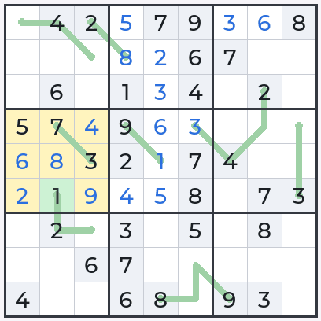

#### Step 18: the 6 in box 6

Box 6 needs a 6. r4c7, r4c8 and r4c9: row 4 has one (r4c5). r5c8 and r5c9: row 5 has one (r5c1). Only **r6c7** is left: **r6c7 = 6**.

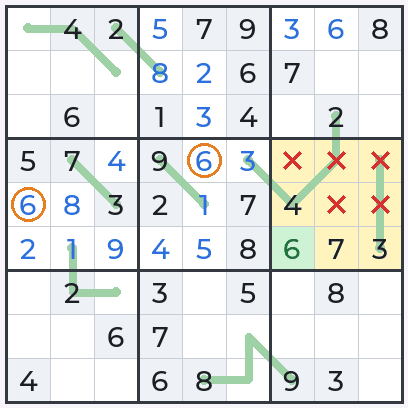

#### Step 19: the 8 in box 6

Box 6 needs an 8. r4c8: column 8 has one (r7c8). r4c9: column 9 has one (r1c9). r5c8 and r5c9: row 5 has one (r5c2). Only **r4c7** is left: **r4c7 = 8**.

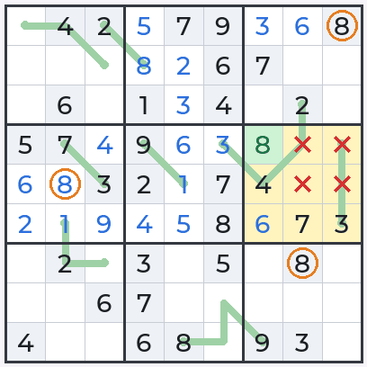

#### Step 20: the 2 in box 6

Box 6 needs a 2. r4c8: column 8 has one (r3c8). r5c8 and r5c9: row 5 has one (r5c4). Only **r4c9** is left: **r4c9 = 2**.

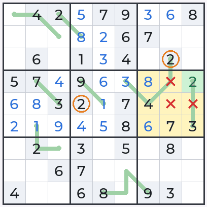

#### Step 21: the 1 in box 6

Box 6 needs a 1. r5c8 and r5c9: row 5 has one (r5c5). Only **r4c8** is left: **r4c8 = 1**.

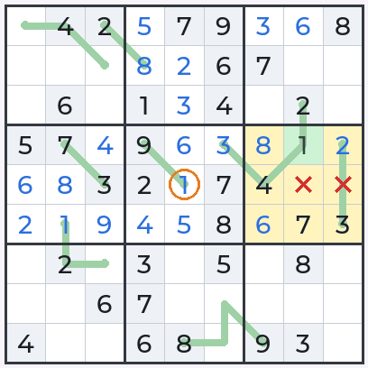

#### Step 22: the 1 in box 3

Box 3 needs a 1. r2c8: column 8 has one (r4c8). r3c7 and r3c9: row 3 has one (r3c4). Only **r2c9** is left: **r2c9 = 1**.

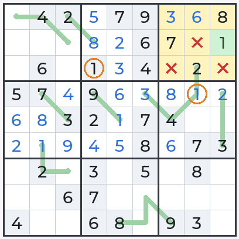

#### Step 23: the 1 in box 1

Box 1 needs a 1. r2c1, r2c2 and r2c3: row 2 has one (r2c9). r3c1 and r3c3: row 3 has one (r3c4). Only **r1c1** is left: **r1c1 = 1**.

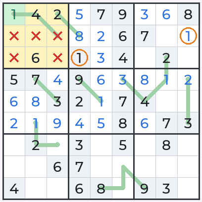

#### Step 24: the 4 in box 3

Box 3 needs a 4. r3c7 and r3c9: row 3 has one (r3c6). Only **r2c8** is left: **r2c8 = 4**.

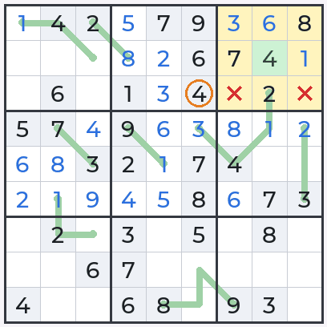

#### Step 25: the 9 in box 3

Box 3 needs a 9. r3c7: column 7 has one (r9c7). Only **r3c9** is left: **r3c9 = 9**.

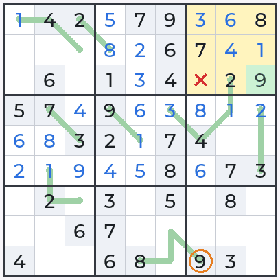

#### Step 26: the 5 in box 3

Box 3 needs a 5, and r3c7 is its last empty cell: **r3c7 = 5**.

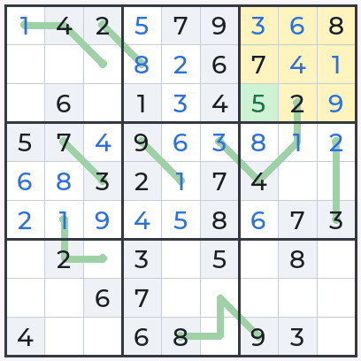

#### Step 27: the 9 in box 6

Box 6 needs a 9. r5c9: column 9 has one (r3c9). Only **r5c8** is left: **r5c8 = 9**.

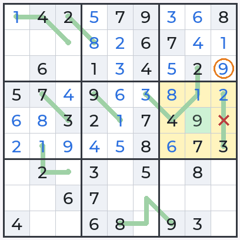

#### Step 28: the 5 in box 6

Box 6 needs a 5, and r5c9 is its last empty cell: **r5c9 = 5**.

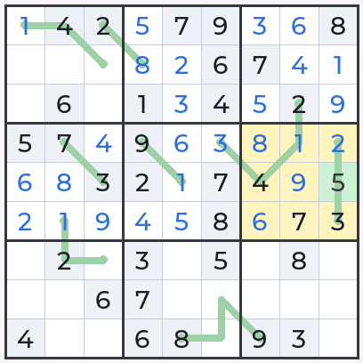

#### Step 29: the 1 in box 7

Box 7 needs a 1. r7c1 and r8c1: column 1 has one (r1c1). r8c2 and r9c2: column 2 has one (r6c2). r7c3: with a 1 there, its green line couldn't split into runs that each add up to 10. Only **r9c3** is left: **r9c3 = 1**.

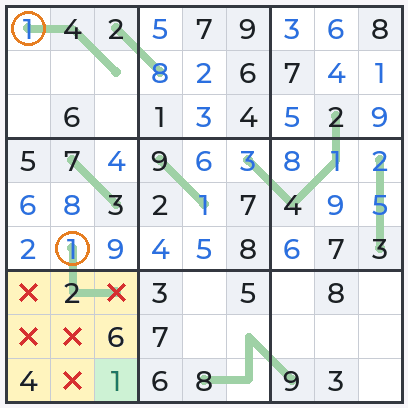

#### Step 30: the 8 in box 7

Box 7 needs an 8. r7c1 and r7c3: row 7 has one (r7c8). r8c2: column 2 has one (r5c2). r9c2: row 9 has one (r9c5). Only **r8c1** is left: **r8c1 = 8**.

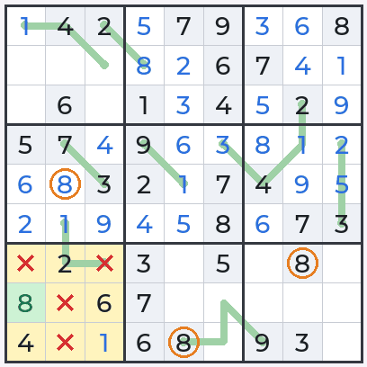

#### Step 31: the 8 in box 1

Box 1 needs an 8. r2c1, r2c2 and r2c3: row 2 has one (r2c4). r3c1: column 1 has one (r8c1). Only **r3c3** is left: **r3c3 = 8**.

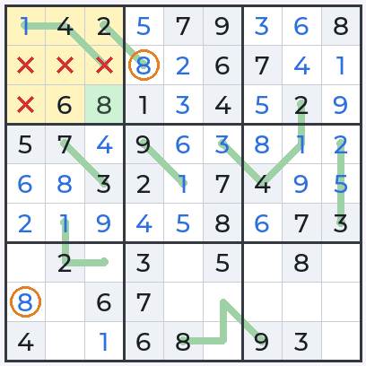

#### Step 32: the 7 in box 1

Box 1 needs a 7. r2c1, r2c2 and r2c3: row 2 has one (r2c7). Only **r3c1** is left: **r3c1 = 7**.

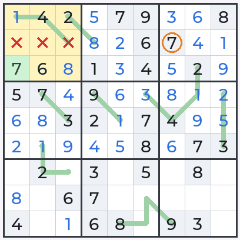

#### Step 33: the 3 in box 7

Box 7 needs a 3. r7c1 and r7c3: row 7 has one (r7c4). r9c2: row 9 has one (r9c8). Only **r8c2** is left: **r8c2 = 3**.

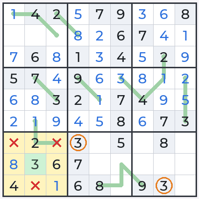

#### Step 34: the 3 in box 1

Box 1 needs a 3. r2c2: column 2 has one (r8c2). r2c3: column 3 has one (r5c3). Only **r2c1** is left: **r2c1 = 3**.

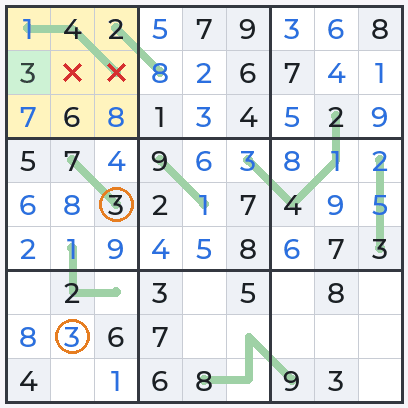

#### Step 35: the 9 in box 1

Box 1 needs a 9. r2c3: column 3 has one (r6c3). Only **r2c2** is left: **r2c2 = 9**.

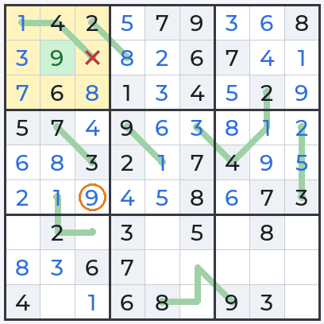

#### Step 36: the 5 in box 1

Box 1 needs a 5, and r2c3 is its last empty cell: **r2c3 = 5**.

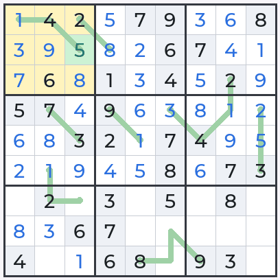

#### Step 37: the 5 in box 7

Box 7 needs a 5. r7c1 and r7c3: row 7 has one (r7c6). Only **r9c2** is left: **r9c2 = 5**.

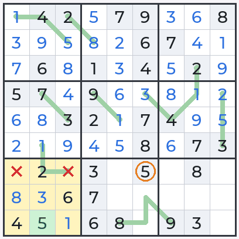

#### Step 38: the 7 in box 7

Box 7 needs a 7. r7c1: column 1 has one (r3c1). Only **r7c3** is left: **r7c3 = 7**.

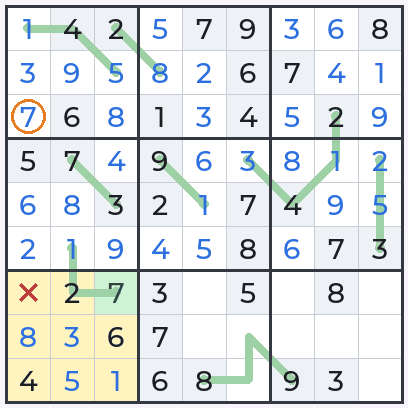

#### Step 39: the 9 in box 7

Box 7 needs a 9, and r7c1 is its last empty cell: **r7c1 = 9**.

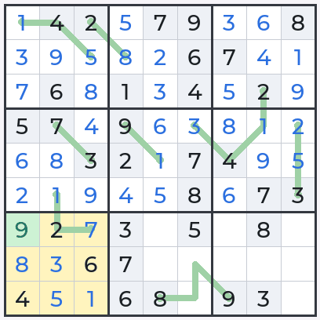

#### Step 40: the 1 in box 8

Box 8 needs a 1. r7c5 and r8c5: column 5 has one (r5c5). r9c6: row 9 has one (r9c3). Only **r8c6** is left: **r8c6 = 1**.

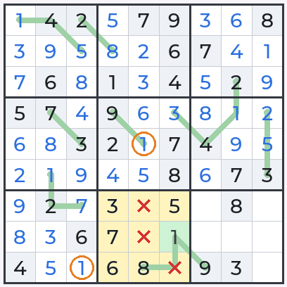

#### Step 41: the 2 in box 8

Box 8 needs a 2. r7c5: row 7 has one (r7c2). r8c5: column 5 has one (r2c5). Only **r9c6** is left: **r9c6 = 2**.

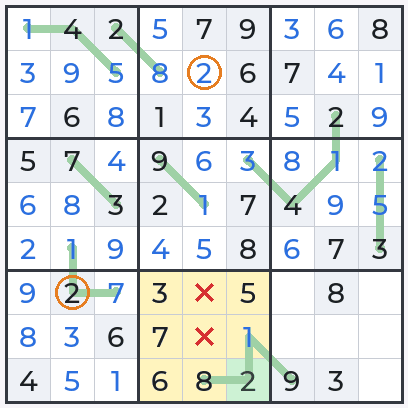

#### Step 42: the 9 in box 8

Box 8 needs a 9. r7c5: row 7 has one (r7c1). Only **r8c5** is left: **r8c5 = 9**.

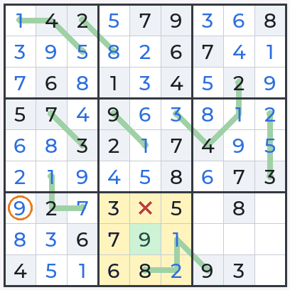

#### Step 43: the 4 in box 8

Box 8 needs a 4, and r7c5 is its last empty cell: **r7c5 = 4**.

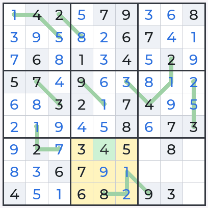

#### Step 44: the 1 in box 9

Box 9 needs a 1. r7c9: column 9 has one (r2c9). r8c7, r8c8 and r8c9: row 8 has one (r8c6). r9c9: row 9 has one (r9c3). Only **r7c7** is left: **r7c7 = 1**.

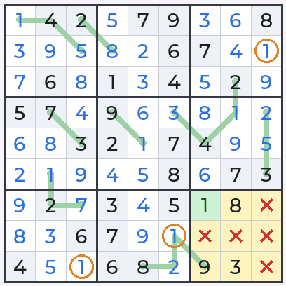

#### Step 45: the 2 in box 9

Box 9 needs a 2. r7c9: row 7 has one (r7c2). r8c8: column 8 has one (r3c8). r8c9: column 9 has one (r4c9). r9c9: row 9 has one (r9c6). Only **r8c7** is left: **r8c7 = 2**.

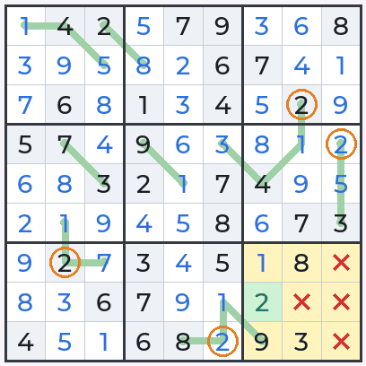

#### Step 46: the 4 in box 9

Box 9 needs a 4. r7c9: row 7 has one (r7c5). r8c8: column 8 has one (r2c8). r9c9: row 9 has one (r9c1). Only **r8c9** is left: **r8c9 = 4**.

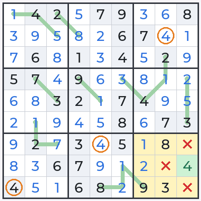

#### Step 47: the 5 in box 9

Box 9 needs a 5. r7c9: row 7 has one (r7c6). r9c9: row 9 has one (r9c2). Only **r8c8** is left: **r8c8 = 5**.

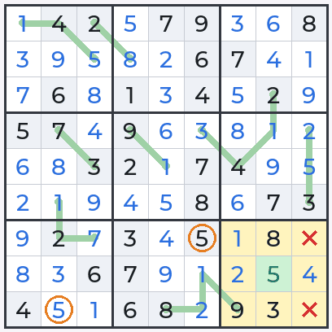

#### Step 48: the 6 in box 9

Box 9 needs a 6. r9c9: row 9 has one (r9c4). Only **r7c9** is left: **r7c9 = 6**.

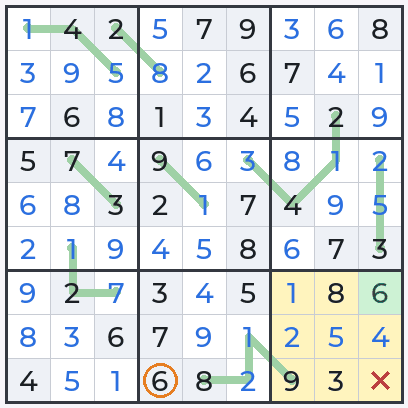

#### Step 49: the 7 in box 9

Box 9 needs a 7, and r9c9 is its last empty cell: **r9c9 = 7**.

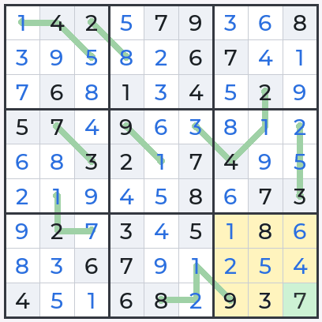

Solved.

<!-- /walkthrough -->
