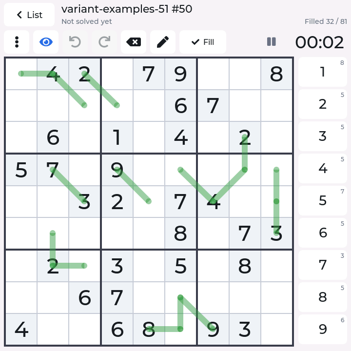
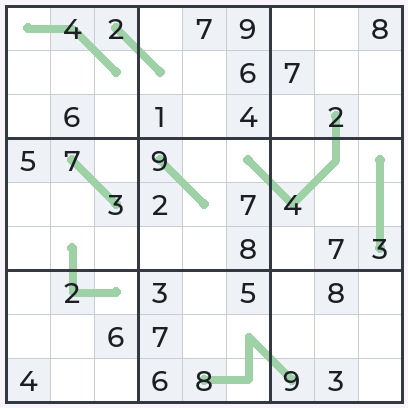

# 10 Lines

[← All variants](README.md) · [Puzzles](../features-puzzles.md) · [How to play](../how-to-play.md)

## The rules

[Classic](classic.md) rules, and **green lines**: each line splits into **runs** of cells next to each other along it, and every run adds up to **10**. 3, 7, 1, 5, 4 is 3 + 7 and 1 + 5 + 4. Where a line splits isn't shown: that's part of the puzzle. A run has 2 cells or more.

## On the board

- The lines are wide soft green bands through the cell centres; lines don't cross each other.
- When no way of splitting a line into runs of 10 is left with the digits on it, its digits turn red.
- The grader and hints try every way to split a line: "This line splits into runs of cells that each add up to 10, so row 2, column 4 can only be 8."
- **Puzzles → ⋮ → New puzzle → Lines → 10 Lines**: 8 lines (Hard and Expert: 10), of 2 to 8 cells.

## How to solve it

- **Short lines are one run:** a run has 2 cells at least, so a line of 2 or 3 cells adds up to exactly 10. A two-cell line is 1 and 9, 2 and 8, 3 and 7 or 4 and 6 (5 and 5 only where the two don't see each other).
- **The whole line adds up to 10, 20, 30 ...:** a line of 4 is one run of 10 or two pairs making 20.
- **From the ends:** the first run starts at the line's start, so a 9 there needs a 1 right after it.

## Worked example

**variant-examples #50**, 10 Lines Easy (see [Classic](classic.md#worked-example-the-whole-puzzle) for how to import the examples; cells are written r*row*c*column*).

**Step 1: the 2 in box 2**, by the Classic rules: row 1 has a 2 (r1c3), column 4 one (r5c4), row 3 one (r3c8). **r2c5 = 2**.

**Step 2: the 3 in box 2**: column 4 has a 3 (r7c4), and the rest of the box is filled. **r3c5 = 3**.

**Step 3: the 5 in box 2.** Only r1c4 and r2c4 are empty. r2c4 and the 2 in r1c3 make a short green line of two cells: a single run, so r2c4 is 8, not 5. Only **r1c4** is left: **r1c4 = 5**.

## The whole puzzle, step by step

<!-- walkthrough -->
<!-- Written by tools/walkthrough.py 10-lines: edit the script, not this part. -->

The whole puzzle, from the start to the last cell: 49 steps, each one a single (one place left for a digit, or one digit left for a cell), taken in the order a box's single comes first, so not quite the order of the worked example above. Each step has a page of its own, with **Previous** and **Next**: pick its number below. In each picture, the unit the step looks at is tinted yellow (for a cell with one digit left: its row, column and box), the new digit is on green, the digits that rule cells out have an **orange ring**, and the empty cells they rule out a **red cross**. Givens are on grey, digits from earlier steps in blue.

| [1](10-lines/step-01.md) | [2](10-lines/step-02.md) | [3](10-lines/step-03.md) | [4](10-lines/step-04.md) | [5](10-lines/step-05.md) | [6](10-lines/step-06.md) | [7](10-lines/step-07.md) | [8](10-lines/step-08.md) | [9](10-lines/step-09.md) | [10](10-lines/step-10.md) |
|:-:|:-:|:-:|:-:|:-:|:-:|:-:|:-:|:-:|:-:|
| [11](10-lines/step-11.md) | [12](10-lines/step-12.md) | [13](10-lines/step-13.md) | [14](10-lines/step-14.md) | [15](10-lines/step-15.md) | [16](10-lines/step-16.md) | [17](10-lines/step-17.md) | [18](10-lines/step-18.md) | [19](10-lines/step-19.md) | [20](10-lines/step-20.md) |
| [21](10-lines/step-21.md) | [22](10-lines/step-22.md) | [23](10-lines/step-23.md) | [24](10-lines/step-24.md) | [25](10-lines/step-25.md) | [26](10-lines/step-26.md) | [27](10-lines/step-27.md) | [28](10-lines/step-28.md) | [29](10-lines/step-29.md) | [30](10-lines/step-30.md) |
| [31](10-lines/step-31.md) | [32](10-lines/step-32.md) | [33](10-lines/step-33.md) | [34](10-lines/step-34.md) | [35](10-lines/step-35.md) | [36](10-lines/step-36.md) | [37](10-lines/step-37.md) | [38](10-lines/step-38.md) | [39](10-lines/step-39.md) | [40](10-lines/step-40.md) |
| [41](10-lines/step-41.md) | [42](10-lines/step-42.md) | [43](10-lines/step-43.md) | [44](10-lines/step-44.md) | [45](10-lines/step-45.md) | [46](10-lines/step-46.md) | [47](10-lines/step-47.md) | [48](10-lines/step-48.md) | [49](10-lines/step-49.md) |  |

Solved.

<!-- /walkthrough -->
