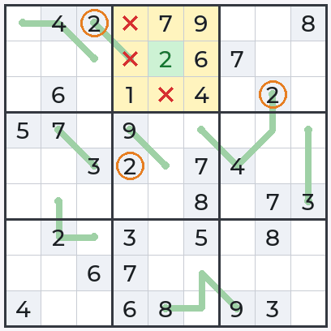

<!-- Written by tools/walkthrough.py 10-lines: edit the script, not this page. -->
# 10 Lines, step 1: the 2 in box 2

**Step 1 of 49** · [← The start](../10-lines.md#the-whole-puzzle-step-by-step) · [All steps](../10-lines.md#the-whole-puzzle-step-by-step) · [Step 2 →](step-02.md)

Box 2 needs a 2. r1c4: row 1 has one (r1c3). r2c4: column 4 has one (r5c4). r3c5: row 3 has one (r3c8). Only **r2c5** is left: **r2c5 = 2**.

**Step 1 of 49** · [← The start](../10-lines.md#the-whole-puzzle-step-by-step) · [All steps](../10-lines.md#the-whole-puzzle-step-by-step) · [Step 2 →](step-02.md)
