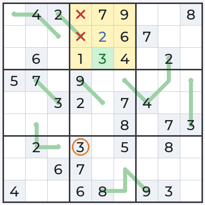

<!-- Written by tools/walkthrough.py 10-lines: edit the script, not this page. -->
# 10 Lines, step 2: the 3 in box 2

**Step 2 of 49** · [← Step 1](step-01.md) · [All steps](../10-lines.md#the-whole-puzzle-step-by-step) · [Step 3 →](step-03.md)

Box 2 needs a 3. r1c4 and r2c4: column 4 has one (r7c4). Only **r3c5** is left: **r3c5 = 3**.

**Step 2 of 49** · [← Step 1](step-01.md) · [All steps](../10-lines.md#the-whole-puzzle-step-by-step) · [Step 3 →](step-03.md)
