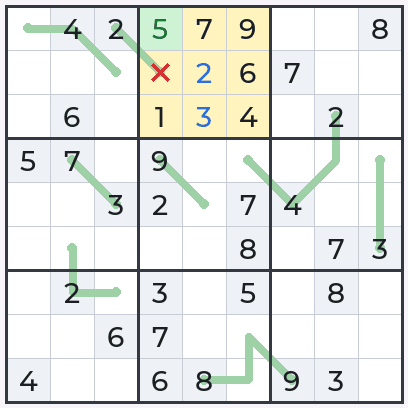

<!-- Written by tools/walkthrough.py 10-lines: edit the script, not this page. -->
# 10 Lines, step 3: the 5 in box 2

**Step 3 of 49** · [← Step 2](step-02.md) · [All steps](../10-lines.md#the-whole-puzzle-step-by-step) · [Step 4 →](step-04.md)

Box 2 needs a 5. r2c4: with a 5 there, its green line couldn't split into runs that each add up to 10. Only **r1c4** is left: **r1c4 = 5**.

**Step 3 of 49** · [← Step 2](step-02.md) · [All steps](../10-lines.md#the-whole-puzzle-step-by-step) · [Step 4 →](step-04.md)
