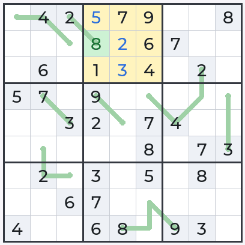

<!-- Written by tools/walkthrough.py 10-lines: edit the script, not this page. -->
# 10 Lines, step 4: the 8 in box 2

**Step 4 of 49** · [← Step 3](step-03.md) · [All steps](../10-lines.md#the-whole-puzzle-step-by-step) · [Step 5 →](step-05.md)

Box 2 needs an 8, and r2c4 is its last empty cell: **r2c4 = 8**.

**Step 4 of 49** · [← Step 3](step-03.md) · [All steps](../10-lines.md#the-whole-puzzle-step-by-step) · [Step 5 →](step-05.md)
