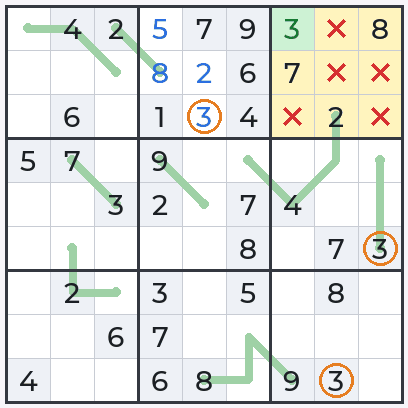

<!-- Written by tools/walkthrough.py 10-lines: edit the script, not this page. -->
# 10 Lines, step 5: the 3 in box 3

**Step 5 of 49** · [← Step 4](step-04.md) · [All steps](../10-lines.md#the-whole-puzzle-step-by-step) · [Step 6 →](step-06.md)

Box 3 needs a 3. r1c8 and r2c8: column 8 has one (r9c8). r2c9: column 9 has one (r6c9). r3c7 and r3c9: row 3 has one (r3c5). Only **r1c7** is left: **r1c7 = 3**.

**Step 5 of 49** · [← Step 4](step-04.md) · [All steps](../10-lines.md#the-whole-puzzle-step-by-step) · [Step 6 →](step-06.md)
