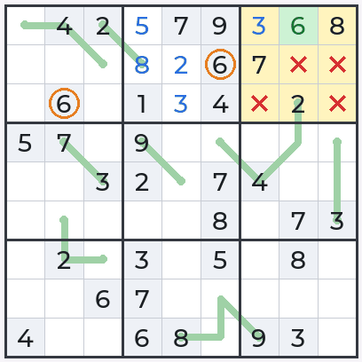

<!-- Written by tools/walkthrough.py 10-lines: edit the script, not this page. -->
# 10 Lines, step 6: the 6 in box 3

**Step 6 of 49** · [← Step 5](step-05.md) · [All steps](../10-lines.md#the-whole-puzzle-step-by-step) · [Step 7 →](step-07.md)

Box 3 needs a 6. r2c8 and r2c9: row 2 has one (r2c6). r3c7 and r3c9: row 3 has one (r3c2). Only **r1c8** is left: **r1c8 = 6**.

**Step 6 of 49** · [← Step 5](step-05.md) · [All steps](../10-lines.md#the-whole-puzzle-step-by-step) · [Step 7 →](step-07.md)
