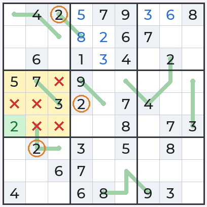

<!-- Written by tools/walkthrough.py 10-lines: edit the script, not this page. -->
# 10 Lines, step 7: the 2 in box 4

**Step 7 of 49** · [← Step 6](step-06.md) · [All steps](../10-lines.md#the-whole-puzzle-step-by-step) · [Step 8 →](step-08.md)

Box 4 needs a 2. r4c3 and r6c3: column 3 has one (r1c3). r5c1 and r5c2: row 5 has one (r5c4). r6c2: column 2 has one (r7c2). Only **r6c1** is left: **r6c1 = 2**.

**Step 7 of 49** · [← Step 6](step-06.md) · [All steps](../10-lines.md#the-whole-puzzle-step-by-step) · [Step 8 →](step-08.md)
