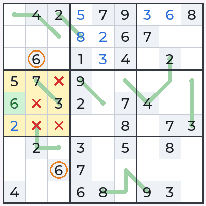

<!-- Written by tools/walkthrough.py 10-lines: edit the script, not this page. -->
# 10 Lines, step 8: the 6 in box 4

**Step 8 of 49** · [← Step 7](step-07.md) · [All steps](../10-lines.md#the-whole-puzzle-step-by-step) · [Step 9 →](step-09.md)

Box 4 needs a 6. r4c3 and r6c3: column 3 has one (r8c3). r5c2 and r6c2: column 2 has one (r3c2). Only **r5c1** is left: **r5c1 = 6**.

**Step 8 of 49** · [← Step 7](step-07.md) · [All steps](../10-lines.md#the-whole-puzzle-step-by-step) · [Step 9 →](step-09.md)
