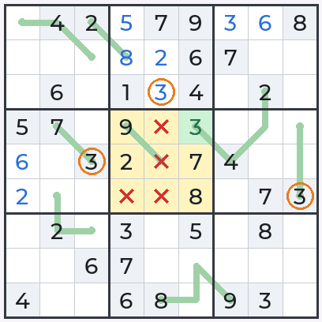

<!-- Written by tools/walkthrough.py 10-lines: edit the script, not this page. -->
# 10 Lines, step 9: the 3 in box 5

**Step 9 of 49** · [← Step 8](step-08.md) · [All steps](../10-lines.md#the-whole-puzzle-step-by-step) · [Step 10 →](step-10.md)

Box 5 needs a 3. r4c5: column 5 has one (r3c5). r5c5: row 5 has one (r5c3). r6c4 and r6c5: row 6 has one (r6c9). Only **r4c6** is left: **r4c6 = 3**.

**Step 9 of 49** · [← Step 8](step-08.md) · [All steps](../10-lines.md#the-whole-puzzle-step-by-step) · [Step 10 →](step-10.md)
