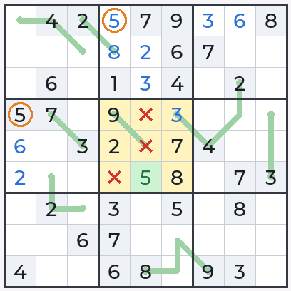

<!-- Written by tools/walkthrough.py 10-lines: edit the script, not this page. -->
# 10 Lines, step 10: the 5 in box 5

**Step 10 of 49** · [← Step 9](step-09.md) · [All steps](../10-lines.md#the-whole-puzzle-step-by-step) · [Step 11 →](step-11.md)

Box 5 needs a 5. r4c5: row 4 has one (r4c1). r6c4: column 4 has one (r1c4). r5c5: on its green line the run before it adds up to 9, and a 5 would take it past 10. Only **r6c5** is left: **r6c5 = 5**.

**Step 10 of 49** · [← Step 9](step-09.md) · [All steps](../10-lines.md#the-whole-puzzle-step-by-step) · [Step 11 →](step-11.md)
