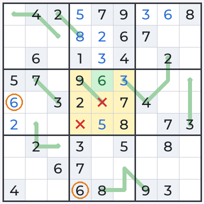

<!-- Written by tools/walkthrough.py 10-lines: edit the script, not this page. -->
# 10 Lines, step 11: the 6 in box 5

**Step 11 of 49** · [← Step 10](step-10.md) · [All steps](../10-lines.md#the-whole-puzzle-step-by-step) · [Step 12 →](step-12.md)

Box 5 needs a 6. r5c5: row 5 has one (r5c1). r6c4: column 4 has one (r9c4). Only **r4c5** is left: **r4c5 = 6**.

**Step 11 of 49** · [← Step 10](step-10.md) · [All steps](../10-lines.md#the-whole-puzzle-step-by-step) · [Step 12 →](step-12.md)
