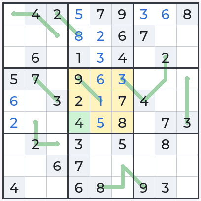

<!-- Written by tools/walkthrough.py 10-lines: edit the script, not this page. -->
# 10 Lines, step 13: the 4 in box 5

**Step 13 of 49** · [← Step 12](step-12.md) · [All steps](../10-lines.md#the-whole-puzzle-step-by-step) · [Step 14 →](step-14.md)

Box 5 needs a 4, and r6c4 is its last empty cell: **r6c4 = 4**.

**Step 13 of 49** · [← Step 12](step-12.md) · [All steps](../10-lines.md#the-whole-puzzle-step-by-step) · [Step 14 →](step-14.md)
