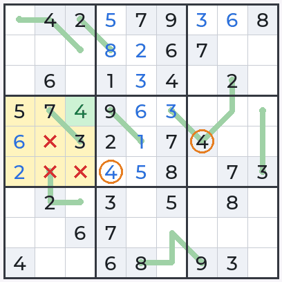

<!-- Written by tools/walkthrough.py 10-lines: edit the script, not this page. -->
# 10 Lines, step 14: the 4 in box 4

**Step 14 of 49** · [← Step 13](step-13.md) · [All steps](../10-lines.md#the-whole-puzzle-step-by-step) · [Step 15 →](step-15.md)

Box 4 needs a 4. r5c2: row 5 has one (r5c7). r6c2 and r6c3: row 6 has one (r6c4). Only **r4c3** is left: **r4c3 = 4**.

**Step 14 of 49** · [← Step 13](step-13.md) · [All steps](../10-lines.md#the-whole-puzzle-step-by-step) · [Step 15 →](step-15.md)
