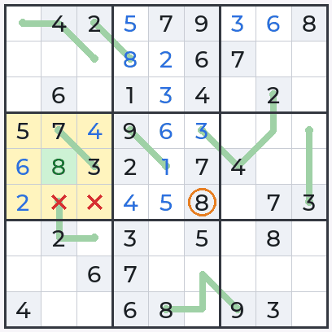

<!-- Written by tools/walkthrough.py 10-lines: edit the script, not this page. -->
# 10 Lines, step 15: the 8 in box 4

**Step 15 of 49** · [← Step 14](step-14.md) · [All steps](../10-lines.md#the-whole-puzzle-step-by-step) · [Step 16 →](step-16.md)

Box 4 needs an 8. r6c2 and r6c3: row 6 has one (r6c6). Only **r5c2** is left: **r5c2 = 8**.

**Step 15 of 49** · [← Step 14](step-14.md) · [All steps](../10-lines.md#the-whole-puzzle-step-by-step) · [Step 16 →](step-16.md)
