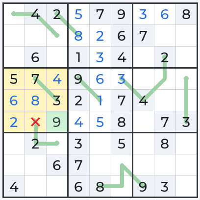

<!-- Written by tools/walkthrough.py 10-lines: edit the script, not this page. -->
# 10 Lines, step 16: the 9 in box 4

**Step 16 of 49** · [← Step 15](step-15.md) · [All steps](../10-lines.md#the-whole-puzzle-step-by-step) · [Step 17 →](step-17.md)

Box 4 needs a 9. r6c2: with a 9 there, its green line couldn't split into runs that each add up to 10. Only **r6c3** is left: **r6c3 = 9**.

**Step 16 of 49** · [← Step 15](step-15.md) · [All steps](../10-lines.md#the-whole-puzzle-step-by-step) · [Step 17 →](step-17.md)
