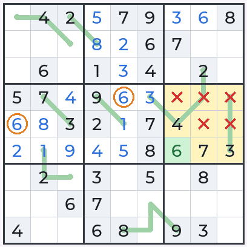

<!-- Written by tools/walkthrough.py 10-lines: edit the script, not this page. -->
# 10 Lines, step 18: the 6 in box 6

**Step 18 of 49** · [← Step 17](step-17.md) · [All steps](../10-lines.md#the-whole-puzzle-step-by-step) · [Step 19 →](step-19.md)

Box 6 needs a 6. r4c7, r4c8 and r4c9: row 4 has one (r4c5). r5c8 and r5c9: row 5 has one (r5c1). Only **r6c7** is left: **r6c7 = 6**.

**Step 18 of 49** · [← Step 17](step-17.md) · [All steps](../10-lines.md#the-whole-puzzle-step-by-step) · [Step 19 →](step-19.md)
