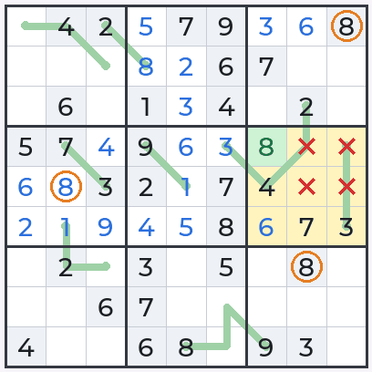

<!-- Written by tools/walkthrough.py 10-lines: edit the script, not this page. -->
# 10 Lines, step 19: the 8 in box 6

**Step 19 of 49** · [← Step 18](step-18.md) · [All steps](../10-lines.md#the-whole-puzzle-step-by-step) · [Step 20 →](step-20.md)

Box 6 needs an 8. r4c8: column 8 has one (r7c8). r4c9: column 9 has one (r1c9). r5c8 and r5c9: row 5 has one (r5c2). Only **r4c7** is left: **r4c7 = 8**.

**Step 19 of 49** · [← Step 18](step-18.md) · [All steps](../10-lines.md#the-whole-puzzle-step-by-step) · [Step 20 →](step-20.md)
