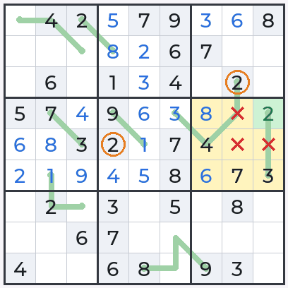

<!-- Written by tools/walkthrough.py 10-lines: edit the script, not this page. -->
# 10 Lines, step 20: the 2 in box 6

**Step 20 of 49** · [← Step 19](step-19.md) · [All steps](../10-lines.md#the-whole-puzzle-step-by-step) · [Step 21 →](step-21.md)

Box 6 needs a 2. r4c8: column 8 has one (r3c8). r5c8 and r5c9: row 5 has one (r5c4). Only **r4c9** is left: **r4c9 = 2**.

**Step 20 of 49** · [← Step 19](step-19.md) · [All steps](../10-lines.md#the-whole-puzzle-step-by-step) · [Step 21 →](step-21.md)
