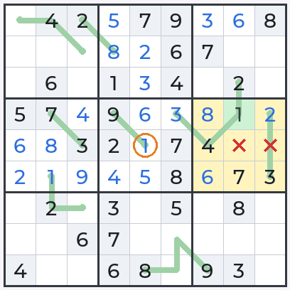

<!-- Written by tools/walkthrough.py 10-lines: edit the script, not this page. -->
# 10 Lines, step 21: the 1 in box 6

**Step 21 of 49** · [← Step 20](step-20.md) · [All steps](../10-lines.md#the-whole-puzzle-step-by-step) · [Step 22 →](step-22.md)

Box 6 needs a 1. r5c8 and r5c9: row 5 has one (r5c5). Only **r4c8** is left: **r4c8 = 1**.

**Step 21 of 49** · [← Step 20](step-20.md) · [All steps](../10-lines.md#the-whole-puzzle-step-by-step) · [Step 22 →](step-22.md)
