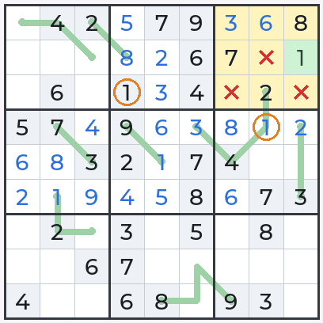

<!-- Written by tools/walkthrough.py 10-lines: edit the script, not this page. -->
# 10 Lines, step 22: the 1 in box 3

**Step 22 of 49** · [← Step 21](step-21.md) · [All steps](../10-lines.md#the-whole-puzzle-step-by-step) · [Step 23 →](step-23.md)

Box 3 needs a 1. r2c8: column 8 has one (r4c8). r3c7 and r3c9: row 3 has one (r3c4). Only **r2c9** is left: **r2c9 = 1**.

**Step 22 of 49** · [← Step 21](step-21.md) · [All steps](../10-lines.md#the-whole-puzzle-step-by-step) · [Step 23 →](step-23.md)
