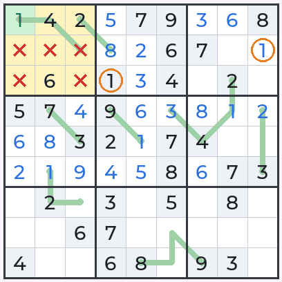

<!-- Written by tools/walkthrough.py 10-lines: edit the script, not this page. -->
# 10 Lines, step 23: the 1 in box 1

**Step 23 of 49** · [← Step 22](step-22.md) · [All steps](../10-lines.md#the-whole-puzzle-step-by-step) · [Step 24 →](step-24.md)

Box 1 needs a 1. r2c1, r2c2 and r2c3: row 2 has one (r2c9). r3c1 and r3c3: row 3 has one (r3c4). Only **r1c1** is left: **r1c1 = 1**.

**Step 23 of 49** · [← Step 22](step-22.md) · [All steps](../10-lines.md#the-whole-puzzle-step-by-step) · [Step 24 →](step-24.md)
