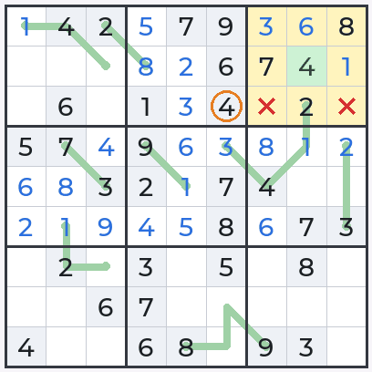

<!-- Written by tools/walkthrough.py 10-lines: edit the script, not this page. -->
# 10 Lines, step 24: the 4 in box 3

**Step 24 of 49** · [← Step 23](step-23.md) · [All steps](../10-lines.md#the-whole-puzzle-step-by-step) · [Step 25 →](step-25.md)

Box 3 needs a 4. r3c7 and r3c9: row 3 has one (r3c6). Only **r2c8** is left: **r2c8 = 4**.

**Step 24 of 49** · [← Step 23](step-23.md) · [All steps](../10-lines.md#the-whole-puzzle-step-by-step) · [Step 25 →](step-25.md)
