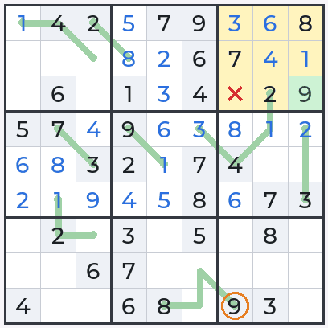

<!-- Written by tools/walkthrough.py 10-lines: edit the script, not this page. -->
# 10 Lines, step 25: the 9 in box 3

**Step 25 of 49** · [← Step 24](step-24.md) · [All steps](../10-lines.md#the-whole-puzzle-step-by-step) · [Step 26 →](step-26.md)

Box 3 needs a 9. r3c7: column 7 has one (r9c7). Only **r3c9** is left: **r3c9 = 9**.

**Step 25 of 49** · [← Step 24](step-24.md) · [All steps](../10-lines.md#the-whole-puzzle-step-by-step) · [Step 26 →](step-26.md)
