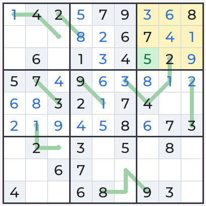

<!-- Written by tools/walkthrough.py 10-lines: edit the script, not this page. -->
# 10 Lines, step 26: the 5 in box 3

**Step 26 of 49** · [← Step 25](step-25.md) · [All steps](../10-lines.md#the-whole-puzzle-step-by-step) · [Step 27 →](step-27.md)

Box 3 needs a 5, and r3c7 is its last empty cell: **r3c7 = 5**.

**Step 26 of 49** · [← Step 25](step-25.md) · [All steps](../10-lines.md#the-whole-puzzle-step-by-step) · [Step 27 →](step-27.md)
