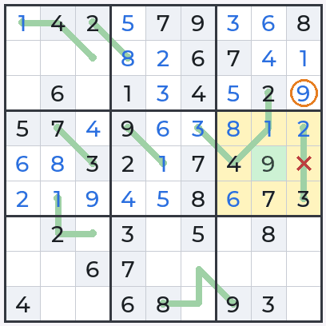

<!-- Written by tools/walkthrough.py 10-lines: edit the script, not this page. -->
# 10 Lines, step 27: the 9 in box 6

**Step 27 of 49** · [← Step 26](step-26.md) · [All steps](../10-lines.md#the-whole-puzzle-step-by-step) · [Step 28 →](step-28.md)

Box 6 needs a 9. r5c9: column 9 has one (r3c9). Only **r5c8** is left: **r5c8 = 9**.

**Step 27 of 49** · [← Step 26](step-26.md) · [All steps](../10-lines.md#the-whole-puzzle-step-by-step) · [Step 28 →](step-28.md)
