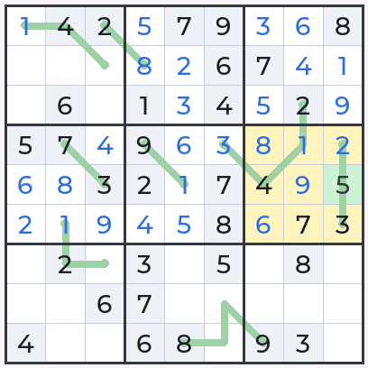

<!-- Written by tools/walkthrough.py 10-lines: edit the script, not this page. -->
# 10 Lines, step 28: the 5 in box 6

**Step 28 of 49** · [← Step 27](step-27.md) · [All steps](../10-lines.md#the-whole-puzzle-step-by-step) · [Step 29 →](step-29.md)

Box 6 needs a 5, and r5c9 is its last empty cell: **r5c9 = 5**.

**Step 28 of 49** · [← Step 27](step-27.md) · [All steps](../10-lines.md#the-whole-puzzle-step-by-step) · [Step 29 →](step-29.md)
