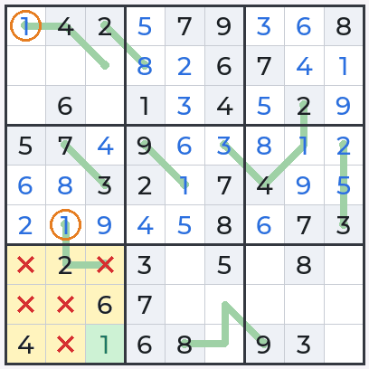

<!-- Written by tools/walkthrough.py 10-lines: edit the script, not this page. -->
# 10 Lines, step 29: the 1 in box 7

**Step 29 of 49** · [← Step 28](step-28.md) · [All steps](../10-lines.md#the-whole-puzzle-step-by-step) · [Step 30 →](step-30.md)

Box 7 needs a 1. r7c1 and r8c1: column 1 has one (r1c1). r8c2 and r9c2: column 2 has one (r6c2). r7c3: with a 1 there, its green line couldn't split into runs that each add up to 10. Only **r9c3** is left: **r9c3 = 1**.

**Step 29 of 49** · [← Step 28](step-28.md) · [All steps](../10-lines.md#the-whole-puzzle-step-by-step) · [Step 30 →](step-30.md)
