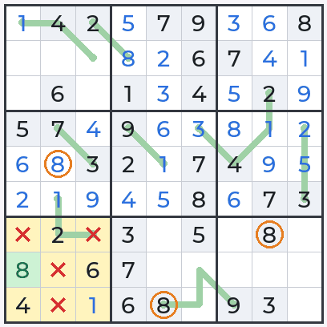

<!-- Written by tools/walkthrough.py 10-lines: edit the script, not this page. -->
# 10 Lines, step 30: the 8 in box 7

**Step 30 of 49** · [← Step 29](step-29.md) · [All steps](../10-lines.md#the-whole-puzzle-step-by-step) · [Step 31 →](step-31.md)

Box 7 needs an 8. r7c1 and r7c3: row 7 has one (r7c8). r8c2: column 2 has one (r5c2). r9c2: row 9 has one (r9c5). Only **r8c1** is left: **r8c1 = 8**.

**Step 30 of 49** · [← Step 29](step-29.md) · [All steps](../10-lines.md#the-whole-puzzle-step-by-step) · [Step 31 →](step-31.md)
