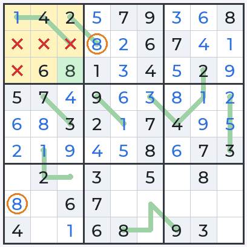

<!-- Written by tools/walkthrough.py 10-lines: edit the script, not this page. -->
# 10 Lines, step 31: the 8 in box 1

**Step 31 of 49** · [← Step 30](step-30.md) · [All steps](../10-lines.md#the-whole-puzzle-step-by-step) · [Step 32 →](step-32.md)

Box 1 needs an 8. r2c1, r2c2 and r2c3: row 2 has one (r2c4). r3c1: column 1 has one (r8c1). Only **r3c3** is left: **r3c3 = 8**.

**Step 31 of 49** · [← Step 30](step-30.md) · [All steps](../10-lines.md#the-whole-puzzle-step-by-step) · [Step 32 →](step-32.md)
